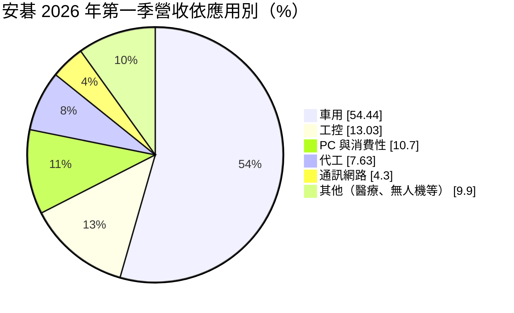
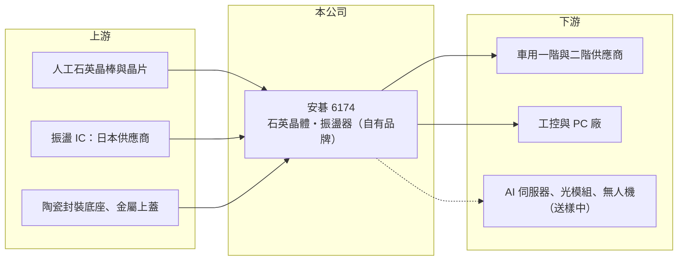

# 6174 安碁

> 上櫃｜[[產業索引-電子零組件業|電子零組件業]]｜上市（櫃）日期 2002/05/02

# 第一章：企業模式與商業藍圖

> [!info] 撰寫說明
> 精簡版，由 Claude 依公開資料整理，架構比照 [[2330台積電]]，資料截至 2026-10-08。來源：櫃買中心開放資料（基本資料、2026 年上半年財報）、Goodinfo 經營績效頁、富果研究 2026 年 6 月法說會整理。注意本公司與資安業者 [[6690安碁資訊]] 不同。#待校對

本章說明安碁科技（6174）的頻率元件事業：以自有品牌的[[石英晶體]]與[[石英振盪器]]，主攻車用與工業控制這類重視可靠度的市場。

- **核心業務：** 安碁成立於 1990 年，總部與生產基地在台中潭子，2002 年在櫃買中心掛牌。頻率元件是電子產品的「時鐘」，提供晶片運作所需的穩定頻率。2026 年第一季不含 IC 的石英晶體占營收 60.4%，內含 IC 的振盪器占 39.6%；振盪器單價約為晶體的 4 至 5 倍、供應商較少，毛利率也較高。
- **營收結構：** 依應用別，車用占 2026 年第一季營收 54.4%，自 2024 年起持續超過一半，應用包括 [[ADAS]]、智慧座艙、車內通訊與電池管理系統；工控占 13%、PC 與消費性約 11%。自有品牌約占營收九成以上，直接銷售給車用一階與二階供應商。
- **營運據點：** 台中潭子是總部與主要生產基地。公司 2025 年資本支出約 1.26 億元、2026 年規劃約 0.92 億元，擴充約兩成產能，集中在含 IC 的高階振盪器。
- **長期方向：** 公司的策略是專注高門檻的利基市場，研發費用率目標維持在營收的 7% 至 8%。新應用方面，已送樣給 23 家 AI 伺服器客戶、4 家光通訊模組客戶與 11 家無人機客戶，中期目標是讓 AI 伺服器與光模組營收占比達到 5% 至 10%。

# 第二章：護城河深度與競爭優勢

本章分析安碁的護城河。在頻率元件這個由日本大廠主導的市場，安碁選擇以車用認證作為差異化的核心。

- **競爭優勢：** 車用頻率元件需要通過 [[IATF 16949]] 品質系統與 [[AEC-Q]] 可靠度認證，從送樣到量產往往需要數年，一旦導入車款，在該車款生命週期內很少更換。安碁車用比重超過一半、並以自有品牌直接供貨給車用一階供應商，代表它已經跨過這道門檻，這是比消費性訂單更穩定的客戶基礎。
- **主要對手：** 全球頻率元件市場以日本 Epson、NDK（日本電波工業）、KDS（大真空）等為首，台灣同業有規模最大的 [[3042晶技]]，以及 [[8182加高]]、[[3221台嘉碩]]、[[2484希華]] 等。安碁的規模遠小於晶技，但車用比重較高，定位較為專注。
- **觀察重點：** 振盪器比重由 2025 年的 38% 提升到 2026 年第一季的 39.6%，產品組合正往高單價移動。長期要看兩點：第一，AI 伺服器、光模組等新應用能否從送樣走到量產；第二，振盪器所需的 IC 主要向日本廠商採購，公司雖簽有多年保量合約，但成本仍受上游牽動。

# 第三章：財務體質與盈利規模

資料日期：2026-10-08，表格是撰寫當時的快照；最新月營收、毛利率、累計 EPS 由自動排程寫在本筆記的屬性欄位（月營收、毛利率、累計EPS 等）。#待校對

本章用多年度數字檢視安碁：毛利率穩定在三成以上，但營收規模小，營業利益率隨景氣大幅波動。

| 年度 | 營收（億元） | [[毛利率]] | [[營業利益率]] | EPS（元） | [[ROE]] |
|---|---|---|---|---|---|
| 2020 | 4.23 | 27.1% | 1.4% | 0.03 | 0.2% |
| 2021 | 6.01 | 36.3% | 15.6% | 1.79 | 13.8% |
| 2022 | 7.20 | 42.8% | 21.8% | 3.06 | 21.7% |
| 2023 | 4.65 | 32.6% | 1.8% | 0.29 | 2.0% |
| 2024 | 4.67 | 32.9% | -1.5% | 0.75 | 5.6% |
| 2025 | 6.11 | 34.8% | 6.7% | 0.66 | 5.1% |

- **營收規模：** 2020 至 2025 年營收年複合成長率約 7.6%（推算），但 2022 年 7.2 億元的高點後曾回落到 4.65 億元。2026 年上半年營收 3.64 億元，比去年同期明顯成長。
- **獲利：** 毛利率在 2022 年達到 42.8%，低谷時也有 32% 以上，顯示產品有一定的定價能力。但營業費用相對固定，營收少一成，營業利益率就可能由兩位數掉到接近零，2023 至 2024 年就是如此。2026 年上半年毛利率 36.3%、營業利益率 13%、EPS 0.77 元，已超過 2025 年全年。
- **財務特色：** 近 5 年（2021 至 2025）平均 ROE 約 9.6%（推算），波動大。2026 年第二季股東權益 6.68 億元、負債 4.07 億元，負債比約 38%。2025 年度配發現金股利 0.34 元，配息率約 52%；管理層表示在負債比降到 30% 以下之前，配息率將維持在約 50%。庫存天數在 2026 年第一季約 257 天，偏高，主要是為因應原料交期拉長而提高備貨。
- **[[ROIC]] 與 [[WACC]]：** 2025 年營業利益約 0.41 億元（6.11 億 × 6.68%），稅後約 0.33 億元；以股東權益 6.68 億元為投入資本，ROIC 約 4.9%，把全部負債也算入約 3.1%（推算，有息負債金額未查得）。2022 年高峰時 ROIC 約 19%，2026 年上半年年化約 11%（推算）。WACC 以 [[CAPM]] 推估：無風險利率 1.75%、市場風險溢酬 6%、β 假設 1.0（頻率元件中小廠常見值），股東權益成本約 7.75%；負債成本假設稅後 2%、有息負債占資本 15%（假設），WACC 約 6.9%（推算）。安碁在景氣好的年份 ROIC 明顯高於 WACC、景氣差時則低於 WACC；長期能否穩定創造價值，取決於車用比重提升能否降低這種波動。

# 第四章：總體風險與地緣政治

本章整理安碁長期要面對的風險。

- **產業週期：** 頻率元件跟著電子產業庫存循環起伏，2022 年缺貨時營收創高，2023 年庫存調整時營收下滑約 35%。車用比重提高雖然讓訂單較穩定，但汽車產業本身也有景氣循環。
- **營運風險：** 振盪器用的 IC 依賴日本供應商，若供應吃緊或漲價，會直接影響出貨與毛利。高庫存天數在需求轉弱時有跌價損失的風險。AI 伺服器與光模組等新應用仍在送樣階段，光模組出貨目前很少，2027 年目標尚未確定。
- **其他風險：** 石英材料、貴金屬電極與封裝材料價格上升會壓縮毛利；營收以外銷為主，新台幣升值會影響換算後的獲利。日本大廠若在車用市場降價搶單，也可能壓縮安碁的利潤空間。

# 專有名詞解析

## 應用

- **[[石英振盪器]]**：在石英晶體外加上振盪電路 IC 的頻率元件，可直接輸出時脈訊號，單價與門檻高於晶體。
- **[[ADAS]]**：先進駕駛輔助系統，例如自動緊急煞車、車道維持，需要大量感測器與穩定的時脈元件。
- **[[IATF 16949]]**：汽車產業的品質管理系統標準，是打入車廠與車用一階供應商的基本門檻。
- **[[AEC-Q]]**：汽車電子委員會訂定的車用零件可靠度測試標準，被動與主動元件都需通過。

## 金融

- **[[ROIC]]**：投入資本報酬率，衡量公司用股東與債權人投入的資本，每年能賺回多少稅後營業利益。
- **[[WACC]]**：加權平均資金成本，依股東權益與負債的比重，加權計算公司取得資金的平均成本。
- **[[CAPM]]**：資本資產定價模型，以無風險利率加上 β 乘以市場風險溢酬，推估股東要求的報酬率。

## 產業

- **[[石英晶體]]**：利用石英的壓電效應產生穩定振動頻率的元件，提供晶片運作所需的時脈基準。

# 核心供應鏈

- 上游：人工石英晶片、振盪 IC（主要來自日本供應商）、陶瓷封裝底座與金屬上蓋，具名供應商未查得。
- 下游／客戶：全球車用一階與二階供應商、工控與 PC 廠；AI 伺服器、光通訊模組與無人機客戶仍在送樣階段，具名客戶未查得。
- 同業：[[3042晶技]]、[[8182加高]]、[[3221台嘉碩]]、[[2484希華]]，以及 Epson、NDK、KDS 等日系廠。

## 最新新聞
<!-- news:start（自動產生，請勿手動編輯此範圍） -->
- 2026-10-12 📰 媒體 18:30｜安碁科技完成3億元面額CB募集 自結9月轉盈EPS 0.19元｜[鉅亨網](https://news.cnyes.com/news/id/6628295)
- 2026-10-12 🏛️ 重訊 14:51｜本公司有價證券近期多次達公佈注意交易資訊標準，故公告 相關訊息，以利投資人區別暸解｜[觀測站](https://mops.twse.com.tw/mops/#/web/t05st01)

完整紀錄：[[6174安碁 新聞]]
<!-- news:end -->

## 相關連結
- [公開資訊觀測站](https://mopsov.twse.com.tw/mops/web/t05st03?step=1&firstin=1&co_id=6174)
- [Goodinfo](https://goodinfo.tw/tw/StockDetail.asp?STOCK_ID=6174)
- [Yahoo 股市](https://tw.stock.yahoo.com/quote/6174)
- [鉅亨網新聞](https://www.cnyes.com/twstock/6174/news)
