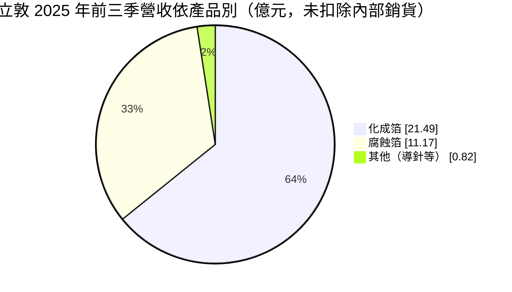
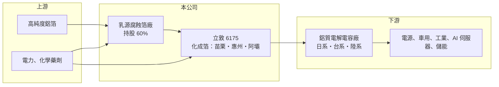

# 6175 立敦

> 上櫃｜[[產業索引-電子零組件業|電子零組件業]]｜上市（櫃）日期 2002/06/10

# 第一章：企業模式與商業藍圖

> [!info] 撰寫說明
> 精簡版，由 Claude 依公開資料整理，架構比照 [[2330台積電]]，資料截至 2026-10-08。來源：櫃買中心開放資料（基本資料、2026 年上半年財報）、Goodinfo 經營績效頁、富果研究 2025 年 12 月法說會整理。2024 年營收 Goodinfo 為 42.3 億元、法說會整理為 41.25 億元，表格採 Goodinfo。#待校對

本章說明立敦科技（6175）的商業模式：它生產[[鋁質電解電容]]最關鍵的材料——[[化成箔]]與[[腐蝕箔]]，而且一路往上游整合。

- **核心業務：** 立敦成立於 1993 年，總部在苗栗銅鑼，2002 年在櫃買中心掛牌。化成箔是鋁質電解電容的正極箔，占電容材料成本六成以上；腐蝕箔則是化成箔的前段原料，經過電化學蝕刻擴大表面積後，再經化成處理形成介電氧化膜。另有電容內部連接用的導針。產品依電壓等級分為低壓、中壓與高壓。
- **營收結構：** 2025 年前三季化成箔約 21.5 億元、腐蝕箔約 11.2 億元、其他約 0.8 億元。客戶依國別為日系 33%、陸系 32%、台系 28%、歐美 6%；出貨地區以中國 57%、東南亞 28% 為主。AI 與車用應用約占化成箔銷售的兩成。
- **營運據點：** 台灣苗栗生產低壓化成箔；廣東惠州生產低壓化成箔，2020 年取得 [[IATF 16949]] 車規認證；四川阿壩生產低、中、高壓化成箔與導針；廣東乳源是與東陽光科合資、立敦持股 60% 的腐蝕箔廠。
- **長期方向：** 公司持續往上游整合腐蝕箔，以掌握成本與原料供應。乳源腐蝕箔新廠已於 2025 年取得約一公頃土地，規劃 2026 年建廠、2027 年第二季量產。產品面則鎖定車用電子等高階應用，並導入 AI 系統檢測箔面瑕疵。

# 第二章：護城河深度與競爭優勢

本章分析立敦的護城河。電極箔是高度製程導向的材料產業，護城河來自製程經驗、電力成本與垂直整合。

- **競爭優勢：** 化成箔的品質決定電容的耐壓、容量與壽命，電容廠更換箔材需要重新驗證，轉換成本高。立敦同時掌握腐蝕與化成兩段製程，並在台灣與中國多地設廠，能就近供應日、台、陸系電容廠。客戶結構中日系電容大廠占三分之一，代表產品品質已通過要求最嚴格的客戶驗證。母公司為鋁質電解電容廠 [[2472立隆電]]（待校對），可借重其車用認證經驗。
- **主要對手：** 中國電極箔產業規模龐大，東陽光科、新疆眾和、華鋒等廠商近年擴產，在價格上造成壓力；日系則有 JCC（日本蓄電器工業）等（同業定位為整理性描述，待校對）。立敦的策略是以穩定品質服務日系與台系客戶，避開純價格競爭的低階市場。
- **觀察重點：** 2025 年前三季營收微減約 2%、EPS 由 2.50 元降到 1.96 元，主因是中國化成箔市場價格競爭導致平均售價下滑，銷量則有增加。長期要看乳源腐蝕箔擴產完成後，自製率提升能否抵銷價格壓力，以及車用、AI 伺服器、儲能等高階應用比重能否持續提高。

# 第三章：財務體質與盈利規模

資料日期：2026-10-08，表格是撰寫當時的快照；最新月營收、毛利率、累計 EPS 由自動排程寫在本筆記的屬性欄位（月營收、毛利率、累計EPS 等）。#待校對

本章用多年度數字檢視立敦：營收穩定在 40 億元上下，營業利益率維持在 12% 至 17%，是一家穩定賺錢的材料廠。

| 年度 | 營收（億元） | [[毛利率]] | [[營業利益率]] | EPS（元） | [[ROE]] |
|---|---|---|---|---|---|
| 2020 | 32.6 | 22.3% | 13.8% | 2.02 | 13.3% |
| 2021 | 41.9 | 24.4% | 16.6% | 3.45 | 18.8% |
| 2022 | 38.4 | 25.1% | 16.9% | 3.52 | 16.0% |
| 2023 | 36.8 | 20.4% | 11.6% | 2.08 | 9.0% |
| 2024 | 42.3 | 24.0% | 14.3% | 3.23 | 14.2% |
| 2025 | 41.7 | 23.4% | 15.8% | 2.68 | 11.1% |

- **營收規模：** 2020 至 2025 年營收年複合成長率約 5%（推算）。2026 年上半年營收 25.3 億元，明顯高於過去任何一個半年，顯示需求與產能同步擴大。
- **獲利：** 毛利率維持在 20% 至 25%，營業利益率即使在 2023 年景氣低谷也有 11.6%，獲利穩定度在被動元件材料中相當好。2026 年上半年營業利益率 13.9%、歸屬母公司 EPS 1.70 元。由於乳源合資廠有 40% 屬於合作夥伴，2026 年上半年淨利 3.27 億元中有 0.72 億元歸屬非控制權益。
- **財務特色：** 近 5 年（2021 至 2025）平均 ROE 約 13.8%（推算）。2026 年第二季權益總計 53.1 億元（其中非控制權益 10.7 億元）、負債 17.6 億元，負債比約 25%，財務穩健。
- **[[ROIC]] 與 [[WACC]]：** 2025 年營業利益約 6.6 億元（41.7 億 × 15.8%），稅後約 5.3 億元；以權益總計 53.1 億元為投入資本，ROIC 約 9.9%，把全部負債 17.6 億元也算入約 7.5%（推算，有息負債金額未查得，實際值在兩者之間）。2026 年上半年年化約 10.6%（推算）。WACC 以 [[CAPM]] 推估：無風險利率 1.75%、市場風險溢酬 6%、β 假設 1.0（被動元件材料常見值），股東權益成本約 7.75%；負債成本假設稅後 2%、有息負債占資本 15%（假設），WACC 約 6.9%（推算）。ROIC 長期高於 WACC 約 1 至 3 個百分點，代表立敦持續在創造經濟價值，但利差不算大，擴產效益與價格競爭會直接影響未來的價值創造。

# 第四章：總體風險與地緣政治

本章整理立敦長期要面對的風險。

- **產業週期：** 化成箔需求跟著鋁質電解電容與終端電子產品的景氣起伏，2023 年營收下滑、毛利率降到 20.4% 就是庫存調整的結果。新能源、車用與 AI 伺服器電源帶來新的需求，但消費性電子仍是重要的基本盤。
- **營運風險：** 中國電極箔市場價格競爭激烈，是 2025 年獲利下滑的主因。營運重心大多在中國（惠州、阿壩、乳源），面臨當地政策、環保標準與地緣政治風險。乳源新廠若延後量產或良率不如預期，會影響上游整合的效益。
- **其他風險：** 電極箔的腐蝕與化成製程大量耗電，電價變動會直接影響成本（待校對）；高純度鋁箔原料價格也會隨鋁價波動。營收以外幣計價，2025 年第二季即曾因匯兌損失拖累獲利。

# 專有名詞解析

## 應用

- **[[IATF 16949]]**：汽車產業的品質管理系統標準，是打入車廠與車用一階供應商的基本門檻。

## 金融

- **[[ROIC]]**：投入資本報酬率，衡量公司用股東與債權人投入的資本，每年能賺回多少稅後營業利益。
- **[[WACC]]**：加權平均資金成本，依股東權益與負債的比重，加權計算公司取得資金的平均成本。
- **[[CAPM]]**：資本資產定價模型，以無風險利率加上 β 乘以市場風險溢酬，推估股東要求的報酬率。

## 產業

- **[[鋁質電解電容]]**：以鋁箔為電極、電解液為介質的電容，容量大、價格低，廣泛用於電源供應器、車用與工業設備。
- **[[化成箔]]**：經電化學處理在表面形成氧化鋁介電膜的鋁箔，是鋁質電解電容的正極材料，決定電容的耐壓與容量。
- **[[腐蝕箔]]**：以電化學蝕刻在高純度鋁箔表面形成大量微孔、擴大表面積的半成品，是化成箔的前段原料。

# 核心供應鏈

- 上游：高純度鋁箔（具名供應商未查得）、電力與化學藥劑；乳源合資夥伴為東陽光科。
- 下游／客戶：日系、台系與陸系鋁質電解電容廠，包括 [[2472立隆電]]、[[2375凱美]] 等台系電容廠（具名客戶待校對）；終端為電源、車用、工業、AI 伺服器與儲能。
- 同業：中國東陽光科、新疆眾和、華鋒，日本 JCC 等電極箔廠。

## 最新新聞
<!-- news:start（自動產生，請勿手動編輯此範圍） -->
- 2026-10-13 🏛️ 重訊 15:50｜公告本公司董事會決議通過馬來西亞投資案。｜[觀測站](https://mops.twse.com.tw/mops/#/web/t05st01)
- 2026-10-07 📰 媒體 11:50｜營收速報 - 立敦(6175)9月營收4.78億元年增率高達40.26％｜[鉅亨網](https://news.cnyes.com/news/id/6623532)

完整紀錄：[[6175立敦 新聞]]
<!-- news:end -->

## 相關連結
- [公開資訊觀測站](https://mopsov.twse.com.tw/mops/web/t05st03?step=1&firstin=1&co_id=6175)
- [Goodinfo](https://goodinfo.tw/tw/StockDetail.asp?STOCK_ID=6175)
- [Yahoo 股市](https://tw.stock.yahoo.com/quote/6175)
- [鉅亨網新聞](https://www.cnyes.com/twstock/6175/news)
