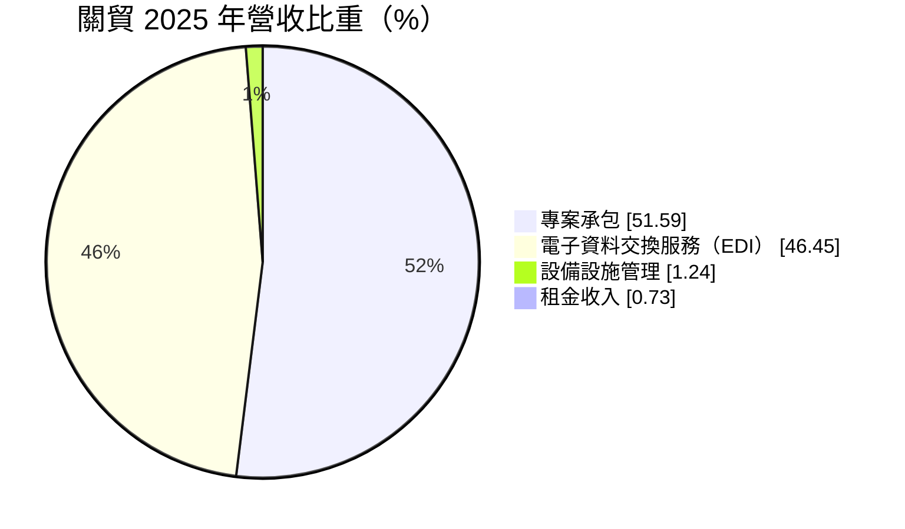
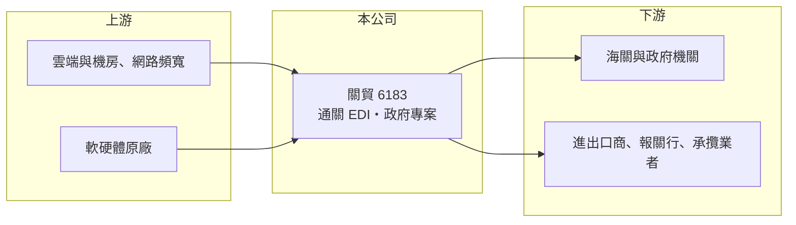

# 6183 關貿

> 上市｜[[產業索引-資訊服務業|資訊服務業]]｜上市（櫃）日期 2011/12/01

# 第一章：企業模式與商業藍圖

> [!info] 撰寫說明
> 精簡版，由 Claude 依公開資料整理，架構比照 [[2330台積電]]，資料截至 2026-10-08。來源：Goodinfo 經營績效年表（2019 至 2025 年）；富邦 e 點通（MoneyDJ）公司基本資料（2025 年營收比重）；證交所開放資料快照（基本資料、2026 年第二季資產負債、營益分析與上半年損益、本益比殖利率）。公司沿革、股東背景與主要專案依記憶整理，標示待校對。#待校對

關貿（關貿網路）成立於 1996 年 8 月，總部在台北市南港區，實收資本額 15 億元，是台灣進出口通關電子資料交換的核心業者。它的起點是政府推動貨物通關自動化，由財政部關稅總局（今關務署）結合民間與電信業者共同設立（股東背景待校對），因此長年承接海關與政府的關鍵資訊系統，2025 年營收約 27.5 億元。

- **核心業務：** 關貿有兩大收入來源。第一是[[EDI]]服務，進出口業者、報關行與承攬業者透過關貿的網路把報單、艙單等文件傳給海關，每筆傳輸或每月使用都要付費，2025 年占營收 46.45%。第二是專案承包，例如替政府建置與維運通關、貿易便捷化的資訊系統，占 51.59%。
- **營收結構：** EDI 收入跟著台灣進出口筆數走，屬於使用量計費的[[經常性收入]]，只要台灣有貿易就有收入，是關貿最穩定的現金來源。專案承包雖然是一次性建置，但政府系統上線後通常有多年維運合約，實際上也具有相當程度的延續性。
- **營運據點與延伸：** 公司以台灣為主要市場，除了通關，也把同一套電子資料交換與平台經驗延伸到電子發票、食品追溯與雲端服務等領域（待校對）。這些都是「政府制度要求、企業必須上傳資料」的場景，關貿的角色是資料傳輸與平台營運者。
- **長期方向：** 關貿的長期成長來自兩個方向：一是政府數位化專案持續外包，二是把累積的貿易與物流資料延伸成數據與雲端服務。近年營收從 2019 年的 17.3 億元穩定成長到 2025 年的 27.5 億元，顯示這條路線已逐步擴大。

# 第二章：護城河深度與競爭優勢

關貿的護城河在台灣資訊服務業中相當少見：它卡在進出口通關這個制度性的必經流程上。

- **競爭優勢：** 通關 EDI 的價值在於「所有參與者都已連上同一個網路」，報關行、承攬業者與海關之間的連線、格式與流程都已建立，新業者很難說服整個生態系統轉換，這是典型的[[網路效應]]與轉換成本。再加上長期承接海關系統，關貿對通關規則與資料格式的理解，是一般系統整合商短時間學不來的。
- **主要對手：** 通關網路市場另有一家同類業者（如汎宇電商，待校對），政府專案則與 [[6214精誠]]、[[2453凌群]]、[[6752叡揚]]、[[2471資通]]、[[2412中華電]] 等資訊服務業者競標。關貿在通關與貿易相關標案上有明顯的領域優勢。
- **觀察重點：** 第一，EDI 收入能否在台灣貿易量成長下維持穩定增加；第二，專案承包的毛利是否穩定，[[毛利率]]能否守在 40% 以上；第三，新事業如雲端與數據服務能否成為第二個經常性收入來源，降低對單一政府體系的依賴。

# 第三章：財務體質與盈利規模

資料日期：2026-10-08，表格是撰寫當時的快照；最新月營收、毛利率、累計 EPS 由自動排程寫在本筆記的屬性欄位（月營收、毛利率、累計EPS 等）。#待校對

關貿的財務特色是高毛利、高 ROE、獲利逐年墊高，在資訊服務業中屬於品質最好的一群。

| 年度 | 營收（億元） | [[毛利率]] | [[營業利益率]] | EPS（元） | [[ROE]] |
|---|---|---|---|---|---|
| 2019 | 17.3 | 38.4% | 20.3% | 1.96 | 13.5% |
| 2020 | 19.0 | 39.9% | 22.2% | 2.25 | 15.2% |
| 2021 | 22.3 | 40.6% | 23.1% | 2.84 | 18.6% |
| 2022 | 22.7 | 43.6% | 24.4% | 3.09 | 19.3% |
| 2023 | 23.0 | 44.1% | 24.3% | 3.20 | 19.0% |
| 2024 | 25.5 | 42.2% | 23.0% | 3.40 | 19.2% |
| 2025 | 27.5 | 43.4% | 24.7% | 3.90 | 21.1% |
| 2026 上半年 | 13.59 | 45.94% | 29.53% | 2.41 | 未查得 |

註：2019 至 2025 年取自 Goodinfo；2026 年上半年取自證交所營益分析與綜合損益開放資料。

- **長期指標：** 2020 至 2025 年營收年複合成長率約 7.7%（推算），2021 至 2025 年平均 ROE 約 19.4%（推算），EPS 從 1.96 元一路增加到 3.90 元，七年間沒有一年衰退。這種「營收穩定成長、利潤率同步擴張」的軌跡，說明 EDI 這類經常性收入帶來營運槓桿。逐年現金股利未查得，證交所快照顯示殖利率約 3.87%，配息政策細節待校對。
- **[[ROIC]] 與 [[WACC]]：** 2025 年營業利益約 6.79 億元（27.5 億 × 24.7%），稅後約 5.43 億元；2026 年第二季股東權益 26.86 億元，有息負債未查得，資訊服務業通常借款不多，假設接近 0，ROIC 約 20%（推算）。WACC 以無風險利率 1.75%、市場風險溢酬 6%、β 0.7（具公用事業性質的防禦型資訊服務股常見值）推得權益成本約 6%，資本結構幾乎全為權益，WACC 約 6%（推算）。ROIC 長期高出 WACC 約 14 個百分點，代表關貿持續在創造經濟價值。
- **財務特色：** 2026 年第二季總資產 53.3 億元、負債 26.5 億元，其中流動負債 24.4 億元，推估多為代收款與預收款這類營運性負債，而非借款。[[每股淨值]] 17.91 元，股價淨值比約 5 倍，反映市場給予高 ROE 的溢價。

# 第四章：總體風險與地緣政治

關貿的風險不在景氣，而在制度與客戶集中：它最大的優勢來自政府，最大的風險也來自政府。

- **產業週期：** EDI 收入與台灣進出口量相關，全球貿易衰退時傳輸量會減少，但因為是使用量計費，影響通常溫和。政府專案受預算週期影響，個別年度的認列可能有落差。
- **營運風險：** 政府若改變通關系統架構，例如自建平台或開放更多業者，關貿的 EDI 收費模式可能受影響。專案承包以政府為主，標案價格與規格由政府決定，議價能力有限。
- **其他風險：** 通關與政府系統屬關鍵基礎設施，[[資安]]事件或系統中斷會帶來商譽與法律風險。人才成本上升會壓縮專案毛利。長期來看，國際通關標準化或區塊鏈貿易平台的發展，也可能改變電子資料交換的商業模式。

# 專有名詞解析

## 應用

- **[[EDI]]**：電子資料交換，企業之間以標準格式自動傳送報單、訂單等文件的系統，台灣進出口通關即採用此方式。
- **[[資安]]**：資訊安全，保護系統與資料不被入侵、竊取或破壞的技術與管理措施。

## 金融

- **[[經常性收入]]**：每年固定重複發生的收入，例如維運年約、訂閱費，能讓營收比一次性專案更穩定。
- **[[ROIC]]**：投入資本報酬率，稅後營業利益除以股東權益加有息負債，衡量本業運用資本的效率。
- **[[WACC]]**：加權平均資金成本，股東與債權人要求報酬率的加權平均，是 ROIC 要超越的門檻。

## 產業

- **[[網路效應]]**：使用者越多、服務價值越高的現象，參與者一旦都連上同一個平台，新業者很難取代。

# 核心供應鏈

- 上游：網路頻寬與機房服務（例如 [[2412中華電]]，合作關係待校對）、國內外軟硬體原廠。
- 下游／客戶：財政部關務署等政府機關、進出口廠商、報關行與物流承攬業者。
- 同業：政府資訊專案的 [[6214精誠]]、[[2453凌群]]、[[6752叡揚]]、[[2471資通]]。

## 最新新聞
<!-- news:start -->
<!-- news:end -->

## 相關連結
- [公開資訊觀測站](https://mopsov.twse.com.tw/mops/web/t05st03?step=1&firstin=1&co_id=6183)
- [Goodinfo](https://goodinfo.tw/tw/StockDetail.asp?STOCK_ID=6183)
- [Yahoo 股市](https://tw.stock.yahoo.com/quote/6183)
- [鉅亨網新聞](https://www.cnyes.com/twstock/6183/news)
