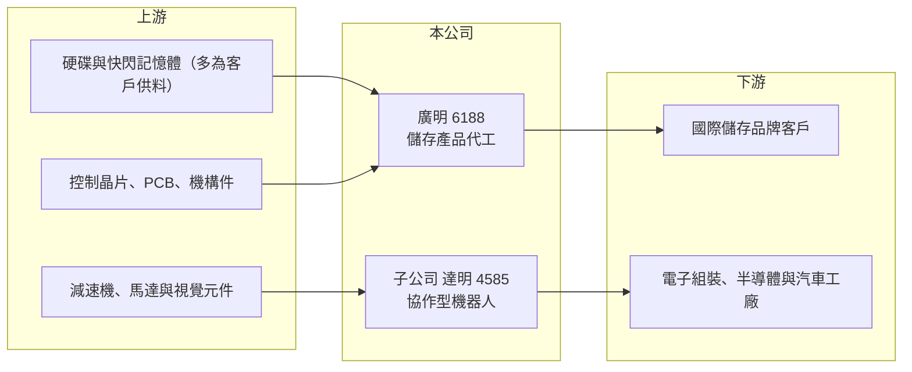

# 6188 廣明

> 上櫃｜[[產業索引-電腦及週邊設備業|電腦及週邊設備業]]｜上市（櫃）日期 2002/08/27

# 第一章：企業模式與商業藍圖

> [!info] 撰寫說明
> 精簡版，由 Claude 依公開資料整理，架構比照 [[2330台積電]]，資料截至 2026-10-08。來源：櫃買中心開放資料快照（基本資料、2026 年第二季資產負債與損益、本益比殖利率）、Goodinfo 經營績效頁、富果 2025 年 11 月法說會備忘錄。與廣達集團的關係、光碟機歷史依記憶整理，已標註待校對。#待校對

廣明是一家正在轉型的代工廠，理解它的關鍵在於兩條腿：本業是替品牌客戶代工外接硬碟、SSD 等儲存產品，另一條腿則是子公司 [[4585達明]] 的[[協作型機器人]]，後者決定了廣明的長期想像空間。

- **核心業務：** 廣明成立於 1999 年，2002 年在櫃買中心掛牌，屬於 [[2382廣達]] 集團（#待校對），早年以筆電與桌機用光碟機代工起家，在光碟機需求萎縮後轉向儲存產品代工（#待校對）。依富果整理的 2025 年法說內容，目前主力是外接硬碟、[[SSD]] 與擴充基座的 [[OEM]] 代工，另有 Wi-Fi 模組與少量挖礦機代工。廣明自我定位為專業代工廠，著重研發、設計與製造，不經營自有品牌。
- **營收結構：** 2025 年前三季，機器人約占合併營收 20% 且維持穩定，外接硬碟比重下滑、SSD 比重小幅上升，其他產品約 4%。2025 年前三季合併營收 69.6 億元、年增 21%，毛利率 29%。機器人業務雖然營收占比只有兩成，但毛利率較高，是集團毛利率由 2020 年 22% 升到 2025 年 29% 的重要原因（推估）。
- **營運據點：** 生產據點在公開資料中未查得，推估以中國與東南亞代工廠為主（#待校對）。達明機器人的研發與生產在台灣桃園（#待校對）。
- **長期方向：** 廣明對儲存代工採取保守經營：記憶體等價格波動大的關鍵零件改用客戶供料模式，降低庫存與價格風險，再持續尋找新的代工產品。真正的成長期待放在達明，達明 2025 年第三季掛牌並完成約 50 億元現金增資，未來機器人業務的擴張速度，將決定廣明是「穩定配息的代工股」還是「機器人控股公司」。

# 第二章：護城河深度與競爭優勢

廣明本業的護城河偏窄，價值主要來自持有達明機器人的股權與長期經營代工客戶的關係。

- **競爭優勢：** 儲存產品代工講究量產良率、成本控管與交期，廣明長期替國際硬碟與儲存品牌代工，累積了穩定的客戶關係與製造經驗。客戶供料模式讓它不需承擔記憶體價格的漲跌，獲利波動比自己買料的模組廠小。達明則是台灣少數自有品牌的協作型機器人廠，內建視覺系統是其產品特色（#待校對），在台灣機器人產業中具有先行者地位。
- **主要對手：** 儲存代工方面，對手包括其他電子代工廠與硬碟品牌自有工廠，台灣同業如 [[2301光寶科]] 早年也經營儲存事業（#待校對）。協作型機器人方面，國際對手有丹麥優傲（Universal Robots）、日本發那科，以及大量中國廠商；台灣有 [[2049上銀]]、[[2464盟立]] 等工業機器人與自動化業者。
- **觀察重點：** 長期要追蹤兩件事。第一，外接硬碟需求持續萎縮，SSD 與新代工產品能否補上缺口，2024 年營收曾降到 81.4 億元。第二，達明的營收成長與獲利能否兌現，因為廣明財報中有大量屬於達明其他股東的[[非控制權益]]，達明成長越快，廣明股東實際分到的比例反而要看持股變化。

# 第三章：財務體質與盈利規模

資料日期：2026-10-08，表格是撰寫當時的快照；最新月營收、毛利率、累計 EPS 由自動排程寫在本筆記的屬性欄位（月營收、毛利率、累計EPS 等）。#待校對

廣明的財務是典型的穩健代工廠：毛利率逐年改善、營業利益率約一成、ROE 約一成，並以高配息回饋股東。

| 年度 | 營收（億元） | [[毛利率]] | [[營業利益率]] | EPS（元） | [[ROE]] |
|---|---|---|---|---|---|
| 2020 | 105 | 22.1% | 9.85% | 0.41 | 1.37% |
| 2021 | 110 | 23.5% | 8.86% | 3.57 | 12.4% |
| 2022 | 121 | 22.6% | 9.02% | 3.91 | 12.4% |
| 2023 | 104 | 25.6% | 11.1% | 4.00 | 11.8% |
| 2024 | 81.4 | 27.6% | 7.66% | 2.33 | 6.86% |
| 2025 | 95.9 | 28.7% | 11.1% | 3.61 | 8.29% |

（來源：Goodinfo 經營績效頁。2020 年營業利益率近一成但 EPS 只有 0.41 元，推估有大額業外損失，原因未查得。2026 年上半年依櫃買中心資料：營收 41.4 億元、毛利率 26.2%、營業利益率 4.9%、業外收益約 2.36 億元、EPS 0.99 元。）

- **營收規模：** 2020 至 2025 年營收由 105 億元降到 95.9 億元，年複合成長率約 -1.8%（推算），反映傳統儲存代工需求的萎縮，2024 年一度降到 81.4 億元。毛利率則由 22.1% 穩定升到 28.7%，代表產品組合往機器人與較高附加價值的產品移動。
- **獲利：** 近五年（2021 至 2025）平均 ROE 約 10.4%（推算）。2026 年上半年營業利益率降到 4.9%，獲利有一半以上來自業外，本業表現需要觀察下半年是否回升。
- **財務特色：** 依 2026 年第二季資料，總資產約 216.7 億元、權益總計約 150.9 億元（其中歸屬母公司 127.5 億元、非控制權益約 23.4 億元），負債約 65.8 億元且幾乎都是流動負債，非流動負債僅 3.8 億元，財務結構非常保守。每股淨值約 45.8 元，非流動資產達 106.9 億元，推估多為金融資產與轉投資（含達明增資後的權益變動）。櫃買中心資料顯示近一年現金股利 3.2 元，以 2025 年 EPS 3.61 元計[[配息率]]近九成（推算）；Goodinfo 統計長期平均現金股利約 2.2 元，屬於高配息公司。
- **[[ROIC]] 與 [[WACC]]：** 以 2025 年營業利益約 10.6 億元（95.9 億元 × 11.1%）、稅率 20% 計算，稅後營業利益約 8.5 億元。投入資本以權益總計 150.9 億元到「權益加全部負債」216.7 億元為區間，ROIC 約 3.9% 至 5.6%（推算）；不過權益中有大量非營業用的金融資產，若扣除，營業資本的實際報酬應明顯較高（推估）。WACC 以 [[CAPM]] 推估：無風險利率 1.75%、市場風險溢酬 6%、β 假設 0.9（電子代工股常見值），權益成本約 7.15%；有息負債很少，WACC 約 7%（推算）。以帳面資本計算，ROIC 略低於 WACC，原因在於公司持有大量金融資產；本業本身大致能創造價值，但整體資本效率受到閒置資金與轉投資拖累。

# 第四章：總體風險與地緣政治

廣明的風險來自儲存產品的長期萎縮、客戶集中，以及機器人事業的不確定性。

- **產業週期：** 外接硬碟是成熟甚至衰退中的產品，雲端儲存與大容量手機降低了消費者對外接儲存的需求；SSD 雖然成長，但價格隨記憶體週期大幅波動。機器人需求則與製造業資本支出高度相關，景氣下行時企業會延後自動化投資。
- **營運風險：** 代工廠通常集中在少數大客戶，客戶轉單或產品世代交替都可能造成營收大幅波動，例如 2024 年營收年減兩成。挖礦機等新代工產品屬於高波動市場，不宜視為長期營收來源。達明若需要持續增資或擴大研發，短期內可能拖累合併獲利。
- **其他風險：** 生產與客戶分散在不同國家，美國關稅與供應鏈在地化政策可能迫使代工廠遷移產能。營收以美元為主，新台幣升值會壓縮毛利。協作型機器人市場面臨中國廠商的低價競爭，價格壓力可能比預期大。

# 專有名詞解析

## 金融

- **[[非控制權益]]**：子公司中不屬於母公司的股權，其分得的淨利不計入母公司股東的 EPS。
- **[[配息率]]**：現金股利占當年度每股盈餘的比例，反映公司把獲利分給股東的程度。

## 產業

- **[[OEM]]**：原廠委託製造，代工廠依品牌客戶的設計生產，產品掛客戶品牌，毛利率通常低於自有品牌。
- **[[SSD]]**：固態硬碟，以快閃記憶體儲存資料，速度快、耐震，正逐步取代傳統機械硬碟。
- **[[協作型機器人]]**：可與人在同一空間安全協同作業的輕型機械手臂，導入門檻低，適合中小型工廠與多樣少量生產。

# 核心供應鏈

- 上游：硬碟與快閃記憶體（多採客戶供料）、儲存控制晶片（例如 [[8299群聯]] 等，#待校對）、PCB 與機構件；機器人所需的減速機、馬達與視覺元件。
- 下游／客戶：國際外接硬碟與 SSD 品牌（客戶名單未公開，#待校對）；達明的機器人客戶為電子組裝、半導體與汽車零件工廠。
- 同業：集團母公司 [[2382廣達]]；機器人與自動化同業 [[2049上銀]]、[[2464盟立]]、[[2359所羅門]]；儲存模組業者 [[3260威剛]]、[[2451創見]]。

## 最新新聞
<!-- news:start -->
<!-- news:end -->

## 相關連結
- [公開資訊觀測站](https://mopsov.twse.com.tw/mops/web/t05st03?step=1&firstin=1&co_id=6188)
- [Goodinfo](https://goodinfo.tw/tw/StockDetail.asp?STOCK_ID=6188)
- [Yahoo 股市](https://tw.stock.yahoo.com/quote/6188)
- [鉅亨網新聞](https://www.cnyes.com/twstock/6188/news)
