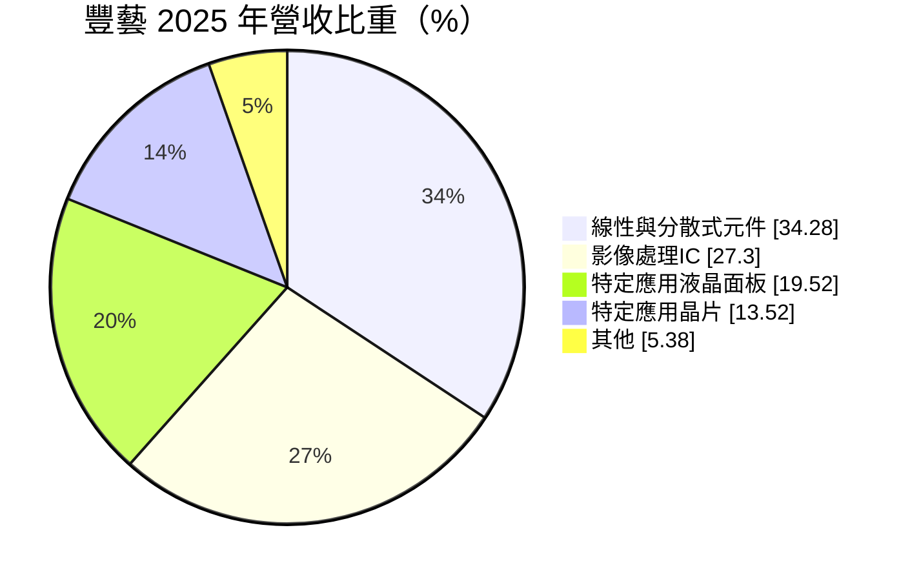
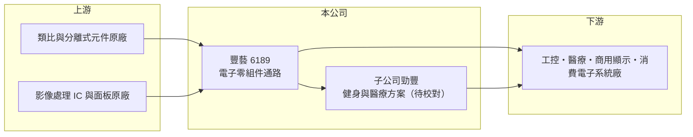

# 6189 豐藝

> 上市｜[[產業索引-電子通路業|電子通路業]]｜上市（櫃）日期 2004/05/24

# 第一章：企業模式與商業藍圖

> [!info] 撰寫說明
> 精簡版，由 Claude 依公開資料整理，架構比照 [[2330台積電]]，資料截至 2026-10-08。來源：證交所開放資料（基本資料、2026 年第二季財報、股利、月營收）、Goodinfo 經營績效頁、MoneyDJ 基本資料（2025 年營收比重）、理財周刊關於子公司勁豐的報導標題。代理原廠名稱未查得。#待校對

豐藝電子是成立近四十年的中型電子零組件通路商，產品橫跨類比與分離式元件、影像處理 IC 與特定應用面板，並透過子公司勁豐延伸到健身與醫療設備的控制方案。它的特點是毛利率在通路業中屬中上，且長期維持高配息。

- **核心業務：** 豐藝成立於 1986 年，2004 年上市，總部在台北內湖，屬於[[電子通路]]業，替半導體與面板原廠向系統廠鋪貨並提供技術支援。
- **營收結構：** 2025 年線性與分散式元件占 34.28%、影像處理 IC 占 27.30%、特定應用液晶面板產品占 19.52%、特定應用晶片（[[ASIC]]）占 13.52%、其他占 5.38%。

- **子公司：** 依財經媒體報導，子公司勁豐的業務集中在健身器材與醫療領域（待校對）。2026 年上半年豐藝稅後淨利 6.02 億元中，約 7,122 萬元歸屬非控制權益，代表有持股未達百分之百、但獲利貢獻不小的子公司。
- **長期方向：** 線性與分離式元件、影像處理 IC 與工業用面板多用於工控、醫療、車用與商用顯示，產品生命週期較消費性電子長。豐藝若能持續擴大這類長週期應用的比重，營收波動可望低於以手機、PC 為主的通路商。

# 第二章：護城河深度與競爭優勢

豐藝的競爭力來自多元產品線與長週期應用市場，護城河屬於通路業中的中等水準。

- **競爭優勢：** 豐藝的毛利率約 7.3% 至 9.2%，高於大型通路商的 3% 至 5%，代表其產品線需要較多技術支援，例如面板與影像處理 IC 的系統整合。[[設計導入]]後，工控與醫療客戶通常會在產品生命週期內持續採購，帶來穩定的回頭訂單。
- **主要對手：** 大型通路商 [[3702大聯大]]、[[3036文曄]]；中型同業 [[3209全科]]、[[3312弘憶股]]、[[3048益登]]、[[3028增你強]]、[[8112至上]]。在顯示相關產品上，也與面板廠的直銷團隊競爭。
- **觀察重點：** 2025 年營收從 380 億元降到 297 億元，但毛利率反而升到 8.81%，顯示公司可能淡出部分低毛利產品線（推估）。觀察重點在於營收規模與毛利率之間的取捨，以及子公司勁豐能否持續貢獻獲利。

# 第三章：財務體質與盈利規模

資料日期：2026-10-08，表格是撰寫當時的快照；最新月營收、毛利率、累計 EPS 由自動排程寫在本筆記的屬性欄位（月營收、毛利率、累計EPS 等）。#待校對

豐藝的財務特徵是營業利益率穩定、ROE 多年落在 12% 至 24% 之間，以及接近百分之百的股利配發率。

| 年度 | 營收（億元） | [[毛利率]] | [[營業利益率]] | EPS（元） | [[ROE]] |
|---|---|---|---|---|---|
| 2020 | 267 | 7.48% | 3.87% | 2.99 | 14.6% |
| 2021 | 325 | 7.29% | 3.80% | 4.31 | 18.3% |
| 2022 | 281 | 7.77% | 3.34% | 4.08 | 16.8% |
| 2023 | 295 | 8.44% | 4.31% | 4.00 | 16.6% |
| 2024 | 380 | 8.20% | 4.67% | 6.46 | 24.1% |
| 2025 | 297 | 8.81% | 4.85% | 2.73 | 12.2% |
| 2026 上半年 | 149.7 | 9.24% | 4.79% | 2.01 | 未查得 |

- **營收規模：** 2020 至 2025 年營收年複合成長率約 2.2%（推算）。2024 年營收 380 億元是近年高點，2025 年回落；2026 年前 8 個月營收約 202 億元，與前一年同期持平（證交所月營收）。
- **獲利：** 營業利益率由 3.3% 逐步提升到 4.8%，顯示產品組合往高毛利方向調整。近 5 年平均 ROE 約 17.6%（推算）。2024 年 EPS 6.46 元明顯偏高，原因未查得，可能含一次性收益（推估）。
- **財務特色：** 2026 年第二季總資產 172.6 億元、負債 107.3 億元、權益 65.3 億元，負債比約 62%。2025 年度配發盈餘現金股利 2.15 元，另以資本公積發放 0.55 元，合計 2.7 元，接近當年 EPS 2.73 元；分配後未分配盈餘僅約 27 萬元，代表公司幾乎把可分配盈餘全數發還股東。

**[[ROIC]] 與 [[WACC]]：** 有息負債未查得，以負債總額 40% 估約 42.9 億元（推算假設）。2025 年營業利益約 14.4 億元，稅後約 11.5 億元，除以權益 65.3 億元加有息負債 42.9 億元，ROIC 約 10.6%；2026 年上半年年化同樣約 10.6%（推算）。WACC 以 CAPM 推估：無風險利率 1.75%、市場風險溢酬 6%、β 取 1.0（同業常見值），股權成本 7.75%；稅後負債成本 2%，股權占比約 60%，WACC 約 5.5%（推算）。ROIC 穩定高於 WACC 約 5 個百分點，代表豐藝長期在創造價值，並以高配息把成果回饋股東。

# 第四章：總體風險與地緣政治

豐藝的風險主要來自電子零組件的庫存循環、面板產品的價格波動，以及高配息下的資本保留。

- **產業週期：** 2022 年與 2025 年營收都曾明顯下滑，反映電子零組件的庫存調整。面板與影像處理 IC 受面板產業景氣影響，價格波動大，[[長鞭效應]]會放大通路商的庫存風險。
- **營運風險：** 代理權若被原廠收回或轉移，對應的營收會一次消失。高配息政策讓公司保留的盈餘很少，若未來需要擴大營運資金或投資新事業，可能需要增加借款。
- **其他風險：** 進貨以美元與日圓計價，匯率波動影響毛利；面板產業供給集中於中國，價格競爭與美中科技管制都可能影響相關產品線。

# 專有名詞解析

## 半導體

- **[[ASIC]]**：特定應用積體電路，為特定產品或客戶需求設計的晶片，相對於通用型晶片功能更專一。

## 金融

- **[[長鞭效應]]**：終端需求的小幅變動，沿供應鏈往上游傳遞時被逐級放大，造成上游庫存與訂單劇烈波動。

## 產業

- **[[電子通路]]**：替半導體原廠向系統廠銷售零組件、備庫存並提供技術支援的中間商，賺取買賣價差與服務價值。
- **[[設計導入]]**：晶片被客戶選入產品設計並完成驗證，之後該產品量產期間都會持續採購，是通路商長期營收的來源。

# 核心供應鏈

- 上游：類比與分離式元件、影像處理 IC、液晶面板原廠（品牌未查得）。
- 下游／客戶：工控、醫療、健身器材、商用顯示與消費電子系統廠。
- 同業：[[3702大聯大]]、[[3036文曄]]、[[3209全科]]、[[3312弘憶股]]、[[3048益登]]、[[3028增你強]]、[[8112至上]]。

## 最新新聞
<!-- news:start -->
<!-- news:end -->

## 相關連結
- [公開資訊觀測站](https://mopsov.twse.com.tw/mops/web/t05st03?step=1&firstin=1&co_id=6189)
- [Goodinfo](https://goodinfo.tw/tw/StockDetail.asp?STOCK_ID=6189)
- [Yahoo 股市](https://tw.stock.yahoo.com/quote/6189)
- [鉅亨網新聞](https://www.cnyes.com/twstock/6189/news)
