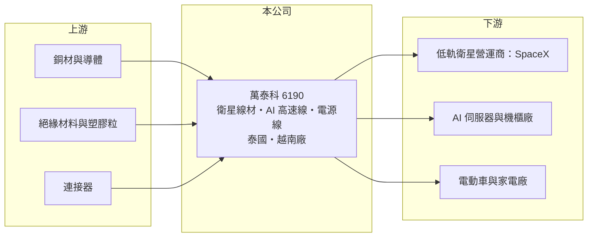

# 6190 萬泰科

> 上櫃｜[[產業索引-通信網路業|通信網路業]]｜上市（櫃）日期 1998/02/04

# 第一章：企業模式與商業藍圖

> [!info] 撰寫說明
> 精簡版，由 Claude 依公開資料整理，架構比照 [[2330台積電]] 的四章研究，資料截至 2026-10-08。來源：經濟日報（萬泰科 2026 年 6 月法說會報導）、Goodinfo 年度經營績效、櫃買中心開放資料（基本資料、綜合損益、資產負債、每月營收、本益比）。公開資料有限，本次未取得產品別營收比重；早年產品線依記憶整理。#待校對

本章說明萬泰科技（股票代號：6190，以下簡稱萬泰科）的商業模式：從傳統電子線材起家，近年因低軌衛星地面接收設備與 AI 伺服器線材而轉型的電線電纜廠。

- **核心業務：** 萬泰科成立於 1978 年，1998 年在櫃買中心掛牌，總部位於桃園中壢工業區。公司長年生產電子線、電源線與各類[[線材]]（依記憶整理，待校對），近年主力轉為[[低軌衛星]]地面接收設備的纜線與電源線。依 2026 年 6 月法說會報導，萬泰科是 SpaceX 衛星地面設備線材的主力供應商之一，因電源線需要非中國大陸產地而接手相關訂單；同時發展 AI 機櫃用高速線、AI 伺服器大電流電源線與液冷散熱測漏線。
- **營收結構：** 公司未揭露產品別比重。從法說會內容推估，低軌衛星相關線材是近年營收成長的主要來源，AI 高速線則是正在放大的第二引擎（推估）。法說會指出，AI 高速線的毛利率已由 10% 至 15% 提升到 30% 至 35%，產品組合改善會反映在整體毛利率上。
- **營運據點：** 主要海外生產基地在泰國與越南。泰國廠進行高速線第三期擴產（約新台幣 2.5 億元），完成後總月產能可達 800 萬至 1,000 萬米；越南廠的輻照交聯線（E-Beam）已完成擴產，2026 年 1 月試量產，應用於電動車與家電。東南亞產地是萬泰科取得「非中國」訂單的關鍵。
- **長期方向：** 公司把產品從地面設備延伸到太空用太陽能線、高速訊號傳輸線等極端環境線材，以及資料中心與機器人、無人機等實體 AI 應用。2026 年[[CapEx]]規劃 3 至 4 億元，營收目標為百億元。

# 第二章：護城河深度與競爭優勢

本章評估萬泰科的護城河。線材本身是成熟產業，但萬泰科透過特定客戶的認證與非中國產能，建立了窄護城河。

- **競爭優勢：** 衛星與 AI 伺服器線材需要通過客戶嚴格的電氣、耐候與可靠度認證，一旦成為合格供應商，在產品世代內不容易被替換。萬泰科在泰國、越南擁有產能，符合美國客戶要求的非中國產地，這在美中對抗下成為接單的門檻。快速擴產的執行能力（SpaceX 電源線月產能由 80 萬條提升到 180 萬條，年底目標 250 萬條）也是客戶選擇供應商的重要考量。
- **主要對手：** 電子線材與連接線組領域的台灣同業包括 [[3023信邦]]、[[3665貿聯-KY]]、[[6290良維]]、[[2462良得電]]、[[6197佳必琪]]，電線電纜則有 [[1605華新]]、[[1609大亞]] 等（對手名單為產業常識整理，待校對）。AI 高速線市場有更大的連接器與線材廠競爭，萬泰科的規模並不突出。
- **觀察重點：** 第一，對單一衛星客戶的依賴程度與訂單延續性。第二，AI 伺服器電源線與測漏線的客戶驗證結果。第三，擴產後產能利用率與毛利率能否同步維持。

# 第三章：財務體質與盈利規模

資料日期：2026-10-08。數字取自 Goodinfo 年度經營績效、經濟日報與櫃買中心開放資料，表格是撰寫當時的快照；最新月營收、毛利率、累計 EPS 由自動排程寫在本筆記的屬性欄位（月營收、毛利率、累計EPS 等）。#待校對

萬泰科的財務數字顯示營收規模在五年內接近翻倍，但毛利率仍停留在線材業常見的 15% 至 17%。

| 年度 | 營收（新台幣） | [[毛利率]] | [[營業利益率]] | EPS（元） | [[ROE]] |
|---|---|---|---|---|---|
| 2020 | 47.9 億 | 15.4% | 5.12% | 1.03 | 8.9% |
| 2021 | 75.4 億 | 14.4% | 4.77% | 1.68 | 12.2% |
| 2022 | 90.3 億 | 17.5% | 7.85% | 3.04 | 19.6% |
| 2023 | 65.2 億 | 14.7% | 5.39% | 1.46 | 8.95% |
| 2024 | 81.4 億 | 17.0% | 6.23% | 2.28 | 11.9% |
| 2025 | 86.3 億 | 17.2% | 7.00% | 2.19 | 10.6% |
| 2026 上半年 | 54.71 億 | 15.2% | 6.5% | 1.35 | 未查得 |

註：2020 至 2025 年取自 Goodinfo 合併報表；2026 上半年取自櫃買中心開放資料（毛利率、營業利益率依開放資料推算）。

- **營收規模：** 2020 至 2025 年營收年複合成長率約 12.5%（推算），2023 年曾因衛星接收設備庫存調整而下滑。2026 年 1 至 8 月累計營收 75.96 億元，較去年同期 58.58 億元成長約 30%，公司說明為市場需求成長、出貨量持續增加。
- **獲利：** 營業利益率在 4.8% 至 7.9% 之間，2021 至 2025 年平均 ROE 約 12.7%（推算）。2026 年上半年歸屬母公司淨利 2.49 億元，EPS 1.35 元；毛利率 15.2% 尚未反映法說會所說的高毛利 AI 產品放量。
- **財務特色：** 2026 年第二季底資產總計 97.57 億元、負債 52.42 億元（其中非流動負債 10.05 億元）、歸屬母公司權益 39.94 億元，每股淨值 21.16 元，負債比約 54%。開放資料的股本 19.54 億元高於基本資料的 18.65 億元，推估近年有配發股票股利（Goodinfo 統計歷年平均股票股利 0.23 元）。最近一次現金股利約 1.93 元，以 2025 年 EPS 2.19 元計算[[配息率]]約 88%（推算）。
- **[[ROIC]] 與 [[WACC]]：** 以 2025 年營業利益約 6.04 億元（86.3 億元 × 7.0%）扣 20% 稅後約 4.83 億元，投入資本以權益總計約 45.15 億元加非流動負債 10.05 億元（短期借款未查得，未計入）約 55.2 億元計算，ROIC 約 8.8%（推算）。WACC 以 CAPM 推估：無風險利率 1.75%、市場風險溢酬 6%、β 取 1.2（推估，題材型中小型電子股波動較大），權益成本約 8.95%；稅前負債成本假設 2.5%，以約八比二的權益與負債比重加權，WACC 約 7.5%（推算）。ROIC 略高於 WACC，價值創造空間不大；若 AI 高速線等高毛利產品比重提高，利差才有機會明顯擴大。

# 第四章：總體風險與地緣政治

本章整理萬泰科面對的長期風險，主要來自客戶集中與產能擴張。

- **產業週期：** 衛星接收設備的出貨取決於低軌衛星營運商的用戶擴張速度，2023 年營收從 90.3 億元降到 65.2 億元，顯示客戶庫存調整的衝擊。AI 伺服器線材則跟隨資料中心資本支出週期，需求高峰後可能出現[[長鞭效應]]。
- **營運風險：** 衛星相關訂單集中在單一客戶，客戶改變設計、自製或引進第二供應商，都會影響營收。擴產與資本支出增加後，若需求不如預期，折舊與閒置產能會壓縮毛利。線材的主要成本是銅，銅價大幅波動時，報價調整若有落差就會影響毛利。
- **其他風險：** 生產基地在泰國、越南，當地工資、電力與政策變化會影響成本；美國對東南亞的關稅政策也是變數。營收以美元計價為主，新台幣升值壓縮毛利。

# 專有名詞解析

## 應用

- **[[低軌衛星]]**：在距地面數百至兩千公里軌道運行的通訊衛星，以大量衛星組成網路提供寬頻服務，代表業者為 SpaceX Starlink。

## 金融

- **[[CapEx]]**：資本支出，企業用於購買廠房、設備等長期資產的支出。
- **[[長鞭效應]]**：終端需求的小幅變動，沿供應鏈往上游傳遞時被逐級放大，造成上游庫存與訂單劇烈波動。
- **[[配息率]]**：股利占每股盈餘的比例，反映公司把多少獲利分給股東。
- **[[ROIC]]**：投入資本報酬率，稅後營業利益除以股東權益與有息負債的合計，衡量本業對所有資金提供者的報酬。
- **[[WACC]]**：加權平均資金成本，依股東權益與負債的比重加權計算的資金成本，ROIC 高於它才代表創造價值。

## 產業

- **[[線材]]**：電線、電纜與連接線組的統稱，負責傳輸電力與訊號，規格取決於電流、頻寬與使用環境。

# 核心供應鏈

- 上游：銅材與導體、絕緣材料與塑膠粒、連接器（供應商名稱本次未查得）。
- 下游／客戶：低軌衛星營運商 SpaceX（地面接收設備線材）、AI 伺服器與機櫃組裝廠（[[NVDA輝達]] 機櫃生態帶動需求，非直接客戶）、電動車與家電廠。
- 同業：[[3023信邦]]、[[3665貿聯-KY]]、[[6290良維]]、[[2462良得電]]、[[6197佳必琪]]、[[1605華新]]。

## 最新新聞
<!-- news:start（自動產生，請勿手動編輯此範圍） -->
- 2026-10-07 📰 媒體 19:50｜營收速報 - 萬泰科(6190)9月營收11.05億元年增率高達58.41％｜[鉅亨網](https://news.cnyes.com/news/id/6623958)
- 2026-10-06 🏛️ 重訊 16:52｜本公司受邀參加寬量國際主辦之「20th QIC CEO Week」，向投資人說明本公司之營運概況、財務及業務相關資訊。｜[觀測站](https://mops.twse.com.tw/mops/#/web/t05st01)

完整紀錄：[[6190萬泰科 新聞]]
<!-- news:end -->

## 相關連結
- [公開資訊觀測站](https://mopsov.twse.com.tw/mops/web/t05st03?step=1&firstin=1&co_id=6190)
- [Goodinfo](https://goodinfo.tw/tw/StockDetail.asp?STOCK_ID=6190)
- [Yahoo 股市](https://tw.stock.yahoo.com/quote/6190)
- [鉅亨網新聞](https://www.cnyes.com/twstock/6190/news)
