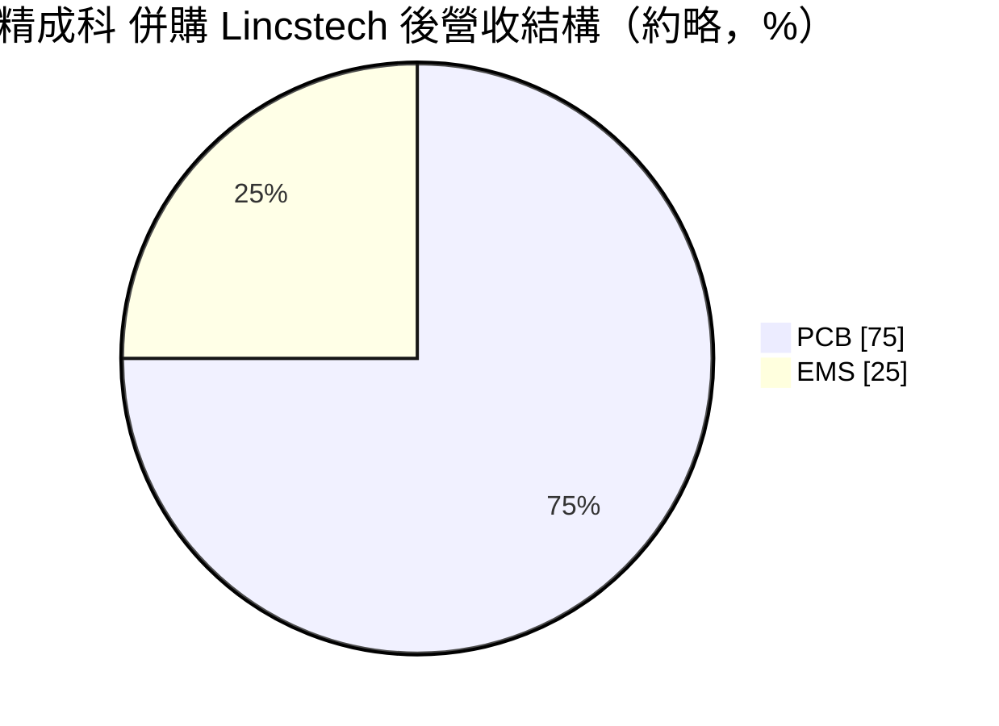
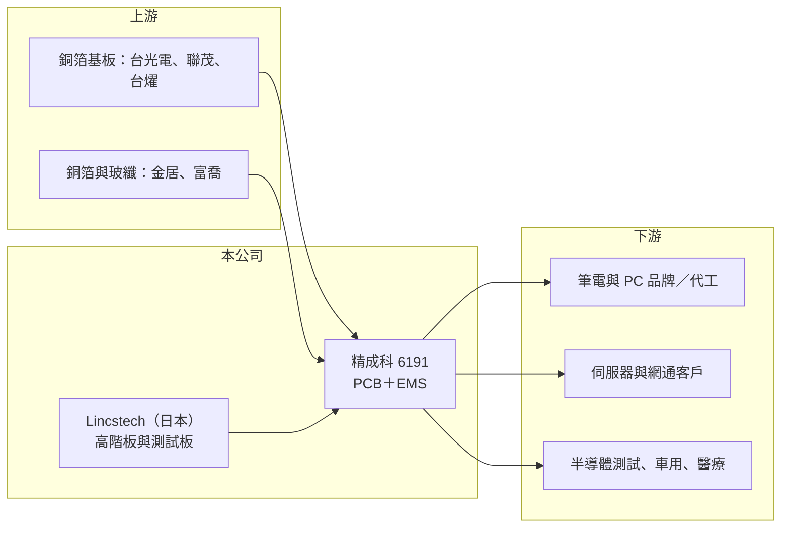

# 6191 精成科

> 上市｜[[產業索引-電子零組件業|電子零組件業]]｜上市（櫃）日期 2007/10/19

# 第一章：企業模式與商業藍圖

> [!info] 撰寫說明
> 精簡版，由 Claude 依公開資料整理，架構比照 [[2330台積電]]，資料截至 2026-10-08。來源：證交所開放資料快照（基本資料、2026 年第二季資產負債與綜合損益、股利）、Goodinfo 經營績效頁（2019 至 2025 年度數據）、口袋學堂〈精成科技做什麼的〉（2025/11 更新）、經濟日報。營收比重與併購細節為媒體整理，尚未比對公司年報。#待校對

精成科技（以下簡稱精成科）是一家同時做[[PCB]]（印刷電路板）與[[EMS]]（電子製造服務）的老牌製造商，2025 年透過併購日本高階板廠，正從筆電板走向 AI 伺服器與半導體測試板。

- **核心業務：** 精成科成立於 1973 年，是台灣最早一批電路板廠之一，2007 年上市，董事長焦佑衡同時擔任 [[5469瀚宇博]] 董事長，屬於華新集團旗下的「華科事業群」。公司分成兩個事業群：PCB 事業群生產 4 至 14 層的多層板，EMS 事業群提供模具、射出、表面黏著（SMT）到系統組裝的一條龍代工。這種「板子加組裝」的組合，讓客戶可以把電路板和後段組裝一起外包，減少供應商管理的成本。
- **營收結構：** 依媒體整理，併購前 PCB 約占六成三、EMS 約占三成六；2025 年併購日本 Lincstech 後，PCB 比重升到約七成五、EMS 約二成五，AI 相關營收約占兩成。應用面從過去的個人電腦主機板、消費性電子、網通設備、車用電子，擴大到伺服器板、[[探針卡]]用測試板、機器人與醫療用板。比重的轉變代表公司重心正從低單價、量大的板子，移往層數高、驗證嚴格的高階板。
- **營運據點：** 總部在新北新店，主要產能長期設在中國大陸，包括廣東深圳（PCB）、東莞黃江與江蘇昆山（EMS），以及重慶。2025 年 4 月完成收購的 Lincstech 位於日本，依媒體報導，後續規劃在新加坡、馬來西亞與台灣設新廠。從「以中國為主」轉向「日本加東南亞加台灣」的布局，主要是回應美系伺服器客戶對非中國產能的要求。
- **長期方向：** 精成科的長期策略是以併購換取技術與客戶，再用集團的量產能力放大。Lincstech 帶來的是日本高階多層板與半導體測試板的製程技術，這類產品過去精成科自己很難在短時間內做到。媒體指出，瀚宇博與精成科 2025 年前三季合計資本支出近 60 億元，高於 2024 年全年約 40 億元，顯示 2025 至 2026 年是集團的擴產高峰期。

# 第二章：護城河深度與競爭優勢

精成科的競爭力不在單一技術領先，而在「老牌量產廠加上併購而來的高階技術」，本章說明這個組合能守住什麼、守不住什麼。

- **競爭優勢：** 第一是一條龍能力，同一家公司能做電路板也能做組裝，對客戶來說可以縮短開發時程，並把品質責任集中在一個供應商。第二是集團綜效，與 [[5469瀚宇博]]、[[8183精星]] 同屬華科事業群，採購、客戶與產能可以互相支援。第三是 Lincstech 帶來的日本高階板技術與客戶認證，伺服器板與半導體測試板的認證週期長，一旦通過就不容易被替換，這是精成科過去在筆電板市場欠缺的轉換成本。
- **主要對手：** 在伺服器與高階多層板，主要對手是 [[2368金像電]]、[[3044健鼎]]、[[2313華通]] 與 [[3037欣興]]，這些公司在 AI 伺服器板的規模與客戶關係都比精成科深。在 EMS，面對的是 [[2317鴻海]] 等大型代工廠與眾多中國同業，規模差距明顯。在筆電與消費性電路板，則與中國大陸本土板廠及 [[4958臻鼎-KY]] 等大廠競爭，這個市場同質性高、價格壓力大。
- **觀察重點：** 長期最重要的是 Lincstech 的技術能否「移植」到東南亞與台灣的新產能，也就是能否在成本較低的地方做出日本水準的高階板。其次是 AI 與伺服器營收比重能否持續上升，讓整體[[毛利率]]擺脫筆電板的循環。第三是併購整合的成效：跨國併購常見文化與管理磨合問題，2025 年毛利率由 26.1% 降到 19.3%，部分可能反映併購初期的整合成本與產品組合變化（推估）。

# 第三章：財務體質與盈利規模

資料日期：2026-10-08，表格是撰寫當時的快照；最新月營收、毛利率、累計 EPS 由自動排程寫在本筆記的屬性欄位（月營收、毛利率、累計EPS 等）。#待校對

本章用多年度數據檢視精成科的獲利結構，重點是它從低毛利的筆電板與組裝，轉向高階板之後，資本報酬是否跟著改善。

| 年度 | 營收（億元） | [[毛利率]] | [[營業利益率]] | EPS（元） | [[ROE]] |
|---|---|---|---|---|---|
| 2019 | 218 | 14.1% | 4.8% | 2.01 | 6.1% |
| 2020 | 228 | 19.3% | 10.3% | 3.42 | 10.9% |
| 2021 | 276 | 18.4% | 11.2% | 5.79 | 18.6% |
| 2022 | 243 | 17.8% | 10.8% | 5.24 | 14.6% |
| 2023 | 229 | 23.5% | 15.4% | 6.73 | 16.3% |
| 2024 | 217 | 26.1% | 16.0% | 6.01 | 13.0% |
| 2025 | 337 | 19.3% | 10.4% | 6.55 | 12.8% |
| 2026 上半年 | 192.9 | 15.9% | 7.6% | 2.32 | 未查得 |

資料來源：2019 至 2025 年為 Goodinfo，2026 上半年為證交所開放資料。

- **營收規模：** 2019 至 2024 年營收大致在 220 至 280 億元之間，隨筆電景氣起伏；2025 年因併購 Lincstech 跳升到 337 億元，2019 至 2025 年營收年複合成長率約 7.5%（推算），但成長幾乎集中在併購那一年。2026 年上半年營收 192.9 億元，延續併購後的規模。
- **獲利：** 毛利率從 2019 年的 14% 提升到 2024 年的 26%，反映產品組合改善與成本控制；但 2025 年與 2026 年上半年回落到 19% 與 16%，營業利益率也降到 7.6%。2026 年上半年稅前淨利 19.3 億元中，業外收入約 4.7 億元，占比不低，評估本業時應以營業利益為準。近 5 年（2021 至 2025）平均 [[ROE]] 約 15%（推算），在電路板同業中屬中上水準。
- **財務特色：** 2026 年第二季股東權益 369 億元，其中「其他權益」高達 127.6 億元，2026 年上半年其他綜合損益就有 106.8 億元，代表公司持有的股權投資出現大額未實現評價利益。這類利益不經過損益表，也會隨市價大幅波動，因此帳面淨值（每股約 73.6 元）不能全部視為本業資產。2025 年 7 月公司以每股 75 元現金增資 2,500 萬股，資金用於償還銀行借款，是降低財務槓桿的動作。
- **股利：** 2025 年度配發現金股利 2.60 元，配息率約 40%（推算）。Goodinfo 統計的歷年平均現金股利僅約 0.67 元，顯示過去有不少年度配息很少或未配，股利穩定度是近幾年才建立的。

**[[ROIC]] 與 [[WACC]]**

ROIC（推算）：以 2025 年營收 337 億元乘以營業利益率 10.4%，營業利益約 35 億元，扣除 20% 稅率後稅後營業利益約 28 億元。投入資本若以股東權益扣除未實現評價的其他權益（369 − 127.6 ≈ 241 億元）計算，再加上有息負債（開放資料未拆分，假設約 80 至 150 億元，推估），ROIC 約落在 7% 至 9%；若不計有息負債則為約 11.6%，是上限值。

WACC（推算）：台灣 10 年期公債殖利率取 1.75%、市場風險溢酬 6%、β 取電路板同業常見值 1.2（非官方數字），股東權益成本約 9%；負債成本假設 2.5%，稅後約 2%。以市值約 434 億元（股價淨值比 1.18 乘以淨值）與上述有息負債估計，負債占資本約 20% 至 25%，WACC 約 7% 至 7.5%。

ROIC 與 WACC 的差距大致在 0 至 2 個百分點，代表精成科目前只是「小幅創造價值」。併購 Lincstech 之後投入資本增加，但 2025 至 2026 年的毛利率反而下滑，未來高階板比重若無法拉升獲利率，ROIC 會逼近甚至低於資金成本；反之，若高階板順利放量，利差才會明顯擴大。

# 第四章：總體風險與地緣政治

精成科的風險來自三個層面：電路板產業本身的景氣循環、併購與擴產的執行，以及生產據點集中在中國大陸的地緣政治。

- **產業週期：** 筆電、消費性電子與網通需求本身有明顯週期，2019 至 2024 年營收在固定區間起伏就是證明。AI 伺服器板雖然成長快，但同樣受到雲端業者資本支出節奏影響，一旦 AI 投資放緩，高階板產能可能從供不應求轉成過剩。銅、玻纖布與[[CCL]]（銅箔基板）等原物料價格上漲，也會壓縮毛利率。
- **營運風險：** 跨國併購的整合需要時間，日本工廠的管理文化與成本結構和中國大陸工廠不同，技術能否順利轉移到新廠是最大的不確定性。2025 至 2026 年的擴產會讓折舊上升，若新產能利用率爬坡太慢，獲利率可能持續低於併購前。此外，股權投資的未實現評價占淨值比重高，市價下跌時淨值會明顯縮水。
- **其他風險：** 主要產能在中國大陸，面臨美國關稅、出口管制與客戶要求「中國以外產能」的壓力，這也是公司布局東南亞的原因，但新廠的成本與良率需要時間驗證。營收以美元計價為主、成本有人民幣與日圓，匯率變動會影響獲利。

# 專有名詞解析

## 半導體

- **[[探針卡]]**：晶圓測試時連接測試機與晶片的介面板，需要極高層數與精度的電路板。

## 應用

- **[[AI伺服器]]**：搭載 GPU 或 AI 加速器的伺服器，所用電路板層數多、材料規格高，單價遠高於一般伺服器板。

## 產業

- **[[PCB]]**：印刷電路板，用銅箔線路連接電子元件的基板，是所有電子產品的骨架。
- **[[EMS]]**：電子製造服務，替品牌客戶代工電路板組裝與整機組裝，本身不賣自有品牌。
- **[[CCL]]**：銅箔基板，由玻纖布、樹脂與銅箔壓合而成，是製作電路板的主要原料。

# 核心供應鏈

- 上游：銅箔基板 [[2383台光電]]、[[6213聯茂]]、[[6274台燿]]；銅箔 [[8358金居]]；玻纖布 [[1815富喬]]。
- 下游／客戶：公司未具名揭露主要客戶，銷售地區以亞洲約九成為主；應用為筆電與 PC、伺服器與網通、車用電子、半導體測試、醫療與機器人。
- 同業：[[2368金像電]]、[[3044健鼎]]、[[2313華通]]、[[3037欣興]]、[[4958臻鼎-KY]]；集團關係企業 [[5469瀚宇博]]、[[8183精星]]。

## 最新新聞
<!-- news:start（自動產生，請勿手動編輯此範圍） -->
- 2026-10-15 🏛️ 重訊 15:36｜公告本公司召開法說會相關內容｜[觀測站](https://mops.twse.com.tw/mops/#/web/t05st01)
- 2026-10-08 📰 媒體 19:51｜營收速報 - 精成科(6191)9月營收42.46億元年增率高達36.13％｜[鉅亨網](https://news.cnyes.com/news/id/6625897)

完整紀錄：[[6191精成科 新聞]]
<!-- news:end -->

## 相關連結
- [公開資訊觀測站](https://mopsov.twse.com.tw/mops/web/t05st03?step=1&firstin=1&co_id=6191)
- [Goodinfo](https://goodinfo.tw/tw/StockDetail.asp?STOCK_ID=6191)
- [Yahoo 股市](https://tw.stock.yahoo.com/quote/6191)
- [鉅亨網新聞](https://www.cnyes.com/twstock/6191/news)
