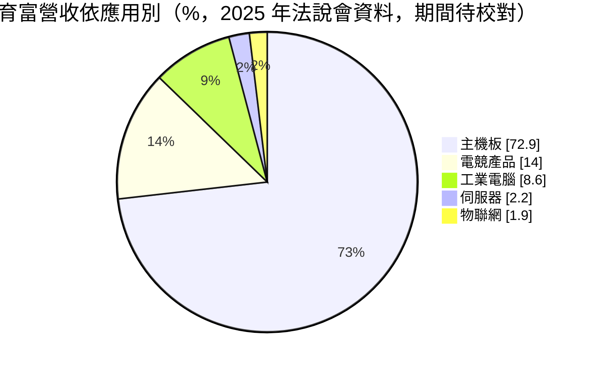
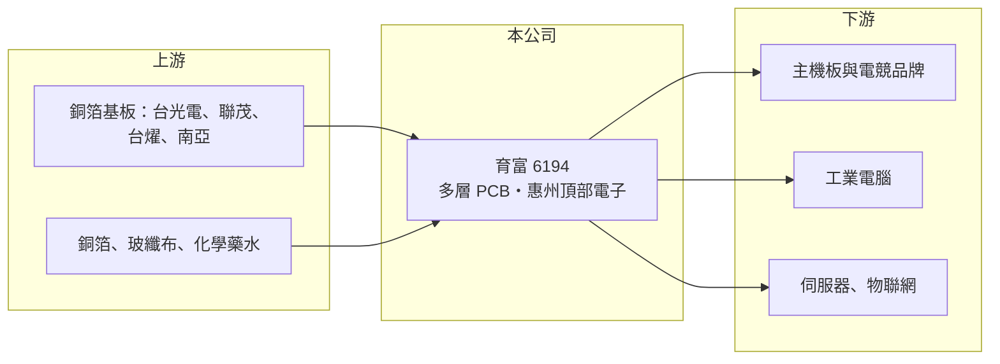

# 6194 育富

> 上櫃｜[[產業索引-電子零組件業|電子零組件業]]｜上市（櫃）日期 2002/12/05

# 第一章：企業模式與商業藍圖

> [!info] 撰寫說明
> 精簡版，由 Claude 依公開資料整理，架構比照 [[2330台積電]]，資料截至 2026-10-08。來源：櫃買中心開放資料（基本資料、2026 年上半年財報）、Goodinfo 經營績效頁、富果研究 2025 年 12 月法說會整理（該整理的資料期間標示不一致，產品比重與現金部位的期間待校對）。#待校對

本章說明育富電子（6194）的商業模式：一家生產多層[[PCB]]、以電腦主機板為主要應用的中型板廠，以及它極為保守的財務風格。

- **核心業務：** 育富成立於 1983 年，總部在桃園，2002 年在櫃買中心掛牌。主要產品是 2 至 20 層的精密印刷電路板，依層數以 4 層與 6 層板為主（各約 38%），8 層板約 21%，10 層以上比重很小。PCB 是承載並連接所有電子元件的基板，層數越多、線路越細，單價與毛利也越高。
- **營收結構：** 依法說會資料，主機板占營收約 73%，電競產品約 14%、工業電腦約 9%，伺服器與物聯網合計約 4%。這代表育富的營收高度依賴 PC 主機板市場的景氣。主要客戶推估為台系主機板品牌（待校對）。
- **營運據點：** 生產基地是廣東惠州的頂部電子，廠區約 1.8 萬坪、員工約 600 人，月產能約 60 萬平方呎、年產能約 720 萬平方呎，公司表示將依客戶需求擴線。
- **長期方向：** 公司的策略是提高 6 層與 8 層板比重以改善產品組合，並在守住 PC 主機板地位的同時切入伺服器市場。Windows 更新與 AI PC 的換機需求是潛在動能，但伺服器板需要更高層數與更嚴格的認證，育富目前比重仍很低。

# 第二章：護城河深度與競爭優勢

本章分析育富的競爭位置。主機板用 PCB 屬於成熟、競爭激烈的市場，育富的優勢不在技術領先，而在長期合作關係與穩健的財務。

- **競爭優勢：** 育富專注主機板用多層板多年，熟悉主機板品牌的規格與交期要求，長期合作的客戶關係是訂單的主要基礎。此外，公司幾乎沒有銀行借款、現金部位占總資產六成以上，在景氣低迷時不必為了還債而殺價搶單，可以撐過產業的價格戰。
- **主要對手：** 主機板與電腦用板的台系同業有 [[2367燿華]]、[[2316楠梓電]]、8213志超、6191精成科 等，規模更大的 [[3044健鼎]]、[[2313華通]] 也有相關產品線，中國 PCB 廠則以價格競爭（同業定位為整理性描述，待校對）。育富規模相對小，在高階 HDI 與伺服器板的技術與產能上落後大廠。
- **觀察重點：** 毛利率由 2020 年的 20.2% 一度跌到 2022 年的 4%，2023 至 2024 年回到 18% 左右，2025 年 14.6%，2026 年上半年只剩 7.8%，顯示產品組合單一、議價能力有限。長期要看伺服器與高層數板比重能否真正提升，讓公司擺脫對主機板單一市場的依賴。

# 第三章：財務體質與盈利規模

資料日期：2026-10-08，表格是撰寫當時的快照；最新月營收、毛利率、累計 EPS 由自動排程寫在本筆記的屬性欄位（月營收、毛利率、累計EPS 等）。#待校對

本章用多年度數字檢視育富：本業利潤波動大，但現金充沛、長期穩定配息。

| 年度 | 營收（億元） | [[毛利率]] | [[營業利益率]] | EPS（元） | [[ROE]] |
|---|---|---|---|---|---|
| 2020 | 15.1 | 20.2% | 14.8% | 2.40 | 8.0% |
| 2021 | 15.9 | 6.4% | 1.1% | 0.26 | 0.9% |
| 2022 | 12.2 | 4.0% | -4.0% | 0.12 | 0.4% |
| 2023 | 12.9 | 18.1% | 11.2% | 2.84 | 7.8% |
| 2024 | 14.2 | 17.6% | 11.5% | 4.15 | 10.5% |
| 2025 | 13.8 | 14.6% | 8.1% | 2.19 | 5.3% |

- **營收規模：** 2020 至 2025 年營收年複合成長率約 -1.8%（推算），規模在 12 億至 16 億元之間。2026 年上半年營收 4.88 億元，1 至 8 月累計較去年同期減少約 35%，是近年少見的大幅衰退。
- **獲利：** 毛利率與營業利益率隨主機板景氣與原料成本大幅擺動，2021 至 2022 年本業幾乎不賺錢。EPS 除了本業，也受匯兌與利息收入影響，因為公司持有大量外幣與定存。2026 年上半年毛利率 7.8%、營業小幅虧損 0.01 億元，靠業外收入才有 EPS 0.09 元。
- **財務特色：** 近 5 年（2021 至 2025）平均 ROE 約 5.0%（推算），偏低的主因是大量現金拉低了資本報酬。2026 年第二季股東權益 19.5 億元、負債僅 4.1 億元，負債比約 17%，流動資產 21.4 億元是流動負債的 6.6 倍；每股淨值 40.66 元，保留盈餘 14.1 億元遠高於股本 4.8 億元。依法說會資料，公司連續 23 年發放現金股利，2015 至 2017 年虧損時仍配發 0.75 元，獲利年度配息率約五到六成（待校對）。
- **[[ROIC]] 與 [[WACC]]：** 2025 年營業利益約 1.12 億元（13.8 億 × 8.14%），稅後約 0.9 億元；以股東權益 19.5 億元為投入資本，ROIC 約 4.6%（推算）。若扣除約 14 億元的現金與定存（法說會資料，期間待校對），實際投入營運的資本約 5.5 億元，本業 ROIC 約 16%（推算）。2026 年上半年營業虧損，ROIC 約為零。WACC 以 [[CAPM]] 推估：無風險利率 1.75%、市場風險溢酬 6%、β 假設 0.9（PCB 中小廠常見值），股東權益成本約 7.15%；公司沒有銀行借款，WACC 約等於 7.2%（推算）。本業在正常年份 ROIC 高於 WACC，但大量閒置現金的報酬遠低於資金成本，使整體股東報酬偏低；資本配置偏向保守、重視安全而非效率。

# 第四章：總體風險與地緣政治

本章整理育富長期要面對的風險。

- **產業週期：** 主機板 PCB 的需求跟著 PC 出貨與通路庫存週期起伏，2021 至 2022 年與 2026 年上半年都出現毛利率大幅下滑。PC 是成熟市場，總量成長有限，除非出現大規模換機潮，否則營收很難持續成長。
- **營運風險：** 主機板占營收七成以上，客戶與應用都高度集中；若主要客戶轉單或主機板市場萎縮，營收將直接受衝擊。切入伺服器板需要投資更高階的設備與通過更嚴格的認證，以目前的規模推進速度有限。
- **其他風險：** 生產集中在廣東惠州，面臨中國人工成本上升、環保法規、美中關稅與供應鏈移轉的壓力。銅箔基板與銅價上漲會壓縮毛利；公司持有大量外幣資產，匯率變動會造成明顯的匯兌損益。

# 專有名詞解析

## 金融

- **[[ROIC]]**：投入資本報酬率，衡量公司用股東與債權人投入的資本，每年能賺回多少稅後營業利益。
- **[[WACC]]**：加權平均資金成本，依股東權益與負債的比重，加權計算公司取得資金的平均成本。
- **[[CAPM]]**：資本資產定價模型，以無風險利率加上 β 乘以市場風險溢酬，推估股東要求的報酬率。

## 產業

- **[[PCB]]**：印刷電路板，承載並連接電子元件的基板，是所有電子產品的基礎零件。
- **[[銅箔基板]]**：在絕緣基材兩面壓上銅箔的板材，是製造 PCB 的主要原料，台光電、聯茂、台燿為主要供應商。

# 核心供應鏈

- 上游：銅箔基板廠 [[2383台光電]]、[[6213聯茂]]、[[6274台燿]]、[[1303南亞]]，以及銅箔、玻纖布與化學藥水（育富的具體供應商未查得）。
- 下游／客戶：主機板與電競產品品牌（推估包括 [[2357華碩]]、[[2376技嘉]]、[[2377微星]]，待校對）、工業電腦、伺服器與物聯網客戶。
- 同業：[[2367燿華]]、[[2316楠梓電]]、8213志超、6191精成科、[[3044健鼎]]、[[2313華通]]。

## 最新新聞
<!-- news:start -->
<!-- news:end -->

## 相關連結
- [公開資訊觀測站](https://mopsov.twse.com.tw/mops/web/t05st03?step=1&firstin=1&co_id=6194)
- [Goodinfo](https://goodinfo.tw/tw/StockDetail.asp?STOCK_ID=6194)
- [Yahoo 股市](https://tw.stock.yahoo.com/quote/6194)
- [鉅亨網新聞](https://www.cnyes.com/twstock/6194/news)
