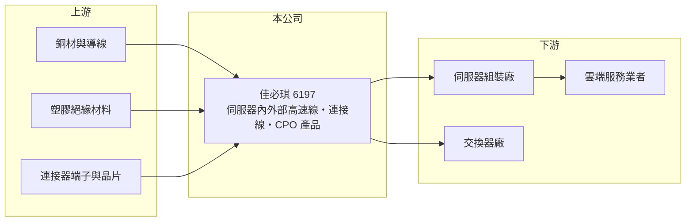

# 6197 佳必琪

> 上市｜[[產業索引-電子零組件業|電子零組件業]]｜上市（櫃）日期 2004/11/08

# 第一章：企業模式與商業藍圖

> [!info] 撰寫說明
> 精簡版，由 Claude 依公開資料整理，架構比照 [[2330台積電]]，資料截至 2026-10-08。來源：證交所開放資料快照（基本資料、2026 年第二季資產負債與損益、營益分析、股利、每月營收）、Goodinfo 經營績效頁、聯合新聞網 2026 年 4 月法說會報導。生產據點與產品別營收比重未查得。#待校對

佳必琪國際（以下簡稱佳必琪）是一家以[[連接線]]與[[連接器]]為主的電子零組件廠，總部位於新北市中和，2004 年在證交所上市。理解佳必琪的關鍵在於：公司過去五年由傳統訊號線與[[電源線]]，轉型為 [[AI 伺服器]]內外部高速傳輸線的供應商，AI 相關營收在 2025 年已占約一半以上。

- **核心業務：** 佳必琪成立於 1992 年，主要產品是各式連接線、線束與連接器。依 2026 年 4 月法說會報導，目前最大的營收來源是伺服器機櫃內部的線材與高速傳輸線，公司正從一般訊號線轉向高速與高功率產品。線材看似簡單，但資料中心的高速線必須在極高頻率下維持訊號完整，設計與驗證門檻遠高於一般消費性線材。
- **營收結構：** 公司表示 2025 年 AI 相關營收約占總營收 50% 至 55%，2026 年目標提高到 60% 至 65%。客戶涵蓋雲端服務業者與伺服器品牌，報導點名 [[AMZN亞馬遜]] AWS、[[MSFT微軟]]、美超微（Supermicro）與甲骨文（Oracle）。產品別與地區別的詳細比重公開資料未查得。
- **營運據點：** 總部在新北市中和，2026 年第二季總資產約 104 億元，其中非流動資產約 29 億元。生產工廠所在地公開資料未查得（#待校對）。
- **長期方向：** 公司正在開發共同封裝光學（[[CPO]]）相關產品，包括 1.6T 迴路測試模組、1.6T 主動式銅纜（ACC）與 800G 光銅產品，部分已通過美系交換器大廠認證（2026 年 4 月報導）。同時拓展歐洲與日本市場，並切入半導體設備與電源應用。這代表佳必琪想把客戶關係從「賣線」延伸到「賣高速互連方案」，若成功，單價與技術門檻都會提高。

# 第二章：護城河深度與競爭優勢

佳必琪的護城河來自大型雲端客戶的認證與量產經驗，而不是專利或規模壟斷。

- **競爭優勢：** 資料中心線材需要通過客戶與伺服器組裝廠的長期驗證，一旦進入合格供應商名單，只要良率與交期穩定，客戶通常不會輕易更換。佳必琪 2024 至 2025 年營業利益率維持在 18% 至 20%，在線材業中屬於很高的水準，顯示產品組合已明顯偏向高附加價值的 AI 伺服器線材。
- **主要對手：** 台灣同業包括 [[3665貿聯-KY]]、[[3533嘉澤]]、[[3023信邦]]、[[6290良維]]、[[2392正崴]]，國際上有安費諾（Amphenol）、莫仕（Molex）等大型連接器廠。這些對手多數規模更大、產品線更完整，佳必琪的定位是以專注與彈性爭取特定客戶的特定線材。
- **觀察重點：** 長期最值得追蹤的是 AI 營收占比能否穩定在六成以上，以及高速銅纜被光纖取代的速度。如果 1.6T 以上的世代改用光學互連，佳必琪在 CPO 相關產品的布局能否量產，將決定它能否保住現有地位。

# 第三章：財務體質與盈利規模

資料日期：2026-10-08，表格是撰寫當時的快照；最新月營收、毛利率、累計 EPS 由自動排程寫在本筆記的屬性欄位（月營收、毛利率、累計EPS 等）。#待校對

佳必琪的財務呈現「營收與利潤率同步上升」的典型轉型成功軌跡：2020 至 2025 年營收成長一倍多，營業利益率則由一成升到兩成。

| 年度 | 營收（億元） | [[毛利率]] | [[營業利益率]] | EPS（元） | [[ROE]] |
|---|---|---|---|---|---|
| 2021 | 38.7 | 27.2% | 9.3% | 3.06 | 12.5% |
| 2022 | 43.4 | 25.4% | 8.7% | 3.60 | 14.2% |
| 2023 | 49.6 | 28.9% | 12.9% | 5.20 | 19.9% |
| 2024 | 67.7 | 33.1% | 17.8% | 8.69 | 28.2% |
| 2025 | 75.8 | 34.3% | 20.0% | 8.67 | 22.9% |

（來源：Goodinfo 經營績效頁；2020 年營收 35.8 億元、EPS 2.13 元、ROE 8.7%。）

- **營收規模：** 2020 至 2025 年營收由 35.8 億元增至 75.8 億元，年複合成長率約 16%（推算）。2026 年前八月累計營收約 62.1 億元，年增約 24%（官方月營收資料）。
- **獲利：** 近五年（2021 至 2025）平均 ROE 約 19.5%（推算），且逐年墊高，代表新增的 AI 業務比舊業務更賺錢。2026 年上半年營收約 45.3 億元、[[毛利率]]約 35.9%、[[營業利益率]]約 22.8%、EPS 7.00 元，利潤率再創新高。
- **財務特色：** 2026 年第二季權益約 59.1 億元、負債約 45.2 億元，負債比約 43%，每股淨值約 46 元。2025 年稅後淨利約 10.6 億元，董事會決議配發現金股利 7 元，配息率約八成（推算），顯示公司在高成長期仍維持高配息。
- **[[ROIC]] 與 [[WACC]]：** 2025 年營業利益約 15.2 億元（75.8 億元 × 20.0%），扣除 20% 稅後約 12.1 億元。有息負債金額未查得，以 2026 年第二季權益 59.1 億元到「權益加全部負債」104.3 億元為投入資本區間，ROIC 約 11.6% 至 20.5%（推算）。WACC 以 [[CAPM]] 推估：無風險利率 1.75%、市場風險溢酬 6%、β 假設 1.0（電子零組件同業常見值），權益成本約 7.75%；稅後負債成本假設 2%、有息負債占資本約兩成，WACC 約 6.6%（推算）。ROIC 明顯高於 WACC，代表佳必琪近年持續創造經濟價值；關鍵在於這個利差是否只是 AI 建置高峰的短期現象。

# 第四章：總體風險與地緣政治

佳必琪的風險集中在客戶集中、技術世代更替與 AI 資本支出週期。

- **產業週期：** AI 營收占比過半，代表公司營運與雲端業者的資本支出高度連動。雲端業者建置資料中心有明顯的高峰與消化期，訂單可能因[[長鞭效應]]被放大，一旦建置放緩，營收與利潤率可能同步回落。
- **營運風險：** 主要客戶集中在少數美系雲端業者與伺服器品牌，單一客戶改變設計或轉單都會造成明顯影響。高速傳輸由銅纜轉向光學的技術路線一旦加速，佳必琪必須在新世代產品上重新取得認證，否則現有優勢可能快速流失。
- **其他風險：** 主要原料是銅與塑膠，銅價上漲會壓縮毛利；客戶多為美系業者，美國關稅與供應鏈在地化政策可能要求調整生產地點。營收以美元計價為主（推估），新台幣升值會影響以台幣計算的獲利。

# 專有名詞解析

## 半導體

- **[[CPO]]**：共同封裝光學，把光學收發元件與交換器晶片封裝在一起，以降低高速傳輸的耗電。

## 應用

- **[[AI 伺服器]]**：搭載 GPU 或 AI 加速晶片、用於訓練與推論的伺服器，功耗與傳輸速度要求遠高於一般伺服器。

## 金融

- **[[CAPM]]**：資本資產定價模型，以無風險利率加上 β 乘以市場風險溢酬，估算股東要求的報酬率。

## 產業

- **[[連接線]]**：兩端接上連接器、用來傳遞訊號或電力的線材組件，從一般電腦線到資料中心高速線都屬此類。
- **[[連接器]]**：讓電路之間可插拔連接的零件，負責傳遞訊號或電力。
- **[[電源線]]**：連接電器與插座、傳輸電力的線材，需通過各國安規認證。

# 核心供應鏈

- 上游：銅材與導線（例如 [[1605華新]]、[[1609大亞]]）、塑膠絕緣材料、連接器端子與高速傳輸晶片（具體供應商未查得）。
- 下游／客戶：雲端服務業者 [[AMZN亞馬遜]]、[[MSFT微軟]]、甲骨文，伺服器品牌美超微，以及美系交換器大廠與伺服器組裝廠（例如 [[2382廣達]]、[[6669緯穎]]，屬推估，#待校對）。
- 同業：[[3665貿聯-KY]]、[[3533嘉澤]]、[[3023信邦]]、[[6290良維]]、[[2392正崴]]，以及安費諾、莫仕。

## 最新新聞
<!-- news:start -->
<!-- news:end -->

## 相關連結
- [公開資訊觀測站](https://mopsov.twse.com.tw/mops/web/t05st03?step=1&firstin=1&co_id=6197)
- [Goodinfo](https://goodinfo.tw/tw/StockDetail.asp?STOCK_ID=6197)
- [Yahoo 股市](https://tw.stock.yahoo.com/quote/6197)
- [鉅亨網新聞](https://www.cnyes.com/twstock/6197/news)
