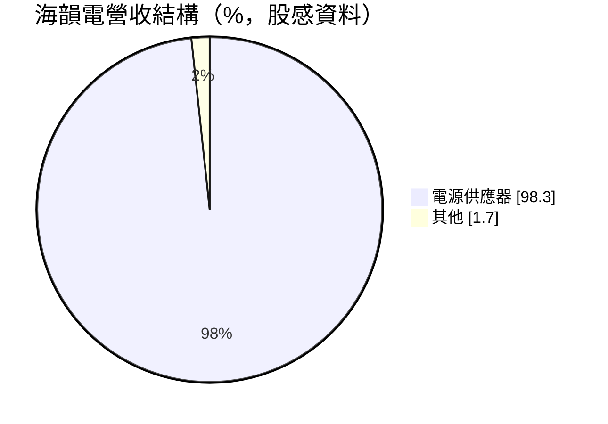
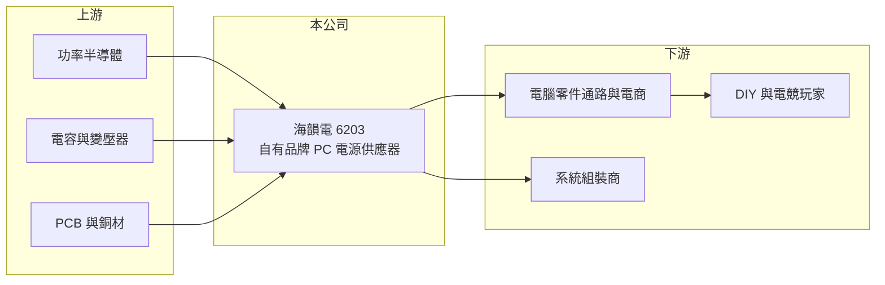

# 6203 海韻電

> 上櫃｜[[產業索引-電子零組件業|電子零組件業]]｜上市（櫃）日期 2002/12/26

# 第一章：企業模式與商業藍圖

> [!info] 撰寫說明
> 精簡版，由 Claude 依公開資料整理，架構比照 [[2330台積電]]，資料截至 2026-10-08。來源：櫃買中心開放資料快照（基本資料、2026 年第二季資產負債與損益、每月營收、本益比殖利率）、Goodinfo 經營績效頁、股感（StockFeel）個股財務頁、科技新報月營收報導。品牌定位、通路與生產據點以 Claude 既有認知整理，公開資料有限。#待校對

海韻電子工業（以下簡稱海韻電）是一家專做[[交換式電源供應器]]的公司，總部位於台北內湖，2002 年在櫃買中心掛牌。理解海韻電的關鍵在於：它是少數以自有品牌 Seasonic 在全球 DIY 電腦市場經營的台灣電源廠（#待校對），營收高度集中在單一產品，因此業績隨電競與 PC 組裝市場起伏很大。

- **核心業務：** 海韻電成立於 1975 年，是台灣歷史最久的電源廠之一。依股感資料，電源供應器占營收 98.3%，其他業務僅 1.7%。[[電源供應器]]負責把插座的交流電轉換成電腦各零件需要的穩定直流電，品質好壞直接影響整台電腦的穩定度與壽命，高階玩家願意為高效率、低噪音與長保固付出溢價。
- **營收結構：** 產品以桌上型電腦用電源為主，銷售對象是 DIY 玩家、電競族群與系統組裝商（#待校對）。地區別與通路別比重公開資料未查得。營收在 2021 年達 50.2 億元高峰，2022 年腰斬至 25.5 億元，2024 年再降到 20.2 億元，顯示需求受 PC 週期與挖礦熱潮等一次性因素影響很大（推估）。
- **營運據點：** 總部在台北內湖。生產工廠所在地公開資料未查得，一般認知海韻在中國大陸設有製造據點（#待校對）。2026 年第二季總資產約 38.6 億元，其中非流動資產僅約 4.3 億元，屬輕資產結構。
- **長期方向：** 電腦電源的技術演進方向是更高轉換效率、更高功率與更小體積，新一代顯示卡耗電大增，帶動高瓦數電源需求。海韻電的長期課題是在品牌溢價之外，找到 PC 以外的第二成長來源，以降低單一市場的波動。

# 第二章：護城河深度與競爭優勢

海韻電的護城河主要來自品牌口碑與長期累積的電源設計經驗。

- **競爭優勢：** 電源供應器出問題可能燒毀整台電腦，因此高階玩家重視品牌信譽與保固。海韻電 2019 至 2025 年毛利率大多維持在 30% 以上，遠高於一般代工電源廠，反映自有品牌帶來的定價能力。公司幾乎沒有長期負債，現金部位充足，能撐過需求低迷期。
- **主要對手：** 台灣電源同業有 [[2308台達電]]、[[2301光寶科]]、[[3015全漢]]、[[6282康舒]]、[[6412群電]]、[[2457飛宏]]，DIY 零售市場則與海盜船（Corsair）、[[2377微星]]、[[2357華碩]]等品牌直接競爭（#待校對）。海韻電規模遠小於這些大廠，必須靠專注與品質維持定位。
- **觀察重點：** 長期最值得追蹤的是毛利率能否守住三成，以及營收能否擺脫大起大落。2024 年毛利率一度降到 25.3%、營業利益率僅 5.1%，代表需求不振時品牌溢價也會被壓縮。

# 第三章：財務體質與盈利規模

資料日期：2026-10-08，表格是撰寫當時的快照；最新月營收、毛利率、累計 EPS 由自動排程寫在本筆記的屬性欄位（月營收、毛利率、累計EPS 等）。#待校對

海韻電的財務呈現「高毛利、低負債、營收波動大」的樣貌：每一年都賺錢，但獲利高低差距可達兩倍以上。

| 年度 | 營收（億元） | [[毛利率]] | [[營業利益率]] | EPS（元） | [[ROE]] |
|---|---|---|---|---|---|
| 2021 | 50.2 | 29.7% | 20.2% | 9.42 | 31.9% |
| 2022 | 25.5 | 30.4% | 16.8% | 5.63 | 17.2% |
| 2023 | 33.3 | 34.2% | 22.8% | 7.58 | 21.6% |
| 2024 | 20.2 | 25.3% | 5.1% | 3.50 | 9.6% |
| 2025 | 27.7 | 34.7% | 20.6% | 5.51 | 15.0% |

（來源：Goodinfo 經營績效頁；2019 年營收 22.4 億元、EPS 3.70 元，2020 年營收 38.9 億元、EPS 7.64 元。）

- **營收規模：** 2020 至 2025 年營收由 38.9 億元降至 27.7 億元，年複合成長率約 -6.6%（推算）；若以 2019 年 22.4 億元為基期則為正成長，顯示選擇的起訖年對結論影響很大，本質上是週期性波動而非趨勢。2026 年前八月累計營收約 13.2 億元，年減約 30%（官方月營收資料）。
- **獲利：** 近五年（2021 至 2025）平均 ROE 約 19.1%（推算），即使在 2024 年低谷也有近一成。2026 年上半年營收約 10.1 億元、毛利率約 30.2%、營業利益率約 11.1%、EPS 1.89 元，其中業外收益約 1.0 億元，與本業獲利相當。
- **財務特色：** 2026 年第二季權益約 29.4 億元、負債約 9.2 億元，負債比僅約 24%，非流動負債只有約 0.26 億元，幾乎沒有長期借款。每股淨值約 35.7 元。現金股利近三年分別為 5 元、3.5 元與 4 元（股感資料），2025 年度配發 4 元、EPS 5.51 元，配息率約七成（推算），配息政策穩定。
- **[[ROIC]] 與 [[WACC]]：** 2025 年營業利益約 5.7 億元（27.7 億元 × 20.6%），稅後約 4.6 億元。以 2026 年第二季權益 29.4 億元到「權益加全部負債」38.6 億元為投入資本區間，ROIC 約 11.8% 至 15.5%（推算）；若扣除帳上大量流動資產，實際營運資本報酬應更高。WACC 以 [[CAPM]] 推估：無風險利率 1.75%、市場風險溢酬 6%、β 假設 0.9，權益成本約 7.15%；公司幾乎無有息負債，WACC 約 7%（推算）。ROIC 高於 WACC，即使在 2024 年低谷 ROIC 也大致與 WACC 打平，代表海韻電長期仍在創造價值。

# 第四章：總體風險與地緣政治

海韻電的風險集中在單一產品、單一市場的需求波動。

- **產業週期：** DIY 電腦市場受新一代 CPU 與顯示卡推出、電競熱潮、挖礦等因素帶動，需求容易暴起暴落，經過通路庫存調整後更會被[[長鞭效應]]放大。2021 至 2024 年營收從 50 億元跌到 20 億元，就是這種週期的典型。
- **營運風險：** 電源供應器占營收近百分之百，缺乏其他產品分散風險。若品牌形象受損（例如產品召回），或主要通路商調整採購，對營收影響會很直接。
- **其他風險：** 主要零件為功率半導體、電容、變壓器與銅材，原料與晶片價格上漲會壓縮毛利；營收以外銷為主（推估），美元兌新台幣匯率與美國關稅政策都會影響獲利。業外收益占比偏高的年度，本業獲利可能被高估。

# 專有名詞解析

## 金融

- **[[CAPM]]**：資本資產定價模型，以無風險利率加上 β 乘以市場風險溢酬，估算股東要求的報酬率。
- **[[長鞭效應]]**：終端需求的小幅變動，沿供應鏈往上游傳遞時被逐級放大，造成上游庫存與訂單劇烈波動。

## 產業

- **[[交換式電源供應器]]**：以高頻開關切換方式轉換電壓的電源，體積小、效率高，是電腦與伺服器電源的主流。
- **[[電源供應器]]**：把市電轉換成電子設備所需穩定直流電的裝置。
- **[[功率半導體]]**：負責電能轉換與開關控制的半導體元件，例如 MOSFET、IGBT。

# 核心供應鏈

- 上游：功率半導體、電解電容（例如 [[2472立隆電]]，屬推估）、變壓器與磁性元件、[[PCB]]、散熱風扇（具體供應商未查得，#待校對）。
- 下游／客戶：全球電腦零件通路商、電商平台、系統組裝商與 DIY 玩家（具體客戶未查得）。
- 同業：[[2308台達電]]、[[2301光寶科]]、[[3015全漢]]、[[6282康舒]]、[[6412群電]]、[[2457飛宏]]，以及海盜船等 PC 零組件品牌。

## 最新新聞
<!-- news:start -->
<!-- news:end -->

## 相關連結
- [公開資訊觀測站](https://mopsov.twse.com.tw/mops/web/t05st03?step=1&firstin=1&co_id=6203)
- [Goodinfo](https://goodinfo.tw/tw/StockDetail.asp?STOCK_ID=6203)
- [Yahoo 股市](https://tw.stock.yahoo.com/quote/6203)
- [鉅亨網新聞](https://www.cnyes.com/twstock/6203/news)
