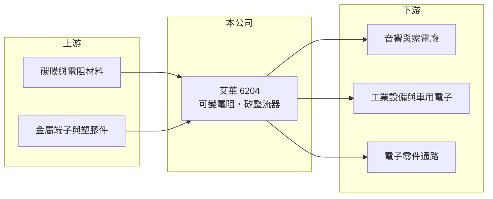

# 6204 艾華

> 上櫃｜[[產業索引-電子零組件業|電子零組件業]]｜上市（櫃）日期 2002/11/13

# 第一章：企業模式與商業藍圖

> [!info] 撰寫說明
> 精簡版，由 Claude 依公開資料整理，架構比照 [[2330台積電]]，資料截至 2026-10-08。來源：櫃買中心開放資料快照（基本資料、2026 年第二季資產負債與損益、每月營收、本益比殖利率）、Goodinfo 經營績效頁、nStock 公司簡介。公開資料有限，產品別營收比重、應用市場、客戶與生產據點未查得；2021 與 2023 年高 EPS 的原因為推估。#待校對

台灣艾華電子工業（以下簡稱艾華）是一家生產[[可變電阻]]的老牌[[被動元件]]廠，總部位於桃園市，2002 年在櫃買中心掛牌。理解艾華的關鍵在於：它的本業規模很小，年營收不到 4 億元，但歷史悠久、利基明確；歷年 EPS 的大起大落多半來自業外收益，而非本業變化。

- **核心業務：** 艾華成立於 1970 年，是台灣最早的電子零件廠之一。依公司登記資料，主要產品為可變電阻與交換式矽整流器，並從事相關原料與產品的製造、加工與外銷。可變電阻是可以用旋鈕或滑桿調整電阻值的元件，常見於音響音量旋鈕、家電控制面板、工業設備與車用控制裝置。
- **營收結構：** 產品別、應用別與地區別營收比重公開資料未查得。市場報導稱艾華為全球可變電阻市場的主要供應商之一（#待校對）。可變電阻屬於成熟產品，單價低但品項多，客戶需要長期穩定供貨。
- **營運據點：** 公司登記地址為桃園市中正路，2026 年第二季總資產僅約 5.2 億元，其中非流動資產約 2.0 億元。生產工廠所在地公開資料未查得，傳統被動元件廠多在中國大陸或東南亞設廠生產（推估，#待校對）。
- **長期方向：** 可變電阻的長期需求面臨數位化取代的壓力，例如觸控面板與數位編碼器逐漸取代傳統旋鈕。艾華的長期課題是把產品推向車用、工業與高可靠度應用，讓利基市場的溢價足以抵消消費性需求的衰退。

# 第二章：護城河深度與競爭優勢

艾華的護城河在於利基市場的長期經驗，但規模小、成長性有限。

- **競爭優勢：** 可變電阻品項繁多、單量小，大型被動元件廠通常不願投入，留給專業廠商生存空間。艾華的毛利率由 2019 年 25.1% 逐步提升到 2024 至 2025 年約 34%，顯示產品組合往較高價值方向調整（推估）。數十年的客戶關係與品項齊全，是小廠在利基市場延續的主要原因。
- **主要對手：** 國際上有日本阿爾卑斯阿爾派（Alps Alpine）、美國伯恩斯（Bourns）等可變電阻與感測器大廠，以及大量中國大陸中小型廠商（#待校對）。台灣被動元件大廠如 [[2327國巨]]、[[2492華新科]] 以晶片電阻與電容為主，與艾華的產品重疊不多。
- **觀察重點：** 長期最值得追蹤的是本業營業利益率能否維持在 8% 以上，以及營收能否擺脫 4 億元左右的停滯。2022 年營業利益率曾降到 1.8%，代表小規模下費用壓力明顯。

# 第三章：財務體質與盈利規模

資料日期：2026-10-08，表格是撰寫當時的快照；最新月營收、毛利率、累計 EPS 由自動排程寫在本筆記的屬性欄位（月營收、毛利率、累計EPS 等）。#待校對

艾華的財務呈現「本業穩定但規模小、業外收益主導 EPS」的樣貌：2021 與 2023 年 EPS 分別高達 12.41 元與 17.9 元，但當年營業利益率只有 9.0% 與 5.1%。

| 年度 | 營收（億元） | [[毛利率]] | [[營業利益率]] | EPS（元） | [[ROE]] |
|---|---|---|---|---|---|
| 2021 | 6.23 | 27.8% | 9.0% | 12.41 | 47.2% |
| 2022 | 3.92 | 26.9% | 1.8% | 0.92 | 5.4% |
| 2023 | 3.78 | 33.3% | 5.1% | 17.9 | 129% |
| 2024 | 3.86 | 34.1% | 8.2% | 1.48 | 10.3% |
| 2025 | 3.87 | 34.4% | 8.5% | 1.18 | 7.8% |

（來源：Goodinfo 經營績效頁；2020 年營收 4.64 億元、EPS 1.41 元。2021 與 2023 年業外收益遠大於營業利益，推估來自處分資產或投資的一次性收益，原因待校對。）

- **營收規模：** 2020 至 2025 年營收由 4.64 億元降至 3.87 億元，年複合成長率約 -3.6%（推算）。2021 年營收 6.23 億元是例外高點，之後回到 4 億元以下。2026 年前八月累計營收約 2.88 億元，年增約 7.8%（官方月營收資料）。
- **獲利：** 近五年平均 ROE 帳面上約 40%，但被 2021 與 2023 年的一次性收益嚴重扭曲；排除這兩年，2022、2024、2025 年 ROE 約在 5% 至 10% 之間，較能代表本業水準（推算）。2026 年上半年營收約 2.07 億元、毛利率約 33.7%、營業利益率約 7.9%、EPS 0.48 元。
- **財務特色：** 2026 年第二季權益約 3.6 億元、負債約 1.6 億元，負債比約 31%。股本僅 2.31 億元，每股淨值約 15.6 元。2026 年配發現金股利 0.5 元（櫃買中心資料）。股本小、股數少，使得任何業外收益都會讓 EPS 大幅跳動。
- **[[ROIC]] 與 [[WACC]]：** 2025 年營業利益約 0.33 億元（3.87 億元 × 8.5%），稅後約 0.26 億元。以 2026 年第二季權益 3.6 億元到「權益加全部負債」5.2 億元為投入資本區間，ROIC 約 5.0% 至 7.3%（推算）。WACC 以 [[CAPM]] 推估：無風險利率 1.75%、市場風險溢酬 6%、β 假設 0.9，權益成本約 7.15%；稅後負債成本 2%、有息負債占資本約一成，WACC 約 6.6%（推算）。ROIC 與 WACC 大致相當，代表艾華本業大約只賺回資金成本，長期價值創造有限，股東報酬較依賴資產處分等一次性事件。

# 第四章：總體風險與地緣政治

艾華的風險集中在規模過小、產品被數位化取代，以及獲利來源的不穩定。

- **產業週期：** 被動元件需求跟隨家電、消費電子與工業設備景氣起伏，下游庫存調整時會透過[[長鞭效應]]放大成訂單波動。2022 年營收由 6.2 億元跌到 3.9 億元，就是這種調整的結果。
- **營運風險：** 營收規模不到 4 億元，固定費用占比高，營收小幅下滑就可能讓營業利益大幅縮水。可變電阻屬成熟產品，若下游改用數位控制介面，需求會長期萎縮。EPS 受業外一次性收益影響大，投資人容易誤判本業獲利能力。
- **其他風險：** 主要原料包括碳膜、金屬端子與塑膠件，原料價格波動影響成本；外銷比重高時（推估），匯率與關稅政策會影響獲利。中國大陸同業價格競爭激烈，也限制了提價空間。

# 專有名詞解析

## 金融

- **[[業外收入]]**：本業以外的收益，例如處分資產、投資收益與匯兌收益，通常不具持續性。
- **[[CAPM]]**：資本資產定價模型，以無風險利率加上 β 乘以市場風險溢酬，估算股東要求的報酬率。
- **[[長鞭效應]]**：終端需求的小幅變動，沿供應鏈往上游傳遞時被逐級放大，造成上游庫存與訂單劇烈波動。

## 產業

- **[[可變電阻]]**：可以用旋鈕或滑桿調整電阻值的元件，常見於音量控制、家電面板與工業設備。
- **[[被動元件]]**：不需外加電源即可運作的電子零件，主要包括電阻、電容與電感。

# 核心供應鏈

- 上游：碳膜與電阻材料、金屬端子、塑膠射出件（具體供應商未查得）。
- 下游／客戶：音響、家電、工業設備與車用電子製造商，以及電子零件通路商（具體客戶公開資料未查得，#待校對）。
- 同業：阿爾卑斯阿爾派、伯恩斯，以及台灣被動元件廠 [[2327國巨]]、[[2492華新科]]（產品重疊有限）。

## 最新新聞
<!-- news:start -->
<!-- news:end -->

## 相關連結
- [公開資訊觀測站](https://mopsov.twse.com.tw/mops/web/t05st03?step=1&firstin=1&co_id=6204)
- [Goodinfo](https://goodinfo.tw/tw/StockDetail.asp?STOCK_ID=6204)
- [Yahoo 股市](https://tw.stock.yahoo.com/quote/6204)
- [鉅亨網新聞](https://www.cnyes.com/twstock/6204/news)
