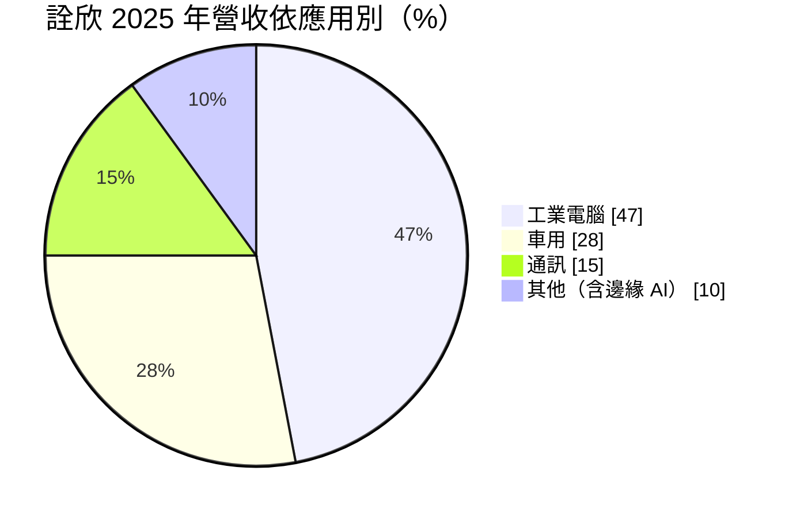
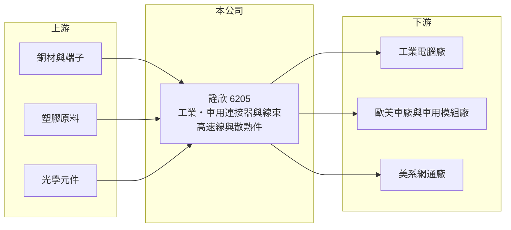

# 6205 詮欣

> 上市｜[[產業索引-電子零組件業|電子零組件業]]｜上市（櫃）日期 2008/01/21

# 第一章：企業模式與商業藍圖

> [!info] 撰寫說明
> 精簡版，由 Claude 依公開資料整理，架構比照 [[2330台積電]]，資料截至 2026-10-08。來源：證交所開放資料快照（基本資料、2026 年第二季資產負債與損益、營益分析、股利、每月營收）、Goodinfo 經營績效頁、富果研究 2026 年 8 月 12 日法說會摘要（AI 整理稿）。法說會內容未比對原始簡報。#待校對

詮欣股份有限公司（以下簡稱詮欣）是一家生產[[連接器]]與[[線束]]的電子零組件廠，總部位於新北市汐止，2008 年在證交所上市。理解詮欣的關鍵在於：它不追求消費電子的大量訂單，而是專攻[[工業電腦]]、車用與通訊這類少量多樣、認證期長的市場，因此毛利率長期接近四成。

- **核心業務：** 詮欣成立於 1986 年，產品涵蓋工業用 I/O 模組連接器、Type-C、記憶卡、M12、D-Sub 等連接器，以及車用天線放大器、Type-C 充電與攝影機連接器。近年延伸到 800G 以上的 QSFP-DD、OSFP 高速傳輸線與 MPO 光纖跳線，以及均溫板、熱管、冷板等[[液冷散熱]]產品。
- **營收結構：** 依法說會摘要，2025 年工業電腦約占 47%、車用 28%、通訊 15%；2026 年上半年車用升到 33%、工業電腦降到 41%、通訊 17%。公司目標 2027 年車用占比超過四成。工業客戶包括西門子與台灣工業電腦廠 [[2395研華]]、[[6166凌華]]；車用客戶約 80 家，摘要點名寶馬、賓士、奧迪、保時捷與特斯拉等歐美車廠（#待校對）。
- **營運據點：** 生產基地在台灣汐止與中國廣東東莞。公司已在泰國取得土地，但因客戶需求與關稅變化暫緩建廠，必要時可快速啟動，以滿足「非中非台」供應需求。2026 年第二季總資產約 39.5 億元。
- **長期方向：** 詮欣正在開發 XPO、NPO、[[CPO]] 等光學互連產品，目標是整合光學、散熱、訊號與電源的高速模組。長期成長動能來自歐洲車廠的座艙與攝影機連接器，以及美系網通客戶的 800G 以上高速線，公司目標是營收維持雙位數成長、毛利率在 2027 年回到四成以上。

# 第二章：護城河深度與競爭優勢

詮欣的護城河來自工業與車用客戶的長期認證，以及少量多樣的生產彈性。

- **競爭優勢：** 工業電腦與車用連接器需要通過嚴格的可靠度測試，車用更需要 VDA 6.3 等製程稽核，摘要提到 80 家車用客戶中有 17 家完成此類認證。客戶導入後通常沿用多年，轉換成本高。2024 年毛利率達 41.7%，在連接器業中屬於高水準，反映利基市場的定價能力。
- **主要對手：** 台灣同業包括 [[3533嘉澤]]、[[3023信邦]]、[[6290良維]]、[[3665貿聯-KY]]、[[3526凡甲]]，國際上有安費諾、莫仕、泰科電子（TE Connectivity）等大廠。詮欣規模小很多，靠專注特定應用與客製化服務取得空間。
- **觀察重點：** 長期最該追蹤的是營業利益率能否回到 2022 年 17% 的水準。2025 年毛利率仍有 39.9%，但營業利益率只有 12.2%，2026 年上半年更降到 9.2%，代表營收規模不足以攤提研發與管理費用。

# 第三章：財務體質與盈利規模

資料日期：2026-10-08，表格是撰寫當時的快照；最新月營收、毛利率、累計 EPS 由自動排程寫在本筆記的屬性欄位（月營收、毛利率、累計EPS 等）。#待校對

詮欣的財務呈現「高毛利、穩定配息、營收成長停滯」的樣貌：毛利率逐年墊高，但營收在 13 億至 19 億元之間徘徊。

| 年度 | 營收（億元） | [[毛利率]] | [[營業利益率]] | EPS（元） | [[ROE]] |
|---|---|---|---|---|---|
| 2021 | 16.0 | 29.3% | 10.8% | 2.02 | 7.0% |
| 2022 | 18.7 | 36.2% | 17.3% | 4.06 | 13.5% |
| 2023 | 13.8 | 37.6% | 12.8% | 2.10 | 6.9% |
| 2024 | 14.1 | 41.7% | 11.2% | 2.65 | 8.4% |
| 2025 | 13.6 | 39.9% | 12.2% | 2.00 | 6.2% |

（來源：Goodinfo 經營績效頁；2020 年營收 13.3 億元、EPS 2.01 元。）

- **營收規模：** 2020 至 2025 年營收由 13.3 億元到 13.6 億元，年複合成長率約 0.4%（推算），基本上原地踏步。2026 年前八月累計營收約 9.17 億元，年減約 3.7%（官方月營收資料）。
- **獲利：** 近五年平均 ROE 約 8.4%（推算），2022 年最高 13.5%。2026 年上半年營收約 6.66 億元、毛利率約 37.5%、營業利益率約 9.2%、EPS 1.16 元，其中業外收益約 0.51 億元，接近本業營業利益的八成。
- **財務特色：** 2026 年第二季權益約 26.3 億元、負債約 13.1 億元，負債比約 33%，每股淨值約 32.5 元，持有庫藏股 150 萬股。依法說會摘要，公司已連續 27 年配發股利；2025 年稅後淨利約 1.62 億元，配發現金股利 1.5 元，配息率約 75%。
- **[[ROIC]] 與 [[WACC]]：** 2025 年營業利益約 1.66 億元（13.6 億元 × 12.2%），稅後約 1.33 億元。以 2026 年第二季權益 26.3 億元到「權益加全部負債」39.5 億元為投入資本區間，ROIC 約 3.4% 至 5.0%（推算）。WACC 以 [[CAPM]] 推估：無風險利率 1.75%、市場風險溢酬 6%、β 假設 0.9，權益成本約 7.15%；稅後負債成本 2%、有息負債占資本約兩成五，WACC 約 5.9%（推算）。ROIC 低於 WACC，主因是帳上資產遠大於本業所需（推估含大量金融資產與閒置土地），本業高毛利並未轉化為高資本報酬；若車用放量讓營收突破 20 億元，利差才有機會轉正。

# 第四章：總體風險與地緣政治

詮欣的風險集中在營收規模停滯、車用與工業景氣，以及供應鏈移轉。

- **產業週期：** 工業電腦與車用都是景氣循環產業，客戶在需求轉弱時會先去化庫存，透過[[長鞭效應]]放大成連接器訂單的波動。2023 年營收由 18.7 億元降到 13.8 億元，就是工業電腦庫存調整的結果（推估）。
- **營運風險：** 營收規模小，費用彈性有限，毛利率高但營業利益率被固定費用侵蝕。車用新產品從設計導入到量產常需兩年以上，若歐洲車廠電動化進度放緩，成長會延後。光學與高速產品的技術門檻高，需要持續投資研發。
- **其他風險：** 主要生產在中國東莞，美國關稅與客戶要求「非中國產能」的壓力可能迫使公司啟動泰國建廠，增加資本支出。銅價波動與新台幣匯率也會影響毛利。

# 專有名詞解析

## 半導體

- **[[CPO]]**：共同封裝光學，把光學收發元件與交換器晶片封裝在一起，以降低高速傳輸的耗電。

## 金融

- **[[CAPM]]**：資本資產定價模型，以無風險利率加上 β 乘以市場風險溢酬，估算股東要求的報酬率。

## 產業

- **[[連接器]]**：讓電路之間可插拔連接的零件，負責傳遞訊號或電力。
- **[[線束]]**：把多條電線、端子與連接器組合成一組的配線組件，廣泛用於汽車與工業設備。
- **[[工業電腦]]**：用於工廠自動化、交通、醫療等場域的電腦，強調耐用、長期供貨與客製化。
- **[[液冷散熱]]**：以液體帶走熱量的散熱方式，用於高功耗的 AI 伺服器與晶片。

# 核心供應鏈

- 上游：銅材與端子、塑膠原料、光學元件（具體供應商未查得）。
- 下游／客戶：工業電腦廠 [[2395研華]]、[[6166凌華]] 與西門子；歐美車廠寶馬、賓士、奧迪、保時捷、特斯拉（依法說會摘要，#待校對）；美系網通大廠。
- 同業：[[3533嘉澤]]、[[3023信邦]]、[[6290良維]]、[[3665貿聯-KY]]、[[3526凡甲]]，以及安費諾、莫仕、泰科電子。

## 最新新聞
<!-- news:start -->
<!-- news:end -->

## 相關連結
- [公開資訊觀測站](https://mopsov.twse.com.tw/mops/web/t05st03?step=1&firstin=1&co_id=6205)
- [Goodinfo](https://goodinfo.tw/tw/StockDetail.asp?STOCK_ID=6205)
- [Yahoo 股市](https://tw.stock.yahoo.com/quote/6205)
- [鉅亨網新聞](https://www.cnyes.com/twstock/6205/news)
