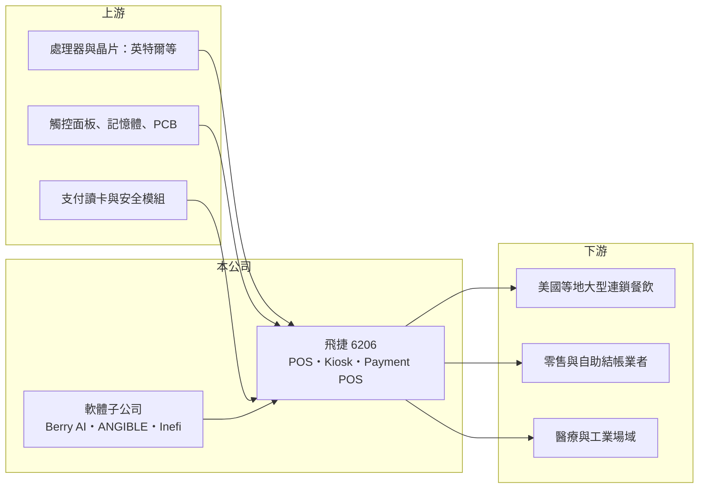

# 6206 飛捷

> 上市｜[[產業索引-電腦及週邊設備業|電腦及週邊設備業]]｜上市（櫃）日期 2004/08/03

# 第一章：企業模式與商業藍圖

> [!info] 撰寫說明
> 精簡版，由 Claude 依公開資料整理，架構比照 [[2330台積電]]，資料截至 2026-10-08。來源：證交所開放資料快照（基本資料、2026 年第二季資產負債與損益、股利）、Goodinfo 經營績效頁、富果 2026 年 8 月法說會備忘錄、自由時報與優分析新聞標題。客戶名稱與生產據點部分依記憶整理，已標註待校對。#待校對

飛捷是台灣的[[POS]]（銷售時點系統）設備廠，理解它的關鍵在於：它替大型連鎖餐飲與零售業者設計專用的收銀與自助點餐設備，客戶一旦在數千家門市導入，就會在汰換週期內持續採購，飛捷再以支付與 AI 軟體把一次性的硬體生意延伸成長期關係。

- **核心業務：** 飛捷成立於 1984 年，2004 年在證交所上市，總部位於台北內湖。公司專注於硬體設計與製造，深耕餐飲、零售、醫療、工控四大垂直領域，以餐飲零售為主。產品包括 POS 主機、[[自助服務機]]（Kiosk）、具刷卡與感應功能的 Payment POS 與手持裝置，以及醫療與工業級平板電腦。2026 年上半年具支付功能的產品已占 POS 產品線一成以上，全年目標 10% 至 20%。
- **營收結構：** 法說會未揭露產品別與地區別比重。公司表示客戶以大型連鎖品牌為主，對價格的耐受度較高；依過往報導，北美是最大市場（#待校對）。2026 年第一季公司取得美國億元級新客戶（自由時報標題），上半年營收 33.9 億元、年增 25%。
- **營運據點：** 生產據點在本次查得資料中未揭露，推估以台灣與中國為主（#待校對）；上海、香港與英國子公司為獲利子公司。
- **長期方向：** 飛捷的長期策略是提高每位客戶的貢獻（ARPU），從賣單台 POS 擴展到廚房系統與支付整合，並發展三家軟體子公司：Berry AI（速食餐廳 AI 影像辨識，2025 年營收破億元）、ANGIBLE（零售自助結帳 AI 防損）與 Inefi（端點管理平台），以月租訂閱建立[[經常性收入]]。公司提出 2027 年軟體營收占比達一成的目標。

# 第二章：護城河深度與競爭優勢

飛捷的護城河來自大型連鎖客戶的導入門檻與客製化設計能力，近年再加上支付認證與軟體服務，屬於利基型的中等偏強護城河，這從 40% 以上的毛利率可以看出。

- **競爭優勢：** 大型連鎖品牌導入 POS 需要配合門市系統、支付規範與軟體平台進行測試，一旦完成就會在數千家門市大量部署，並在五到七年的汰換週期內持續向同一家供應商採購，[[轉換成本]]高。支付終端還需通過 PCI 等支付安全認證（#待校對），進一步提高新進者門檻。軟體子公司讓飛捷能提供硬體加 AI 的整套方案，例如 Berry AI 的 AI Box 由飛捷製造，硬體與軟體互相帶動。
- **主要對手：** 國際 POS 大廠包括美國 NCR Voyix、日本東芝 Global Commerce Solutions 等（#待校對）；台灣同業有 8114振樺電（POS 與工業電腦）、[[3594磐儀]]，以及工業電腦廠 [[2395研華]] 的零售方案。支付終端方面，Verifone、Ingenico 等專業支付設備商也是潛在競爭者（#待校對）。
- **觀察重點：** 毛利率由 2020 年 34.8% 升到 2025 年 44.1%，顯示產品組合往支付與高階機種移動。長期要追蹤的是軟體營收占比能否如期達到一成，以及支付產品滲透率能否持續提升，因為這兩者決定飛捷能否擺脫硬體汰換週期的大起大落。

# 第三章：財務體質與盈利規模

資料日期：2026-10-08，表格是撰寫當時的快照；最新月營收、毛利率、累計 EPS 由自動排程寫在本筆記的屬性欄位（月營收、毛利率、累計EPS 等）。#待校對

飛捷的財務是高毛利、高配息、零負債型的設備公司，ROE 長期在一成五到兩成，但營收會隨大客戶的汰換週期明顯起伏。

| 年度 | 營收（億元） | [[毛利率]] | [[營業利益率]] | EPS（元） | [[ROE]] |
|---|---|---|---|---|---|
| 2020 | 44.3 | 34.8% | 15.8% | 4.12 | 12.8% |
| 2021 | 51.9 | 32.9% | 15.8% | 4.77 | 14.8% |
| 2022 | 55.4 | 35.8% | 20.0% | 7.29 | 20.9% |
| 2023 | 34.9 | 38.7% | 16.0% | 3.51 | 9.74% |
| 2024 | 46.1 | 43.6% | 23.3% | 6.93 | 19.5% |
| 2025 | 50.3 | 44.1% | 25.1% | 6.90 | 18.6% |

（來源：Goodinfo 經營績效頁。2026 年上半年依證交所資料：營收 33.9 億元、毛利率 45.5%、營業利益率 29.7%、EPS 5.93 元。）

- **營收規模：** 2020 至 2025 年營收由 44.3 億元增至 50.3 億元，年複合成長率約 2.6%（推算），但中間 2023 年曾因大客戶拉貨告一段落而年減三成多，顯示營收受少數大客戶專案影響很大。2026 年上半年營收已達 2025 年全年的三分之二，若延續將創新高。
- **獲利：** 近五年（2021 至 2025）平均 ROE 約 16.7%（推算）。營業利益率由 2020 年 15.8% 升到 2025 年 25.1%，2026 年上半年更達 29.7%，代表支付產品與軟體帶來的組合改善，以及營收放大後的[[營業槓桿]]。
- **財務特色：** 依 2026 年第二季資料，總資產約 75.4 億元、股東權益約 53.1 億元、負債約 22.3 億元且幾乎全為流動負債（非流動負債僅 0.2 億元），推估沒有長期借款，財務非常保守。2025 年度每股配發現金股利 5.5 元，以 EPS 6.90 元計[[配息率]]約 80%（推算）；公司章程規定分配數不低於可分配盈餘的 60%，Goodinfo 統計長期平均現金股利約 3.91 元，配息穩定且持續提高。高配息加上零負債，推估自由現金流長期為正（未查得現金流量表數字）。
- **[[ROIC]] 與 [[WACC]]：** 以 2025 年營業利益約 12.6 億元（50.3 億元 × 25.1%）、稅率 20% 計算，稅後營業利益約 10.1 億元。有息負債推估接近零，投入資本以股東權益 53.1 億元計，ROIC 約 19%（推算）；若改以「權益加全部負債」75.4 億元計約 13.4%。由於帳上有大量現金（流動資產 61.0 億元），扣除現金後的營業資本報酬應遠高於此（推估）。WACC 以 [[CAPM]] 推估：無風險利率 1.75%、市場風險溢酬 6%、β 假設 0.9（同業常見值），權益成本約 7.15%；幾乎無負債，WACC 約 7.2%（推算）。ROIC 明顯高於 WACC，飛捷長期持續創造經濟價值。

# 第四章：總體風險與地緣政治

飛捷的風險來自客戶集中、汰換週期與零售餐飲景氣。

- **產業週期：** POS 設備是連鎖業者的資本支出，通常隨新店展店與舊機汰換週期進行，大客戶完成一輪換機後，訂單可能大幅減少，2023 年營收年減三成就是例子。零售與餐飲景氣轉弱時，連鎖業者也會延後設備投資。
- **營運風險：** 營收集中在少數大型連鎖客戶，單一客戶的決策變化就能左右全年業績。軟體子公司仍在投資期，若訂閱客戶成長不如預期，可能拖累獲利。記憶體與面板等零件漲價或缺料，會影響交期與毛利。
- **其他風險：** 北美比重高（#待校對），美國關稅與產地規定可能影響成本與報價。營收以美元計價，新台幣升值會壓縮毛利。支付設備需符合各國支付安全規範，規範改版時須重新認證。

# 專有名詞解析

## 應用

- **[[POS]]**：銷售時點系統，零售與餐飲門市用來結帳、記錄銷售與管理庫存的收銀設備與軟體。
- **[[自助服務機]]**：Kiosk，讓消費者自行點餐、結帳或查詢的觸控終端機，可降低門市人力需求。

## 金融

- **[[經常性收入]]**：以訂閱或月租等方式按期收取的收入，可預測性高，市場通常給予較高評價。
- **[[轉換成本]]**：客戶更換供應商需付出的時間、驗證與風險成本，越高代表既有供應商的地位越穩固。
- **[[營業槓桿]]**：固定成本占比高的公司，營收增加時利潤增幅大於營收增幅，反之亦然。

# 核心供應鏈

- 上游：處理器供應商 [[INTC英特爾]] 等；觸控面板、記憶體、PCB 與支付讀卡模組供應商。
- 下游／客戶：大型連鎖速食與餐飲品牌（依富果相關文章，Berry AI 客戶包括美國 Zaxby's、Culver's）、零售通路與自助結帳業者，以及醫療與工業用戶。
- 同業：8114振樺電、[[3594磐儀]]、[[2395研華]]；國際 POS 與支付設備商 NCR Voyix、東芝、Verifone 等（#待校對）。

## 最新新聞
<!-- news:start（自動產生，請勿手動編輯此範圍） -->
- 2026-10-09 📰 媒體 00:08｜飛捷9月、Q3營收創同期高 前三季營收超越去年全年｜[鉅亨網](https://news.cnyes.com/news/id/6625848)
- 2026-10-09 📰 媒體 00:08｜飛捷9月、Q3營收創同期高 前三季超越去年全年｜[鉅亨網](https://news.cnyes.com/news/id/6625848)

完整紀錄：[[6206飛捷 新聞]]
<!-- news:end -->

## 相關連結
- [公開資訊觀測站](https://mopsov.twse.com.tw/mops/web/t05st03?step=1&firstin=1&co_id=6206)
- [Goodinfo](https://goodinfo.tw/tw/StockDetail.asp?STOCK_ID=6206)
- [Yahoo 股市](https://tw.stock.yahoo.com/quote/6206)
- [鉅亨網新聞](https://www.cnyes.com/twstock/6206/news)
