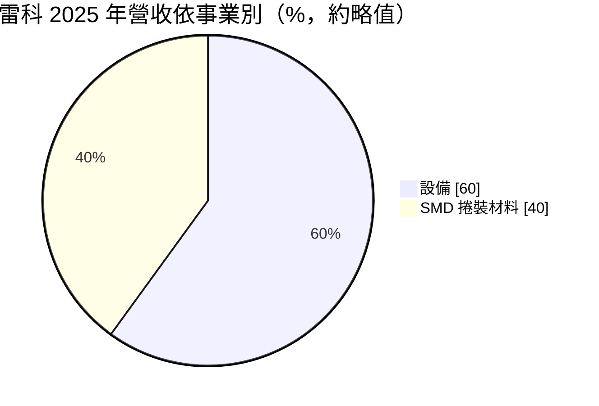
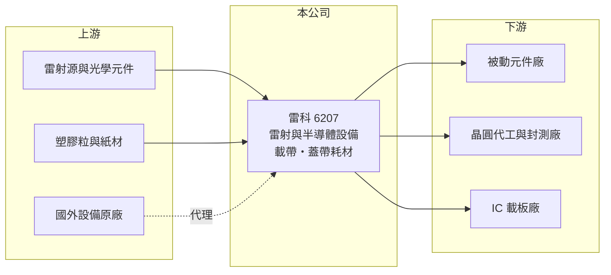

# 6207 雷科

> 上櫃｜[[產業索引-電子零組件業|電子零組件業]]｜上市（櫃）日期 2002/12/23

# 第一章：企業模式與商業藍圖

> [!info] 撰寫說明
> 精簡版，由 Claude 依公開資料整理，架構比照 [[2330台積電]]，資料截至 2026-10-08。來源：櫃買中心開放資料快照（基本資料、2026 年第二季資產負債與損益、每月營收、本益比殖利率）、Goodinfo 經營績效頁、富果研究 2025 年 12 月 23 日法說會摘要（AI 整理稿）。法說會內容未比對原始簡報；生產據點未查得。#待校對

雷科股份有限公司（以下簡稱雷科）是一家同時經營[[自動化設備]]與[[被動元件]]包裝材料的公司，總部位於高雄前鎮，2002 年在櫃買中心掛牌。理解雷科的關鍵在於：它有一個穩定但成長慢的耗材事業（載帶），加上一個成長快但波動大的設備事業，而近年設備事業正從被動元件轉向半導體先進封裝。

- **核心業務：** 雷科成立於 1988 年，以雷射加工技術起家。設備事業包括自製雷射設備，以及代理半導體檢測設備；耗材事業則生產上下蓋帶、打孔紙帶與[[載帶]]，用來包裝被動元件與半導體零件，讓[[SMT]]打件機可以自動取料。
- **營收結構：** 依法說會摘要，2025 年設備約占營收 60%、SMD 捲裝材料約 40%；依終端市場分，半導體與光電超過 53%、被動元件約 46%。設備營收中約 75% 與半導體相關，其中包括 [[CoWoS]] 檢測設備的代理業務。營收一半以上以美元計價。
- **營運據點：** 總部與主要營運在高雄前鎮，2026 年第二季總資產約 45.8 億元。各生產據點的分布公開資料未查得（#待校對）。
- **長期方向：** 雷科正把雷射技術延伸到先進封裝，包括玻璃基板鑽孔（[[TGV]]）、厚板切割與鑽孔、雷射乾式蝕刻，以及碳化矽切割與晶圓修邊設備。公司目標把自製設備占設備營收比重由 2025 年約四成提高到 2026 年五成以上，因為自製設備毛利率約四成以上，高於代理設備的 25% 至 35%。2025 年 10 月公司發行 8 億元[[可轉換公司債]]，為設備擴張籌資。

# 第二章：護城河深度與競爭優勢

雷科的護城河一半來自耗材的長期客戶關係，一半來自雷射製程的技術累積。

- **競爭優勢：** 載帶與蓋帶是被動元件廠每天消耗的耗材，品質不穩會造成打件機卡料，因此客戶重視長期穩定供貨，轉換意願低，這部分業務提供穩定現金流。設備端，雷科在雷射加工有三十多年經驗，法說會摘要稱其 TGV 設備在台灣約五家競爭者中排名第二（#待校對）。
- **主要對手：** 載帶方面有日本與中國大陸的包裝材料廠；雷射設備方面，日本三菱電機在厚板鑽孔居主導地位，台灣設備同業包括 [[6187萬潤]]、[[3131弘塑]]、[[3583辛耘]]、[[6640均華]]、[[5443均豪]]，各自專攻不同製程。
- **觀察重點：** 長期最值得追蹤的是自製半導體設備能否通過大客戶認證並量產。若 TGV 與先進封裝設備放量，雷科會從「被動元件耗材廠」轉型為「先進封裝設備廠」，毛利率與估值結構都會改變；若認證延誤，代理設備的低毛利會繼續拖累整體獲利。

# 第三章：財務體質與盈利規模

資料日期：2026-10-08，表格是撰寫當時的快照；最新月營收、毛利率、累計 EPS 由自動排程寫在本筆記的屬性欄位（月營收、毛利率、累計EPS 等）。#待校對

雷科的財務呈現「毛利率穩定、營業利益率偏低、獲利隨設備出貨波動」的樣貌：毛利率長年約三成，但營業利益率由 2021 年 13.3% 降到 2025 年 4.9%。

| 年度 | 營收（億元） | [[毛利率]] | [[營業利益率]] | EPS（元） | [[ROE]] |
|---|---|---|---|---|---|
| 2021 | 17.5 | 30.5% | 13.3% | 3.07 | 16.9% |
| 2022 | 13.9 | 32.5% | 11.9% | 1.82 | 9.2% |
| 2023 | 11.8 | 32.9% | 8.9% | 1.84 | 8.3% |
| 2024 | 13.6 | 31.5% | 8.1% | 2.07 | 8.7% |
| 2025 | 11.1 | 30.8% | 4.9% | 0.90 | 3.6% |

（來源：Goodinfo 經營績效頁；2020 年營收 12.2 億元、EPS 1.55 元。）

- **營收規模：** 2020 至 2025 年營收由 12.2 億元降至 11.1 億元，年複合成長率約 -1.9%（推算）。設備出貨認列時點不固定，使年度營收起伏較大。2026 年前八月累計營收約 8.54 億元，年增約 8.3%（官方月營收資料）。
- **獲利：** 近五年平均 ROE 約 9.3%（推算），但趨勢向下，2025 年只有 3.6%。2026 年上半年營收約 6.05 億元、毛利率約 30.9%、營業利益率約 5.7%、EPS 1.11 元，其中業外收益約 0.67 億元，大於本業營業利益 0.34 億元。
- **財務特色：** 2026 年第二季權益約 28.0 億元、負債約 17.8 億元，負債比約 39%，每股淨值約 30.2 元。上半年其他綜合損益約 1.86 億元，推估來自持有的金融資產評價上升。2025 年 10 月發行 8 億元可轉債，未來轉換將稀釋股本。
- **[[ROIC]] 與 [[WACC]]：** 2025 年營業利益約 0.54 億元（11.1 億元 × 4.87%），稅後約 0.43 億元。以 2026 年第二季權益 28.0 億元到「權益加全部負債」45.8 億元為投入資本區間，ROIC 約 0.9% 至 1.5%（推算）。WACC 以 [[CAPM]] 推估：無風險利率 1.75%、市場風險溢酬 6%、β 假設 1.2（設備股波動較大），權益成本約 8.95%；稅後負債成本 2%、有息負債（含可轉債）占資本約兩成五，WACC 約 7.2%（推算）。ROIC 遠低於 WACC，代表目前的資本投入尚未換來足夠的本業獲利；先進封裝設備若能量產，才可能讓 ROIC 回到 2021 年的水準。

# 第四章：總體風險與地緣政治

雷科的風險集中在設備認證、客戶集中與產業轉型的執行。

- **產業週期：** 被動元件與半導體都有明顯的庫存與資本支出週期，客戶擴產時設備訂單湧入，景氣反轉時訂單延後甚至取消，[[長鞭效應]]會讓設備商的營收波動遠大於終端需求。2025 年營收下滑，部分原因就是設備交機延後。
- **營運風險：** 先進封裝設備的客戶集中在少數晶圓代工與封測大廠，認證期長、規格要求高，任何延誤都會讓研發投入無法回收。代理設備毛利率較低，且代理權存在被原廠收回的風險。
- **其他風險：** 營收過半以美元計價，新台幣升值會壓縮毛利；部分設備銷往中國大陸客戶（法說會摘要提到中芯國際），美國出口管制可能限制出貨。可轉債轉換後股本增加，若獲利未同步成長，EPS 會被稀釋。

# 專有名詞解析

## 半導體

- **[[TGV]]**：玻璃通孔，在玻璃基板上以雷射等方式鑽出導通孔，是玻璃基板先進封裝的關鍵製程。
- **[[CoWoS]]**：台積電的 2.5D 先進封裝技術，把 GPU 與高頻寬記憶體並排放在中介層上，是 AI 晶片的主流封裝。

## 產業

- **[[自動化設備]]**：用於工廠自動生產、檢測或加工的機台，例如雷射加工機、檢測機與自動化產線。
- **[[被動元件]]**：不需外加電源即可運作的電子零件，主要包括電阻、電容與電感。
- **[[載帶]]**：有一格格凹槽的塑膠或紙質帶子，用來裝載電子零件，搭配蓋帶捲成盤狀供打件機自動取料。
- **[[SMT]]**：表面黏著技術，把電子零件直接焊接在電路板表面的組裝方式。

# 核心供應鏈

- 上游：雷射源與光學元件、塑膠粒與紙材、國外半導體檢測設備原廠（代理，具體廠商未查得）。
- 下游／客戶：被動元件廠（例如 [[2327國巨]]、[[2492華新科]]，屬推估，#待校對）、晶圓代工與封測廠（法說會摘要提到 [[3711日月光投控]] 與一家台灣晶圓代工大廠的先進封裝廠）、IC 載板廠。
- 同業：[[6187萬潤]]、[[3131弘塑]]、[[3583辛耘]]、[[6640均華]]、[[5443均豪]]，以及日本三菱電機（雷射鑽孔）。

## 最新新聞
<!-- news:start（自動產生，請勿手動編輯此範圍） -->
- 2026-10-20 🏛️ 重訊 17:08｜代子公司LASER TEK INTERNATIONAL CO.,LTD.依資金貸與及 背書保證處理準則第22條第1項第3款公告｜[觀測站](https://mops.twse.com.tw/mops/#/web/t05st01)

完整紀錄：[[6207雷科 新聞]]
<!-- news:end -->

## 相關連結
- [公開資訊觀測站](https://mopsov.twse.com.tw/mops/web/t05st03?step=1&firstin=1&co_id=6207)
- [Goodinfo](https://goodinfo.tw/tw/StockDetail.asp?STOCK_ID=6207)
- [Yahoo 股市](https://tw.stock.yahoo.com/quote/6207)
- [鉅亨網新聞](https://www.cnyes.com/twstock/6207/news)
