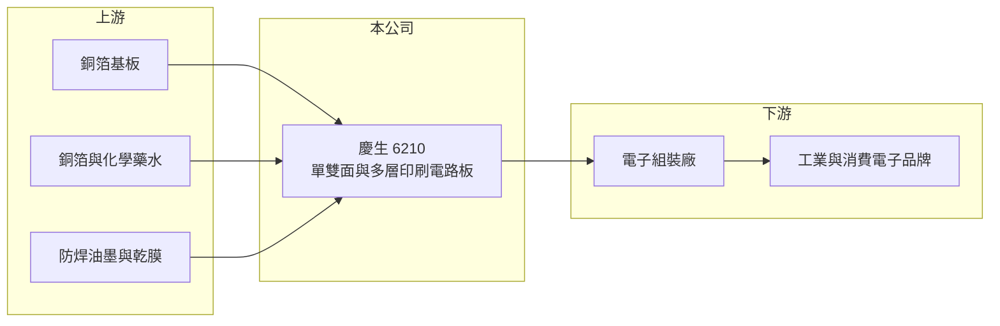

# 6210 慶生

> 上櫃｜[[產業索引-電子零組件業|電子零組件業]]｜上市（櫃）日期 2003/02/14

# 第一章：企業模式與商業藍圖

> [!info] 撰寫說明
> 精簡版，由 Claude 依公開資料整理，架構比照 [[2330台積電]]，資料截至 2026-10-08。來源：櫃買中心開放資料快照（基本資料、2026 年第二季資產負債與損益、每月營收、本益比殖利率）、Goodinfo 經營績效頁、nStock 公司簡介。公開資料有限，應用市場、客戶與營收比重未查得。#待校對

慶生電子（以下簡稱慶生）是一家位於桃園中壢工業區的[[PCB]]（印刷電路板）製造商，2003 年在櫃買中心掛牌。理解慶生的關鍵在於：它是年營收只有 3 億至 9 億元的小型電路板廠，2019 年時毛利率接近四成、獲利穩定，但 2023 年起毛利率轉負、連年虧損，目前正處於營收回升但尚未轉盈的階段。

- **核心業務：** 慶生成立於 1984 年，依公司登記資料，主要產品是單面、雙面與多層印刷電路板及其他電子零組件，從事製造、加工與買賣。印刷電路板是承載與連接電子零件的基板，幾乎所有電子產品都需要。小型 PCB 廠通常專做少量多樣的訂單，與大廠的大量標準品市場區隔。
- **營收結構：** 產品別、應用別與客戶別營收比重公開資料未查得。2026 年月營收公告的備註寫明營收成長原因為「訂單增加」，但未說明來自哪些應用。
- **營運據點：** 總部與工廠位於桃園中壢工業區，公司財報只編製個體報表（依官方基本資料推估沒有合併子公司），代表生產集中在台灣單一據點。2026 年第二季總資產約 5.4 億元，其中非流動資產約 2.3 億元，以廠房與設備為主（推估）。
- **長期方向：** 慶生的長期課題是讓毛利率回到正常的兩成以上。2026 年前八月營收年增約 52%，代表訂單正在回流；如果營收能回到 2019 至 2021 年的 7 億至 9 億元規模，固定成本攤提改善，才有機會恢復獲利。

# 第二章：護城河深度與競爭優勢

慶生的競爭地位偏弱，優勢主要在於小量多樣的接單彈性，而非規模或技術。

- **競爭優勢：** 小型 PCB 廠的生存之道是承接大廠不願做的少量、急單與特殊規格訂單，並以台灣在地生產提供較短交期。慶生 2019 年毛利率曾達 37.8%、營業利益率 22.1%，顯示過去在利基市場有一定定價能力；但 2022 年後毛利率崩落，代表這項優勢已明顯弱化。
- **主要對手：** 台灣中小型 PCB 同業包括 6141柏承、[[2367燿華]]、[[5439高技]]、6108競國、[[8155博智]]，大型廠有 [[3037欣興]]、[[2313華通]]、[[3044健鼎]]，中國大陸則有大量低價產能。這些對手多數規模是慶生的數十倍以上。
- **觀察重點：** 長期最值得追蹤的是毛利率能否轉正並站上一成五，以及營收回升能否持續。2026 年上半年毛利率約 1.6%，雖然比 2023 至 2025 年的負兩成多大幅改善，但距離損益兩平仍有距離。

# 第三章：財務體質與盈利規模

資料日期：2026-10-08，表格是撰寫當時的快照；最新月營收、毛利率、累計 EPS 由自動排程寫在本筆記的屬性欄位（月營收、毛利率、累計EPS 等）。#待校對

慶生的財務呈現「由穩定獲利轉為連年虧損」的樣貌：2019 至 2021 年 ROE 在一成以上，2023 至 2025 年則每年虧掉約兩成以上的淨值。

| 年度 | 營收（億元） | [[毛利率]] | [[營業利益率]] | EPS（元） | [[ROE]] |
|---|---|---|---|---|---|
| 2021 | 7.50 | 31.2% | 16.3% | 2.95 | 11.8% |
| 2022 | 5.90 | 17.7% | 2.4% | 0.80 | 3.4% |
| 2023 | 3.03 | -24.7% | -47.8% | -4.04 | -20.3% |
| 2024 | 2.74 | -27.6% | -49.2% | -3.69 | -24.3% |
| 2025 | 3.26 | -20.5% | -35.1% | -3.10 | -26.1% |

（來源：Goodinfo 經營績效頁；2019 年營收 8.78 億元、EPS 4.35 元，2020 年營收 7.45 億元、EPS 3.24 元。）

- **營收規模：** 2020 至 2025 年營收由 7.45 億元降至 3.26 億元，年複合成長率約 -15%（推算），規模縮小超過一半。2026 年前八月累計營收約 2.91 億元，年增約 52%（官方月營收資料），已接近 2025 年全年水準。
- **獲利：** 近五年平均 ROE 約 -11%（推算）。營收腰斬後固定成本無法攤提，毛利率由正轉負，是典型的[[營運槓桿]]反向作用。2026 年上半年營收約 2.14 億元、毛利率約 1.6%、營業利益率約 -11.0%、EPS -0.63 元，虧損幅度明顯收斂。
- **財務特色：** 2026 年第二季權益約 3.4 億元、負債約 2.0 億元，負債比約 37%。保留盈餘為負約 0.30 億元，出現[[累積虧損]]，每股淨值約 9.71 元，已低於面額 10 元。過去五年平均現金股利約 1 元（nStock 資料），但虧損期間未配息。
- **[[ROIC]] 與 [[WACC]]：** 2025 年營業損失約 1.14 億元（3.26 億元 × -35.1%），虧損年度不計稅盾。以 2026 年第二季權益 3.4 億元到「權益加全部負債」5.4 億元為投入資本區間，ROIC 約 -21% 至 -34%（推算）。WACC 以 [[CAPM]] 推估：無風險利率 1.75%、市場風險溢酬 6%、β 假設 1.0，權益成本約 7.75%；稅後負債成本 2%、有息負債占資本約兩成，WACC 約 6.6%（推算）。ROIC 遠低於 WACC，代表過去三年慶生持續消耗股東資本；營收回升若能讓毛利率回到兩成以上，ROIC 才可能轉正。

# 第四章：總體風險與地緣政治

慶生的風險集中在規模過小、虧損侵蝕淨值，以及大型同業與中國大陸產能的價格壓力。

- **產業週期：** PCB 需求跟隨電子產品景氣起伏，下游去庫存時，小廠的訂單往往最先被砍，[[長鞭效應]]讓小廠營收波動遠大於大廠。2022 至 2024 年營收由 7.5 億元跌到 2.7 億元，就是這種情況。
- **營運風險：** 淨值已低於股本，若虧損持續，可能需要增資或面臨借款條件惡化。單一廠區、規模小，任何設備故障、良率問題或主要客戶流失，都會直接衝擊營收。客戶集中程度公開資料未查得。
- **其他風險：** PCB 主要原料為銅箔基板、銅箔與化學藥水，原料價格上漲會進一步壓縮毛利；電鍍與蝕刻製程涉及廢水處理，環保法規趨嚴會增加成本。台灣工資與電價上升，也讓小型廠在成本上更難與中國大陸及東南亞產能競爭。

# 專有名詞解析

## 金融

- **[[營運槓桿]]**：固定成本占比高的公司，營收小幅變動就會造成獲利大幅變動的現象。
- **[[累積虧損]]**：公司歷年虧損累積超過盈餘的部分，會使淨值低於股本。
- **[[CAPM]]**：資本資產定價模型，以無風險利率加上 β 乘以市場風險溢酬，估算股東要求的報酬率。
- **[[長鞭效應]]**：終端需求的小幅變動，沿供應鏈往上游傳遞時被逐級放大，造成上游庫存與訂單劇烈波動。

## 產業

- **[[PCB]]**：印刷電路板，用來承載電子零件並以銅線路連接，是幾乎所有電子產品的基礎零件。

# 核心供應鏈

- 上游：銅箔基板（例如 [[6213聯茂]]、[[2383台光電]]，屬推估）、銅箔（例如 8358金居）、化學藥水、防焊油墨與乾膜（具體供應商未查得，#待校對）。
- 下游／客戶：電子組裝廠與工業、消費電子品牌（具體客戶公開資料未查得）。
- 同業：6141柏承、[[2367燿華]]、[[5439高技]]、6108競國、[[8155博智]]，大型廠 [[3037欣興]]、[[2313華通]]、[[3044健鼎]]。

## 最新新聞
<!-- news:start（自動產生，請勿手動編輯此範圍） -->
- 2026-10-22 🏛️ 重訊 16:22｜公告本公司115年第三季財務報告董事會召開日期｜[觀測站](https://mops.twse.com.tw/mops/#/web/t05st01)

完整紀錄：[[6210慶生 新聞]]
<!-- news:end -->

## 相關連結
- [公開資訊觀測站](https://mopsov.twse.com.tw/mops/web/t05st03?step=1&firstin=1&co_id=6210)
- [Goodinfo](https://goodinfo.tw/tw/StockDetail.asp?STOCK_ID=6210)
- [Yahoo 股市](https://tw.stock.yahoo.com/quote/6210)
- [鉅亨網新聞](https://www.cnyes.com/twstock/6210/news)
