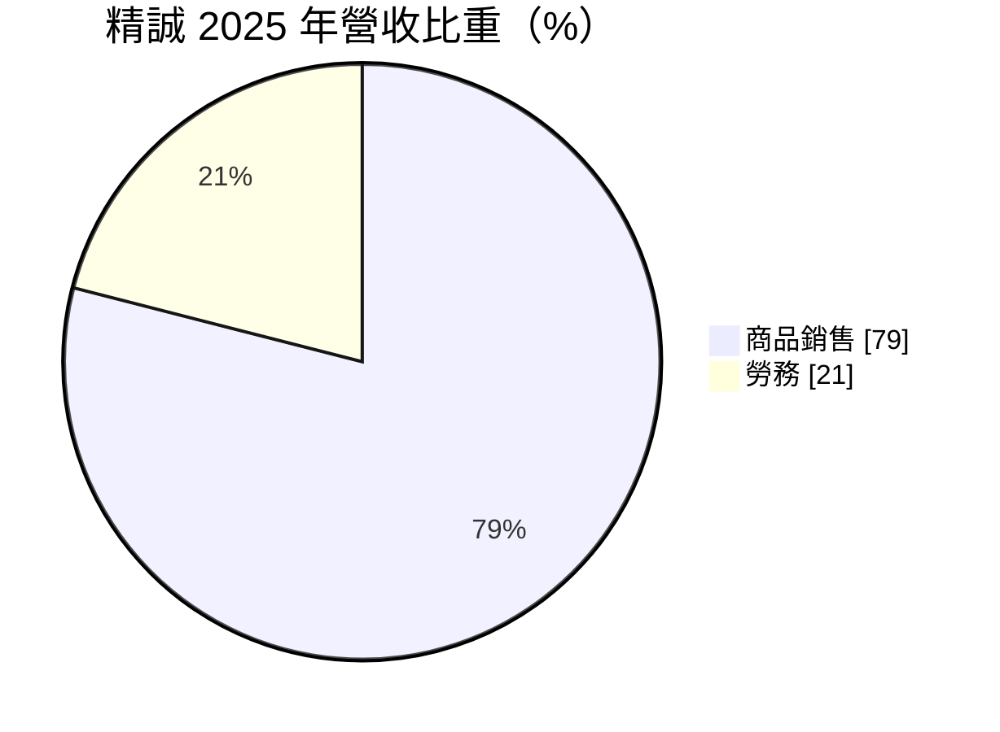
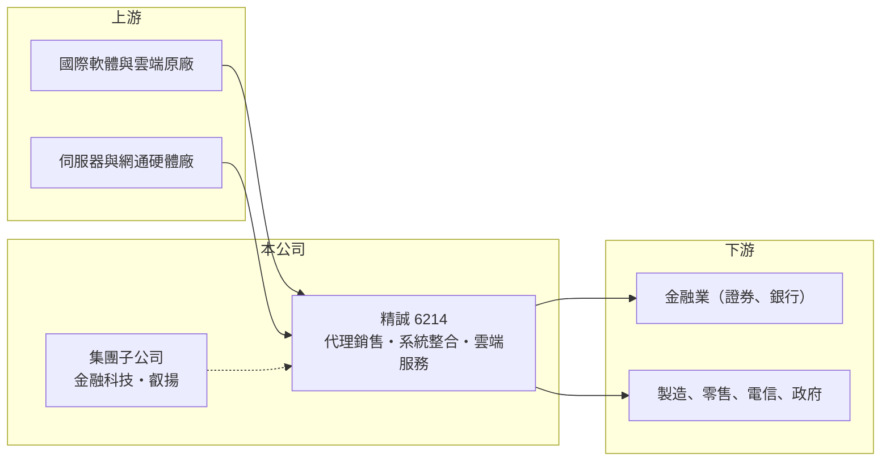

# 6214 精誠

> 上市｜[[產業索引-資訊服務業|資訊服務業]]｜上市（櫃）日期 2010/12/30

# 第一章：企業模式與商業藍圖

> [!info] 撰寫說明
> 精簡版，由 Claude 依公開資料整理，架構比照 [[2330台積電]]，資料截至 2026-10-08。來源：Goodinfo 經營績效年表（2019 至 2025 年）；富邦 e 點通（MoneyDJ）公司基本資料（2025 年營收比重）；證交所開放資料快照（基本資料、2026 年第二季資產負債、營益分析與上半年損益、每月營收、本益比殖利率）。集團架構、子公司與原廠合作關係依記憶整理，標示待校對。#待校對

精誠（精誠資訊）成立於 1997 年 1 月，總部在台北市內湖區，實收資本額約 27.2 億元，董事長兼總經理為林隆奮。它是台灣規模最大的本土資訊服務集團之一，2025 年合併營收約 440 億元，業務橫跨軟硬體代理銷售、[[系統整合]]、金融資訊系統與雲端服務，旗下有多家專業子公司，像一個資訊服務的控股平台。

- **核心業務：** 精誠營收約八成來自商品銷售、兩成來自勞務。商品銷售主要是代理與轉售國際原廠的軟硬體與公有雲資源（原廠名單待校對），勞務則是系統建置、顧問、維運與軟體開發。前者讓精誠有龐大的營收規模與客戶覆蓋面，後者才是真正累積專業與利潤的部分。
- **營收結構：** 精誠在金融業的資訊系統有很深的基礎，旗下金融科技子公司長期提供證券業的交易與後台系統（待校對），這類系統與券商日常營運綁在一起，屬於[[經常性收入]]性質較高的業務。另外，集團也透過子公司經營企業軟體與知識管理，例如 [[6752叡揚]] 被視為精誠集團成員（持股關係待校對）。
- **營運據點：** 以台灣為主，並在中國大陸與香港等地設有據點（待校對）。客戶涵蓋金融、電信、製造、零售與政府，客戶產業分散，是精誠相對小型同業的一大優勢。
- **長期方向：** 精誠的長期方向是從「代理銷售」往「雲端、資料與 AI 服務」移動，也就是讓客戶從一次買斷軟硬體轉為訂閱雲端服務，精誠則提供轉移、管理與加值服務。2026 年 1 至 8 月累計營收較去年同期成長約 40%，顯示雲端與資料中心相關需求帶動規模擴大，但商品銷售比重提高也會拉低整體毛利率。

# 第二章：護城河深度與競爭優勢

精誠的護城河在於規模、客戶廣度與金融領域的專業，而不是單一技術。

- **競爭優勢：** 第一是規模與原廠關係，作為台灣最大的資訊服務集團之一，精誠能取得較佳的代理條件，並提供一站式採購。第二是金融業的系統熟悉度，證券、銀行的核心系統更換風險極高，客戶通常不會輕易更換供應商，這是很強的轉換成本。第三是集團內子公司分工，讓精誠能同時承接硬體、軟體、雲端與顧問案。
- **主要對手：** 綜合型系統整合商如 [[2480敦陽科]]、[[2453凌群]]、[[8099大世科]]、[[2427三商電]]、[[6811宏碁資訊]]；雲端代理與管理服務則有 [[6689伊雲谷]]、6112邁達特 等；國際上則與 IBM、Accenture 等大型顧問公司在大型企業案競爭。
- **觀察重點：** 第一，勞務收入比重能否提高，因為勞務的毛利遠高於商品轉售；第二，[[營業利益率]]能否突破長年 3% 至 4% 的區間；第三，業外投資收益是否穩定，因為精誠的 EPS 有相當比例來自轉投資而非本業。

# 第三章：財務體質與盈利規模

資料日期：2026-10-08，表格是撰寫當時的快照；最新月營收、毛利率、累計 EPS 由自動排程寫在本筆記的屬性欄位（月營收、毛利率、累計EPS 等）。#待校對

精誠的財務特色是營收規模大、本業利潤率薄，但靠穩定的業外投資收益把 ROE 撐在一成以上。

| 年度 | 營收（億元） | [[毛利率]] | [[營業利益率]] | EPS（元） | [[ROE]] |
|---|---|---|---|---|---|
| 2019 | 221 | 25.2% | 2.75% | 7.31 | 13.6% |
| 2020 | 237 | 24.2% | 3.90% | 6.72 | 12.4% |
| 2021 | 295 | 22.5% | 3.84% | 4.90 | 8.91% |
| 2022 | 331 | 22.2% | 3.80% | 4.40 | 7.94% |
| 2023 | 352 | 22.5% | 4.18% | 6.02 | 10.7% |
| 2024 | 390 | 21.2% | 3.58% | 7.66 | 12.3% |
| 2025 | 440 | 21.9% | 3.63% | 7.91 | 12.4% |
| 2026 上半年 | 273.7 | 18.57% | 4.26% | 6.15 | 未查得 |

註：2019 至 2025 年取自 Goodinfo；2026 年上半年取自證交所營益分析與綜合損益開放資料。

- **長期指標：** 2020 至 2025 年營收年複合成長率約 13.2%（推算），2021 至 2025 年平均 ROE 約 10.5%（推算）。毛利率從 2019 年的 25.2% 一路下滑到 2026 年上半年的 18.6%，原因是低毛利的商品銷售成長較快。2026 年上半年營業利益 11.7 億元，但稅後淨利達 18.0 億元，業外收益約占稅前淨利的四成以上（推算），說明投資收益對精誠的重要性。逐年現金股利未查得，證交所快照顯示殖利率約 3.18%。
- **[[ROIC]] 與 [[WACC]]：** 2025 年營業利益約 16.0 億元（440 億 × 3.63%），稅後約 12.8 億元；2026 年第二季股東權益 194.1 億元，有息負債未查得，假設約 20 億元，投入資本約 214 億元，ROIC 約 6.0%（推算）。這個算法把大量轉投資也算進資本，若只看營運資本，本業 ROIC 會更高。WACC 以無風險利率 1.75%、市場風險溢酬 6%、β 0.8（大型資訊服務股常見值）推得權益成本約 6.55%，負債約占一成、稅後負債成本約 2%，WACC 約 6.1%（推算）。以整體資本衡量，ROIC 大約等於 WACC，代表本業只是勉強賺回資金成本；股東報酬能高於此，主要靠業外投資的貢獻。
- **財務特色：** 2026 年第二季總資產 454 億元、負債 260 億元，流動負債 248 億元，推估多為應付帳款與預收款等營運性負債。[[每股淨值]] 67.56 元，淨值龐大一部分是長期持有的轉投資。

# 第四章：總體風險與地緣政治

精誠的風險在於本業利潤率薄，任何成本或價格的小變動都會放大到獲利上。

- **產業週期：** 企業資訊支出與景氣連動，景氣差時硬體採購最先延後，而精誠營收八成是商品銷售，會直接受影響。金融業系統支出則與證券交易量、金融法規更新相關。
- **營運風險：** 代理銷售的毛利由原廠政策決定，原廠調整通路制度或改為直接銷售時，代理商的利潤會被壓縮。雲端轉型過程中，客戶從買斷轉訂閱，短期營收可能下降。業外收益占比高，投資標的表現不佳時 EPS 波動會加大。
- **其他風險：** 進口軟硬體以美元計價，新台幣升值或貶值會影響成本與報價。金融與政府系統屬關鍵基礎設施，[[資安]]事件的商譽與法律責任重大。中國大陸據點面臨兩岸關係與法規風險（待校對）。

# 專有名詞解析

## 應用

- **[[系統整合]]**：把不同廠牌的硬體、軟體與網路整合成可運作的資訊系統，並負責建置與後續維護的服務。
- **[[資安]]**：資訊安全，保護系統與資料不被入侵、竊取或破壞的技術與管理措施。

## 金融

- **[[經常性收入]]**：每年固定重複發生的收入，例如維運年約、訂閱費，能讓營收比一次性專案更穩定。
- **[[ROIC]]**：投入資本報酬率，稅後營業利益除以股東權益加有息負債，衡量本業運用資本的效率。
- **[[WACC]]**：加權平均資金成本，股東與債權人要求報酬率的加權平均，是 ROIC 要超越的門檻。

## 產業

- **[[代理商]]**：取得原廠授權，在特定地區銷售與支援原廠產品的公司，利潤受原廠政策影響。

# 核心供應鏈

- 上游：國際軟體與公有雲原廠，例如 [[MSFT微軟]]、[[AMZN亞馬遜]]、[[GOOGL谷歌]]（合作關係待校對），以及伺服器與網通硬體原廠。
- 下游／客戶：證券、銀行等金融業，以及製造、零售、電信與政府機關。
- 同業：[[2480敦陽科]]、[[2453凌群]]、[[8099大世科]]、[[2427三商電]]、[[6811宏碁資訊]]、[[6689伊雲谷]]、6112邁達特。

## 最新新聞
<!-- news:start（自動產生，請勿手動編輯此範圍） -->
- 2026-10-15 📰 媒體 10:52｜〈焦點股〉精誠業績衝高、加大拓海外版圖 股價寫新猷拚挑戰2字頭｜[鉅亨網](https://news.cnyes.com/news/id/6630940)
- 2026-10-07 📰 媒體 17:50｜營收速報 - 精誠(6214)9月營收83.72億元年增率高達55.69％｜[鉅亨網](https://news.cnyes.com/news/id/6623804)
- 2026-10-07 🏛️ 重訊 14:21｜更正本公司115年8月背書保證明細表資訊｜[觀測站](https://mops.twse.com.tw/mops/#/web/t05st01)

完整紀錄：[[6214精誠 新聞]]
<!-- news:end -->

## 相關連結
- [公開資訊觀測站](https://mopsov.twse.com.tw/mops/web/t05st03?step=1&firstin=1&co_id=6214)
- [Goodinfo](https://goodinfo.tw/tw/StockDetail.asp?STOCK_ID=6214)
- [Yahoo 股市](https://tw.stock.yahoo.com/quote/6214)
- [鉅亨網新聞](https://www.cnyes.com/twstock/6214/news)
