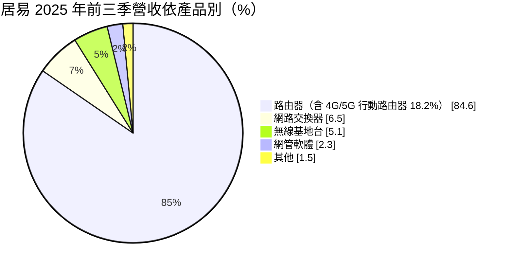
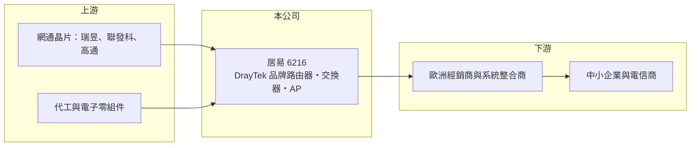

# 6216 居易

> 上市｜[[產業索引-通信網路業|通信網路業]]｜上市（櫃）日期 2004/09/27

# 第一章：企業模式與商業藍圖

> [!info] 撰寫說明
> 精簡版，由 Claude 依公開資料整理，架構比照 [[2330台積電]] 的四章研究，資料截至 2026-10-08。來源：富果研究（居易 2025 年 11 月法說會整理）、Goodinfo 年度經營績效、證交所開放資料（基本資料、綜合損益、資產負債、營益分析、股利、每月營收、本益比）。地區別比重本次未取得，歐洲為主要市場的描述依法說會內容與記憶整理。#待校對

本章說明居易科技（股票代號：6216，以下簡稱居易）的商業模式：以 DrayTek [[自有品牌]]行銷全球、專攻中小企業的路由器廠。

- **核心業務：** 居易成立於 1997 年，2004 年上市，總部位於新竹湖口，員工約 210 人。公司以 DrayTek 品牌銷售路由器、網路[[交換器]]、無線基地台與網管軟體，主要客群是中小企業。中小企業沒有專職的網管人員，需要一台設定簡單、同時具備 [[VPN]]、防火牆與多線路備援的路由器，這正是 DrayTek 的產品定位。
- **營收結構：** 2025 年前三季路由器占營收 84.6%，其中 4G/5G 行動路由器占 18.2%；交換器 6.5%、無線基地台 5.1%、網管軟體 2.3%。產品高度集中在路由器，交換器與無線產品是補足整體方案的配角。
- **營運據點：** 總部與研發在新竹，市場以歐洲為主，英國是能見度最高的市場之一（DrayTek 在英國獲 CRN Awards 等獎項），透過當地經銷商與系統整合商銷售（地區比重本次未查得，待校對）。
- **長期方向：** 2026 年起的產品重點包括資安（DraySOAR、DrayEDR，並把 AI 威脅防護延伸到低階路由器）、[[零信任]]認證、交換器堆疊與網路韌性、XGS-PON 與 10G 乙太網路、Wi-Fi 7 與 Mesh，以及網管軟體雲端化、資安功能服務化。從賣硬體轉向「硬體加訂閱服務」，是提高經常性收入的方向。

# 第二章：護城河深度與競爭優勢

本章評估居易的護城河。毛利率長期維持在 45% 以上，遠高於網通代工廠，說明 DrayTek 品牌在利基市場有實在的定價能力。

- **競爭優勢：** 居易的護城河來自品牌與通路。DrayTek 在英國等歐洲中小企業市場經營二十多年，經銷商與系統整合商熟悉其設定介面與管理工具，終端用戶習慣後不易更換。路由器韌體整合了 VPN、多 WAN 備援、頻寬管理等功能，並持續更新，形成軟體價值。這些因素讓居易在營收規模不大的情況下，毛利率仍能維持在 45% 至 49%。
- **主要對手：** 中小企業網通市場的對手包括 TP-Link、[[2332友訊]]、Zyxel（[[3704合勤控]]）、Ubiquiti、Fortinet 與 [[CSCO思科]] 旗下 Meraki（對手名單為產業常識整理，待校對）。資安廠商把防火牆往下延伸、雲端網管品牌把管理體驗做得更簡單，都在侵蝕傳統中小企業路由器的市場。
- **觀察重點：** 第一，歐洲市場需求與關稅影響何時消退；2025 年前三季營收年減 39%。第二，資安與雲端服務能否形成訂閱收入。第三，行動路由器與高速光纖產品能否帶來新的成長。

# 第三章：財務體質與盈利規模

資料日期：2026-10-08。數字取自 Goodinfo 年度經營績效、富果法說會整理與證交所開放資料，表格是撰寫當時的快照；最新月營收、毛利率、累計 EPS 由自動排程寫在本筆記的屬性欄位（月營收、毛利率、累計EPS 等）。#待校對

居易的財務數字顯示毛利率高而穩定，但營收規模小、波動大，獲利隨營收起伏明顯。

| 年度 | 營收（新台幣） | [[毛利率]] | [[營業利益率]] | EPS（元） | [[ROE]] |
|---|---|---|---|---|---|
| 2020 | 8.41 億 | 48.8% | 17.3% | 1.27 | 7.19% |
| 2021 | 9.31 億 | 48.9% | 20.5% | 1.85 | 10.4% |
| 2022 | 8.99 億 | 46.3% | 14.9% | 1.96 | 10.8% |
| 2023 | 7.75 億 | 47.0% | 10.6% | 1.34 | 7.27% |
| 2024 | 11.8 億 | 47.2% | 18.4% | 2.88 | 15.1% |
| 2025 | 7.57 億 | 45.0% | 7.49% | 0.60 | 3.17% |
| 2026 上半年 | 2.85 億 | 42.77% | -8.30% | -0.14 | 未查得 |

註：2020 至 2025 年取自 Goodinfo 合併報表；2026 上半年取自證交所營益分析與綜合損益資料。

- **營收規模：** 2020 至 2025 年營收年複合成長率約 -2.1%（推算），在 7.5 至 11.8 億元之間波動。2026 年 1 至 8 月累計營收 3.99 億元，較去年同期 5.41 億元減少約 26%，衰退仍在延續。
- **獲利：** 毛利率穩定在 45% 至 49%，但營業費用相對固定，營收縮小時營業利益率從 2024 年的 18.4% 降到 2025 年的 7.5%，2026 年上半年轉為 -8.3%。2021 至 2025 年平均 ROE 約 9.3%（推算）。2025 年前三季公司說明衰退主因是關稅戰與 2025 年 4、5 月匯率大幅波動。
- **財務特色：** 2026 年第二季底資產總計 19.11 億元、負債僅 2.64 億元，權益約 16.47 億元（推算），每股淨值 16.92 元，幾乎沒有有息負債。2025 年度配發現金 1.03 元，其中盈餘 0.53 元、資本公積 0.50 元，在 EPS 只有 0.60 元的年度動用資本公積維持股利，顯示公司重視股利穩定。Goodinfo 統計歷年平均現金股利 1.71 元。
- **[[ROIC]] 與 [[WACC]]：** 以 2025 年營業利益約 0.57 億元（7.57 億元 × 7.49%）扣 20% 稅後約 0.45 億元，投入資本以權益約 16.47 億元計算（幾乎無有息負債），ROIC 約 2.8%（推算）；2024 年營業利益約 2.17 億元時，ROIC 約 10.5%（推算，資本以近期數字代替）。由於帳上有大量現金，若扣除現金計算本業投入資本，ROIC 會明顯更高（推估）。WACC 以 CAPM 推估：無風險利率 1.75%、市場風險溢酬 6%、β 取 0.9（推估，高股息網通品牌股），權益成本約 7.15%；無負債，WACC 約 7.15%（推算）。好年度 ROIC 高於 WACC、壞年度低於 WACC，長期平均大致持平，價值創造取決於營收能否回到 10 億元以上。

# 第四章：總體風險與地緣政治

本章整理居易面對的長期風險，主要來自單一市場與產品集中。

- **產業週期：** 中小企業的網通支出跟隨歐洲景氣與企業 IT 預算，2022 年缺料期間通路備貨、2023 年庫存調整，2024 年回升後 2025 年又遇上關稅與匯率衝擊，營收起伏明顯，呈現[[長鞭效應]]。
- **營運風險：** 營收集中在歐洲（特別是英國）市場與路由器產品，單一市場的經濟或通路變化影響很大。研發團隊規模小，要同時開發資安、雲端、高速光纖與 Wi-Fi 7 產品，資源有限。雲端網管品牌與資安廠商的競爭，可能削弱傳統路由器的定位。
- **其他風險：** 營收以英鎊、歐元與美元計價，匯率波動直接影響營收與毛利，2025 年 4、5 月的匯率波動即是例子。美國與歐盟對網通設備的資安規範日趨嚴格，增加合規成本，但也可能提高中小品牌的進入門檻。

# 專有名詞解析

## 應用

- **[[VPN]]**：虛擬私人網路，透過加密通道讓分公司或遠端員工安全連回公司內網。
- **[[零信任]]**：不預設信任任何裝置或使用者，每次存取都要驗證身分與權限的資安架構。

## 金融

- **[[長鞭效應]]**：終端需求的小幅變動，沿供應鏈往上游傳遞時被逐級放大，造成上游庫存與訂單劇烈波動。
- **[[ROIC]]**：投入資本報酬率，稅後營業利益除以股東權益與有息負債的合計，衡量本業對所有資金提供者的報酬。
- **[[WACC]]**：加權平均資金成本，依股東權益與負債的比重加權計算的資金成本，ROIC 高於它才代表創造價值。

## 產業

- **[[自有品牌]]**：企業以自己的商標設計、行銷與銷售產品，掌握定價與通路，毛利通常高於代工。
- **[[交換器]]**：在資料中心或企業網路中轉送資料封包的網路設備，AI 資料中心需要 800G、1.6T 等高速規格。

# 核心供應鏈

- 上游：網通晶片 [[2379瑞昱]]、[[2454聯發科]]、[[QCOM高通]]（實際採用比重未公開，待校對），代工與電子零組件。
- 下游／客戶：歐洲（特別是英國）及其他地區的經銷商與系統整合商，終端為中小企業與部分電信商。
- 同業：[[2332友訊]]、[[3704合勤控]]、[[3047訊舟]]、[[6142友勁]]。

## 最新新聞
<!-- news:start -->
<!-- news:end -->

## 相關連結
- [公開資訊觀測站](https://mopsov.twse.com.tw/mops/web/t05st03?step=1&firstin=1&co_id=6216)
- [Goodinfo](https://goodinfo.tw/tw/StockDetail.asp?STOCK_ID=6216)
- [Yahoo 股市](https://tw.stock.yahoo.com/quote/6216)
- [鉅亨網新聞](https://www.cnyes.com/twstock/6216/news)
