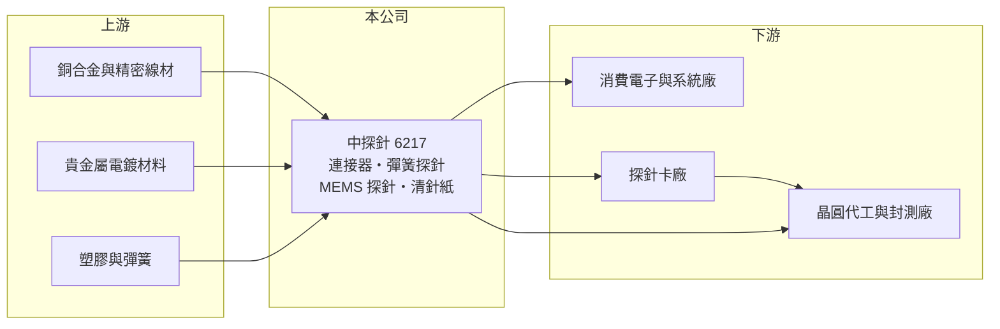

# 6217 中探針

> 上櫃｜[[產業索引-電子零組件業|電子零組件業]]｜上市（櫃）日期 2003/01/09

# 第一章：企業模式與商業藍圖

> [!info] 撰寫說明
> 精簡版，由 Claude 依公開資料整理，架構比照 [[2330台積電]]，資料截至 2026-10-08。來源：櫃買中心開放資料快照（基本資料、2026 年第二季資產負債與損益、每月營收、本益比殖利率）、Goodinfo 經營績效頁、優分析轉載鉅亨網 2026 年 9 月 SEMICON 報導。完整的應用別營收比重與客戶名稱未查得。#待校對

中國探針（以下簡稱中探針）是一家以[[連接器]]與測試探針為主的精密零件廠，總部位於新北市板橋，2003 年在櫃買中心掛牌。理解中探針的關鍵在於：本業連接器仍占營收六成以上，但公司正把精密加工能力轉向半導體測試，目標 2027 年半導體相關產品占比超過四成；同時，轉投資的鎂合金結構件公司拖累了合併獲利。

- **核心業務：** 中探針成立於 1986 年，以彈簧探針（Pogo Pin）起家，這種探針內含彈簧，可以反覆壓接，用於電池、充電座與各類電子產品的連接，也用於電子測試治具。依 2026 年 9 月報導，連接器仍占營收六成以上，半導體相關產品占比已由約 16% 提高到 25% 以上。
- **營收結構：** 新產品包括 [[MEMS 探針]]與[[清針紙]]。MEMS 探針以類似半導體微影的製程製作，用於 GPU、CPU 與 [[CoWoS]] 先進封裝的晶圓測試；清針紙是清除探針上殘留錫屑與氧化物的測試耗材，目前台灣大廠多仰賴進口。兩者都與半導體大廠及[[探針卡]]廠共同開發，預計 2027 年開始貢獻營收。另有 [[AI 伺服器]]零件已通過客戶認證並小量出貨。
- **營運據點：** 台灣是 MEMS 探針等高階產品的主要生產基地，中國大陸設有既有工廠（東莞子公司，依 Goodinfo 公告標題），越南則規劃分期建廠，第一期以系統廠產線的自動化產品為主，第二期再加入連接器與測試探針。2026 年第二季總資產約 72.9 億元。
- **長期方向：** 中探針的長期目標是從「消費性連接器廠」轉型為「半導體測試零組件廠」。半導體測試耗材單價高、需要持續補貨，若能打進晶圓代工與封測大廠的供應鏈，營收穩定度與毛利率都會改善。轉投資的冠德正在調整，降低低毛利的車用產品，轉向智慧眼鏡與手機鏡框。

# 第二章：護城河深度與競爭優勢

中探針的護城河來自數十年的精密微小零件加工經驗，但目前仍在由傳統業務轉向高階市場的過程中。

- **競爭優勢：** 彈簧探針與微型連接器需要精密車削、電鍍與組裝能力，良率與一致性是客戶最重視的條件。中探針累積數十年的量產經驗，讓它可以把這套能力延伸到半導體測試座與 MEMS 探針。2026 年 7 月報導公司與半導體大廠共同開發 MEMS 探針與清針紙，代表技術已獲得客戶一定程度的認可。
- **主要對手：** 半導體測試領域有 [[6223旺矽]]、[[6510精測]]、[[6515穎崴]]、[[6683雍智科技]]，國際上有美商 FormFactor、日本 Micronics Japan 等探針卡大廠；連接器領域則有 [[2392正崴]]、[[3533嘉澤]] 與大量中國大陸同業。
- **觀察重點：** 長期最值得追蹤的是半導體相關營收占比能否如期在 2027 年超過四成，以及毛利率能否止跌回升。2022 至 2025 年毛利率由 31.3% 一路降到 19.7%，營業利益率轉負，反映傳統業務與轉投資的拖累。

# 第三章：財務體質與盈利規模

資料日期：2026-10-08，表格是撰寫當時的快照；最新月營收、毛利率、累計 EPS 由自動排程寫在本筆記的屬性欄位（月營收、毛利率、累計EPS 等）。#待校對

中探針的財務呈現「營收成長、獲利惡化」的樣貌：2025 年營收創 37 億元新高，但已連續三年營業虧損。

| 年度 | 營收（億元） | [[毛利率]] | [[營業利益率]] | EPS（元） | [[ROE]] |
|---|---|---|---|---|---|
| 2021 | 29.6 | 31.7% | 7.1% | 2.70 | 9.5% |
| 2022 | 32.8 | 31.3% | 4.7% | 2.06 | 6.7% |
| 2023 | 26.9 | 27.8% | -4.4% | -0.37 | -0.2% |
| 2024 | 31.1 | 23.1% | -7.6% | -2.65 | -10.6% |
| 2025 | 37.0 | 19.7% | -6.6% | -1.65 | -7.7% |

（來源：Goodinfo 經營績效頁；2020 年營收 24.1 億元、EPS 1.48 元。）

- **營收規模：** 2020 至 2025 年營收由 24.1 億元增至 37.0 億元，年複合成長率約 9%（推算）。2026 年前八月累計營收約 31.1 億元，年增約 34%（官方月營收資料）。
- **獲利：** 近五年平均 ROE 約 -0.5%（推算），前兩年小幅獲利、後三年虧損。2026 年上半年營收約 22.7 億元、毛利率約 21.4%、營業利益率約 -1.3%、EPS -0.19 元，虧損明顯收斂；公司表示虧損主要來自冠德，本業的半導體與連接器業務仍有獲利。
- **財務特色：** 2026 年第二季權益約 29.2 億元、負債約 43.8 億元，負債比約 60%，在零組件廠中偏高。保留盈餘接近零（約 -0.04 億元），但資本公積約 18.2 億元，每股淨值約 25.7 元。持有庫藏股約 319 萬股。虧損期間未配發現金股利。
- **[[ROIC]] 與 [[WACC]]：** 2025 年營業損失約 2.4 億元（37.0 億元 × -6.56%），虧損年度不計稅盾。以 2026 年第二季權益 29.2 億元到「權益加全部負債」72.9 億元為投入資本區間，ROIC 約 -3.3% 至 -8.3%（推算）。WACC 以 [[CAPM]] 推估：無風險利率 1.75%、市場風險溢酬 6%、β 假設 1.1，權益成本約 8.35%；稅後負債成本 2%、有息負債占資本約四成，WACC 約 5.8%（推算）。ROIC 低於 WACC，代表近三年資本投入（含冠德與新產品研發）尚未產生回報；半導體新品能否在 2027 年放量，是 ROIC 能否轉正的關鍵。

# 第四章：總體風險與地緣政治

中探針的風險集中在轉型執行、轉投資拖累與偏高的負債。

- **產業週期：** 連接器需求跟隨消費電子景氣，半導體測試耗材則跟隨晶片測試量，兩者都有庫存週期，[[長鞭效應]]會放大訂單波動。AI 伺服器零件的放量時程取決於客戶機櫃出貨，若延後，新業務貢獻也會延後。
- **營運風險：** MEMS 探針與清針紙仍在開發與認證階段，技術門檻高、競爭對手強，量產時程存在不確定性。冠德的鎂合金結構件業務若轉型不順，將持續拖累合併獲利。負債比約六成，若虧損延續，財務彈性會受限。
- **其他風險：** 生產分布在台灣、中國大陸與規劃中的越南，美中貿易與關稅政策會影響供應鏈配置；越南建廠需要資本支出。主要原料為銅合金、貴金屬電鍍材料，金價與銅價上漲會壓縮毛利。

# 專有名詞解析

## 半導體

- **[[探針卡]]**：晶圓測試時與晶片接觸的介面，上面排列大量細微探針，把測試機的訊號傳到每顆晶片。
- **[[MEMS 探針]]**：以微機電製程製作的細微探針，間距與精度高於傳統探針，用於高階晶片的晶圓測試。
- **[[清針紙]]**：用來清潔測試探針針尖殘留錫屑與氧化物的耗材，維持測試接觸品質。
- **[[CoWoS]]**：台積電的 2.5D 先進封裝技術，把 GPU 與高頻寬記憶體並排放在中介層上，是 AI 晶片的主流封裝。

## 應用

- **[[AI 伺服器]]**：搭載 GPU 或 AI 加速晶片、用於訓練與推論的伺服器，功耗與傳輸速度要求遠高於一般伺服器。

## 產業

- **[[連接器]]**：讓電路之間可插拔連接的零件，負責傳遞訊號或電力。

# 核心供應鏈

- 上游：銅合金與精密線材、金等貴金屬電鍍材料、彈簧與塑膠件（具體供應商未查得）。
- 下游／客戶：消費電子與 AI 伺服器系統廠、探針卡廠、半導體大廠與封測廠（客戶名稱未公開，#待校對）。
- 同業：[[6223旺矽]]、[[6510精測]]、[[6515穎崴]]、[[6683雍智科技]]、[[2392正崴]]、[[3533嘉澤]]，以及 FormFactor、Micronics Japan。

## 最新新聞
<!-- news:start（自動產生，請勿手動編輯此範圍） -->
- 2026-10-16 🏛️ 重訊 15:03｜本公司有價證券近期多次達公布注意交易資訊標準，故公告 相關訊息，以利投資人區別暸解｜[觀測站](https://mops.twse.com.tw/mops/#/web/t05st01)

完整紀錄：[[6217中探針 新聞]]
<!-- news:end -->

## 相關連結
- [公開資訊觀測站](https://mopsov.twse.com.tw/mops/web/t05st03?step=1&firstin=1&co_id=6217)
- [Goodinfo](https://goodinfo.tw/tw/StockDetail.asp?STOCK_ID=6217)
- [Yahoo 股市](https://tw.stock.yahoo.com/quote/6217)
- [鉅亨網新聞](https://www.cnyes.com/twstock/6217/news)
