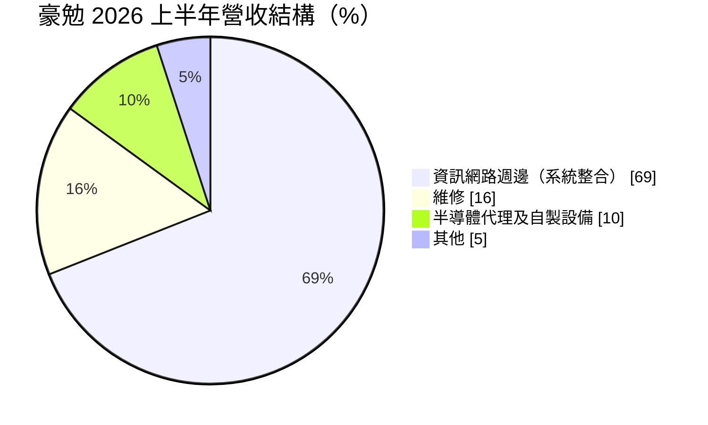
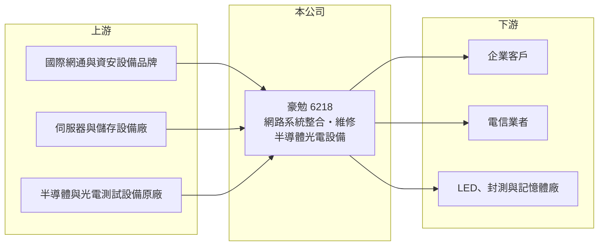

# 6218 豪勉

> 上櫃｜[[產業索引-通信網路業|通信網路業]]｜上市（櫃）日期 2003/01/14

# 第一章：企業模式與商業藍圖

> [!info] 撰寫說明
> 精簡版，由 Claude 依公開資料整理，架構比照 [[2330台積電]] 的四章研究，資料截至 2026-10-08。來源：理財周刊（豪勉 2026 年 9 月個股報導）、Goodinfo 年度經營績效、櫃買中心開放資料（基本資料、綜合損益、資產負債、每月營收、本益比）。公開資料有限，代理品牌與主要客戶名稱本次未取得。#待校對

本章說明豪勉科技（股票代號：6218，以下簡稱豪勉）的商業模式：以企業與電信客戶為主的網路[[系統整合]]商，另經營半導體與光電測試設備。

- **核心業務：** 豪勉成立於 1979 年，2003 年在櫃買中心掛牌，總部位於台北市承德路。核心業務是資訊網路系統整合，涵蓋交換器、路由器、無線網路、資安、伺服器、儲存與私有雲，也就是替企業與電信業者規劃、採購、建置並維護整套網路架構。另一條業務線是半導體及光電設備，包括 LED 光電測試、IC 與特殊封裝模組外觀檢測、記憶體耐讀寫測試，並推廣 [[Micro LED]] 與 [[AOI]] 光學檢測設備。
- **營收結構：** 依理財周刊整理，2026 年上半年資訊網路週邊約占營收 69%、維修約 16%、半導體代理及自製設備約 10%。客戶以企業及電信為大宗，兩者合計超過七成。維修收入屬於系統完工後的維運合約，是較穩定的[[經常性收入]]。
- **營運據點：** 總部位於台北，營運以國內市場為主（海外據點本次未查得，待校對）。
- **長期方向：** 公司未明確公布長期策略。從業務組合看，網路系統整合是穩定的基本盤，半導體與光電設備則是提高毛利的嘗試，但理財周刊指出 Micro LED 與 AOI 設備仍在市場推廣階段，對營收貢獻不明顯。半導體設備比重能否提升，是觀察豪勉轉型的重點。

# 第二章：護城河深度與競爭優勢

本章評估豪勉的護城河。系統整合是門檻不高、價格競爭激烈的行業，從營業利益率長期低於 6% 來看，豪勉屬於窄護城河。

- **競爭優勢：** 豪勉的優勢在於長期服務企業與電信客戶累積的關係與維運實績。網路架構一旦由某家整合商建置，後續擴充、維修與更新多半交給同一家，客戶更換整合商需要重新熟悉環境，形成一定的轉換成本。維修收入占 16%，代表已有一批穩定的維運客戶。
- **主要對手：** 國內網路系統整合同業包括 [[6214精誠]]、[[2471資通]]、[[5410國眾]]、[[3029零壹]]、[[6163華電網]]，以及大型電信商的企業服務部門（對手名單為產業常識整理，待校對）。半導體與光電設備則面對國內外大型設備商，豪勉規模相對小。
- **觀察重點：** 第一，毛利率能否維持在 2026 年上半年的 23% 水準，而非回到 2024 至 2025 年的 12.7%。第二，大型專案的驗收時程。第三，半導體設備營收比重與獲利貢獻。

# 第三章：財務體質與盈利規模

資料日期：2026-10-08。數字取自 Goodinfo 年度經營績效、理財周刊與櫃買中心開放資料，表格是撰寫當時的快照；最新月營收、毛利率、累計 EPS 由自動排程寫在本筆記的屬性欄位（月營收、毛利率、累計EPS 等）。#待校對

豪勉的財務數字顯示營收穩定成長，但毛利率在 2024 年明顯下滑，連續兩年虧損後 2026 年才回升。

| 年度 | 營收（新台幣） | [[毛利率]] | [[營業利益率]] | EPS（元） | [[ROE]] |
|---|---|---|---|---|---|
| 2020 | 8.37 億 | 36.8% | 5.38% | 0.79 | 4.90% |
| 2021 | 9.24 億 | 30.9% | 2.39% | 0.70 | 4.42% |
| 2022 | 10.2 億 | 30.2% | 4.70% | 0.36 | 2.34% |
| 2023 | 10.6 億 | 25.4% | 1.14% | 0.44 | 2.82% |
| 2024 | 12.6 億 | 12.7% | -13.1% | -1.68 | -11.3% |
| 2025 | 13.2 億 | 12.7% | -10.1% | -1.15 | -8.47% |
| 2026 上半年 | 8.01 億 | 23.0% | 6.6% | 2.41 | 未查得 |

註：2020 至 2025 年取自 Goodinfo 合併報表；2026 上半年取自櫃買中心開放資料（毛利率、營業利益率依開放資料推算）。

- **營收規模：** 2020 至 2025 年營收年複合成長率約 9.5%（推算），營收逐年增加。2026 年 1 至 8 月累計營收 10.45 億元，較去年同期 8.91 億元成長約 17%；公司說明部分月份營收增加，主要是較多專案工程同時完成驗收，單月營收在 0.76 億元到 2.05 億元之間大幅波動。
- **獲利：** 毛利率從 2020 年的 36.8% 一路降到 2024 至 2025 年的 12.7%，代表低毛利的硬體轉售專案比重提高，或部分專案認列損失（原因本次未查得）。2021 至 2025 年平均 ROE 約 -2.0%（推算）。2026 年上半年毛利率回到 23%，營業利益 0.53 億元，加上業外收入 1.14 億元，歸屬母公司淨利 1.55 億元，EPS 2.41 元；業外收入是本業的兩倍以上，來源本次未查得，不宜視為常態。
- **財務特色：** 2026 年第二季底資產總計 15.90 億元、負債 5.89 億元（幾乎都是流動負債）、歸屬母公司權益 10.01 億元，每股淨值 15.58 元，非流動負債僅 0.02 億元。依櫃買中心資料，最近一年未配發現金股利，與 2025 年虧損相符。
- **[[ROIC]] 與 [[WACC]]：** 以 2025 年營業損失約 1.33 億元（13.2 億元 × -10.1%，虧損不計稅盾）計算，投入資本以歸屬母公司權益 10.01 億元計算（有息負債未查得，推估很少），ROIC 約 -13%（推算）；以 2026 年上半年營業利益年化約 1.06 億元、扣稅後約 0.85 億元計算，ROIC 約 8.5%（推算）。WACC 以 CAPM 推估：無風險利率 1.75%、市場風險溢酬 6%、β 取 1.0（推估，系統整合股常見值），權益成本約 7.75%；幾乎無長期負債，WACC 約 7.5%（推算）。過去五年 ROIC 多數低於 WACC，2026 年若能維持上半年的本業獲利水準，才可能小幅超越資金成本。

# 第四章：總體風險與地緣政治

本章整理豪勉面對的長期風險，主要來自專案型營收與毛利率不穩定。

- **產業週期：** 企業與電信的網路設備採購跟隨 IT 預算與 5G、資安等建置週期，半導體與光電設備則跟隨面板、LED 與封測廠的資本支出週期，兩者都有明顯的循環。
- **營運風險：** 專案收入在驗收時才認列，季度營收與獲利波動大。2024 至 2025 年毛利率驟降，顯示專案報價或成本控管一旦失誤，全年就可能虧損。設備業務規模小、研發投入有限，與大型設備商競爭不易。
- **其他風險：** 代理的國際網通與資安品牌若調整台灣代理政策，會影響貨源與毛利。進口設備以美元計價，匯率波動影響成本。業外收入波動大，使 EPS 難以反映本業實力。

# 專有名詞解析

## 應用

- **[[Micro LED]]**：以微米級 LED 作為每個像素的顯示技術，亮度高、壽命長，但巨量轉移與檢測難度高。

## 金融

- **[[經常性收入]]**：每年能穩定重複產生的收入，例如維護合約、訂閱費，比一次性專案收入更可預測。
- **[[ROIC]]**：投入資本報酬率，稅後營業利益除以股東權益與有息負債的合計，衡量本業對所有資金提供者的報酬。
- **[[WACC]]**：加權平均資金成本，依股東權益與負債的比重加權計算的資金成本，ROIC 高於它才代表創造價值。

## 產業

- **[[系統整合]]**：把多家廠商的硬體、軟體與網路整合成能運作的完整系統，並負責建置與後續維運的服務。
- **[[AOI]]**：自動光學檢測，用相機與影像演算法自動檢查電路板、晶片或面板外觀缺陷的設備。

# 核心供應鏈

- 上游：國際網通與資安設備品牌（如 [[CSCO思科]] 等，實際代理品牌待校對）、伺服器與儲存設備廠、半導體與光電測試設備原廠。
- 下游／客戶：企業與電信業者（合計超過七成），LED、封測與記憶體廠。
- 同業：[[6214精誠]]、[[2471資通]]、[[5410國眾]]、[[3029零壹]]、[[6163華電網]]。

## 最新新聞
<!-- news:start -->
<!-- news:end -->

## 相關連結
- [公開資訊觀測站](https://mopsov.twse.com.tw/mops/web/t05st03?step=1&firstin=1&co_id=6218)
- [Goodinfo](https://goodinfo.tw/tw/StockDetail.asp?STOCK_ID=6218)
- [Yahoo 股市](https://tw.stock.yahoo.com/quote/6218)
- [鉅亨網新聞](https://www.cnyes.com/twstock/6218/news)
