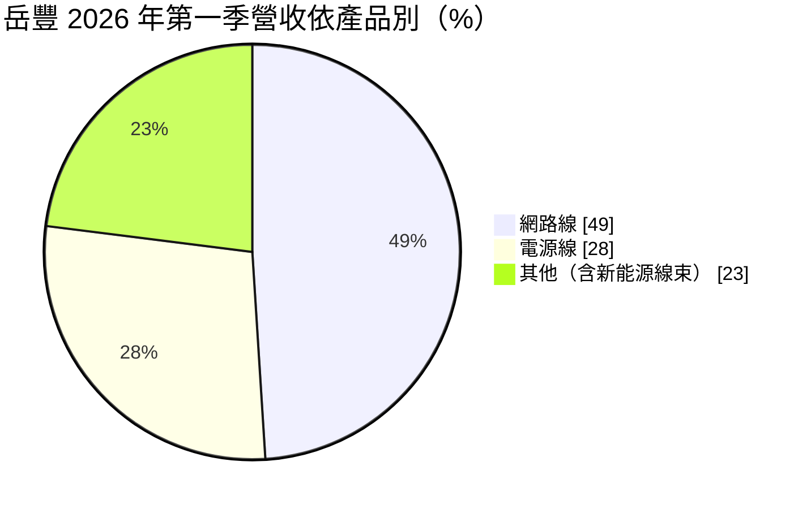
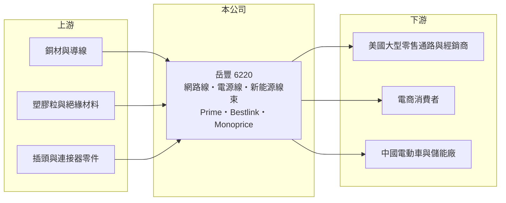

# 6220 岳豐

> 上櫃｜[[產業索引-電子零組件業|電子零組件業]]｜上市（櫃）日期 2003/01/09

# 第一章：企業模式與商業藍圖

> [!info] 撰寫說明
> 精簡版，由 Claude 依公開資料整理，架構比照 [[2330台積電]]，資料截至 2026-10-08。來源：櫃買中心開放資料快照（基本資料、2026 年第二季資產負債與損益、每月營收、本益比殖利率）、Goodinfo 經營績效頁、富果研究 2026 年 6 月 26 日法說會摘要（AI 整理稿）。法說會內容未比對原始簡報；Monoprice 納入集團的年份未查得。#待校對

岳豐科技（以下簡稱岳豐）是一家垂直整合的線材公司，總部位於桃園新屋，2003 年在櫃買中心掛牌。理解岳豐的關鍵在於：它不只是代工線材，還擁有美國自有品牌與電商平台，把「工廠製造」一路延伸到「直接賣給美國消費者」，因此毛利率高於一般線材廠，但通路費用也高，營業利益率長期偏低。

- **核心業務：** 岳豐成立於 1983 年，產品以[[網路線]]與[[電源線]]為主，也生產新能源車與儲能用[[線束]]、高耐彎折的機器人線材，以及 SPE、M8、M12 等工業連接器。電源線與延長線必須取得 UL、CSA、CCC 等各國安規認證，認證本身就是進入門檻。
- **營收結構：** 依 2026 年第一季法說會摘要，品牌與直銷（B2B）約占 75%，透過 Prime（戶外延長線）與 Bestlink（網路線）品牌供應美國大型零售通路與專業經銷商；電商（B2C）約占 25%，透過美國 Monoprice 網站與亞馬遜銷售 6,000 多項 3C 商品。地區上美國約占 75%，中國大陸由一年前的 2.1% 提升到 9%。
- **營運據點：** 生產據點在台灣與中國江蘇無錫，原東莞廠的產能於 2026 年移往無錫後結束營運；菲律賓新廠興建中，預計 2027 年 6 月完工，產能規劃與無錫相當。美國則有 Monoprice 等通路與倉儲營運（推估）。2026 年第二季總資產約 101 億元。
- **長期方向：** 公司定出三個成長方向：智慧自動化與機器人線材、電動車與綠能線束、雲端與 AI 伺服器的網路基礎建設。以美國品牌與電商作為現金基本盤，再用菲律賓新廠分散中國生產的關稅風險，是岳豐的長期策略。低軌衛星電源與訊號產品仍在送樣階段。

# 第二章：護城河深度與競爭優勢

岳豐的護城河來自安規認證、美國通路關係與品牌，而非製造成本。

- **競爭優勢：** 從工廠、品牌到電商的垂直整合，讓岳豐能保留通路端的利潤，2024 至 2025 年毛利率約 26% 至 28.5%，高於一般線材代工廠。美國大型零售通路對供應商的認證、物流與售後服務要求嚴格，長期合作的供應商不容易被取代。Monoprice 的電商平台累積了大量美國消費者與商品資料，是代工廠很難複製的資產。
- **主要對手：** 台灣電線電纜與線材同業包括 [[1603華電]]、[[1609大亞]]、[[1612宏泰]]、[[3023信邦]]、[[6290良維]]，美國通路上則與貝爾金（Belkin）、亞馬遜自有品牌等競爭，中國大陸也有大量低價線材廠。
- **觀察重點：** 長期最值得追蹤的是營業利益率能否穩定在 5% 以上。岳豐毛利率雖高，但 2019 至 2025 年營業利益率最高只有 4.7%，2022 與 2023 年更是虧損，顯示通路與電商費用吃掉大部分毛利。

# 第三章：財務體質與盈利規模

資料日期：2026-10-08，表格是撰寫當時的快照；最新月營收、毛利率、累計 EPS 由自動排程寫在本筆記的屬性欄位（月營收、毛利率、累計EPS 等）。#待校對

岳豐的財務呈現「營收規模大、利潤率薄、業外影響大」的樣貌：年營收約百億元，但營業利益率多在 3% 上下。

| 年度 | 營收（億元） | [[毛利率]] | [[營業利益率]] | EPS（元） | [[ROE]] |
|---|---|---|---|---|---|
| 2021 | 124 | 21.1% | 1.7% | 0.76 | 3.8% |
| 2022 | 117 | 19.6% | -3.2% | 5.87 | 31.7% |
| 2023 | 98.4 | 20.2% | -6.3% | -3.03 | -15.7% |
| 2024 | 101 | 26.2% | 3.3% | 0.93 | 4.3% |
| 2025 | 83.6 | 28.5% | 2.6% | 0.81 | 3.7% |

（來源：Goodinfo 經營績效頁；2020 年營收 114 億元、EPS 2.40 元。2022 年本業虧損但 EPS 5.87 元，推估來自處分資產等一次性業外收益，原因待校對。）

- **營收規模：** 2020 至 2025 年營收由 114 億元降至 83.6 億元，年複合成長率約 -6%（推算）。2025 年下滑主因是美國關稅導致客戶下單趨緩；2026 年前八月累計營收約 68.6 億元，年增約 26%（官方月營收資料），公司說明為去年基期低與中國內銷成長。
- **獲利：** 近五年平均 ROE 約 5.6%（推算），但被 2022 年一次性收益墊高，本業 ROE 實際更低。2026 年上半年營收約 49.5 億元、毛利率約 25.9%、營業利益率約 3.8%，但業外損失約 1.46 億元（第一季匯損約 0.74 億元），EPS -0.03 元。
- **財務特色：** 2026 年第二季權益約 31.9 億元、負債約 69.3 億元，負債比約 68%，在線材業中偏高，主因是通路營運需要大量存貨與營運資金，加上菲律賓建廠的銀行借款。每股淨值約 21.8 元，2026 年配發現金股利 0.7 元。公司計劃發行[[可轉換公司債]]償還建廠借款。
- **[[ROIC]] 與 [[WACC]]：** 2025 年營業利益約 2.1 億元（83.6 億元 × 2.56%），稅後約 1.7 億元。以 2026 年第二季權益 31.9 億元到「權益加全部負債」101.2 億元為投入資本區間，ROIC 約 1.7% 至 5.4%（推算）。WACC 以 [[CAPM]] 推估：無風險利率 1.75%、市場風險溢酬 6%、β 假設 0.9，權益成本約 7.15%；稅後負債成本 2%、有息負債占資本約五成，WACC 約 4.6%（推算）。ROIC 大致在 WACC 附近或以下，代表岳豐的通路整合模式目前只勉強賺回資金成本；營業利益率若能提升到 5% 以上，才算真正創造價值。

# 第四章：總體風險與地緣政治

岳豐的風險集中在美國市場依賴、關稅政策與高負債。

- **產業週期：** 線材需求跟隨美國消費、居家修繕與網通建設景氣，零售通路調整庫存時，[[長鞭效應]]會放大成供應商的訂單波動。2025 年美國關稅導致客戶延後下單，營收一度大幅下滑。
- **營運風險：** 美國占營收約四分之三，美國消費景氣、通路商策略與亞馬遜平台規則變動都會直接影響營收。菲律賓新廠建設與東莞產能移轉期間，存在良率、成本與交期的過渡風險。負債比約七成，利率上升會增加利息負擔。
- **其他風險：** 主要原料為銅與塑膠粒，銅價波動直接影響成本；營收以美元計價，匯率波動曾造成單季數千萬元匯損。美中關稅與原產地規定變化，是公司把產能移往菲律賓的主要原因，也是長期最大的外部變數。

# 專有名詞解析

## 應用

- **[[UL 認證]]**：美國安全認證機構 UL 的產品安全標章，電源線等電氣產品進入美國市場通常必須取得。

## 金融

- **[[可轉換公司債]]**：可以在約定條件下轉換成公司股票的公司債，發行公司可用較低利率籌資，但轉換後會稀釋股本。
- **[[CAPM]]**：資本資產定價模型，以無風險利率加上 β 乘以市場風險溢酬，估算股東要求的報酬率。

## 產業

- **[[電源線]]**：連接電器與插座、傳輸電力的線材，需通過各國安規認證。
- **[[網路線]]**：連接電腦、路由器與交換器的資料傳輸線，例如 Cat6 乙太網路線。
- **[[線束]]**：把多條電線、端子與連接器組合成一組的配線組件，廣泛用於汽車與工業設備。

# 核心供應鏈

- 上游：銅材與導線（例如 [[1605華新]]、[[1609大亞]]，屬推估）、塑膠粒與絕緣材料、插頭與連接器零件（具體供應商未查得，#待校對）。
- 下游／客戶：美國大型零售通路與專業經銷商、Monoprice 與 [[AMZN亞馬遜]] 電商消費者、中國大陸電動車與儲能廠（未具名）、機器人客戶（小量出貨）。
- 同業：[[1603華電]]、[[1609大亞]]、[[1612宏泰]]、[[3023信邦]]、[[6290良維]]，以及貝爾金等美國品牌。

## 最新新聞
<!-- news:start -->
<!-- news:end -->

## 相關連結
- [公開資訊觀測站](https://mopsov.twse.com.tw/mops/web/t05st03?step=1&firstin=1&co_id=6220)
- [Goodinfo](https://goodinfo.tw/tw/StockDetail.asp?STOCK_ID=6220)
- [Yahoo 股市](https://tw.stock.yahoo.com/quote/6220)
- [鉅亨網新聞](https://www.cnyes.com/twstock/6220/news)
