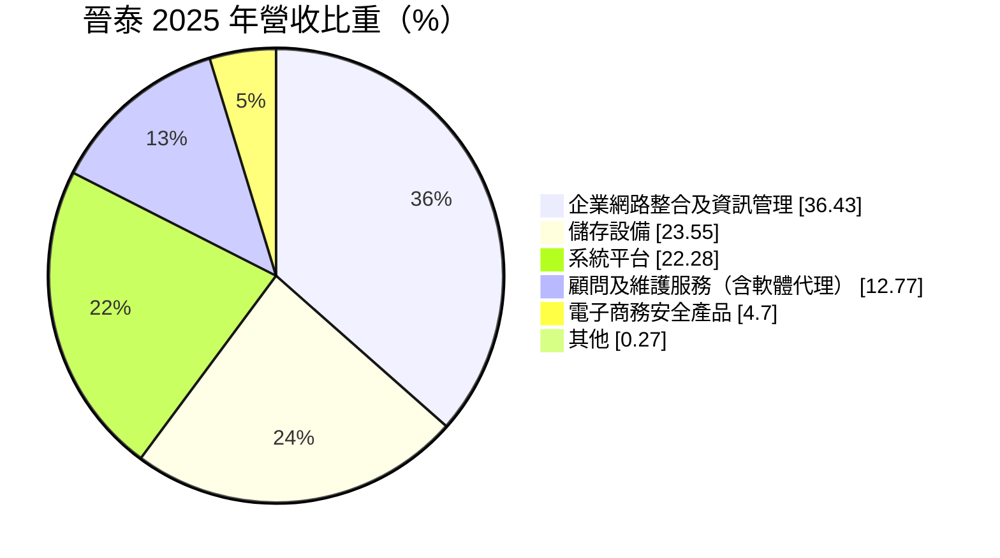
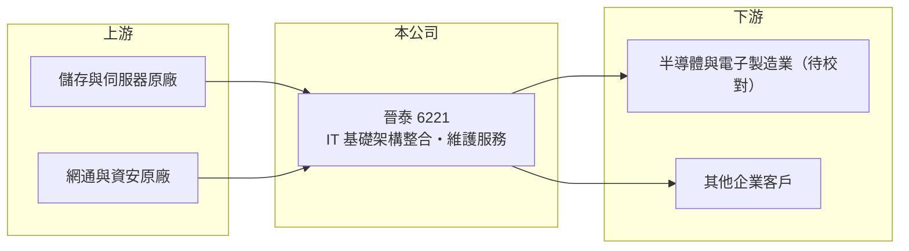

# 6221 晉泰

> 上櫃｜[[產業索引-資訊服務業|資訊服務業]]｜上市（櫃）日期 2003/01/06

# 第一章：企業模式與商業藍圖

> [!info] 撰寫說明
> 精簡版，由 Claude 依公開資料整理，架構比照 [[2330台積電]]，資料截至 2026-10-08。來源：Goodinfo 經營績效年表（2019 至 2025 年）；富邦 e 點通（MoneyDJ）公司基本資料（2025 年營收比重）；櫃買中心開放資料快照（基本資料、2026 年第二季資產負債與上半年損益、每月營收、股利）。主要客戶與代理品牌依記憶整理，標示待校對。#待校對

晉泰（晉泰科技）成立於 1994 年 6 月、2003 年 1 月上櫃，總部設在新竹市光復路，實收資本額約 16.9 億元，董事長由法人昇鋒投資擔任，總經理為楊倉富。它是以新竹為根據地的企業 IT 基礎架構整合商，2025 年營收約 53 億元，長年服務新竹科學園區的高科技製造業客戶（主要客戶名單待校對）。

- **核心業務：** 晉泰替企業建置資料中心與網路的底層架構，包括網路整合、儲存設備、伺服器與系統平台，再加上顧問、維護與資安產品。這些都是企業 IT 的「地基」，晶圓廠與電子廠的生產系統、設計資料都要靠高可靠度的儲存與網路支撐。
- **營收結構：** 2025 年網路整合、儲存與系統平台三項合計約八成，顧問及維護服務約一成三。前者以硬體與軟體銷售為主，隨客戶擴廠與更新週期起伏；後者屬維護合約，是[[經常性收入]]的主要來源。
- **營運據點與客戶產業：** 以新竹為總部，鄰近科學園區，推估客戶集中在半導體與電子製造業（待校對）。客戶集中於高科技業的好處是單一客戶的 IT 預算大、對品質要求高，缺點是營收會跟著半導體擴產週期起伏。
- **長期方向：** 隨著晶圓廠擴產、AI 與高效能運算帶動資料量爆增，企業對儲存、網路與資安的需求持續成長。晉泰的長期課題，是從「設備整合」往「維運與資安服務」延伸，提高服務收入比重，降低對客戶擴廠時點的依賴。

# 第二章：護城河深度與競爭優勢

晉泰的護城河來自在地服務與高科技客戶的長期關係，這在晶圓廠這種不能停機的環境裡特別重要。

- **競爭優勢：** 半導體廠的 IT 系統要求全年不中斷，一旦出狀況就影響生產，因此客戶非常重視供應商的反應速度與過往紀錄。晉泰在新竹深耕三十年，工程師就近支援，這種信任關係很難被外地或新進業者取代，形成實質的轉換成本。
- **主要對手：** IT 基礎架構整合市場的對手包括 [[2480敦陽科]]、[[6214精誠]]、[[8099大世科]]、[[5410國眾]]、[[6112邁達特]]，以及各原廠的直接銷售團隊。晉泰的差異化在於新竹地緣與高科技業經驗。
- **觀察重點：** 第一，顧問與維護服務比重能否從一成多往上提升；第二，[[營業利益率]]在 2024 年之後升到 9% 以上，能否維持；第三，客戶擴產週期放緩時，營收下滑的幅度與恢復速度。

# 第三章：財務體質與盈利規模

資料日期：2026-10-08，表格是撰寫當時的快照；最新月營收、毛利率、累計 EPS 由自動排程寫在本筆記的屬性欄位（月營收、毛利率、累計EPS 等）。#待校對

晉泰的財務特色是營收規模穩定擴大、利潤率逐步改善、ROE 長年維持在 13% 以上。

| 年度 | 營收（億元） | [[毛利率]] | [[營業利益率]] | EPS（元） | [[ROE]] |
|---|---|---|---|---|---|
| 2019 | 33.8 | 22.3% | 7.13% | 3.92 | 19.6% |
| 2020 | 40.7 | 20.3% | 7.33% | 4.29 | 20.9% |
| 2021 | 39.3 | 19.8% | 6.72% | 2.95 | 15.6% |
| 2022 | 51.6 | 19.6% | 7.31% | 3.97 | 19.7% |
| 2023 | 54.7 | 19.1% | 6.77% | 2.92 | 14.9% |
| 2024 | 52.2 | 23.1% | 9.52% | 3.51 | 18.0% |
| 2025 | 53.4 | 20.3% | 9.31% | 2.35 | 13.4% |
| 2026 上半年 | 19.6 | 26.7% | 12.1% | 1.22 | 未查得 |

註：2019 至 2025 年取自 Goodinfo；2026 年上半年取自櫃買中心開放資料推算（營業毛利 5.25 億元、營業利益 2.38 億元）。2025 年營業利益率與 2024 年相近但 EPS 明顯下降，推估與股本擴大（如盈餘轉增資）有關，待校對。

- **長期指標：** 2020 至 2025 年營收年複合成長率約 5.6%（推算），2021 至 2025 年平均 ROE 約 16.3%（推算）。櫃買中心快照顯示最近一年度現金股利約 1.20 元，相對 2025 年 EPS 2.35 元，配息率約五成（推算）；若過去有配發股票股利，代表公司同時保留盈餘擴大營運資金。2026 年 1 至 8 月累計營收較去年同期減少約 28%，但上半年毛利率與營業利益率都高於往年，顯示營收組合轉向高毛利服務。
- **[[ROIC]] 與 [[WACC]]：** 2025 年營業利益約 4.97 億元（53.4 億 × 9.31%），稅後約 3.98 億元；2026 年第二季股東權益 30.4 億元，有息負債未查得，假設約 5 億元，投入資本約 35.4 億元，ROIC 約 11%（推算）。WACC 以無風險利率 1.75%、市場風險溢酬 6%、β 0.9（資訊服務股常見值）推得權益成本 7.15%，負債約占一成五、稅後負債成本約 2%，WACC 約 6.4%（推算）。ROIC 高出 WACC 約 5 個百分點，代表晉泰在正常年度能穩定創造價值。
- **財務特色：** 2026 年第二季總資產 64.8 億元、負債 34.3 億元，負債幾乎都是流動負債，推估多為應付設備款與預收款，屬營運性質。[[每股淨值]] 18.04 元。

# 第四章：總體風險與地緣政治

晉泰的風險主要來自客戶產業集中，半導體與電子業的擴產節奏決定它的營收高低。

- **產業週期：** 高科技製造業的 IT 支出與擴廠計畫高度相關，半導體景氣下行時新廠延後，儲存與網路設備的採購也會跟著遞延。2026 年前八個月營收減少近三成，就是這類週期的例子。
- **營運風險：** 以設備整合為主的營收，毛利率受原廠價格與競標壓力影響。若主要客戶自建 IT 團隊或改向原廠直接採購，代理整合商的角色會被削弱。
- **其他風險：** 進口設備以美元計價，匯率波動會影響成本。客戶向海外擴廠時，晉泰需要跨國服務能力，否則可能無法跟上客戶腳步。[[資安]]需求上升是機會，但資安事件也可能帶來責任風險。

# 專有名詞解析

## 應用

- **[[系統整合]]**：把不同廠牌的硬體、軟體與網路整合成可運作的資訊系統，並負責建置與後續維護的服務。
- **[[資安]]**：資訊安全，保護系統與資料不被入侵、竊取或破壞的技術與管理措施。

## 金融

- **[[經常性收入]]**：每年固定重複發生的收入，例如維運年約、訂閱費，能讓營收比一次性專案更穩定。
- **[[ROIC]]**：投入資本報酬率，稅後營業利益除以股東權益加有息負債，衡量本業運用資本的效率。
- **[[WACC]]**：加權平均資金成本，股東與債權人要求報酬率的加權平均，是 ROIC 要超越的門檻。

# 核心供應鏈

- 上游：國際儲存、伺服器、網通與資安原廠，具體代理品牌未查得。
- 下游／客戶：新竹科學園區一帶的半導體與電子製造業及其他企業（待校對）。
- 同業：[[2480敦陽科]]、[[6214精誠]]、[[8099大世科]]、[[5410國眾]]、[[6112邁達特]]。

## 最新新聞
<!-- news:start（自動產生，請勿手動編輯此範圍） -->
- 2026-10-14 🏛️ 重訊 17:20｜公告本公司法人董事長代表人辭任｜[觀測站](https://mops.twse.com.tw/mops/#/web/t05st01)
- 2026-10-08 📰 媒體 19:51｜營收速報 - 晉泰(6221)9月營收6.16億元年增率高達47.3％｜[鉅亨網](https://news.cnyes.com/news/id/6625898)
- 2026-10-08 🏛️ 重訊 16:23｜公告本公司法人董事指派代表人｜[觀測站](https://mops.twse.com.tw/mops/#/web/t05st01)

完整紀錄：[[6221晉泰 新聞]]
<!-- news:end -->

## 相關連結
- [公開資訊觀測站](https://mopsov.twse.com.tw/mops/web/t05st03?step=1&firstin=1&co_id=6221)
- [Goodinfo](https://goodinfo.tw/tw/StockDetail.asp?STOCK_ID=6221)
- [Yahoo 股市](https://tw.stock.yahoo.com/quote/6221)
- [鉅亨網新聞](https://www.cnyes.com/twstock/6221/news)
