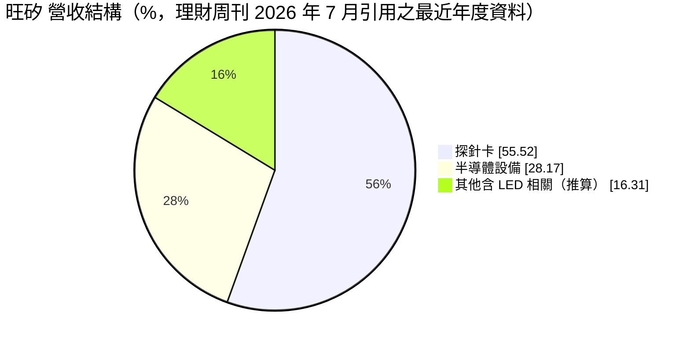
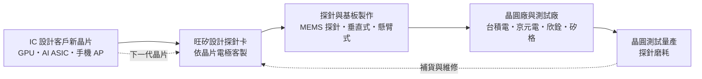
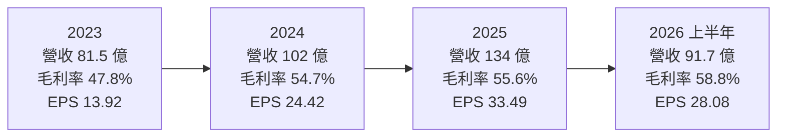
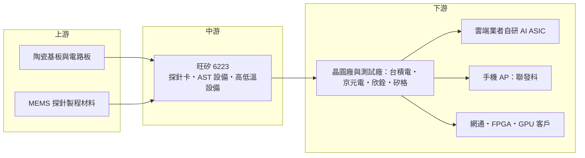

# 6223 旺矽

> 上櫃｜[[產業索引-半導體業|半導體業]]｜上市（櫃）日期 2003/01/06

# 第一章：企業模式與商業藍圖

> [!info] 撰寫說明
> 本文由 Claude 依公開資料整理，架構比照 [[2330台積電]] 的四章研究，資料截至 2026-10-08。財務數字來源：Goodinfo 經營績效頁（2019 至 2025 年度）、櫃買中心開放資料快照（基本資料、2026 年上半年損益與第二季資產負債）、理財周刊 2026 年 7 月兩篇個股報導（含法人與高盛預估）；產業描述為整理性內容，尚未逐條比對原始文件。#待校對

在評估單一個股的長期投資價值時，首要步驟是拆解企業的底層獲利邏輯。本章針對旺矽科技（股票代號：6223，以下簡稱旺矽）的商業模式進行定性分析，說明一家做「測試耗材」的公司，為何能在 AI 晶片時代享有比多數半導體公司更高的毛利率。

## 一、核心定位：台灣最大的探針卡廠，AI ASIC 晶圓測試的關鍵供應商

旺矽成立於 1995 年 7 月，總部位於新竹，在櫃買中心掛牌。公司的核心產品是[[探針卡]]，也就是晶圓測試時接觸晶片電極、把測試機台的訊號傳進每一顆晶片的介面。晶片在切割封裝之前，必須先在晶圓上逐顆量測（[[CP測試]]），把不良品標記出來，避免後段浪費封裝成本。探針卡上布滿數千到數萬根極細的探針，每一款晶片的電極排列都不同，因此每張探針卡都要依客戶晶片客製。

這讓探針卡具有一種特殊的商業性質：它既是客製化的精密零件，又是會磨耗、需要定期更換的耗材。客戶每推出一款新晶片，就要買一批新的探針卡；量產期間探針磨損，又要持續補貨或維修。只要客戶持續設計新晶片、持續量產，探針卡的需求就會不斷發生。

依理財周刊 2026 年 7 月報導，旺矽的垂直式探針卡（VPC）與懸臂式探針卡（CPC）市占率在台灣同業中居首，並與十家以上歐、美、中晶片公司長期合作，客戶包括超大型雲端服務商（[[CSP]]）自研 AI [[ASIC]]、美系 GPU、網通晶片、FPGA 與手機 AP 廠。同一篇報導指出，旺矽在 CSP 委外 AI ASIC 的探針卡市占平均達七成以上。使用者在核心供應鏈章節中，把旺矽列在台積電供應鏈的「測試介面與檢測設備」，以及 [[2454聯發科]] 供應鏈的「垂直與懸臂式探針卡」，正是這個角色。

## 二、終端應用板塊：探針卡為主，設備為輔

依理財周刊 2026 年 7 月報導，旺矽的營收結構如下：

* **探針卡：** 旺矽的營運主力，分為懸臂式、垂直式與 [[MEMS]] 探針卡。懸臂式技術成熟、成本較低，用於腳位較少的晶片；垂直式與 MEMS 探針卡可以容納更多、更密的探針，適合 GPU、AI ASIC 這類腳位數以萬計的大晶片。依理財周刊報導，法人預期 2026 年垂直式占探針卡營收比重可達 60% 以上，高階探針卡占旺矽營收比重有機會達到五成。
* **半導體設備（新事業群）：** 包括先進半導體測試（AST）設備，例如晶圓級的探針台與工程測試系統，以及高低溫測試（Thermal）設備，主要用於晶片研發階段的特性量測與可靠度測試。
* **LED 相關：** 旺矽早期跨足 LED 檢測與分選設備，是三大業務板塊之一，但已不是成長重心（具體比重未查得）。

## 三、資本轉化邏輯：每一款新晶片都要一套新的探針卡

* **需求跟著晶片設計數量走：** 探針卡的需求和「新晶片的數量與複雜度」高度相關，而不只是和晶片出貨量相關。AI 時代雲端業者紛紛自研 ASIC，每一家都有自己的晶片與世代，等於創造了大量新的探針卡需求。
* **晶片越大越複雜，探針卡越值錢：** AI 晶片面積大、腳位多、測試電流高，需要更多探針與更高階的垂直式或 MEMS 探針卡。依理財周刊報導，旺矽已跨入 3 奈米晶圓測試，原本預期 2026 年切入 2 奈米。製程越先進，探針間距越細，單價也越高。
* **擴產與預付款：** 依理財周刊報導，旺矽的垂直式與 MEMS 探針卡擴產幅度超過 30%，產能仍然滿載，並正與客戶洽談預付款以確保產能配置。客戶願意預付，代表探針卡在 AI 晶片測試中已成為瓶頸之一。
* **提高自製率：** 旺矽的策略是提高關鍵零組件的自製率，並拉高高毛利 MEMS 探針卡的占比，讓毛利率隨產品組合升級而提升。

## 四、企業長期藍圖：從探針卡延伸到矽光子測試

* **鞏固 AI ASIC 探針卡地位：** 雲端業者自研晶片的趨勢若持續，旺矽在 CSP 委外 ASIC 探針卡的高市占，是未來數年最重要的成長基礎。
* **爭取 GPU 大客戶的新一代產品：** 依理財周刊報導，市場傳出美系 GPU 大廠正與旺矽洽談新一代產品訂單（尚未證實）。若能進入 GPU 主流平台，將大幅擴大可服務市場。
* **矽光子測試：** 旺矽正加速共同封裝光學（[[CPO]]）與[[矽光子]]量產測試機型的開發，2026 年與客戶驗證，相關合作預計在 2027 年底前逐漸明朗。光電混合晶片需要同時量測電訊號與光訊號，是旺矽結合探針卡與光電設備經驗的新方向。
* **設備事業：** 工程測試與高低溫設備讓旺矽在客戶的研發階段就參與晶片驗證，能提早掌握下一代晶片的測試需求，與探針卡業務形成互補。

# 第二章：護城河深度與競爭優勢

在長期價值投資中，「護城河」指企業抵禦競爭、維持超額利潤的保護機制。本章分析旺矽的護城河構成、全球主要競爭對手，以及這些優勢在探針卡產業擴產與同業追趕下能守住多少。

## 一、旺矽護城河的核心組成要素

旺矽的毛利率長期高於多數半導體公司，2025 年達 55.6%，顯示它擁有「窄但深」的護城河，由三個要素組成：

* **1. 客製化與共同開發的轉換成本：** 探針卡必須在晶片設計階段就與客戶共同開發，配合晶片的電極排列、測試電流與溫度條件，並通過客戶與測試廠的驗證。一款晶片一旦用某家探針卡完成驗證，整個產品生命週期通常會沿用同一家，換供應商就要重新設計與驗證。
* **2. 高階探針的製程能力：** AI 晶片探針卡需要在極小的間距內放入數萬根探針，並確保每根探針在高溫、大電流下接觸穩定。MEMS 探針的製作需要精密的微機電製程能力，這是多數探針卡廠無法跨越的門檻。
* **3. 交期與在地服務：** 晶片公司在新產品上市前最怕測試延誤，探針卡交期往往決定晶片的上市時程。旺矽在台灣靠近晶圓廠與測試廠，能提供快速的設計修改與維修服務，這在 AI 晶片快速迭代的時代特別重要。

## 二、全球主要競爭對手格局

| 對手 | 定位 | 對旺矽的威脅 |
|---|---|---|
| FormFactor | 美國探針卡龍頭，MEMS 探針卡與記憶體探針卡市占高 | 技術與規模領先，在高階邏輯與 GPU 探針卡直接競爭 |
| Technoprobe | 義大利探針卡大廠，高階邏輯探針卡成長快速 | 在 AI 與 HPC 晶片探針卡與旺矽正面競爭 |
| 日本麥克隆尼克斯（MJC） | 日本探針卡大廠，記憶體探針卡為主 | 在記憶體探針卡與部分邏輯產品競爭 |
| [[6510精測]] | 台灣探針卡與測試載板廠，手機 AP 客戶為主 | 在台灣邏輯晶片探針卡與旺矽競爭 |
| [[6515穎崴]] | 台灣測試座龍頭，切入探針卡 | 以測試座的客戶關係延伸，搶食高階測試介面市場 |

## 三、優勢轉化：哪些市場守得住、哪些守不住

* **守得住：** CSP 委外 AI ASIC 的探針卡、網通與手機 AP 的垂直式探針卡。這些客戶與旺矽合作時間長，旺矽在台灣的交期與服務優勢明顯。理財周刊報導的七成以上 ASIC 探針卡市占，是旺矽目前最強的陣地。
* **守不住或尚未取得：** 記憶體探針卡（FormFactor 與 MJC 主導）以及部分最高階 GPU 平台。這些市場的既有供應商地位穩固，旺矽需要時間爭取。
* **觀察重點：** 第一，能否打進美系 GPU 大廠的新一代產品；第二，MEMS 探針卡的自製率與產能擴充能否支撐高毛利率；第三，CPO 與矽光子測試能否在 2027 年前後成為新的成長來源。

# 第三章：財務體質與盈利規模

資料日期：2026-10-08。數字取自 Goodinfo 經營績效頁與櫃買中心開放資料快照，表格是撰寫當時的快照；最新月營收、毛利率、累計 EPS 由自動排程寫在本筆記的屬性欄位（月營收、毛利率、累計EPS 等）。#待校對

財務報表是檢驗護城河是否真實存在的最終標準。本章用多年度的三率、[[ROE]] 與資本報酬，檢視旺矽在 AI 晶片測試需求擴張中的獲利品質。

## 一、獲利能力的基石：三率

| 年度 | 營收（新台幣） | [[毛利率]] | [[營業利益率]] | EPS（元） | [[ROE]] |
|---|---|---|---|---|---|
| 2019 | 55.2 億 | 40.4% | 8.65% | 5.36 | 10.1% |
| 2020 | 59.3 億 | 43.6% | 14.5% | 8.41 | 14.2% |
| 2021 | 65.1 億 | 42.1% | 12.4% | 7.44 | 11.9% |
| 2022 | 74.1 億 | 46.0% | 16.9% | 12.89 | 18.7% |
| 2023 | 81.5 億 | 47.8% | 18.1% | 13.92 | 18.0% |
| 2024 | 102 億 | 54.7% | 24.4% | 24.42 | 27.2% |
| 2025 | 134 億 | 55.6% | 28.2% | 33.49 | 26.6% |
| 2026 上半年 | 91.7 億 | 58.8% | 33.5% | 28.08 | 約 34.6%（年化推算） |

資料來源：2019 至 2025 年為 Goodinfo 經營績效頁；2026 上半年依櫃買中心綜合損益快照計算（營收 91.66 億元、營業毛利 53.93 億元、營業利益 30.75 億元、淨利 27.51 億元），ROE 以上半年淨利年化除以 2026 年第二季權益 159.0 億元推算。

* **毛利率持續墊高：** 旺矽的毛利率從 2019 年的 40.4%，一路提升到 2025 年的 55.6% 與 2026 年上半年的 58.8%。這段期間營收成長了一倍以上，毛利率卻沒有因為擴產而下滑，反而持續上升，說明成長主要來自高階垂直式與 MEMS 探針卡，產品組合不斷升級。
* **營運槓桿明顯：** 營業利益率從 2019 年的 8.65% 升到 2026 年上半年的 33.5%。探針卡的研發與管理費用相對固定，營收擴大後，增加的毛利大部分轉為營業利益。
* **成長速度：** 2020 年到 2025 年營收從 59.3 億元成長到 134 億元，年複合成長率約 17.7%（推算）；2026 年上半年營收已接近 2025 年全年的七成。

## 二、[[ROE]]：資本效率

旺矽 2021 至 2025 年的 ROE 分別為 11.9%、18.7%、18.0%、27.2% 與 26.6%，五年平均約 20.5%（推算），而且呈現逐年上升的趨勢。2026 年上半年年化 ROE 約 34.6%（推算），在台灣半導體公司中屬於很高的水準。

依櫃買中心 2026 年第二季資產負債快照，旺矽資產總計 354.2 億元，負債 195.1 億元，權益 159.0 億元，每股淨值 162.32 元。負債中流動負債 122.3 億元，推估包含應付帳款、合約負債（客戶預付款）與員工酬勞；非流動負債 72.8 億元的組成未查得（推估含長期借款或可轉換公司債）。股本只有 9.8 億元，代表每股獲利與每股淨值都相當高。

## 三、資本支出、自由現金流與股利

* **[[CapEx]]：** 多年度資本支出金額未查得。依理財周刊報導，垂直式與 MEMS 探針卡擴產幅度超過 30%，資本支出推估隨擴產而增加，但探針卡廠的設備投資規模遠小於封測廠或晶圓廠，屬於「中度資本密集」的產業（推估）。
* **[[自由現金流]]：** 多年度數字未查得。以 2026 年上半年營業利益 30.75 億元與客戶洽談預付款的情況推估，營業現金流足以支應擴產，自由現金流應維持為正（推估）。
* **股利：** 櫃買中心開放資料快照中未包含旺矽的股利紀錄，近年配息金額與配發率未查得。

## 四、[[ROIC]] 與 [[WACC]]：價值創造利差

**ROIC 推算：** 2026 年上半年營業利益 30.75 億元，年化約 61.5 億元，以 20% 稅率計算稅後營業利益約 49.2 億元。投入資本以 2026 年第二季權益 159.0 億元，加上非流動負債 72.8 億元作為有息負債的近似值（有息負債明細未查得），合計約 231.8 億元，ROIC 約 21.2%（推算）。以 2025 年營業利益約 37.8 億元（134 億元 × 28.2%）計算，稅後約 30.2 億元，ROIC 約 13.0%（推算；分母用的是 2026 年第二季的投入資本，會低估 2025 年的實際 ROIC）。

**WACC 推算：** 台灣 10 年期公債殖利率取 1.75%，市場風險溢酬取 6%，β 取中小型半導體測試介面股常見的 1.2 至 1.4（旺矽本身的 β 未查得），股東權益成本約 9.0% 至 10.2%。負債成本取 2%，稅後 1.6%，以權益約 69%、負債約 31% 計算，WACC 約 6.7% 至 7.5%（推算）。

**解讀：** 旺矽的 ROIC 約 20% 上下，比 WACC 高出約 13 到 14 個百分點，是這批半導體公司中價值創造利差最大的之一。高毛利、高 ROIC 而不需要龐大資本支出，正是「客製化耗材」商業模式的優勢。需要注意的是，這個利差建立在 AI ASIC 需求強勁與產能吃緊的基礎上，若同業大舉擴產或 AI 晶片設計案減少，價格與產能利用率回落時，ROIC 也會跟著下降。

# 第四章：總體風險與地緣政治

任何企業都無法脫離宏觀環境獨立存在。本章分析旺矽未來必須面對的地緣政治、產業週期與營運風險。

## 一、地緣政治風險

* **客戶分布在美中兩地：** 旺矽的客戶包括美國的 GPU、ASIC 與網通晶片公司，也包括中國晶片公司。美國對中國先進晶片的出口管制若擴大到測試耗材或設備，可能限制旺矽對中國客戶的出貨；反過來，中國推動測試介面國產化，也會逐步侵蝕旺矽在中國市場的份額。
* **生產集中台灣：** 探針卡的主要生產與研發在台灣，兩岸情勢若影響台灣的半導體生產，旺矽與其晶圓廠、測試廠客戶會同時受到衝擊。
* **美國在地化：** 若晶片製造與測試逐步移往美國，探針卡廠可能需要在美國提供在地服務與維修據點。

## 二、產業週期與市場結構風險

* **客戶集中於 AI ASIC：** 旺矽目前最重要的成長來源是少數雲端業者的自研 ASIC。若雲端業者縮減 AI 投資，或改變 ASIC 的設計夥伴與測試流程，旺矽的訂單會受影響。
* **半導體庫存週期：** 探針卡雖然和新晶片設計數量相關，但量產期的補貨仍跟著晶片出貨量走。景氣下修時，客戶會延後新案、減少補貨，透過[[長鞭效應]]放大反映在訂單上。
* **同業擴產：** FormFactor、Technoprobe 等國際大廠也在擴充 AI 相關探針卡產能，若需求成長放緩，產業可能出現價格競爭。

## 三、營運環境的隱性風險

* **人才與技術外流：** 探針卡的核心是設計與製程經驗，關鍵工程師流失或技術被同業挖角，都可能削弱競爭力。
* **產能瓶頸：** 依理財周刊報導，旺矽產能仍然滿載。若擴產速度跟不上客戶需求，客戶可能轉向第二供應商，打破原本的獨家或高市占地位。
* **原料與零組件：** 探針材料、陶瓷基板與 MEMS 製程相關材料若供應吃緊，會影響交期與成本。
* **匯率：** 客戶多為海外公司，營收以美元計價為主，新台幣升值會壓縮以台幣計的獲利。

## 四、科技演進風險

探針卡的技術演進和晶片製程與封裝架構緊密相關。製程從 3 奈米走向 2 奈米及以下，探針間距更細、接觸要求更高；[[Chiplet]] 與先進封裝架構則要求每顆小晶片在封裝前都必須是確認過的良品（[[KGD]]），晶圓測試的重要性與複雜度都會上升，這對探針卡廠是長期利多。另一方面，矽光子與 CPO 需要同時量測電與光訊號，是全新的測試領域，若旺矽在這方面落後，可能錯失下一代 AI 互連晶片的測試商機。測試流程若出現重大改變，例如更多測試改以晶片內建自我測試完成，也可能長期影響探針卡的使用量。

# 專有名詞解析

## 半導體

- **[[探針卡]]**：晶圓測試時接觸晶片電極的介面，上面布滿細微探針，需依每顆晶片客製，屬於會磨耗的耗材。
- **[[CP測試]]**：晶圓針測，晶片還在晶圓上時以探針卡逐顆量測電性，提早剔除不良品。
- **[[MEMS]]**：微機電系統，以半導體製程製作微小機械結構的技術，可用來製作高密度探針。
- **[[ASIC]]**：特殊應用積體電路，為特定用途客製的晶片，例如雲端業者自研的 AI 加速器。
- **[[CPO]]**：共同封裝光學，把光學收發元件和運算或交換晶片封裝在一起，以降低高速傳輸的耗電。
- **[[矽光子]]**：在矽晶片上製作光學元件，以光取代電傳輸資料，可降低 AI 資料中心的傳輸耗電。
- **[[Chiplet]]**：小晶片架構，把大晶片拆成多顆小晶片再以先進封裝整合，可提高良率並混用不同製程。
- **[[KGD]]**：已知良品晶粒，在封裝前就確認為良品的晶片，多晶片先進封裝特別需要。

## 應用

- **[[CSP]]**：雲端服務供應商，例如 Amazon、Google、Microsoft、Meta，是 AI 伺服器與客製化晶片的主要買家。

## 金融

- **[[CapEx]]**：資本支出，企業購買土地、廠房與設備的支出。
- **[[自由現金流]]**：營業活動現金流減去資本支出，代表企業可自由用於配息、還債或併購的現金。
- **[[長鞭效應]]**：終端需求的小幅變動，沿供應鏈往上游傳遞時被逐級放大，造成上游庫存與訂單劇烈波動。

# 核心供應鏈

## 1. 上游：探針卡材料與零組件
- 陶瓷基板、多層電路板與 MEMS 探針製程材料：旺矽在風險章節提到這些材料若供應吃緊會影響交期，個別供應商未查得
- 關鍵零組件自製：旺矽正提高自製率，以降低對外購零件的依賴

## 2. 中游：旺矽本身
- 探針卡：懸臂式、垂直式與 MEMS 探針卡，約占營收五成多
- 半導體設備：先進半導體測試（AST）設備與高低溫測試設備
- 矽光子與 CPO 量產測試機型：開發與客戶驗證中

## 3. 下游：探針卡的使用場域
- 晶圓廠：[[2330台積電]]（垂直與懸臂式探針卡）
- 專業測試廠：[[2449京元電子]]、[[3264欣銓]]、[[6257矽格]]

## 4. 下游：晶片設計客戶
- 雲端業者委外 AI ASIC：旺矽在這個市場的探針卡市占約七成以上，客戶名稱未公開
- 手機 AP：[[2454聯發科]]（垂直與懸臂式探針卡）
- 美系 GPU 大廠新一代產品：市場傳出洽談中，尚未證實
- 網通晶片與 FPGA：歐美多家，個別名單未查得

## 5. 同業競爭
- 國際探針卡大廠：FormFactor、Technoprobe、日本麥克隆尼克斯（MJC）
- 台灣測試介面廠：[[6510精測]]、[[6515穎崴]]

延伸閱讀：[[台積電供應鏈]]、[[聯發科供應鏈]]

## 供應鏈關係
- 供應給 [[2330台積電]]：垂直與懸臂式探針卡（台積電供應鏈 › 下游：測試介面與檢測設備）
- 供應給 [[2454聯發科]]：垂直與懸臂式探針卡（聯發科供應鏈 › 中游：測試介面與高階檢測分析）

## 最新新聞
<!-- news:start（自動產生，請勿手動編輯此範圍） -->
- 2026-10-13 📰 媒體 00:37｜旺矽、均華 認購來電 ／ 權證特區 ／ 證券｜[經濟日報](https://news.google.com/rss/articles/CBMiWkFVX3lxTE5vcFFZeFhjRkdfTjFJOWhuNTRiNkxTcEs0dUNkdWp6T1NlTjg2dUk2ekFtNjN0dm9DZFRLWlVEcWdBYVJ5TVNuMHRhSlZwcmdfbV9ydEZaQ2Z2UQ?oc=5)
- 2026-10-12 📰 媒體 18:30｜封測逆勢勁揚！「這檔」連拔3根寫新高挾旺矽、久元漲停 穎崴衝7%、欣銓攻6.45%｜[FTNN 新聞網](https://news.google.com/rss/articles/CBMiS0FVX3lxTE1Vc1lSWFNUTGl1OWRSalhCU1FRTVdPU3FOcEVDbngyWklHMmxGTDdtRnpWOFNmMzJCMEw0TFA5VE5RZkIzZzEzUnlvOA?oc=5)
- 2026-10-12 📰 媒體 15:30｜9月營收今年來連9月年增 法人看好旺矽明年EPS年增率可達近100%｜[台灣好新聞](https://news.google.com/rss/articles/CBMiggNBVV95cUxPYjJKT2E0SjNqWjB4V3VENndILVhTV3k4eVpNR19Cd0VnQkEtQ0dEVDUzLWNvQ3ZjMV9HRV9yNmJaWUREVktMMVFsWHNNbXdnZE83Y0dIUnFrNFJHZ3hIbkFfRzhLbFBtQmtfelZFNmJKbEtmWERscTNkTU8yRjNPdWNsWjg0VkxfUHhpdlhKYi1kQ2ZsT0s1dWhvS1lKVXp6eG1rZVJVeDE1SE5xeG1tN1Q0dFctWmRvNXIyQ2pibFhCWk1wOWZPWkdubW12VmxVZUpiLXdJdnVyLW1oRmk4NTdMb2M4S2ZHNllWd1JjZ1pDOEFkb05HTEVfUEtqUzhxbWRkVUpEV1lXUXpreXJudFc3WElmMFlla2VUbXBueUJTUk4zYjdQUlFva2d4Z1BTYlA0V2Y1UGt2UWtEUmZPYWVMMTJDYU9YanQxNGhESGUtREtSSnRKd2hENl8wbmtIQzMtY2FvMC0wSVFjT2hOYU5NR0VsQmpEdmZ3RlBFSHl3dw?oc=5)
- 2026-10-12 📰 媒體 15:00｜股市最錢線-20261012-高閔漳-6223旺矽亮燈漲停-1000元-台股繼續往五萬以上邁進-中視-中視新聞-股市最錢線-高閔漳-分析師-股票-股市看中視-華冠投顧- 中視全球資訊網｜[中視全球資訊網](https://news.google.com/rss/articles/CBMijgZBVV95cUxPZzJORDZRS1VNT2oxTkVyamVRTkRXblBHQ0h5dm9IRmhDYXJqRTMwTFF6bl8zZlhabkdhdHNMemRjMXhselA4MDF3dEh0c3pVczJXUndObUpOM1lVS3hHQXlVSlRKX1BOWUVzUGtiODM2UlJOSGM5dXFJNlBLcmE1UndxaUpmUkI4V1BQUWo5THQtSU1rNjBmWWZuN0VwbzJZbHZtSDNSWGhmMDdtamFHOGZLejU1WW1JZ3VnYmFMdkM4ZU1pSnBGbjlqWWtPVlY3eDI0b3RGcENCSkNCSmtfdm5EeXplelFtVTctZ1RxQXJuZnJvOXk2eWl5QVlFVnpZRmE5RlZPU1M1eFk2Y2xVZHJ4bElmc3NTNmx5RmE0ZTNNRE1fc1ZKeWVGaks0T1BWS2VLekdWSnJWWE1rTmVKYkh2MTNwSWMtcHMzdDZvS0RoNWp1ZVp4SGU1VVBtQ01hOEtLNXliX2tVTDlQdnFSYjlBd0prVExIX2xncUd2ejVJSFVDTURQWVJtZjFCVVR0SXBFUW1VSGJIekZzNVFUQnhfa1V2cUhhQXUwNC02SUxCZjBCNVFFSGhJM0tZNjJnbXF0Q2NJbmV0bW9MSlNqWU5EcnZlUElDT0FsNjNDcFRDTThNWVZkdl9TQWFYNk41ZkxxUkFfeXc3QXAzRHlCYTJwOEt4VHBOTzltMC16SkhOdFlFS3E0aklzYlFGMkdyY3ZRS0JwODk2cDJlRmllcm5QdFNsUWFPMUM3Ri1Sdm90WFM5VUhiZ1R6b01rNUJmV2JaUTNCT2phWVNFTWhjN2xfSy1Gd2E0S2JqamhxR3c3ZklIZ3lfOU9MakNORXN2U3NubnNVTWhWV2JtR3ctenVSdmo2M0pCQ0k4d0ZBdW9TM2FjVkxrVjBFLWdnVFhCV1V5OFpRa0R3STVqYWRvWkRhRjF2OFZhQlNLclNzak9HS1JORWhfTEJ5M0VPQWFxb0k0SHVDUDhWOGJjb21PbEJwUHlEZGNOZWdRT0lHOWlfSC1BZnZ1V0Y4SDk2dw?oc=5)
- 2026-10-12 📰 媒體 13:03｜旺矽Q3營收創高 Q4續踩油門｜[台視全球資訊網](https://news.google.com/rss/articles/CBMiqwFBVV95cUxPaHdxT0xuM0NOOTF3WG5CRHVPdEJzaTh3TUV2UEdSZW03MzItT3dBT2ZsR3FESmlVM0tTRHNYYWduajRiVG9FQnRHTzZBWUVzenlrT0Fla2dnSzlzR1B5OHhwWkxyZ3Vod3UzUEtiTEExclQxZ0tkdFVVTWlucTdBaGx5LUFMVFhUUFQ0N1drbzhROXNlOWowT0twamEtMEsxYUtuNXpuSWMxZEU?oc=5)

完整紀錄：[[6223旺矽 新聞]]
<!-- news:end -->

## 相關連結
- [公開資訊觀測站](https://mopsov.twse.com.tw/mops/web/t05st03?step=1&firstin=1&co_id=6223)
- [Goodinfo](https://goodinfo.tw/tw/StockDetail.asp?STOCK_ID=6223)
- [Yahoo 股市](https://tw.stock.yahoo.com/quote/6223)
- [鉅亨網新聞](https://www.cnyes.com/twstock/6223/news)
