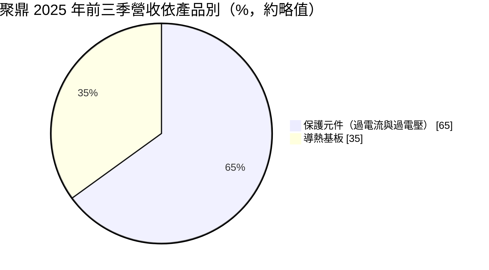
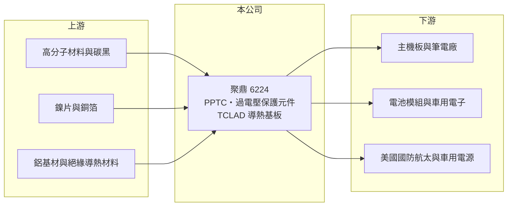

# 6224 聚鼎

> 上市｜[[產業索引-電子零組件業|電子零組件業]]｜上市（櫃）日期 2009/09/17

# 第一章：企業模式與商業藍圖

> [!info] 撰寫說明
> 精簡版，由 Claude 依公開資料整理，架構比照 [[2330台積電]]，資料截至 2026-10-08。來源：證交所開放資料快照（基本資料、2026 年第二季資產負債與損益、營益分析、股利、每月營收）、Goodinfo 經營績效頁（含 2026 年 8 月法說會新聞標題）、富果研究 2025 年 12 月 16 日法說會摘要（AI 整理稿）。法說會內容未比對原始簡報；Goodinfo 部分年度 ROE 與 EPS 正負不一致，待校對。#待校對

聚鼎科技（以下簡稱聚鼎）是一家專做電路保護元件與[[導熱基板]]的公司，總部位於新竹科學園區，2009 年在證交所上市。理解聚鼎的關鍵在於：它的本業是 [[PPTC]] 可復式保險絲這種高毛利的利基元件，2021 年收購德國漢高（Henkel）的 TCLAD 導熱基板事業後，營收規模擴大，但獲利也開始受美國國防與車用訂單的波動拖累。

- **核心業務：** 聚鼎成立於 1997 年，以高分子正溫度係數材料技術起家。主力產品 PPTC 是一種「可以自己復原的保險絲」，電流過大時電阻急升切斷電路，故障排除後又恢復導通，廣泛用於主機板、筆電 USB 埠、鋰電池與車用馬達保護。之後增加過電壓保護元件，讓客戶可以一次購足保護方案。
- **營收結構：** 依法說會摘要，2025 年前三季保護元件約占 65%、導熱基板約 35%；保護元件中過電流保護占營收一半以上、過電壓保護約兩成。2025 年前三季保護元件年增約 13%，導熱基板則年減約 17%，主因美國國防客戶的訂單週期。
- **營運據點：** 總部與主要工廠在新竹科學園區，另在美國與中國大陸設有生產據點，美國據點主要承接 TCLAD 導熱基板業務（推估）。導熱基板由子公司聚燁科技負責。2026 年第二季總資產約 43.7 億元。
- **長期方向：** 聚鼎以過電流、過電壓、過溫度三種保護技術為核心，目標提供完整的電路保護產品組合，並透過 TCLAD 把導熱基板推向車用電源與美國國防航太等高階市場。2026 年 8 月法說會提到企業級記憶體與 [[AI 伺服器]]電源需求強勁，代表保護元件正切入資料中心的新應用。

# 第二章：護城河深度與競爭優勢

聚鼎的護城河來自高分子材料配方與製程的長期累積，以及一站式保護元件的產品組合。

- **競爭優勢：** PPTC 的關鍵在於導電高分子材料的配方與加工控制，性能穩定度直接影響產品安全，新進者很難在短時間內達到大客戶要求。2019 至 2020 年、尚未併入 TCLAD 時，聚鼎毛利率接近 50%、營業利益率約 24%，顯示本業具有相當強的定價能力。
- **主要對手：** 國際上主要對手是美國力特（Littelfuse，PPTC 鼻祖 Raychem 業務的承接者）與伯恩斯（Bourns），導熱基板則與美國貝格斯（Bergquist，現屬漢高）等競爭（#待校對）。台灣同業有 [[2428興勤]]、[[6284佳邦]] 等保護元件廠。
- **觀察重點：** 長期最值得追蹤的是導熱基板事業能否穩定獲利。2021 年併入 TCLAD 後，營收由 17.7 億元躍升到 30.8 億元，但毛利率由近五成掉到兩成至三成、營業利益率一度轉負，收購至今尚未證明能提升整體股東報酬。

# 第三章：財務體質與盈利規模

資料日期：2026-10-08，表格是撰寫當時的快照；最新月營收、毛利率、累計 EPS 由自動排程寫在本筆記的屬性欄位（月營收、毛利率、累計EPS 等）。#待校對

聚鼎的財務呈現「收購帶來規模、卻稀釋了獲利率」的樣貌：營收規模擴大近一倍，但 EPS 由 2021 年 6 元降到 2025 年不到 1 元。

| 年度 | 營收（億元） | [[毛利率]] | [[營業利益率]] | EPS（元） | [[ROE]] |
|---|---|---|---|---|---|
| 2021 | 30.8 | 36.2% | 16.4% | 6.02 | 16.1% |
| 2022 | 29.4 | 17.3% | -6.3% | 1.05 | -3.3%（待校對） |
| 2023 | 27.9 | 25.1% | -2.7% | 1.24 | -1.0%（待校對） |
| 2024 | 29.3 | 31.2% | 4.0% | 2.23 | 4.7% |
| 2025 | 28.5 | 28.2% | 0.2% | 0.67 | -0.3%（待校對） |

（來源：Goodinfo 經營績效頁；2020 年營收 17.7 億元、EPS 5.01 元。2022、2023、2025 年 EPS 為正但 ROE 為負，推估 ROE 欄位以其他口徑計算或資料有誤；以 EPS 除以每股淨值約 26 元粗估，這三年 ROE 約 2.6% 至 4.8%，推算。）

- **營收規模：** 2020 至 2025 年營收由 17.7 億元增至 28.5 億元，年複合成長率約 10%（推算），但成長幾乎全部來自 2021 年的收購，之後四年營收持平。2026 年前八月累計營收約 21.1 億元，年增約 9.4%（官方月營收資料）。
- **獲利：** 依 Goodinfo 數字近五年平均 ROE 約 3.2%，若改以 EPS 粗估約 6% 至 7%（推算），無論哪種口徑都明顯低於收購前的 17% 至 18%。2026 年上半年營收約 14.8 億元、毛利率約 33.7%、營業利益率約 7.1%、EPS 1.37 元，已超過 2025 年全年，顯示獲利正在回升。
- **財務特色：** 2026 年第二季權益約 22.6 億元、負債約 21.1 億元，負債比約 48%，每股淨值約 26.6 元，持有庫藏股 100 萬股。2025 年稅後淨利約 0.57 億元，卻配發每股 1.25 元現金（盈餘 0.5 元加資本公積 0.75 元），配發總額約 1.06 億元高於當年獲利，代表公司以資本公積維持股利水準。
- **[[ROIC]] 與 [[WACC]]：** 2025 年營業利益僅約 0.06 億元（28.5 億元 × 0.21%），ROIC 接近 0%（推算，以權益 22.6 億元至權益加全部負債 43.7 億元為投入資本）。若以 2026 年上半年營業利益 1.05 億元年化約 2.1 億元、稅後約 1.7 億元計算，ROIC 約 3.8% 至 7.4%（推算）。WACC 以 [[CAPM]] 推估：無風險利率 1.75%、市場風險溢酬 6%、β 假設 1.0，權益成本約 7.75%；稅後負債成本 2%、有息負債占資本約兩成五，WACC 約 6.3%（推算）。過去三年 ROIC 明顯低於 WACC，2026 年回升後大致接近資金成本；收購的導熱基板事業必須恢復獲利，聚鼎才能重新創造價值。

# 第四章：總體風險與地緣政治

聚鼎的風險集中在導熱基板事業的波動、收購整合，以及終端市場的景氣循環。

- **產業週期：** 保護元件需求跟隨筆電、主機板、電池與車用景氣，下游調整庫存時，[[長鞭效應]]會放大成元件訂單波動。2022 年毛利率由 36.2% 驟降到 17.3%，反映消費電子去庫存與收購後的成本壓力同時發生。
- **營運風險：** 導熱基板的獲利高度依賴美國國防航太與車用電源等少數市場，訂單週期長、時點不穩，2025 年就因國防訂單遞延導致該事業虧損。跨國收購的整合（德國原母公司、美國工廠）涉及管理、文化與成本控制，至今成效有限。
- **其他風險：** 主要原料包括高分子材料、碳黑、鎳與銅箔，原料價格波動影響成本；美國與中國大陸都有生產據點，美中貿易與關稅政策、國防採購預算變化都會影響訂單。以資本公積配發現金股利不可長期持續。

# 專有名詞解析

## 應用

- **[[AI 伺服器]]**：搭載 GPU 或 AI 加速晶片、用於訓練與推論的伺服器，功耗與傳輸速度要求遠高於一般伺服器。

## 金融

- **[[CAPM]]**：資本資產定價模型，以無風險利率加上 β 乘以市場風險溢酬，估算股東要求的報酬率。
- **[[長鞭效應]]**：終端需求的小幅變動，沿供應鏈往上游傳遞時被逐級放大，造成上游庫存與訂單劇烈波動。

## 產業

- **[[PPTC]]**：高分子正溫度係數元件，又稱可復式保險絲，電流過大時自動斷路、故障排除後自行恢復。
- **[[導熱基板]]**：以金屬為底、表面覆蓋絕緣導熱層與銅線路的電路板，用來快速導出功率元件與 LED 的熱。
- **[[被動元件]]**：不需外加電源即可運作的電子零件，主要包括電阻、電容與電感。

# 核心供應鏈

- 上游：高分子材料、碳黑、鎳片、銅箔（例如 [[8358金居]]，屬推估）、鋁基材與絕緣導熱材料（具體供應商未查得，#待校對）。
- 下游／客戶：主機板與筆電廠（例如 [[2357華碩]]、[[2376技嘉]]、[[2377微星]]，屬推估）、電池模組與車用電子廠、美國國防航太與車用電源客戶（法說會未具名）。
- 同業：[[2428興勤]]、[[6284佳邦]]，以及力特、伯恩斯。

## 最新新聞
<!-- news:start -->
<!-- news:end -->

## 相關連結
- [公開資訊觀測站](https://mopsov.twse.com.tw/mops/web/t05st03?step=1&firstin=1&co_id=6224)
- [Goodinfo](https://goodinfo.tw/tw/StockDetail.asp?STOCK_ID=6224)
- [Yahoo 股市](https://tw.stock.yahoo.com/quote/6224)
- [鉅亨網新聞](https://www.cnyes.com/twstock/6224/news)
