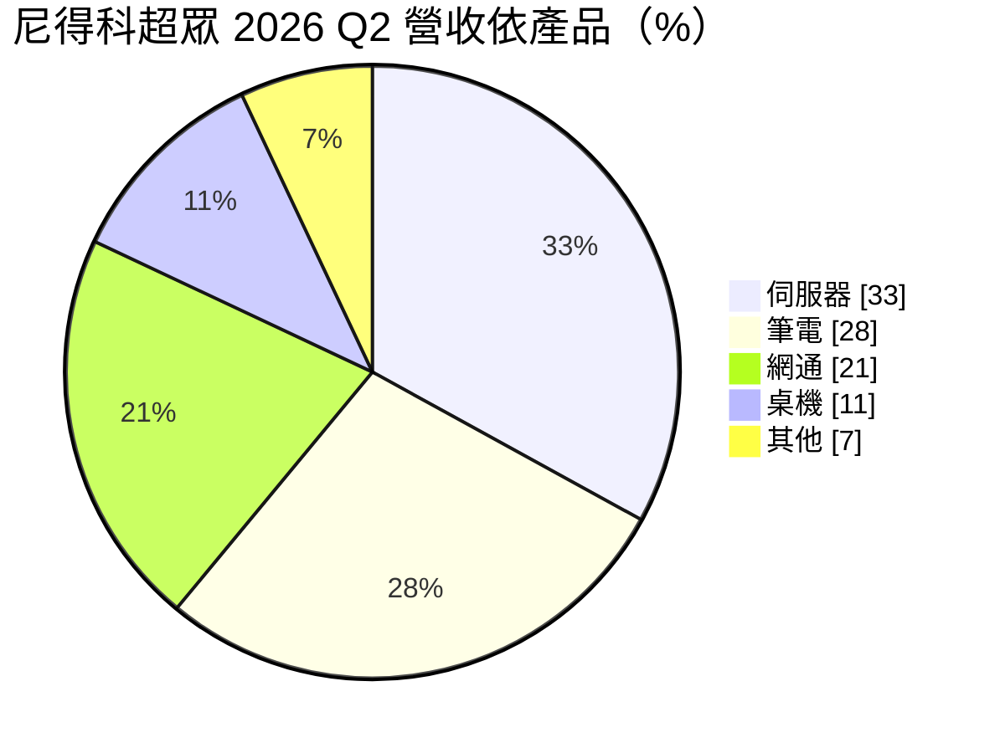
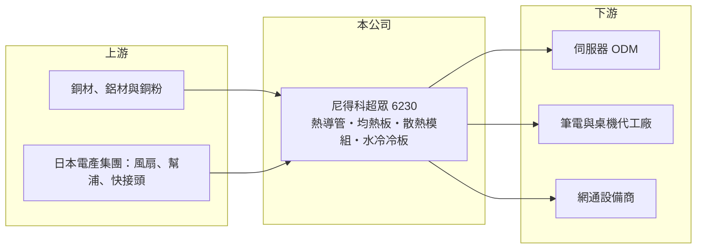

# 6230 尼得科超眾

> 上市｜[[產業索引-電腦及週邊設備業|電腦及週邊設備業]]｜上市（櫃）日期 2010/09/16

# 第一章：企業模式與商業藍圖

> [!info] 撰寫說明
> 精簡版，由 Claude 依公開資料整理，架構比照 [[2330台積電]]，資料截至 2026-10-08。來源：證交所開放資料快照（基本資料、2026 年第二季資產負債與損益、股利）、Goodinfo 經營績效頁、優分析 2026 年 8 月法說會報導。日本電產入主年份與遊戲機客戶依記憶整理，已標註待校對。#待校對

尼得科超眾（原名超眾科技）是台灣老牌的散熱模組廠，理解它的關鍵在於：它過去靠筆電與遊戲機的[[熱導管]]散熱模組賺錢，在日本電產（Nidec）入主後，正努力把重心轉向伺服器與[[液冷散熱]]，但轉型期間獲利明顯下滑，2025 年已轉為虧損。

- **核心業務：** 公司成立於 1973 年，2010 年在證交所上市，總部位於新北三重。產品包括熱導管、[[均熱板]]、散熱鰭片與完整的氣冷散熱模組，近年新增水冷冷板。日本電產約於 2018 至 2019 年取得控股權（#待校對），之後更名為尼得科超眾，董事長由日方派任，屬於日本電產集團的散熱事業成員。
- **營收結構：** 依 2026 年第二季法說資料，伺服器占 33%、筆電 28%、網通 21%、桌機 11%、其他 7%。公司正從遊戲機業務轉向伺服器，伺服器比重自 2026 年起上升。過去遊戲主機散熱曾是重要獲利來源（例如 Sony PS5 世代，#待校對），該業務縮減是近年營收與毛利下滑的主因之一（推估）。
- **營運據點：** 集團生產基地涵蓋中國、越南、台灣、泰國與菲律賓。氣冷產品（熱導管、均熱板、散熱片）主要在中國與越南生產；水冷冷板已在中國昆山量產出貨，第二階段計畫 2027 年移到越南河內廠、2028 年量產；[[CDU]] 在中國與泰國生產。
- **長期方向：** 公司目標 2028 年水冷產品營收比重達 5%。策略是自製冷板，分歧管、快接頭與幫浦則向日本電產集團採購，利用集團資源補齊液冷系統的關鍵零件。能否在 AI 伺服器液冷市場取得一席之地，是公司重回成長的關鍵。

# 第二章：護城河深度與競爭優勢

尼得科超眾在熱導管製造上有長期累積的技術與產能，但散熱產業競爭激烈、產品易被比價，加上在 AI 伺服器液冷起步較晚，護城河目前偏窄。

- **競爭優勢：** 熱導管與均熱板的品質取決於毛細結構、真空封裝與良率控制，超眾是台灣最早量產熱導管的廠商之一（#待校對），在筆電散熱擁有長期客戶關係與規模。加入日本電產集團後，可以取得風扇、幫浦、快接頭等集團零件，理論上能提供更完整的液冷方案，這是獨立散熱廠較難具備的資源。
- **主要對手：** 台灣散熱同業競爭激烈，包括 [[3017奇鋐]]、[[3324雙鴻]]、[[3338泰碩]]、[[3483力致]]、[[3653健策]]、[[8996高力]]，以及風扇廠 [[2421建準]]。其中奇鋐、雙鴻已在 AI 伺服器液冷市場取得領先地位，尼得科超眾必須在客戶認證上追趕。
- **觀察重點：** 毛利率由 2020 年 21.7% 降到 2025 年 15.2%，營業利益率由 11.9% 降到 -0.4%，顯示產品組合與價格都承受壓力。長期最該追蹤的是伺服器與水冷比重能否推升毛利率回到 20% 以上，以及越南新產能的投產進度。

# 第三章：財務體質與盈利規模

資料日期：2026-10-08，表格是撰寫當時的快照；最新月營收、毛利率、累計 EPS 由自動排程寫在本筆記的屬性欄位（月營收、毛利率、累計EPS 等）。#待校對

尼得科超眾的財務呈現「營收持平、獲利率逐年下滑」的走勢：2020 年仍有近兩成 ROE，到 2025 年已轉為虧損，資產負債表則仍相當穩健。

| 年度 | 營收（億元） | [[毛利率]] | [[營業利益率]] | EPS（元） | [[ROE]] |
|---|---|---|---|---|---|
| 2020 | 91.2 | 21.7% | 11.9% | 9.06 | 18.5% |
| 2021 | 110 | 15.7% | 4.2% | 4.05 | 7.7% |
| 2022 | 119 | 18.3% | 6.71% | 7.10 | 12.2% |
| 2023 | 108 | 19.6% | 6.52% | 7.02 | 10.9% |
| 2024 | 81.2 | 18.1% | 1.32% | 1.48 | 2.17% |
| 2025 | 90.9 | 15.2% | -0.4% | -2.44 | -3.59% |

（來源：Goodinfo 經營績效頁。2026 年上半年依證交所資料：營收 46.8 億元、毛利率 17.4%、營業利益率 0.7%、業外損失約 1.96 億元、EPS -1.82 元。）

- **營收規模：** 2020 至 2025 年營收由 91.2 億元到 90.9 億元，年複合成長率約 0%（推算），2022 年高峰 119 億元後兩年衰退。2026 年上半年營收年增約 9%，伺服器出貨增加開始抵銷遊戲機的流失。
- **獲利：** 近五年（2021 至 2025）平均 ROE 約 5.9%（推算），且呈下降趨勢。公司表示 2025 年以來的虧損部分來自美元與人民幣匯率波動造成的匯兌損失；2026 年上半年本業僅小賺，業外損失擴大使淨利轉虧。
- **財務特色：** 依 2026 年第二季資料，總資產約 104.7 億元、股東權益約 58.1 億元、負債約 46.6 億元，其中非流動負債 8.1 億元，負債比約四成五，財務仍屬穩健。每股淨值約 67 元，帳上累積未分配盈餘約 32.8 億元。2025 年度因虧損未配發股利；Goodinfo 統計長期平均現金股利約 2.22 元，過去配息穩定，近兩年中斷。自由現金流是否長期為正未查得。
- **[[ROIC]] 與 [[WACC]]：** 2025 年營業利益約 -0.36 億元（90.9 億元 × -0.4%），ROIC 約為 -0.5%（推算，以股東權益 58.1 億元計），已為負值。以 2023 年營業利益約 7.0 億元、稅率 20% 計算，稅後營業利益約 5.6 億元，以目前權益計 ROIC 約 9.7%（推算），2020 年獲利高峰時更高。WACC 以 [[CAPM]] 推估：無風險利率 1.75%、市場風險溢酬 6%、β 假設 1.0（散熱同業常見值），權益成本約 7.75%；稅後負債成本假設 2%、負債占三成，WACC 約 6.0%（推算）。2023 年以前 ROIC 高於 WACC，2024 年起已低於資金成本，代表目前正在侵蝕經濟價值，轉型能否成功決定利差能否回正。

# 第四章：總體風險與地緣政治

尼得科超眾的風險來自轉型執行、散熱產業的激烈競爭，以及集團與匯率因素。

- **產業週期：** 筆電、桌機與遊戲機散熱需求跟著消費性電子週期起伏，遊戲機更有明顯的世代週期，主機推出初期出貨大，後期迅速衰退。伺服器需求雖然受 AI 帶動，但雲端業者的資本支出也有循環。
- **營運風險：** AI 伺服器液冷市場已由少數台灣廠商取得先機，尼得科超眾 2028 年水冷占比 5% 的目標相對保守，若認證進度落後，可能錯過主要成長期。散熱模組屬於客製化零件，價格競爭激烈，毛利率長期承壓。2026 年 6 月資訊系統曾遭勒索病毒攻擊，資訊安全與營運韌性也需留意。
- **其他風險：** 生產集中在中國與越南，面臨美國關稅與供應鏈轉移壓力；匯兌損失是近年虧損的原因之一。日本電產作為控股股東，集團策略調整（例如事業整併或資源分配）也可能影響公司方向。

# 專有名詞解析

## 金融

- **[[CAPM]]**：資本資產定價模型，以無風險利率加上 β 乘以市場風險溢酬估算股東要求報酬率。

## 產業

- **[[熱導管]]**：內部填充工作液體的密封銅管，利用液體蒸發與凝結快速把熱量從晶片傳到散熱鰭片。
- **[[均熱板]]**：Vapor Chamber，原理與熱導管相同但做成扁平板狀，能把熱量向平面擴散，適合高功耗晶片與薄型裝置。
- **[[液冷散熱]]**：以液體流經冷板帶走晶片熱量的散熱方式，散熱效率高於氣冷，是高功耗 AI 伺服器的主流方向。
- **[[CDU]]**：冷卻液分配裝置，負責在液冷系統中分配冷卻液、控制溫度與流量。

# 核心供應鏈

- 上游：銅管、銅粉、鋁擠型等金屬材料；日本電產集團供應風扇、幫浦、分歧管與快接頭。
- 下游／客戶：伺服器與筆電代工廠，例如 [[2382廣達]]、[[3231緯創]]、[[2324仁寶]]、[[2356英業達]]（具體客戶未於法說點名，#待校對），以及網通與遊戲機品牌（[[SONY索尼]]，#待校對）。
- 同業：[[3017奇鋐]]、[[3324雙鴻]]、[[3338泰碩]]、[[3483力致]]、[[3653健策]]、[[8996高力]]、[[2421建準]]。

## 最新新聞
<!-- news:start -->
<!-- news:end -->

## 相關連結
- [公開資訊觀測站](https://mopsov.twse.com.tw/mops/web/t05st03?step=1&firstin=1&co_id=6230)
- [Goodinfo](https://goodinfo.tw/tw/StockDetail.asp?STOCK_ID=6230)
- [Yahoo 股市](https://tw.stock.yahoo.com/quote/6230)
- [鉅亨網新聞](https://www.cnyes.com/twstock/6230/news)
