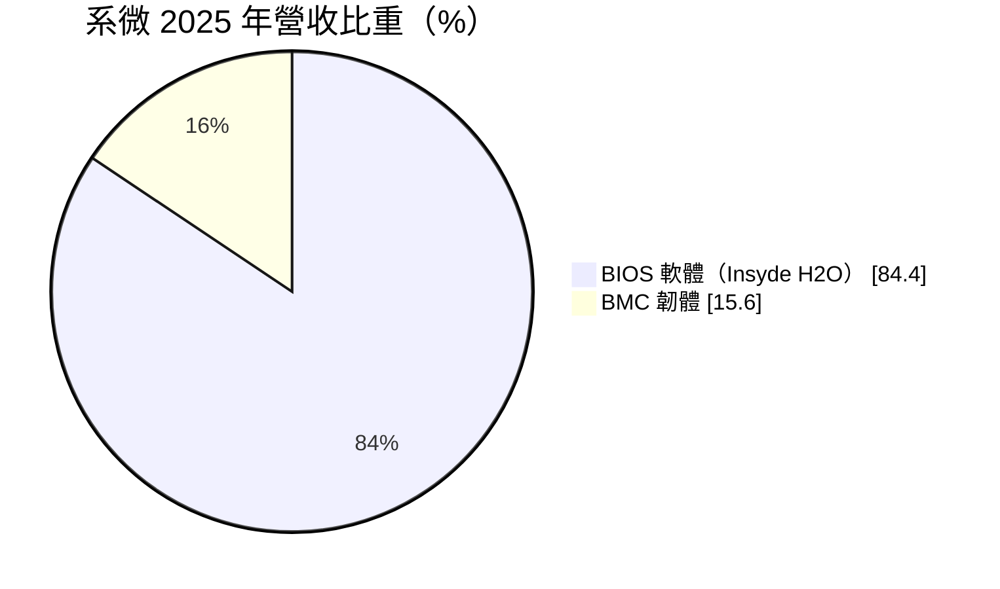
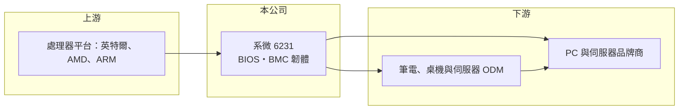

# 6231 系微

> 上櫃｜[[產業索引-資訊服務業|資訊服務業]]｜上市（櫃）日期 2003/01/23

# 第一章：企業模式與商業藍圖

> [!info] 撰寫說明
> 精簡版，由 Claude 依公開資料整理，架構比照 [[2330台積電]]，資料截至 2026-10-08。來源：Goodinfo 經營績效年表（2019 至 2025 年）；富邦 e 點通（MoneyDJ）公司基本資料（2025 年營收比重）；櫃買中心開放資料快照（基本資料、2026 年第二季資產負債與上半年損益、每月營收、股利）。收費模式、客戶與競爭對手依記憶整理，標示待校對。#待校對

系微（英文名 Insyde Software）成立於 1998 年 9 月、2003 年 1 月上櫃，總部在台北市中山區，實收資本額約 4.57 億元，董事長王志高、總經理王彥棋。它是全球少數幾家獨立的電腦[[BIOS]]與韌體供應商之一，產品裝在筆電、桌機與伺服器裡，是電腦開機時第一個執行的軟體。2025 年營收約 16.9 億元，[[毛利率]]超過七成，是台股中少見的純軟體權利金公司。

- **核心業務：** 系微的主力產品 InsydeH2O 是符合 [[UEFI]] 標準的 BIOS 韌體，負責電腦開機時檢查硬體、初始化處理器與記憶體，再把控制權交給作業系統，2025 年占營收 84.4%。另一項產品是伺服器用的 [[BMC]] 韌體，讓資料中心可以遠端監控與管理伺服器，占 15.6%。
- **營收結構：** BIOS 業務的收費模式一般是「開發費加[[權利金]]」，系微替每一個新機種客製韌體收取開發費，機器出貨後再依台數收權利金（待校對）。權利金跟著全球 PC 與伺服器出貨量走，客戶不必另外付款就會持續產生，具有很高的[[經常性收入]]性質。
- **營運據點與客戶：** 總部在台北，並在美國、中國大陸、日本等地設有研發或業務據點（待校對）。客戶是全球 PC 與伺服器品牌商，以及替品牌代工的台灣 ODM，例如 [[2382廣達]]、[[2324仁寶]]、[[3231緯創]]、[[2356英業達]]（合作關係待校對）。
- **長期方向：** 系微的長期成長來自兩條線：一是伺服器 BMC 韌體，AI 伺服器出貨增加、資料中心對遠端管理與[[資安]]要求提高，BMC 比重有機會持續提升；二是韌體安全，各國對開機安全與供應鏈安全的規範趨嚴，讓 BIOS 從「附屬軟體」變成需要持續更新維護的安全元件。

# 第二章：護城河深度與競爭優勢

系微的護城河非常深：BIOS 是高度專業、市場極小但不可或缺的軟體，全球只剩少數幾家獨立供應商。

- **競爭優勢：** 每一代處理器平台推出時，BIOS 供應商都要和英特爾、AMD 同步開發，累積數十年的平台經驗與原始碼，新進者幾乎無法追上。品牌客戶一旦採用某家 BIOS，整條產品線的開發流程、測試工具與工程師習慣都綁在一起，轉換成本極高。毛利率長年在 74% 至 85%，就是這種寡占地位的反映。
- **主要對手：** 全球獨立 BIOS 供應商主要有美國的 AMI（American Megatrends）、Phoenix Technologies，以及中國大陸的百敖軟體（Byosoft）等（待校對）；BMC 韌體則有 AMI 與開源的 OpenBMC。系微在筆電 BIOS 市場的市占率居前段（具體數字未查得）。
- **觀察重點：** 第一，BMC 營收比重能否持續提高，帶動伺服器這條成長曲線；第二，毛利率從 2019 年的 84.5% 降到 2025 年的 73.9%，原因可能是人力成本或產品組合改變，需要追蹤是否止穩；第三，ARM 架構筆電普及後，系微在非 x86 平台的布局與市占率。

# 第三章：財務體質與盈利規模

資料日期：2026-10-08，表格是撰寫當時的快照；最新月營收、毛利率、累計 EPS 由自動排程寫在本筆記的屬性欄位（月營收、毛利率、累計EPS 等）。#待校對

系微的財務特色是高毛利、高 ROE、高配息，典型的輕資產軟體公司。

| 年度 | 營收（億元） | [[毛利率]] | [[營業利益率]] | EPS（元） | [[ROE]] |
|---|---|---|---|---|---|
| 2019 | 9.59 | 84.5% | 11.9% | 2.32 | 13.0% |
| 2020 | 11.3 | 81.6% | 18.2% | 4.05 | 21.2% |
| 2021 | 13.0 | 81.2% | 22.7% | 5.94 | 28.1% |
| 2022 | 14.1 | 82.4% | 23.8% | 7.46 | 31.3% |
| 2023 | 13.4 | 79.0% | 16.0% | 4.86 | 19.7% |
| 2024 | 16.1 | 77.2% | 23.7% | 7.37 | 32.3% |
| 2025 | 16.9 | 73.9% | 23.3% | 6.66 | 26.0% |
| 2026 上半年 | 9.04 | 77.2% | 22.9% | 3.63 | 未查得 |

註：2019 至 2025 年取自 Goodinfo；2026 年上半年取自櫃買中心開放資料推算（營業毛利 6.97 億元、營業利益 2.07 億元）。

- **長期指標：** 2020 至 2025 年營收年複合成長率約 8.4%（推算），2021 至 2025 年平均 ROE 約 27.5%（推算）。櫃買中心快照顯示最近一年度現金股利 5.70 元，相對 2025 年 EPS 6.66 元，配息率約八成五（推算），代表公司不需要大量資本支出，盈餘多數發還股東。軟體公司的主要成本是研發人力，因此毛利率與營業利益率之間差距大，營收成長時營業利益率擴張的空間也大。
- **[[ROIC]] 與 [[WACC]]：** 2025 年營業利益約 3.94 億元（16.9 億 × 23.3%），稅後約 3.15 億元；2026 年第二季股東權益 10.8 億元，有息負債未查得，非流動負債 5.24 億元中可能含租賃或其他長期負債，保守假設有息負債約 2 億元，投入資本約 12.8 億元，ROIC 約 25%（推算）。WACC 以無風險利率 1.75%、市場風險溢酬 6%、β 1.1（軟體與 PC 供應鏈股常見值）推得權益成本約 8.35%，資本幾乎全為權益，WACC 約 8%（推算）。ROIC 約為 WACC 的三倍，代表系微長期大幅創造經濟價值。
- **財務特色：** 2026 年第二季總資產 23.9 億元、負債 13.1 億元，[[每股淨值]] 23.68 元。負債比率看似偏高，推估包含預收的開發費與權利金等合約負債，屬營運性負債。

# 第四章：總體風險與地緣政治

系微的風險集中在 PC 與伺服器出貨週期，以及處理器平台與技術架構的改變。

- **產業週期：** 權利金與 PC、伺服器出貨量直接連動。PC 換機週期轉弱時，BIOS 收入會跟著下滑，2023 年營收與 ROE 下降就是例子。伺服器業務占比提高後，可以部分抵銷 PC 週期。
- **營運風險：** 系微高度依賴英特爾與 AMD 的平台合作，若處理器廠改變策略、自行提供韌體或支持開源方案，獨立 BIOS 供應商的角色可能被削弱。研發人才是核心資產，薪資上升與人才流失會直接影響獲利。
- **其他風險：** 韌體是駭客攻擊的高價值目標，若產品出現重大安全漏洞，商譽受損。營收多以美元計價，匯率波動影響台幣獲利。中國大陸推動自主可控的 PC 與伺服器，本土 BIOS 供應商可能取代外商。

# 專有名詞解析

## 半導體

- **[[BMC]]**：基板管理控制器，伺服器上的獨立管理晶片與韌體，讓管理者遠端監控溫度、電源並重開機。

## 應用

- **[[BIOS]]**：基本輸入輸出系統，電腦開機時最先執行的韌體，負責檢查與初始化硬體，再啟動作業系統。
- **[[UEFI]]**：統一可延伸韌體介面，取代傳統 BIOS 的新標準，支援安全開機與大容量硬碟。
- **[[資安]]**：資訊安全，保護系統與資料不被入侵、竊取或破壞的技術與管理措施。

## 金融

- **[[權利金]]**：使用他人技術或智慧財產時，依出貨量或銷售額支付的費用。
- **[[經常性收入]]**：每年固定重複發生的收入，例如維運年約、訂閱費，能讓營收比一次性專案更穩定。

# 核心供應鏈

- 上游：處理器平台廠商 [[INTC英特爾]]、[[AMD超微]]、[[ARM安謀]]，系微需同步開發各代平台韌體。
- 下游／客戶：PC 與伺服器 ODM，例如 [[2382廣達]]、[[2324仁寶]]、[[3231緯創]]、[[2356英業達]]，以及全球 PC 與伺服器品牌商（合作關係待校對）。
- 同業：AMI（American Megatrends）、Phoenix Technologies、百敖軟體（均為未上市或海外公司，待校對）。

## 最新新聞
<!-- news:start（自動產生，請勿手動編輯此範圍） -->
- 2026-10-15 🏛️ 重訊 16:50｜公告本公司從事衍生性商品交易資訊｜[觀測站](https://mops.twse.com.tw/mops/#/web/t05st01)

完整紀錄：[[6231系微 新聞]]
<!-- news:end -->

## 相關連結
- [公開資訊觀測站](https://mopsov.twse.com.tw/mops/web/t05st03?step=1&firstin=1&co_id=6231)
- [Goodinfo](https://goodinfo.tw/tw/StockDetail.asp?STOCK_ID=6231)
- [Yahoo 股市](https://tw.stock.yahoo.com/quote/6231)
- [鉅亨網新聞](https://www.cnyes.com/twstock/6231/news)
