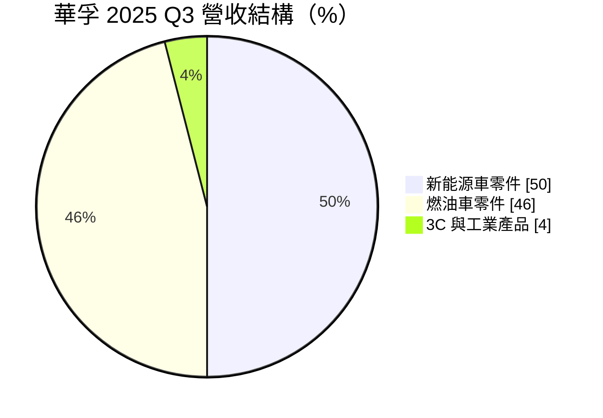
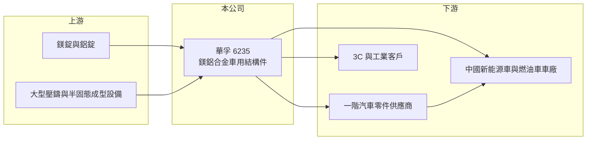

# 6235 華孚

> 上市｜[[產業索引-電腦及週邊設備業|電腦及週邊設備業]]｜上市（櫃）日期 2004/08/23

# 第一章：企業模式與商業藍圖

> [!info] 撰寫說明
> 精簡版，由 Claude 依公開資料整理，架構比照 [[2330台積電]]，資料截至 2026-10-08。來源：證交所開放資料快照（基本資料、2026 年第二季資產負債與損益、股利）、Goodinfo 經營績效頁、優分析 2025 年 12 月報導（引述法說內容）。筆電機殼歷史與客戶描述依記憶整理，已標註待校對。成立日期依證交所資料為 1954 年，與公司現行業務的起始時間可能不同。#待校對

華孚是一家從筆電機殼轉型為車用零件的金屬加工廠，理解它的關鍵在於：它的核心能力是[[鎂鋁合金]]成型，過去用在筆電外殼，如今九成以上營收來自汽車結構件，成長動能與電動車的輕量化趨勢綁在一起。

- **核心業務：** 華孚 2004 年在證交所上市，總部位於台北南港，早年以筆電鎂合金機殼聞名（#待校對），近年轉向車用。依 2025 年第三季法說內容，車載機構件占營收 96%，其中新能源車零件占 50%、傳統燃油車零件占 46%；3C 與工業產品只剩 4%。產品是以[[壓鑄]]與[[半固態成型]]製作的鎂鋁合金結構件，用於車身、儀表板骨架、座椅與電控外殼等（#待校對）。
- **營收結構：** 以動力型式區分，新能源車與燃油車大約各半，客戶以中國車廠及其一階供應商為主（#待校對）。公司營收從 2020 年的 20 億元成長到 2025 年的 66.3 億元，這段高成長幾乎完全來自中國新能源車的放量。
- **營運據點：** 中國有 4 個廠區（3 個生產廠與 1 個模具廠），子公司包括華孚精密科技（馬鞍山）；越南新廠預計 2027 年第四季投產，但管理層表示客戶對越南產能需求不急，仍在與越南政府洽談。
- **長期方向：** 管理層預期單一新能源車的鎂鋁合金用量將從目前約 10 公斤提升到 2035 年的 25 公斤。華孚 2025 年導入全球第一台 7000 噸鎂鋁合金半固態雙射成型機，並持續開發大尺寸車載結構件，因為這個市場的競爭者較少。輕量化對電動車續航有直接幫助，是華孚的長期成長邏輯。

# 第二章：護城河深度與競爭優勢

華孚的護城河來自鎂合金加工的技術門檻與大型設備投資，在大尺寸鎂合金結構件上屬於利基型護城河，但客戶與地區高度集中在中國車市。

- **競爭優勢：** 鎂合金比鋁更輕，但熔點低、易燃，壓鑄與表面處理的技術難度高，能穩定量產的廠商不多。華孚從筆電機殼時代累積了二十多年的鎂合金製程經驗（#待校對），再投入 7000 噸級半固態成型機這類大型設備，讓它能做一般廠商做不出的大尺寸一體化零件。車用零件一旦通過[[IATF 16949]]與車廠驗證，就會在車型生命週期內持續供貨。
- **主要對手：** 車用鎂鋁結構件的競爭者主要是中國本土壓鑄廠，例如萬豐奧威旗下的鎂合金事業、宜安科技等（#待校對）；鋁合金一體化壓鑄則有文燦、拓普等大型車零件集團（#待校對）。台灣過去的鎂合金機殼同業有 [[2474可成]]、[[2354鴻準]]，但兩者未以車用為主。
- **觀察重點：** 毛利率在 2023 年達 31.1% 的高點後，逐年降到 2025 年的 26.2%，2026 年上半年再降到 24.5%，營業利益率也從 15.8% 降到 5.8%。新聞標題指出中國汽車價格戰加劇、公司對隔年展望保守，長期要追蹤的是毛利率能否守住，以及越南與非中國客戶的開發進度。

# 第三章：財務體質與盈利規模

資料日期：2026-10-08，表格是撰寫當時的快照；最新月營收、毛利率、累計 EPS 由自動排程寫在本筆記的屬性欄位（月營收、毛利率、累計EPS 等）。#待校對

華孚的財務呈現高成長後的獲利壓縮：營收五年成長三倍以上，但近兩年獲利率隨中國車市價格戰下滑。

| 年度 | 營收（億元） | [[毛利率]] | [[營業利益率]] | EPS（元） | [[ROE]] |
|---|---|---|---|---|---|
| 2020 | 20.0 | 24.0% | -1.46% | 3.85 | 31.7% |
| 2021 | 28.2 | 26.0% | 4.30% | 0.96 | 6.8% |
| 2022 | 41.6 | 27.3% | 8.89% | 1.83 | 11.2% |
| 2023 | 57.7 | 31.1% | 15.8% | 4.17 | 22.1% |
| 2024 | 58.3 | 28.0% | 10.8% | 3.06 | 13.6% |
| 2025 | 66.3 | 26.2% | 9.67% | 2.90 | 11.9% |

（來源：Goodinfo 經營績效頁。2020 年本業虧損但 EPS 3.85 元，推估來自一次性的業外處分利益，原因未查得。2026 年上半年依證交所資料：營收 32.3 億元、毛利率 24.5%、營業利益率 5.8%、EPS 0.40 元。）

- **營收規模：** 2020 至 2025 年營收由 20 億元增至 66.3 億元，年複合成長率約 27%（推算），是電腦週邊族群中少見的高成長，動能來自中國新能源車。不過 2024 年起成長放緩，2026 年 7 至 9 月月營收約 5.3 億至 5.5 億元，低於 2025 年第四季的高峰。
- **獲利：** 近五年（2021 至 2025）平均 ROE 約 13.1%（推算），2023 年最高達 22.1%。2026 年上半年稅後淨利率只有 2.5%，業外損失約 0.64 億元，推估與利息與匯兌有關（未查得）。
- **財務特色：** 依 2026 年第二季資料，總資產約 105.3 億元、股東權益約 50.3 億元、負債約 55.0 億元，其中非流動負債約 19.9 億元，負債比約五成二，推估包含擴產所需的長期借款。非流動資產約 59.9 億元，反映壓鑄廠的重資產特性。2025 年度每股配發現金股利 1.2 元，以 EPS 2.90 元計[[配息率]]約 41%（推算），公司保留較多盈餘支應擴產；Goodinfo 統計長期平均現金股利僅約 0.48 元。由於持續擴產，自由現金流推估並不穩定（未查得）。
- **[[ROIC]] 與 [[WACC]]：** 以 2025 年營業利益約 6.41 億元（66.3 億元 × 9.67%）、稅率 20% 計算，稅後營業利益約 5.13 億元。有息負債未查得，投入資本以股東權益 50.3 億元到「權益加全部負債」105.3 億元為區間，ROIC 約 4.9% 至 10.2%（推算）；2023 年營業利益約 9.1 億元，以目前資本規模計算約 7% 至 14%（推算）。WACC 以 [[CAPM]] 推估：無風險利率 1.75%、市場風險溢酬 6%、β 假設 1.1（車用零件與小型股常見值），權益成本約 8.35%；稅後負債成本假設 2.4%、負債占四成，WACC 約 6.0%（推算）。2023 至 2025 年 ROIC 大致高於 WACC，華孚的轉型確實創造了價值；但 2026 年上半年營業利益率降到 5.8%，以此估算 ROIC 已接近或低於 WACC，利差正在收窄。

# 第四章：總體風險與地緣政治

華孚的風險高度集中在中國車市，包括價格戰、客戶集中與地緣政治。

- **產業週期：** 汽車零件跟著車市景氣走，中國新能源車在 2020 至 2024 年高速成長後進入激烈價格戰，車廠把降價壓力轉嫁給零件廠，形成毛利率下滑。補貼政策調整或出口受阻，都可能讓中國車市放緩。
- **營運風險：** 營收九成以上來自車用，且以中國客戶為主（#待校對），單一車型停產或客戶轉單會明顯影響營收。壓鑄設備投資大、折舊高，產能利用率下降時，固定成本會拖累獲利，形成反向的[[營業槓桿]]。鎂合金生產需要嚴格的防火與安全管理，工安事故是這類工廠的特殊風險。
- **其他風險：** 生產集中在中國，面臨美中關係與關稅風險，越南新廠是分散風險的布局但進度不明。鎂錠主要產自中國，原料價格與供應受中國政策影響大。人民幣匯率波動影響以新台幣計算的獲利。

# 專有名詞解析

## 應用

- **[[IATF 16949]]**：汽車產業的品質管理系統標準，車用零件供應商通常必須取得此認證才能進入車廠供應鏈。

## 金融

- **[[營業槓桿]]**：固定成本占比高的公司，營收增加時利潤增幅大於營收增幅，反之亦然。

## 產業

- **[[鎂鋁合金]]**：以鎂或鋁為主的輕金屬合金，重量比鋼輕許多，用於筆電機殼與汽車輕量化結構件。
- **[[壓鑄]]**：把熔融的鋁或鋅合金高壓注入模具成型的金屬加工方式，用於製作機殼與結構件。
- **[[半固態成型]]**：把金屬加熱到半熔融狀態再射出成型，比傳統壓鑄的氣孔少、強度高，適合大尺寸鎂合金零件。

# 核心供應鏈

- 上游：鎂錠（主要產自中國）與鋁錠；大型壓鑄機與半固態成型設備供應商；模具由公司自有模具廠製作。
- 下游／客戶：中國新能源車與燃油車車廠及其一階供應商（具體名單公開資料未點名，#待校對）；少量 3C 與工業客戶。
- 同業：中國鎂鋁壓鑄廠（萬豐奧威、宜安科技等，#待校對）；台灣金屬機殼同業 [[2474可成]]、[[2354鴻準]]。

## 最新新聞
<!-- news:start（自動產生，請勿手動編輯此範圍） -->
- 2026-10-13 🏛️ 重訊 15:29｜代子公司華孚精密科技(馬鞍山)有限公司公告新增對華眾精密 科技(馬鞍山)有限公司背書保證金額達新臺幣三千萬元以上且 達本公司最近期財務報表淨值百分之五以上｜[觀測站](https://mops.twse.com.tw/mops/#/web/t05st01)

完整紀錄：[[6235華孚 新聞]]
<!-- news:end -->

## 相關連結
- [公開資訊觀測站](https://mopsov.twse.com.tw/mops/web/t05st03?step=1&firstin=1&co_id=6235)
- [Goodinfo](https://goodinfo.tw/tw/StockDetail.asp?STOCK_ID=6235)
- [Yahoo 股市](https://tw.stock.yahoo.com/quote/6235)
- [鉅亨網新聞](https://www.cnyes.com/twstock/6235/news)
