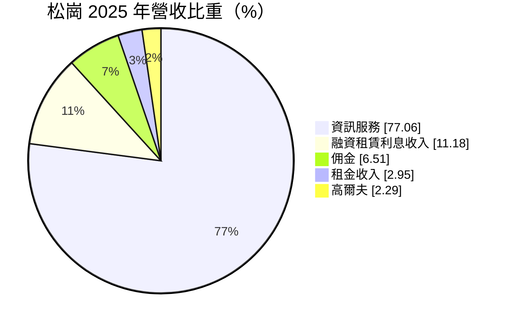
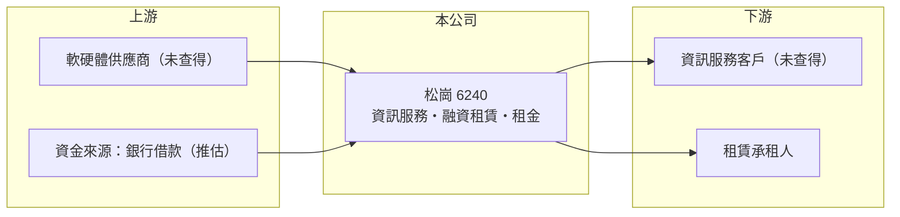

# 6240 松崗

> 上櫃｜[[產業索引-資訊服務業|資訊服務業]]｜上市（櫃）日期 2003/05/30

# 第一章：企業模式與商業藍圖

> [!info] 撰寫說明
> 精簡版，由 Claude 依公開資料整理，架構比照 [[2330台積電]]，資料截至 2026-10-08。來源：Goodinfo 經營績效年表（2019 至 2025 年）；富邦 e 點通（MoneyDJ）公司基本資料（2025 年營收比重）；櫃買中心開放資料快照（基本資料、2026 年第二季資產負債與上半年損益、每月營收）。各業務的具體內容與客戶未查得，公開資料有限，本文寫得較短。#待校對

松崗（松崗國際興業）成立於 1997 年 4 月、2003 年 5 月上櫃，總部在台北市中正區忠孝西路，實收資本額約 2.29 億元，董事長兼總經理為湯順甄。它是台股資訊服務類股中規模極小的公司，2025 年營收只有約 0.5 億元，但業務橫跨資訊服務、融資租賃、佣金、租金與高爾夫，屬於多角化經營的微型股。

- **核心業務：** 依 2025 年營收比重，資訊服務約占 77%，其餘來自融資租賃利息、佣金、租金與高爾夫相關收入。資訊服務的具體內容（例如軟體開發、系統維運或代理銷售）在這次查到的來源中未揭露。
- **營收結構：** 營收規模從 2019 年的 0.29 億元、2021 年的 0.13 億元，到 2023 至 2025 年約 0.5 億元，整體規模始終很小。融資租賃與租金屬於金融與資產運用收入，代表公司有相當部分資本投入在非資訊本業的資產上。
- **營運據點：** 總部在台北市，2026 年第二季總資產約 8.9 億元，遠大於年營收，顯示公司的資產主要不是用在資訊服務，而是租賃、不動產或投資部位（推估）。
- **長期方向：** 公開資料未揭露明確策略。對松崗這類公司，長期觀察重點是本業能否形成可持續獲利的規模，以及多角化資產能否帶來穩定回報，而不是資訊服務產業的整體成長。

# 第二章：護城河深度與競爭優勢

松崗目前看不到明確的護城河：本業長年虧損，營收規模不足以支撐固定成本。

- **競爭優勢：** 依現有資料無法辨識具體的競爭優勢。毛利率雖在 20% 至 60% 之間，但營業利益率 2019 至 2025 年每年都是負值，代表毛利不足以涵蓋營業費用，規模經濟尚未形成。
- **主要對手：** 資訊服務市場的中小型業者眾多，例如 [[6148驊宏資]]、[[6590普鴻]]、[[2471資通]] 等，但因松崗的具體服務內容未查得，與哪些公司直接競爭無法確認。
- **觀察重點：** 第一，營收能否明顯突破每年 1 億元；第二，營業利益能否轉為穩定正值，2026 年上半年營業利益已小幅轉正，是否持續值得追蹤；第三，多角化資產的報酬與處分，是否成為獲利的主要來源。

# 第三章：財務體質與盈利規模

資料日期：2026-10-08，表格是撰寫當時的快照；最新月營收、毛利率、累計 EPS 由自動排程寫在本筆記的屬性欄位（月營收、毛利率、累計EPS 等）。#待校對

松崗的財務呈現「本業虧損、盈虧靠業外」的型態，ROE 在正負之間擺盪。

| 年度 | 營收（億元） | [[毛利率]] | [[營業利益率]] | EPS（元） | [[ROE]] |
|---|---|---|---|---|---|
| 2019 | 0.29 | 20.8% | -16.3% | -2.13 | -14.0% |
| 2020 | 0.14 | 24.0% | -16.9% | 0.04 | 0.25% |
| 2021 | 0.13 | 59.2% | -50.1% | 1.13 | 7.69% |
| 2022 | 0.16 | 31.0% | -77.3% | 2.14 | 13.3% |
| 2023 | 0.46 | 26.3% | -30.1% | -0.45 | -2.62% |
| 2024 | 0.50 | 25.9% | -26.8% | 0.35 | 2.00% |
| 2025 | 0.50 | 46.8% | -9.31% | -1.15 | -6.33% |
| 2026 上半年 | 0.25 | 52.8% | 2.7% | -0.59 | 未查得 |

註：2019 至 2025 年取自 Goodinfo；2026 年上半年取自櫃買中心開放資料推算（營業毛利 0.13 億元、營業利益 0.007 億元、稅後淨損 0.13 億元）。2021、2022 年本業虧損但 EPS 為正，推估來自業外收益。

- **長期指標：** 營收規模過小，年複合成長率意義有限。2021 至 2025 年平均 ROE 約 2.8%（推算），且每年波動大，沒有穩定替股東創造報酬。櫃買中心快照顯示最近一年度未配發現金股利。
- **[[ROIC]] 與 [[WACC]]：** 2025 年營業損失約 0.05 億元（0.50 億 × -9.31%），虧損不計稅盾；2026 年第二季股東權益 3.53 億元，總負債 5.35 億元中有息負債未查得，假設約 4 億元（推估與融資租賃業務的借款相關），投入資本約 7.5 億元，ROIC 約 -0.6%（推算）。WACC 以無風險利率 1.75%、市場風險溢酬 6%、β 1.0 推得權益成本 7.75%，權益與負債約各半、稅後負債成本約 2%，WACC 約 4.9%（推算）。ROIC 為負且遠低於 WACC，表示本業投入的資本沒有產生報酬，公司目前在消耗而非創造價值。
- **財務特色：** 2026 年第二季總資產 8.88 億元、負債比率約 60%，[[每股淨值]] 15.44 元。資產規模遠大於營收，負債比率也高於一般資訊服務公司，與融資租賃與資產運用業務的性質相符（推估）。

# 第四章：總體風險與地緣政治

松崗最主要的風險是本業規模不足與多角化帶來的資產風險，資訊服務景氣反而是次要因素。

- **產業週期：** 資訊服務需求整體穩定成長，但松崗的營收並未隨產業成長而放大，顯示問題在公司本身的規模與定位。
- **營運風險：** 融資租賃屬於放款性質，承租人違約會直接造成損失；高爾夫與租金收入則受不動產與休閒消費景氣影響。本業長年虧損，持續經營需要依賴業外收益或資產處分。
- **其他風險：** 經營權集中在董事長兼總經理一人，治理與資訊揭露較有限。微型股股價容易受題材影響，與基本面脫節。負債比率偏高，利率上升會增加資金成本。

# 專有名詞解析

## 金融

- **[[融資租賃]]**：出租人購買設備或資產後長期出租給承租人，並收取類似分期付款的租金，本質接近放款。
- **[[每股淨值]]**：股東權益除以流通股數，代表每股在帳上的價值。
- **[[ROIC]]**：投入資本報酬率，稅後營業利益除以股東權益加有息負債，衡量本業運用資本的效率。
- **[[WACC]]**：加權平均資金成本，股東與債權人要求報酬率的加權平均，是 ROIC 要超越的門檻。

# 核心供應鏈

- 上游：軟硬體供應商與資金來源未查得。
- 下游／客戶：資訊服務與租賃客戶未查得。
- 同業：中小型資訊服務業者，例如 [[6148驊宏資]]、[[2471資通]]（是否直接競爭未查得）。

## 最新新聞
<!-- news:start -->
<!-- news:end -->

## 相關連結
- [公開資訊觀測站](https://mopsov.twse.com.tw/mops/web/t05st03?step=1&firstin=1&co_id=6240)
- [Goodinfo](https://goodinfo.tw/tw/StockDetail.asp?STOCK_ID=6240)
- [Yahoo 股市](https://tw.stock.yahoo.com/quote/6240)
- [鉅亨網新聞](https://www.cnyes.com/twstock/6240/news)
