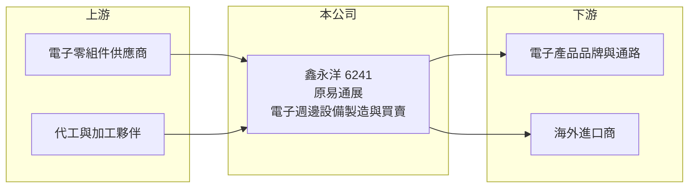

# 6241 易通展

> 上櫃｜[[產業索引-通信網路業|通信網路業]]｜上市（櫃）日期 2003/04/08

# 第一章：企業模式與商業藍圖

> [!info] 撰寫說明
> 精簡版，由 Claude 依公開資料整理，架構比照 [[2330台積電]] 的四章研究，資料截至 2026-10-08。來源：nStock（公司概況、更名與 2026 年營收）、Goodinfo 年度經營績效、櫃買中心開放資料（基本資料、綜合損益、資產負債、每月營收、本益比）。公開資料有限，本次未取得產品別、客戶與生產據點資料，業務描述以登記營業項目為主。#待校對

本章說明鑫永洋科技（股票代號：6241，原名易通展科技，以下簡稱鑫永洋）的商業模式：一家營收規模約 6 至 7 億元、近年經歷更名與營運調整的小型電子週邊設備公司。

- **核心業務：** 公司成立於 1992 年，2003 年在櫃買中心掛牌，帳上歸類為通信網路業，登記的主要業務為電子週邊設備製造加工與進出口買賣。2025 年 12 月 26 日股東臨時會決議由易通展科技更名為鑫永洋科技，董事長為郭金河，總部位於台南市安南區科技五路。更名通常伴隨經營團隊或業務方向的調整，但本次未查得更名的具體原因與新業務內容（待校對）。
- **營收結構：** 公司未揭露產品別營收比重。從營收在 2021 年 2.77 億元、2022 年跳升到 10.5 億元、之後回到 6.4 至 6.8 億元的走勢推估，營收中可能包含較多進出口買賣或專案型業務，產品組合在 2021 至 2022 年間有明顯變化（推估）。
- **營運據點：** 總部位於台南科技工業區（安南區），其他生產或銷售據點本次未查得（待校對）。
- **長期方向：** 公開資料未說明長期策略。對這類規模小、營收結構變動大的公司，長期觀察重點是更名後的核心業務是否穩定、毛利率能否持續回升，以及經營團隊的資本配置是否以本業為主。

# 第二章：護城河深度與競爭優勢

本章評估鑫永洋的競爭地位。從營業利益率在 2021 至 2025 年都是負值、毛利率一度只有 0.22% 來看，公司目前沒有明顯的護城河。

- **競爭優勢：** 公開資料無法確認公司在特定產品或客戶上具有技術或規模優勢。2025 年毛利率回升到 16%、2026 年上半年營業利益率轉為 6.4%，顯示營運有改善，但尚不足以判斷是結構性優勢還是個別訂單的效果。
- **主要對手：** 由於產品線不明，本次未列出具體對手。電子週邊設備製造與買賣是進入門檻低、參與者眾多的領域，價格競爭通常激烈（推估）。
- **觀察重點：** 第一，更名後的業務方向與主要產品，需要從年報或重大訊息確認。第二，毛利率能否維持在 15% 以上。第三，資本額變動與經營權結構；開放資料的股本 4.87 億元高於基本資料的實收資本額 4.55 億元，推估近期有增資（待校對）。

# 第三章：財務體質與盈利規模

資料日期：2026-10-08。數字取自 Goodinfo 年度經營績效、nStock 與櫃買中心開放資料，表格是撰寫當時的快照；最新月營收、毛利率、累計 EPS 由自動排程寫在本筆記的屬性欄位（月營收、毛利率、累計EPS 等）。#待校對

鑫永洋的財務數字顯示營收規模劇烈變動、多數年度虧損，2026 年上半年本業轉為獲利。

| 年度 | 營收（新台幣） | [[毛利率]] | [[營業利益率]] | EPS（元） | [[ROE]] |
|---|---|---|---|---|---|
| 2020 | 2.69 億 | 24.6% | 1.42% | 0.54 | 7.89% |
| 2021 | 2.77 億 | 0.22% | -32.8% | -3.15 | -40.7% |
| 2022 | 10.5 億 | 6.27% | -4.68% | -1.43 | -18.1% |
| 2023 | 6.43 億 | 9.56% | -13.5% | 0.07 | 0.86% |
| 2024 | 6.47 億 | 9.22% | -19.8% | -0.63 | -8.10% |
| 2025 | 6.79 億 | 16.0% | -5.52% | -0.16 | -2.16% |
| 2026 上半年 | 3.55 億 | 16.6% | 6.4% | 0.38 | 未查得 |

註：2020 至 2025 年取自 Goodinfo 合併報表；2026 上半年取自櫃買中心開放資料（毛利率、營業利益率依開放資料推算）。nStock 顯示 2026 年第二季單季 EPS 為 -0.25 元，上半年 0.38 元主要來自第一季。

- **營收規模：** 2020 至 2025 年營收年複合成長率約 20%（推算），但這是因為 2020 年基期極低，2022 年以後營收大致在 6.4 至 10.5 億元之間。2026 年 1 至 8 月累計營收 4.80 億元，與去年同期 4.76 億元持平；nStock 顯示 1 至 9 月累計 5.25 億元、年減約 3%。
- **獲利：** 2021 至 2025 年平均 ROE 約 -13.6%（推算），六年中只有 2020 與 2023 年 EPS 為正。2025 年起毛利率回升到 16%，2026 年上半年營業利益 0.23 億元，但業外損失 0.09 億元，本業改善幅度仍小。
- **財務特色：** 2026 年第二季底資產總計 6.02 億元、負債 2.33 億元（幾乎都是流動負債），權益約 3.69 億元（推算），每股淨值 7.57 元，保留盈餘為 -1.18 億元。nStock 顯示近五年沒有配息紀錄。
- **[[ROIC]] 與 [[WACC]]：** 以 2025 年營業損失約 0.37 億元（6.79 億元 × -5.52%，虧損不計稅盾）計算，投入資本以權益約 3.69 億元（有息負債未查得）計算，ROIC 約 -10%（推算）；以 2026 年上半年營業利益年化約 0.45 億元、扣稅後約 0.36 億元計算，ROIC 約 9.8%（推算），但單季波動很大，不宜外推。WACC 以 CAPM 推估：無風險利率 1.75%、市場風險溢酬 6%、β 取 1.2（推估，微型股波動較大），權益成本約 8.95%；負債多為營運性負債，WACC 約 8.5% 至 9%（推算）。長期 ROIC 遠低於 WACC，公司仍處於重建獲利能力的階段，需持續觀察本業轉正能否延續。

# 第四章：總體風險與地緣政治

本章整理鑫永洋面對的長期風險，核心是業務資訊不透明與規模過小。

- **產業週期：** 電子週邊設備需求跟隨消費電子與企業 IT 支出的週期，2022 年營收跳升、2023 年回落，呈現與網通及電子零組件類似的庫存循環與[[長鞭效應]]。
- **營運風險：** 營收規模小、產品與客戶資訊有限，投資人難以評估業務的持續性。更名與可能的經營權變動，代表策略方向仍在調整，執行結果有不確定性。累積虧損下，公司承受營收下滑的能力有限。
- **其他風險：** 股本小、市值約 7.65 億元（nStock），股價容易受籌碼影響而大幅波動。若需增資籌措營運資金，可能稀釋股權。進出口業務會受匯率與貿易政策影響。

# 專有名詞解析

## 金融

- **[[長鞭效應]]**：終端需求的小幅變動，沿供應鏈往上游傳遞時被逐級放大，造成上游庫存與訂單劇烈波動。
- **[[ROIC]]**：投入資本報酬率，稅後營業利益除以股東權益與有息負債的合計，衡量本業對所有資金提供者的報酬。
- **[[WACC]]**：加權平均資金成本，依股東權益與負債的比重加權計算的資金成本，ROIC 高於它才代表創造價值。

# 核心供應鏈

- 上游：電子零組件供應商、代工與加工夥伴（名稱本次未查得）。
- 下游／客戶：電子產品品牌、通路與海外進口商（客戶名稱本次未查得，待校對）。
- 同業：本次未取得足以判斷同業的產品資料。

## 最新新聞
<!-- news:start -->
<!-- news:end -->

## 相關連結
- [公開資訊觀測站](https://mopsov.twse.com.tw/mops/web/t05st03?step=1&firstin=1&co_id=6241)
- [Goodinfo](https://goodinfo.tw/tw/StockDetail.asp?STOCK_ID=6241)
- [Yahoo 股市](https://tw.stock.yahoo.com/quote/6241)
- [鉅亨網新聞](https://www.cnyes.com/twstock/6241/news)
