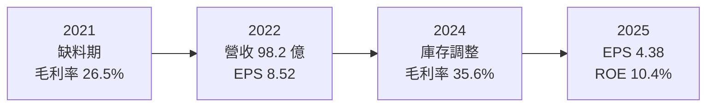
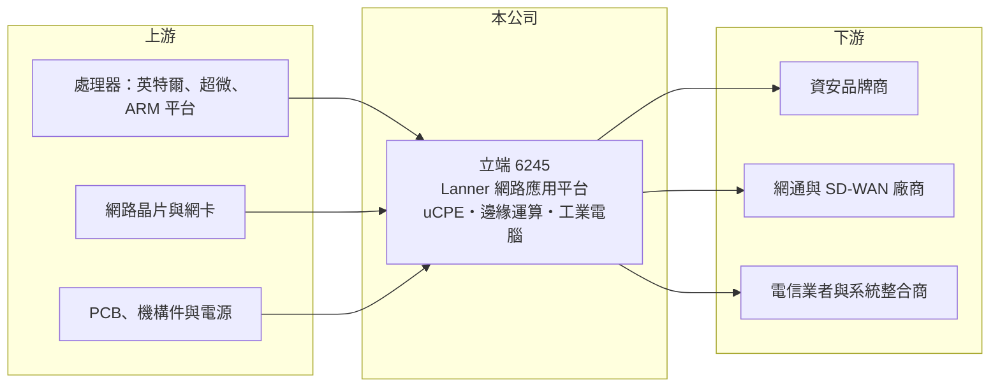

# 6245 立端

> 上櫃｜[[產業索引-通信網路業|通信網路業]]｜上市（櫃）日期 2003/05/19

# 第一章：企業模式與商業藍圖

> [!info] 撰寫說明
> 精簡版，由 Claude 依公開資料整理，架構比照 [[2330台積電]] 的四章研究，資料截至 2026-10-08。來源：nStock（公司概況、2026 年營收與股利）、Goodinfo 年度經營績效、櫃買中心開放資料（基本資料、綜合損益、資產負債、每月營收、本益比）、財經媒體與英特爾合作夥伴頁面標題。公開資料有限，本次未取得產品別與地區別營收比重，產品線與客戶結構多依記憶整理，需逐條比對原始文件。#待校對

本章說明立端科技（股票代號：6245，英文品牌 Lanner，以下簡稱立端）的商業模式：替資安、網通與電信業者設計製造[[網路安全設備]]硬體平台的專業廠商。

- **核心業務：** 立端成立於 1986 年，2003 年在櫃買中心掛牌，總部位於新北市汐止，董事長為周逸文。立端的主力產品是網路應用平台（network appliance）：以 x86 或 ARM 處理器為核心、配備多個網路埠的專用硬體，由資安與網通品牌商灌入自家防火牆、[[SD-WAN]] 或流量管理軟體後，以品牌名義銷售（待校對）。延伸產品包括電信業者用的 [[uCPE]] 與邊緣運算伺服器，以及交通、車載等工業電腦（待校對）。
- **營收結構：** 公司未揭露產品別比重。依記憶，網路安全設備平台是最大宗，客戶以北美資安品牌為主，北美為最大市場（推估，待校對）。這種模式介於 [[ODM]] 與標準品之間：立端提供基礎平台，再依客戶需求客製，一個平台常跟著客戶的產品世代出貨三到五年。
- **營運據點：** 總部與研發在汐止，並在美國、歐洲等地設有子公司負責業務與技術支援（生產據點分布待校對）。英特爾合作夥伴頁面列有 Lanner 的產品，顯示立端與處理器平台商保持密切合作。
- **長期方向：** 網路安全設備的長期驅動力是企業資安支出增加、網路架構從集中式轉向分散式（SD-WAN、[[SASE]]），以及電信業者把網路功能虛擬化。邊緣 AI 推論設備是近年新增的方向。立端能否把資安平台的客戶關係延伸到電信邊緣與 AI 推論，決定下一個十年的成長。

# 第二章：護城河深度與競爭優勢

本章評估立端的護城河。從 2020 至 2025 年毛利率維持在 26% 至 36%、ROE 多在 15% 以上來看，立端在網路安全硬體平台這個利基市場建立了窄而穩固的護城河。

- **競爭優勢：** 網路安全設備對效能、穩定度與長期供貨要求很高，品牌商一旦把軟體移植到某個硬體平台並通過驗證，在整個產品世代內很少更換供應商。立端長期與處理器平台商同步開發新世代平台，能在新處理器推出時第一時間提供設計，這是客戶選擇它的主要理由。長期供貨與生命週期管理能力，也讓客戶的轉換成本更高。
- **主要對手：** 同類型的網路平台與工業電腦廠包括 [[2395研華]]、[[8050廣積]]、3088艾訊、[[3479安勤]]、[[6922宸曜]]，以及大型網通 ODM 廠（對手名單為產業常識整理，待校對）。資安品牌若規模夠大，也可能直接找大型代工廠生產，削弱專業平台廠的角色。
- **觀察重點：** 第一，2024 至 2025 年獲利下滑後，客戶庫存調整是否已結束；2026 年 1 至 8 月營收年增約 21%，是回升的訊號。第二，營業利益率能否回到 2022 至 2024 年的 12% 以上。第三，電信邊緣與 AI 推論新產品的營收貢獻。

# 第三章：財務體質與盈利規模

資料日期：2026-10-08。數字取自 Goodinfo 年度經營績效、nStock 與櫃買中心開放資料，表格是撰寫當時的快照；最新月營收、毛利率、累計 EPS 由自動排程寫在本筆記的屬性欄位（月營收、毛利率、累計EPS 等）。#待校對

立端的財務數字顯示 2022 至 2023 年是獲利高峰，之後隨客戶庫存調整回落，但仍維持穩定獲利與高配息。

| 年度 | 營收（新台幣） | [[毛利率]] | [[營業利益率]] | EPS（元） | [[ROE]] |
|---|---|---|---|---|---|
| 2020 | 75.0 億 | 29.4% | 8.79% | 5.05 | 18.0% |
| 2021 | 76.8 億 | 26.5% | 8.14% | 4.65 | 15.5% |
| 2022 | 98.2 億 | 30.5% | 12.1% | 8.52 | 25.7% |
| 2023 | 83.7 億 | 33.7% | 13.9% | 7.57 | 19.8% |
| 2024 | 74.5 億 | 35.6% | 13.1% | 6.10 | 15.1% |
| 2025 | 71.9 億 | 31.7% | 8.74% | 4.38 | 10.4% |
| 2026 上半年 | 34.68 億 | 30.3% | 8.2% | 1.81 | 未查得 |

註：2020 至 2025 年取自 Goodinfo 合併報表；2026 上半年取自櫃買中心開放資料（毛利率、營業利益率依開放資料推算）。

- **營收規模：** 2020 至 2025 年營收年複合成長率約 -0.8%（推算），高峰是 2022 年的 98.2 億元。2026 年 1 至 8 月累計營收 53.24 億元，較去年同期 44.12 億元成長約 21%；nStock 顯示 1 至 9 月累計 61.24 億元、年增約 18%，營收已重回成長。
- **獲利：** 毛利率維持在 26% 至 36%，營收下滑的 2024 年毛利率反而最高，推估是產品組合偏向高階平台（推估）。2021 至 2025 年平均 ROE 約 17.3%（推算）。2026 年上半年歸屬母公司淨利 2.65 億元、EPS 1.81 元，較去年同期減少約 41%（nStock），營收回升尚未完全反映在獲利。
- **財務特色：** 2026 年第二季底資產總計 102.23 億元、負債 42.75 億元（其中非流動負債 4.05 億元）、歸屬母公司權益 59.48 億元，每股淨值 40.57 元，保留盈餘 29.41 億元，財務結構穩健。股利穩定：2024 年度現金股利 4 元、[[配息率]]約 65.6%（nStock），最近一次現金股利 3.8 元，以 2025 年 EPS 4.38 元計算配息率約 87%（推算）；近五年平均現金股利 3.81 元。
- **[[ROIC]] 與 [[WACC]]：** 以 2025 年營業利益約 6.28 億元（71.9 億元 × 8.74%）扣 20% 稅後約 5.03 億元，投入資本以歸屬母公司權益 59.48 億元加非流動負債 4.05 億元（短期借款未查得，未計入）約 63.5 億元計算，ROIC 約 7.9%（推算）；2022 年營業利益約 11.9 億元時，ROIC 約 15%（推算，資本以近期數字代替）。WACC 以 CAPM 推估：無風險利率 1.75%、市場風險溢酬 6%、β 取 1.0（推估，工業電腦股常見值），權益成本約 7.75%；負債比重低，WACC 約 7.5%（推算）。景氣高峰時 ROIC 明顯高於 WACC，2025 年的低谷則接近持平，長期平均仍為價值創造者；利差能否重新擴大，取決於營業利益率回到 12% 以上。

# 第四章：總體風險與地緣政治

本章整理立端面對的長期風險，主要來自客戶集中與庫存週期。

- **產業週期：** 2021 至 2022 年缺料期間資安品牌超額備貨，2024 至 2025 年去化庫存，立端 EPS 從 8.52 元降到 4.38 元，是典型的[[長鞭效應]]。企業資安支出長期成長，但硬體採購的節奏會隨客戶庫存起伏。
- **營運風險：** 客戶集中在少數北美資安與網通品牌（推估），主要客戶自製、轉單或改採雲端與虛擬化方案，都會影響訂單。處理器平台更新快，若新平台開發延遲，可能錯過客戶的產品世代。
- **其他風險：** 營收以美元計價為主，新台幣升值壓縮毛利。美國關稅與產地要求可能增加生產布局成本。資安功能逐漸雲端化（SASE），長期可能降低部分場景對實體設備的需求，但分支據點與邊緣仍需要硬體。

# 專有名詞解析

## 應用

- **[[SD-WAN]]**：軟體定義廣域網路，以軟體集中管理企業多個分點的網路連線，可混用寬頻與專線並自動選路。
- **[[SASE]]**：安全存取服務邊緣，把網路連線與資安功能整合為雲端服務，讓分散各地的員工安全存取企業資源。
- **[[uCPE]]**：通用型客戶端設備，放在企業端的通用伺服器，可用軟體同時執行路由、防火牆等多種網路功能。

## 金融

- **[[長鞭效應]]**：終端需求的小幅變動，沿供應鏈往上游傳遞時被逐級放大，造成上游庫存與訂單劇烈波動。
- **[[配息率]]**：股利占每股盈餘的比例，反映公司把多少獲利分給股東。
- **[[ROIC]]**：投入資本報酬率，稅後營業利益除以股東權益與有息負債的合計，衡量本業對所有資金提供者的報酬。
- **[[WACC]]**：加權平均資金成本，依股東權益與負債的比重加權計算的資金成本，ROIC 高於它才代表創造價值。

## 產業

- **[[網路安全設備]]**：執行防火牆、入侵防禦、VPN 等功能的專用網路硬體，通常由硬體平台廠製造、資安品牌灌入軟體後銷售。
- **[[ODM]]**：原廠委託設計製造，代工廠可提出設計方案並負責生產，與客戶綁定較深，議價能力較高。

# 核心供應鏈

- 上游：處理器 [[INTC英特爾]]、[[AMD超微]]、[[ARM安謀]] 架構平台，網路晶片與網卡（如 [[AVGO博通]]、[[MRVL邁威爾]]，實際採用比重待校對），PCB、機構件與電源。
- 下游／客戶：北美與歐洲的資安品牌商、網通與 SD-WAN 廠商、電信業者與系統整合商（客戶名稱本次未查得，待校對）。
- 同業：[[2395研華]]、[[8050廣積]]、3088艾訊、[[3479安勤]]、[[6922宸曜]]。

## 最新新聞
<!-- news:start -->
<!-- news:end -->

## 相關連結
- [公開資訊觀測站](https://mopsov.twse.com.tw/mops/web/t05st03?step=1&firstin=1&co_id=6245)
- [Goodinfo](https://goodinfo.tw/tw/StockDetail.asp?STOCK_ID=6245)
- [Yahoo 股市](https://tw.stock.yahoo.com/quote/6245)
- [鉅亨網新聞](https://www.cnyes.com/twstock/6245/news)
