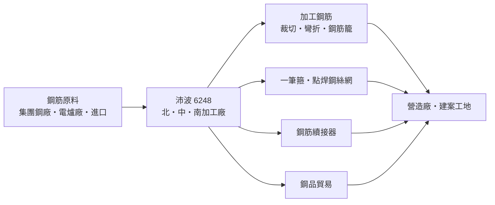
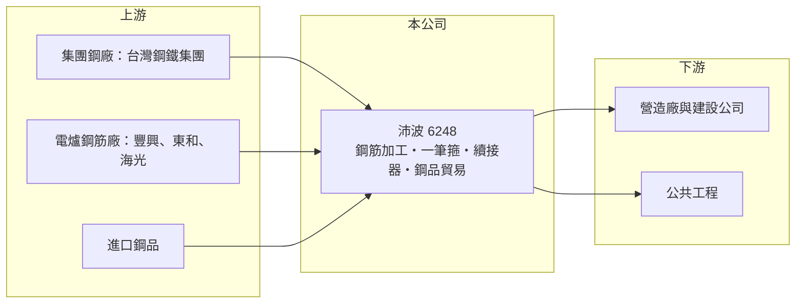

# 6248 沛波

> 上櫃｜[[產業索引-鋼鐵工業|鋼鐵工業]]｜上市（櫃）日期 2003/09/03

# 第一章：企業模式與商業藍圖

> [!info] 撰寫說明
> 本文由 Claude 依公開資料整理，架構比照 [[2330台積電]] 的四章研究，資料截至 2026-10-08。財務數字來源：Goodinfo 年度經營績效頁、富果研究 2026 年上半年法說會備忘錄（2026 年 9 月）、櫃買中心開放資料（基本資料、資產負債、綜合損益、每月營收、本益比殖利率）。產品營收比重、加工產能與加入台鋼集團的年份未查得；產業描述為整理性內容，尚未逐條比對原始文件。#待校對

在評估單一個股的長期投資價值時，首要步驟是拆解企業的底層獲利邏輯。本章說明沛波鋼鐵（股票代號：6248，以下簡稱沛波）如何在營建產業鏈中，以「鋼筋加工一條龍」賺取服務價差。

## 一、核心定位：營建工地的鋼筋加工中心

沛波成立於 1984 年 5 月，2003 年 9 月上櫃，2026 年實收資本額約 10.0 億元，董事長為顏慶利、總經理為黃霈櫻，屬於台灣鋼鐵集團（TSG）的成員。沛波的核心業務是[[鋼筋]]加工與鋼品經銷：向鋼廠採購鋼筋，依營建工地的結構圖預先裁切、彎折、組合成箍筋與鋼筋籠，再配送到工地。

傳統工地是把整支鋼筋送到現場，由工人現場彎紮，耗工又浪費材料。[[鋼筋加工]]廠在工廠內以機器加工，可縮短工期、降低損料，也減少工地對人力的依賴。在台灣營建業缺工嚴重的背景下，這類「工廠預製」的需求長期上升。

## 二、一條龍服務與產品延伸

沛波強調「一條龍」服務，依法說會資料，可將交期從同業約 21 天縮短到 7 至 10 天。產品也從單純的鋼筋加工延伸到進口鋼品、[[一筆箍]]、點焊鋼絲網與鋼筋續接器，讓營造廠能一次採購多種鋼筋相關產品。

## 三、長期方向：擴充加工產能、集團整合

沛波的長期策略是擴大北、中、南三區的加工產能，並借助台鋼集團的上中下游整合來控制原料成本。2026 年法說會提到在手訂單可見度約 6 至 8 個月，2025 年鋼筋加工出貨量創新高。營收從 2019 年的 30 億元成長到 2024 年的 93 億元，主要來自加工量與鋼品貿易的擴張；2025 年起因鋼品貿易需求轉弱與工地延宕而回落。長期來看，沛波的價值在於把低毛利的鋼筋貿易轉為較穩定的加工服務。

# 第二章：護城河深度與競爭優勢

在長期價值投資中，「護城河」指企業抵禦競爭、維持超額利潤的保護機制。本章評估沛波在鋼筋加工市場的競爭位置。

## 一、競爭優勢

* **交期與服務：** 7 至 10 天的交期遠快於同業，對趕工的營造廠很有價值。工地一旦習慣某家加工廠的配送與圖面處理，轉換供應商會增加協調成本。
* **集團原料支援：** 身為台鋼集團成員，可透過集團內部取得鋼筋原料，降低採購成本與斷料風險。
* **三區布局：** 北、中、南加工廠可就近服務全台工地，鋼筋重而便宜，運輸距離直接影響成本。

## 二、競爭對手格局

| 對手 | 定位 | 對沛波的影響 |
|---|---|---|
| [[2015豐興]]、[[2006東和鋼鐵]]、[[2038海光]] | 電爐鋼筋廠，部分自設加工 | 上游整合加工，兼具供應商與競爭者角色 |
| 地區型鋼筋加工廠 | 規模小、地緣關係深 | 在地價格競爭 |
| 營造廠自有加工 | 大型營造廠自行加工 | 減少外包需求 |

## 三、守得住與守不住的地方

* **守得住：** 加工服務的交期與一站式產品，以及在缺工環境下營造廠對工廠預製的依賴。
* **守不住：** 鋼品貿易的價差。沛波毛利率長期只有 5% 至 7%，代表大部分營收仍是貼近原料價格的經銷，價差有限。
* **觀察重點：** 加工出貨量的成長、毛利率能否隨加工比重提升而改善，以及營建景氣受房貸限縮的影響。

# 第三章：財務體質與盈利規模

資料日期：2026-10-08，表格是撰寫當時的快照；最新月營收、毛利率、累計 EPS 由自動排程寫在本筆記的屬性欄位（月營收、毛利率、累計EPS 等）。#待校對

財務報表是檢驗護城河是否真實存在的最終標準。本章用多年度三率、ROE 與資本報酬，檢視沛波的獲利品質。

## 一、多年度獲利

| 年度 | 營收（新台幣） | [[毛利率]] | [[營業利益率]] | EPS（元） | [[ROE]] |
|---|---|---|---|---|---|
| 2019 | 30.1 億 | 6.45% | 3.19% | 2.89 | 24.0% |
| 2020 | 31.2 億 | 6.99% | 2.29% | 1.74 | 13.0% |
| 2021 | 44.4 億 | 4.86% | 1.68% | 1.62 | 10.4% |
| 2022 | 66.3 億 | 6.03% | 3.50% | 3.32 | 19.1% |
| 2023 | 78.3 億 | 6.15% | 2.93% | 4.02 | 20.4% |
| 2024 | 93.1 億 | 5.09% | 2.02% | 3.07 | 12.1% |
| 2025 | 76.8 億 | 5.68% | 2.35% | 1.53 | 6.45% |
| 2026 上半年 | 31.1 億 | 6.62% | 2.90%（推算） | 0.59 | 未查得 |

* **低毛利、高周轉：** 毛利率 5% 至 7%、營業利益率 2% 至 3.5%，但資產周轉快，ROE 在 2019 至 2023 年多數年度超過 10%，是典型的通路型獲利結構。
* **營收快速擴張後回落：** 2019 至 2024 年營收成長三倍，2025 年與 2026 年上半年因鋼品貿易需求轉弱、工地因土方、房貸限縮與天候延宕而下滑，2026 年上半年營收年減約 23%，但毛利率反而從 5.54% 升到 6.62%。
* **股本擴大稀釋 ROE：** 2026 年第二季資本公積約 9.1 億元，顯示過去曾以溢價增資擴充資本（年份未查得），ROE 因此從 20% 降到 6% 至 12%。#待校對

## 二、長期指標

* **平均 ROE：** 2021 至 2025 年平均約 13.7%（推算）。
* **營收年複合成長率：** 2019 至 2025 年約 17%（推算）。
* **股利：** 連續七年配息，2025 年度現金股利約 1.22 元，配息率約 80%（推算）；配息率高，符合通路業資本需求較低的特性。
* **財務結構：** 2026 年第二季流動資產 21.9 億元、流動負債 10.3 億元，流動比率約 2.1 倍（推算），負債比約 46%。

## 三、[[ROIC]] 與 [[WACC]]：價值創造利差

**ROIC 推算：** 2025 年營業利益約 1.8 億元（76.8 億元 × 2.35%），稅後約 1.44 億元。投入資本以 2026 年第二季權益 21.8 億元加負債 18.4 億元計（以負債總額代替有息負債會高估投入資本），ROIC 約 3.6%（推算）；只以權益計算約 6.6%（推算）。2023 年營業利益約 2.3 億元，同法估算約 5% 至 10%（推算）。

**WACC 推算：** 以 [[CAPM]] 推估，台灣 10 年期公債 1.75%、市場風險溢酬 6%、β 取 0.9（鋼鐵業常見值，非來源數字），權益成本約 7.15%；負債成本假設 2.5%，稅後 2%。依帳面權益約 54%、負債約 46% 計算，WACC 約 4.8%；若只計有息負債，約 5.5% 至 6.5%（推算）。

**結論：** 沛波在 2022 至 2023 年營建熱絡時 ROIC 高於 WACC，2025 年後回落到資金成本附近或以下。它的價值創造取決於加工量能否持續放大，讓薄利的模式靠周轉率賺回資本報酬。

# 第四章：總體風險與地緣政治

任何企業都無法脫離宏觀環境獨立存在。本章分析沛波必須面對的產業、營運與外部風險。

## 一、產業週期

* **營建景氣：** 鋼筋需求幾乎完全取決於國內營建與公共工程，央行的房貸限縮、建案開工數與公共建設預算都會直接影響出貨。
* **鋼筋價格：** 鋼筋價格跟著[[廢鋼]]與電爐廠報價波動，價格下跌時庫存與合約價差會受壓。

## 二、營運風險

* **工地延宕：** 2026 年上半年的經驗顯示，土方問題、天候與融資條件都可能讓工地停擺，加工訂單雖然在手，出貨時程卻會延後。
* **集團依賴：** 原料與部分業務依賴台鋼集團，集團策略或內部交易條件改變會影響沛波。
* **低毛利結構：** 毛利率只有 5% 至 7%，費用或原料價格稍有失控就可能侵蝕全部利潤。

## 三、其他風險

* **缺工：** 加工廠本身也需要技術工人，台灣製造與營建缺工會推升人事成本；但缺工同時是推動工廠預製需求的長期動力。
* **碳成本：** 台灣碳費主要由上游電爐廠承擔，但可能轉嫁到鋼筋價格。

# 專有名詞解析

## 產業

- **[[鋼筋]]**：埋在混凝土中提供抗拉強度的條狀鋼材，規格標準化，是住宅與公共工程的主要用鋼。
- **[[鋼筋加工]]**：在工廠內依結構圖預先裁切、彎折與組合鋼筋，再配送到工地，可縮短工期並減少現場人力。
- **[[一筆箍]]**：以一整根鋼筋連續彎折成多圈箍筋，取代多個單獨箍筋，可減少搭接、提高施工效率與耐震性。
- **[[廢鋼]]**：回收的鋼鐵料，是電弧爐的主要原料，價格隨國際供需每日變動，占電爐廠成本最大比重。

# 核心供應鏈

## 1. 上游：鋼筋原料
- 台灣鋼鐵集團內部鋼廠
- 電爐鋼筋廠：[[2015豐興]]、[[2006東和鋼鐵]]、[[2038海光]]（實際採購對象未查得）

## 2. 本公司與同業
- 集團相關：[[5011久陽]]（同屬台灣鋼鐵集團）

## 3. 下游：客戶
- 營造廠與建設公司：[[2597潤弘]]、[[2501國建]]、[[5522遠雄]] 等（是否為沛波客戶未查得）
- 公共工程與基礎建設

## 最新新聞
<!-- news:start -->
<!-- news:end -->

## 相關連結
- [公開資訊觀測站](https://mopsov.twse.com.tw/mops/web/t05st03?step=1&firstin=1&co_id=6248)
- [Goodinfo](https://goodinfo.tw/tw/StockDetail.asp?STOCK_ID=6248)
- [Yahoo 股市](https://tw.stock.yahoo.com/quote/6248)
- [鉅亨網新聞](https://www.cnyes.com/twstock/6248/news)
