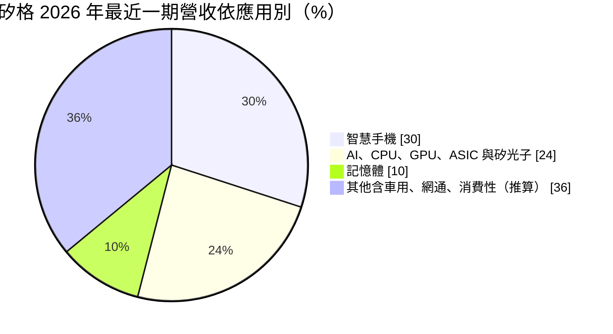
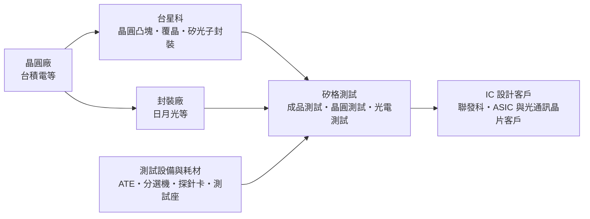
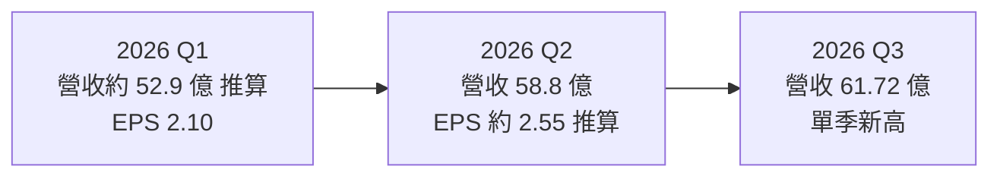
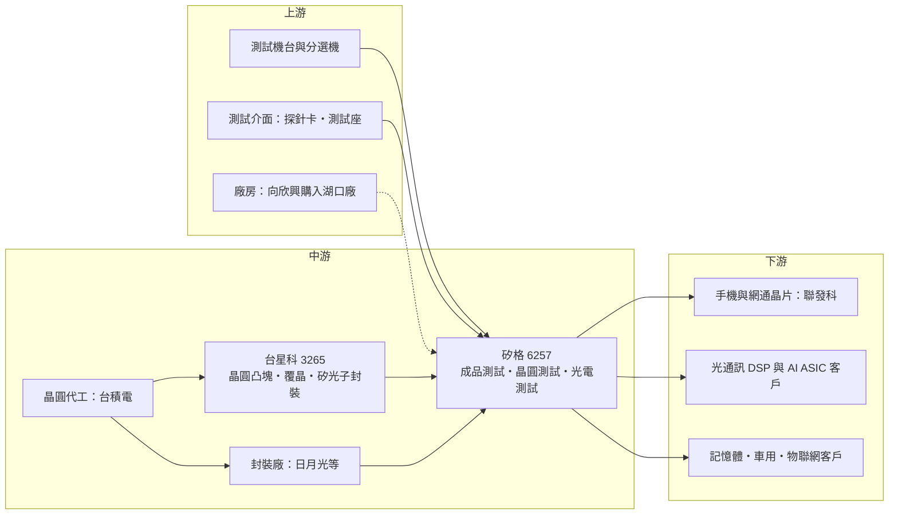

# 6257 矽格

> 上市｜[[產業索引-半導體業|半導體業]]｜上市（櫃）日期 2003/08/25

# 第一章：企業模式與商業藍圖

> [!info] 撰寫說明
> 本文由 Claude 依公開資料整理，架構比照 [[2330台積電]] 的四章研究，資料截至 2026-10-08。財務數字來源：Goodinfo 經營績效頁（2019 至 2025 年度）、證交所開放資料快照（基本資料、2026 年上半年損益與第二季資產負債、股利）、優分析 2026 年 10 月營運報導、經濟日報 2026 年 7 月報導、聯合新聞網 2025 年 11 月矽格與台星科聯合法說報導、理財周刊 2026 年報導、旺得富 2026 年 2 月欣興董事會報導；產業描述為整理性內容，尚未逐條比對原始文件。#待校對

在評估單一個股的長期投資價值時，首要步驟是拆解企業的底層獲利邏輯。本章針對矽格（股票代號：6257）的商業模式進行定性分析，說明一家以手機與消費性晶片測試起家的中型測試廠，如何把產品組合轉向 AI ASIC、記憶體與矽光子測試。

## 一、核心定位：以測試為主、封裝為輔的中型專業測試廠

矽格成立於 1988 年 12 月，總部位於新竹縣，屬於半導體後段的封裝測試業者。依理財周刊報導，矽格的服務組合約 79% 為測試、20% 為封裝，本質上是一家[[測試代工]]公司。旗下的 [[3265台星科]] 負責晶圓凸塊與覆晶封裝，兩家公司形成「封裝加測試」的分工。

矽格的傳統強項是電源管理 IC、射頻 IC 以及電視、PC、手機周邊晶片的成品測試（[[FT]]）。這類晶片數量大、種類多，需要測試廠有足夠的機台彈性與工程支援。使用者在核心供應鏈章節中，把矽格列為 [[2454聯發科]] 供應鏈的「網通與電源管理晶片測試」廠，以及台積電供應鏈中的「網通與手機晶片測試」夥伴，正是這個傳統定位。

近年矽格最重要的變化，是把客戶組合從手機與消費性晶片，逐步轉向 AI 相關晶片。依優分析 2026 年 10 月報導，AI、CPU、GPU、[[ASIC]] 與[[矽光子]]相關業務占比，由 2025 年的 20% 提高到約 24%，目標 2027 年突破 30%；智慧手機占比則由 33% 降到約 30%。

* **以彈性與成本服務多元客戶：** 矽格的規模比 [[2449京元電子]] 小，但能以較靈活的產能配置與成本結構，服務中型 IC 設計公司與國際大廠的特定產品線。
* **以封測整合爭取新應用：** 台星科提供晶圓凸塊、覆晶封裝與矽光子 IC 封裝，矽格提供測試，兩家合作可以替客戶完成從封裝到測試的完整流程，在矽光子這類新產品上特別有用。

## 二、終端應用板塊：手機比重下降，AI 與記憶體上升

依優分析 2026 年 10 月報導整理的營收結構如下：

* **智慧手機：** 手機處理器周邊的電源管理、射頻與連接晶片，是矽格過去最大的業務。依優分析報導，手機營收仍在成長，但速度較慢，占比由 33% 降到約 30%。
* **AI 與高速運算：** 包括雲端業者委外的 AI ASIC、CPU、GPU 與光通訊晶片。依理財周刊報導，光通訊用的 DSP 晶片集中在 [[MRVL邁威爾]] 與 [[AVGO博通]] 兩家；經濟日報則報導，美系雲端業者持續增加 ASIC 訂單，並新增日本與歐美 ASIC 客戶。
* **記憶體：** 依優分析報導，記憶體測試約占營收一成，年增 32%，而且記憶體客戶願意加價以爭取測試產能。
* **其他：** 車用、醫療、物聯網、網通與消費性電子。聯合新聞網報導的 2025 年聯合法說指出，車用、醫療、物聯網與網通在 2025 年都有成長。

## 三、資本轉化邏輯：機台、廠房與產能保障協定

* **產能保障協定：** 依優分析報導，矽格大部分客戶已簽訂一年以上的產能保障協定，湖口二廠全廠產能也已被客戶提前預訂。這讓矽格的擴產比過去更有把握，減少「蓋了廠卻沒有訂單」的風險。
* **擴產節奏：** 依優分析報導，湖口二廠在 2026 年 7 月加入量產，當時產能開出約四成，預期 2027 年逐步開足；中興三廠目標在 2027 年第一季開始提供服務。聯合新聞網報導，中興三廠規劃約 3 個生產樓層，每層滿載可貢獻約 1 億元單月營收。另依旺得富報導，矽格在 2026 年以 15.4 億元向 [[3037欣興]] 購入新竹湖口廠房。
* **設備交期決定營收時點：** 依優分析報導，部分測試設備交期長達一年，從核定投資到營收貢獻可能相隔半年到一年。測試廠的營收成長，取決於設備能否準時到位與裝機。
* **自製與改裝設備：** 矽格在湖口二廠進行矽光子測試，自製及改裝設備已達雙位數台數（優分析）。在新興的光電測試領域，標準設備往往不足，自製能力是爭取客戶的重要條件。

## 四、企業長期藍圖：從手機測試轉向 AI 與矽光子

* **資本支出大幅上調：** 聯合新聞網報導，2025 年資本支出上調到 47 億元；經濟日報與優分析報導，2026 年資本支出由原規劃 59 億元，在 2026 年 5 月上調到 88 億元，主要用於採購先進製程測試設備。對一家年營收約 200 億元的公司而言，這是相當積極的投資。
* **矽光子與光通訊測試：** 依優分析報導，光通訊已進入實際測試服務階段，服務範圍涵蓋電子晶片、光子晶片與光引擎，公司預期 2027 年光通訊營收可倍數成長，且相關測試的獲利優於傳統測試。台星科則已把矽光子 IC 封裝導入量產，並與客戶合作共同封裝光學（[[CPO]]）相關製程。
* **台星科的先進製程封裝：** 依聯合新聞網報導，台星科的 3、5 奈米晶圓凸塊與覆晶封裝已量產，2 奈米進入客戶認證，預期 2026 年起先進製程封裝成為成長主軸。母子公司的分工，讓矽格集團可以跟著台積電的製程演進承接後段需求。

# 第二章：護城河深度與競爭優勢

在長期價值投資中，「護城河」指企業抵禦競爭、維持超額利潤的保護機制。本章分析矽格的護城河構成、全球主要競爭對手，以及這些優勢在測試產業的大者恆大趨勢下能守住多少。

## 一、矽格護城河的核心組成要素

矽格屬於「窄護城河」的中型測試廠，規模不如京元電與日月光，但在特定利基上建立了三個優勢：

* **1. 測試程式與客戶驗證的轉換成本：** 每款晶片的測試程式、測試座與探針卡都需要和測試廠共同開發，並通過客戶驗證。客戶在一款產品的生命週期內很少換測試廠，這讓矽格在既有客戶與產品線上有穩定的訂單基礎。
* **2. 多元客戶與產品線的彈性：** 矽格長期服務電源管理、射頻、網通、記憶體等多種晶片，累積了處理大量、多樣產品的工程經驗。這種彈性讓它能快速承接新興產品，例如光通訊晶片與記憶體的加價測試需求。
* **3. 封測整合與光電測試能力：** 與台星科的分工，讓矽格能提供矽光子從封裝到測試的完整服務，而光電混合測試需要自製或改裝設備，是傳統測試廠較難快速複製的能力。

## 二、全球主要競爭對手格局

| 對手 | 定位 | 對矽格的威脅 |
|---|---|---|
| [[2449京元電子]] | 台灣最大專業測試廠，AI GPU 與 ASIC 測試主力 | 規模與資本支出遠大於矽格，在 AI 測試居領先地位 |
| [[3711日月光投控]] | 全球最大封測集團，封裝加測試一條龍 | 可提供整包服務，積極擴充先進測試 |
| [[3264欣銓]] | 台灣晶圓測試廠，車用與 MCU 為主 | 在晶圓測試與車用領域重疊 |
| [[AMKR艾克爾]] | 全球第二大封測廠 | 具美國與東南亞產能，爭取國際客戶 |
| 中國測試廠 | 政策扶植的本土封測與測試業者 | 在中國客戶的消費性與手機晶片以價格競爭 |

## 三、優勢轉化：哪些市場守得住、哪些守不住

* **守得住：** 既有的電源管理、射頻與網通晶片測試，以及已簽訂產能保障協定的 ASIC 與光通訊客戶。這些客戶看重穩定的交期與工程支援。
* **守不住或競爭激烈：** 最高階 AI GPU 的成品測試與預燒，京元電與日月光已建立大規模產能與客戶關係，矽格較難在這個市場取得主導地位。一般消費性晶片測試則面臨同業的價格競爭。
* **觀察重點：** 第一，AI 與矽光子相關比重能否如期在 2027 年突破三成；第二，湖口二廠與中興三廠開出後，新增營收能否支撐設備折舊；第三，光通訊測試能否如公司預期在 2027 年倍數成長，並維持較高的獲利率。

# 第三章：財務體質與盈利規模

資料日期：2026-10-08。數字取自 Goodinfo 經營績效頁、證交所開放資料快照與財經媒體報導，表格是撰寫當時的快照；最新月營收、毛利率、累計 EPS 由自動排程寫在本筆記的屬性欄位（月營收、毛利率、累計EPS 等）。#待校對

財務報表是檢驗護城河是否真實存在的最終標準。本章用多年度的三率、[[ROE]]、股利與資本報酬，檢視矽格在產品轉型期的獲利品質。

## 一、獲利能力的基石：三率

| 年度 | 營收（新台幣） | [[毛利率]] | [[營業利益率]] | EPS（元） | [[ROE]] |
|---|---|---|---|---|---|
| 2019 | 100 億 | 30.3% | 20.6% | 3.26 | 12.3% |
| 2020 | 124 億 | 29.0% | 18.8% | 4.22 | 13.5% |
| 2021 | 167 億 | 29.7% | 20.6% | 6.25 | 18.5% |
| 2022 | 187 億 | 29.6% | 20.5% | 6.68 | 18.9% |
| 2023 | 155 億 | 23.1% | 13.4% | 3.80 | 10.9% |
| 2024 | 182 億 | 26.1% | 16.9% | 5.89 | 14.8% |
| 2025 | 196 億 | 29.2% | 20.3% | 6.14 | 13.9% |
| 2026 上半年 | 111.7 億 | 33.02% | 24.09% | 4.65 | 約 17.6%（年化推算） |

資料來源：2019 至 2025 年為 Goodinfo 經營績效頁；2026 上半年依證交所綜合損益與營益分析快照（營收 111.7 億元、營業利益 26.9 億元、歸屬母公司淨利 22.3 億元），ROE 以上半年淨利年化除以 2026 年第二季歸屬母公司權益 252.4 億元推算。

* **毛利率穩定在三成上下：** 矽格的毛利率在 2019 至 2022 年穩定在 29% 到 30%，2023 年景氣低谷降到 23.1%，2025 年回到 29.2%，2026 年上半年進一步升到 33.02%。毛利率的提升來自高單價的 AI、記憶體與光通訊測試比重增加，以及產能吃緊下的價格條件改善。
* **營業利益率高：** 測試廠的營業費用占營收比例低，矽格的營業利益率在多數年度維持在 17% 到 21%，2026 年上半年達到 24.09%。
* **成長速度：** 2020 年到 2025 年營收從 124 億元成長到 196 億元，年複合成長率約 9.6%（推算）。依優分析報導，2026 年前九個月營收 173.46 億元，年增 21.15%，成長明顯加速。

## 二、[[ROE]]：資本效率

矽格 2021 至 2025 年的 ROE 分別為 18.5%、18.9%、10.9%、14.8% 與 13.9%，五年平均約 15.4%（推算）。2026 年上半年年化 ROE 約 17.6%（推算），隨獲利成長回升。

依證交所 2026 年第二季資產負債快照，矽格資產總計 502.8 億元，負債 220.2 億元，權益 282.7 億元，每股淨值 52.78 元，負債比約 44%。權益中「其他權益」達 53.4 億元，2026 年上半年其他綜合損益 34.6 億元，推估主要來自持有金融資產（例如轉投資股票）的評價利益。這部分會擴大權益、壓低帳面上的 ROE，但不代表本業的資本效率下降。

## 三、資本支出、自由現金流與股利

* **[[CapEx]] 持續擴大：** 2025 年資本支出上調到 47 億元，2026 年再上調到 88 億元，相當於 2025 年營收的四成以上，屬於積極擴產期。
* **[[自由現金流]]：** 多年度數字未查得。以測試廠的高折舊特性推估，營業現金流通常明顯高於淨利，過去在一般年度足以支應資本支出與股利；2026 年資本支出大增，自由現金流推估會轉弱（推估）。
* **股利：** 依證交所股利資料，2025 年度董事會決議配發盈餘現金股利 2.7 元，另以資本公積發放現金 1.5 元，合計 4.2 元。以 EPS 6.14 元計算，盈餘配發率約 44%，連同資本公積的現金發放約 68%（推算）。公司章程規定股東股利為當年度可分配盈餘的 10% 至 80%，以現金股利為優先。

## 四、[[ROIC]] 與 [[WACC]]：價值創造利差

**ROIC 推算：** 2026 年上半年營業利益 26.9 億元，年化約 53.8 億元，以 20% 稅率計算稅後營業利益約 43.1 億元。投入資本以 2026 年第二季權益總計 282.7 億元，加上非流動負債 111.5 億元作為有息負債的近似值（有息負債明細未查得），合計約 394.2 億元，ROIC 約 10.9%（推算）。以 2025 年營業利益約 39.8 億元（196 億元 × 20.3%）計算，稅後約 31.8 億元，ROIC 約 8.1%（推算）。由於權益包含大額金融資產評價利益，本業實際的 ROIC 會比這個數字更高。

**WACC 推算：** 台灣 10 年期公債殖利率取 1.75%，市場風險溢酬取 6%，β 取封測股常見的 1.0 至 1.2（矽格本身的 β 未查得），股東權益成本約 7.8% 至 9.0%。負債成本取 2%，稅後 1.6%，以權益約 72%、負債約 28% 計算，WACC 約 6.0% 至 6.9%（推算）。

**解讀：** 矽格的 ROIC 約 8% 到 11%，高於 WACC 約 2 到 5 個百分點，代表長期在創造價值，但利差屬於中等。2026 年 ROIC 隨 AI 與記憶體測試需求回升，不過湖口二廠與中興三廠的大量投資即將進入折舊期，ROIC 能否維持，取決於新產能能否像公司預期那樣被產能保障協定填滿。

# 第四章：總體風險與地緣政治

任何企業都無法脫離宏觀環境獨立存在。本章分析矽格未來必須面對的地緣政治、產業週期與營運風險。

## 一、地緣政治風險

* **生產集中台灣：** 矽格的主要廠區集中在新竹縣，兩岸情勢若影響台灣半導體生產，矽格與其晶圓廠、IC 設計客戶會同時受到衝擊。
* **中國客戶與市場：** 手機與消費性晶片客戶中有一部分與中國市場相關，美中科技對抗下，中國客戶可能優先採用本土測試廠，美國出口管制也可能限制部分晶片的測試服務。
* **美國在地化：** 若 AI 晶片客戶要求在美國或東南亞完成測試，矽格這種以台灣為主的中型測試廠，海外擴張的資源相對有限。

## 二、產業週期與市場結構風險

* **手機與消費性的週期：** 手機仍占營收約三成，加上消費性電子，矽格的營收受終端需求影響明顯。2023 年營收從 187 億元降到 155 億元，正是庫存調整透過[[長鞭效應]]放大的結果。
* **AI 投資週期：** AI 與光通訊是未來成長主軸，若雲端業者放緩 AI 投資，ASIC 與光通訊測試的訂單會受影響。
* **大者恆大：** AI 測試需要龐大的資本支出，京元電與日月光的投資規模遠大於矽格。若測試產業持續往大廠集中，中型測試廠的議價空間可能被壓縮。

## 三、營運環境的隱性風險

* **折舊壓力：** 2025、2026 年資本支出大增，未來折舊會明顯上升。優分析報導也指出，擴產效益取決於湖口二廠爬坡與中興三廠投產後，新增營收能否支撐設備折舊。
* **設備交期：** 高階測試設備交期長達一年，若設備延遲到位，新產能開出時間會往後延。
* **客戶集中：** 光通訊 DSP 晶片集中在少數客戶，單一大客戶的訂單變化會影響相關營收。
* **金融資產評價波動：** 權益中有大額金融資產評價利益，股市波動會讓帳面權益與綜合損益大幅變動。

## 四、科技演進風險

測試技術正隨晶片架構快速變化。[[Chiplet]] 與先進封裝讓晶圓測試與 [[KGD]] 的重要性提高，矽光子與 CPO 則需要同時量測電訊號與光訊號，這兩個趨勢都會改變測試設備與流程的需求。矽格已經在矽光子測試投入自製與改裝設備，若能在光通訊測試建立領先地位，將有機會擺脫傳統測試的價格競爭；反之，若新技術的標準與設備由大廠主導，中型測試廠可能只能承接成熟產品。台星科的 2 奈米凸塊與覆晶封裝認證進度，也是集團能否跟上先進製程的關鍵。

# 專有名詞解析

## 半導體

- **[[測試代工]]**：專門替 IC 設計公司或晶圓廠提供晶片測試服務的業者，本身不設計也不製造晶片。
- **[[FT]]**：成品測試，晶片封裝完成後的最終電性與功能測試，合格後才出貨給客戶。
- **[[ASIC]]**：特殊應用積體電路，為特定用途客製的晶片，例如雲端業者自研的 AI 加速器。
- **[[矽光子]]**：在矽晶片上製作光學元件，以光取代電傳輸資料，可降低 AI 資料中心的傳輸耗電。
- **[[CPO]]**：共同封裝光學，把光學收發元件和運算或交換晶片封裝在一起，以降低高速傳輸的耗電。
- **[[Chiplet]]**：小晶片架構，把大晶片拆成多顆小晶片再以先進封裝整合，可提高良率並混用不同製程。
- **[[KGD]]**：已知良品晶粒，在封裝前就確認為良品的晶片，多晶片先進封裝特別需要。

## 金融

- **[[CapEx]]**：資本支出，企業購買土地、廠房與設備的支出。
- **[[自由現金流]]**：營業活動現金流減去資本支出，代表企業可自由用於配息、還債或併購的現金。
- **[[長鞭效應]]**：終端需求的小幅變動，沿供應鏈往上游傳遞時被逐級放大，造成上游庫存與訂單劇烈波動。

# 核心供應鏈

## 1. 上游：測試設備、測試介面與廠房
- 自動測試設備（ATE）：愛德萬（Advantest）、泰瑞達（Teradyne）（待校對）
- 測試分選機：[[7769鴻勁]]（推估）
- 探針卡：[[6223旺矽]]（旺矽將矽格列為探針卡使用場域之一）、[[6510精測]]（推估）
- 測試座：[[6515穎崴]]（推估）
- 湖口廠房：2026 年以 15.4 億元向 [[3037欣興]] 購入

## 2. 中游：前段夥伴與集團分工
- 晶圓來源與合作：[[2330台積電]]（網通與手機晶片測試）
- 晶圓凸塊、覆晶與矽光子 IC 封裝子公司：[[3265台星科]]
- 封裝後送測：[[3711日月光投控]]等封裝廠

## 3. 下游：IC 設計客戶
- 網通與電源管理晶片測試：[[2454聯發科]]
- 光通訊 DSP 晶片：[[MRVL邁威爾]]、[[AVGO博通]]（推估，內文指出光通訊 DSP 集中於這兩家，未證實皆為矽格客戶）
- 美系雲端業者 ASIC，以及新增的日本與歐美 ASIC 客戶：個別名單未公開
- 記憶體、車用、醫療與物聯網晶片：多家，個別名單未查得

## 4. 同業競爭
- 台灣測試與封測廠：[[2449京元電子]]、[[3711日月光投控]]、[[3264欣銓]]
- 國際封測廠：[[AMKR艾克爾]]，以及中國本土測試廠

延伸閱讀：[[台積電供應鏈]]、[[聯發科供應鏈]]

## 供應鏈關係
- 與 [[2330台積電]] 合作：網通與手機晶片測試（台積電供應鏈 › 下游：專業封裝與最終測試廠 (OSAT)）
- 供應給 [[2454聯發科]]：網通與電源管理晶片測試（聯發科供應鏈 › 中游：專業封裝與最終測試廠 (OSAT)）

## 最新新聞
<!-- news:start（自動產生，請勿手動編輯此範圍） -->
- 2026-10-13 📰 媒體 20:02｜矽格集團斥21.88億元 拿下建漢竹科園區萬坪科技廠房｜[鉅亨網](https://news.cnyes.com/news/id/6629591)
- 2026-10-13 📰 媒體 19:22｜矽格集團再度以21.88億購置新竹科學園區科技廠房｜[UDN](https://news.google.com/rss/articles/CBMidEFVX3lxTFAyeHp6QkRmWElZVkJZdmhFSzlwV0RjLVpJeU9mYlJ3ZjJHY1NBOXhHdm1QUnZBM2p3MUQ4RWxzNzNuNnlCR2x2SVFzMHRGVFFwVUdMN0FTcDNHbXR2MTM5T01LQW5pRzZDNEsySUxWd1kzZUt10gFWQVVfeXFMTjktSGZLWE8xeF9DWHBJM0FuakxPOUVuLUdDTjhiWGpVY2lGV1FNZ3REMW15dktxZFoxZnREYmFJZW13RDJ1R1pMaU5kc25DTHYwLVY5OHc?oc=5)
- 2026-10-13 📰 媒體 18:07｜砸21.88億元！矽格再買竹科廠房擴產聚焦三大方向- 產業｜[工商時報](https://news.google.com/rss/articles/CBMiX0FVX3lxTFBjWWdoQUZDX095VnM4QWVObHFoY0x6U3VMZE5ndGxGa2RJVjV4MFRRSmVLcERoNE1Md1dIR2lWRlR4eEEyc0tIQ0ppWUx0VDlObjhCaDZzbndibTVIdC1V?oc=5)
- 2026-10-13 📰 媒體 18:06｜矽格 代子公司矽格聯測股份有限公司公告購置「創新路廠房與附屬設備」｜[CMoney](https://news.google.com/rss/articles/CBMiWEFVX3lxTE1zZWZrOW85ZlNselEydmdXSXA2WWo3WWNJV1JXYUdQZ1JPeThxQ2taNmVPckNkd0VDaTc4VE9nVEx3ZEtzM0YzZ1FrdDZhVlg1V0lzQ3BSTi0?oc=5)
- 2026-10-12 📰 媒體 21:27｜矽格(6257) 個股概覽 ／ 個股 - 股市｜[CMoney](https://news.google.com/rss/articles/CBMiU0FVX3lxTE1xSVlGT25hR0x6cGlqZnBYRUd0enlLQ1hWNDlsMkhTOEh0MFRDUW9jMW9ERS03enV4TC1GcWg3dHExc1hKa0VzSmVVaWxNeFJyQ2xJ?oc=5)

完整紀錄：[[6257矽格 新聞]]
<!-- news:end -->

## 相關連結
- [公開資訊觀測站](https://mopsov.twse.com.tw/mops/web/t05st03?step=1&firstin=1&co_id=6257)
- [Goodinfo](https://goodinfo.tw/tw/StockDetail.asp?STOCK_ID=6257)
- [Yahoo 股市](https://tw.stock.yahoo.com/quote/6257)
- [鉅亨網新聞](https://www.cnyes.com/twstock/6257/news)
