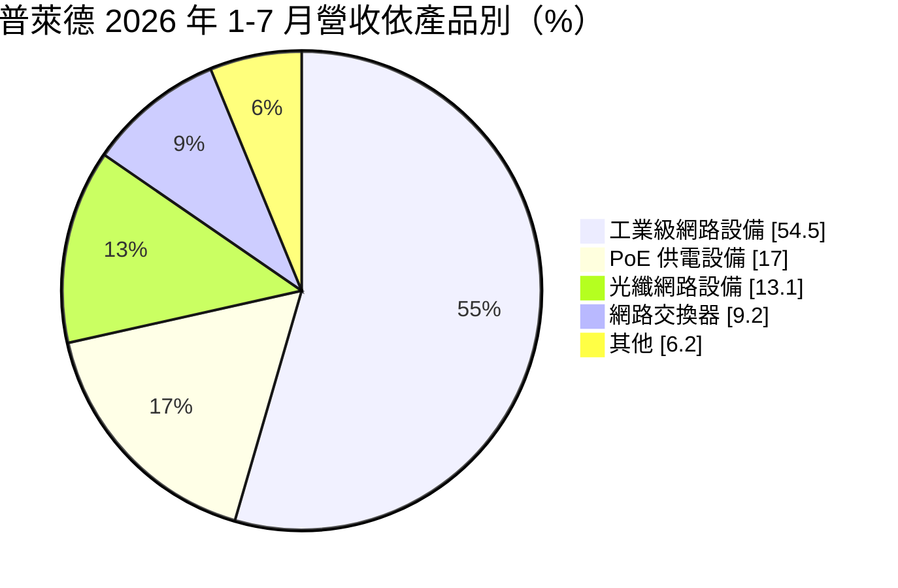
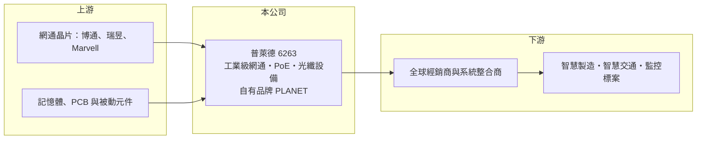

# 6263 普萊德

> 上櫃｜[[產業索引-通信網路業|通信網路業]]｜上市（櫃）日期 2003/09/17

# 第一章：企業模式與商業藍圖

> [!info] 撰寫說明
> 本文由 Claude 依公開資料整理，架構比照 [[2330台積電]] 的四章研究，資料截至 2026-10-08。財務數字來源：Goodinfo 年度經營績效頁、櫃買中心開放資料（基本資料、2026 年第二季資產負債與損益、本益比殖利率）、富果研究整理的 2026 年 8 月法說會摘要；產業描述為整理性內容，尚未逐條比對原始文件。#待校對

評估一家網通設備公司，關鍵在於它賣的是容易被比價的消費性產品，還是被寫進工程規格、一用就是十年的專業設備。本章說明普萊德科技（股票代號：6263，以下簡稱普萊德）如何以自有品牌工業級網路設備，建立少見的高毛利網通模式。

## 一、核心定位：自有品牌的工業級網通設備商

普萊德成立於 1993 年，2003 年在櫃買中心掛牌，實收資本額約 6.25 億元。公司以自有品牌 PLANET 銷售網路交換器、[[PoE]] 乙太網路供電設備、光纖網路設備與工業級網路設備，通路遍及全球超過 160 個國家，研發與製造都以台灣為主。

和多數替品牌代工的網通廠不同，普萊德的客戶主要是系統整合商與標案市場，產品用在智慧製造、智慧交通、監控與樓宇自動化等場域。這類專案重視耐溫、抗震、長期供貨與相容性，價格不是唯一考量，因此普萊德能維持接近五成的[[毛利率]]，這在台灣網通業相當少見。

## 二、營收結構：工業級產品過半、歐洲是最大市場

依 2026 年 8 月法說會資料，2026 年 1 至 7 月的產品結構如下：

* **工業級網路設備：** 營收占比已連續三年超過一半，是公司最重要的獲利來源。工業環境的設備一旦通過現場驗證，替換成本高，帶來穩定的重複訂單。
* **地區分布：** 2026 年上半年歐洲占 49.5%、美洲 23.7%、亞洲 16.9%、中東及非洲 9.9%。歐洲標案對資安與供應鏈來源要求嚴格，公司以台灣製造、非中國供應鏈的身分取得優勢。

## 三、長期方向：從硬體走向資安與軟體服務

公司近年的研發主軸是網路硬體資安、邊緣 AI 影像分析，以及把網管平台發展成訂閱制服務。2026 年推出邊緣 AI 智慧監控平台、具備後量子密碼功能的零信任資安產品，並開發 25G 至 400G 的高速交換器，同時配合歐盟網路韌性法案（CRA）進行產品認證。這些方向的共同點是提高產品附加價值，讓公司從賣盒子逐步延伸到賣解決方案。

# 第二章：護城河深度與競爭優勢

在長期價值投資中，「護城河」指企業抵禦競爭、維持超額利潤的保護機制。本章分析普萊德的護城河與競爭格局。

## 一、普萊德護城河的組成

* **專案規格綁定：** 工業級網路設備通常在專案設計階段就被系統整合商寫進規格，後續擴充與維修也會沿用同一品牌，形成[[轉換成本]]。這是公司毛利率長年維持在 40% 至 47% 的主要原因。
* **自有品牌與全球通路：** 三十年經營累積的品牌與經銷網路，讓公司能直接觸及中小型系統整合商。這些客戶分散、單一客戶議價能力弱，與代工廠面對少數大客戶的處境完全不同。
* **非中國供應鏈：** 歐美公共標案越來越排斥中國製網通設備，台灣自主研發製造的身分在政府與基礎建設專案中成為加分條件。

## 二、主要競爭對手

| 對手 | 定位 | 對普萊德的威脅 |
|---|---|---|
| [[CSCO思科]] | 全球企業網路龍頭，產品線完整 | 大型專案與高階市場的主要對手 |
| 西門子、Moxa（四零四科技） | 工業乙太網路大廠 | 在工廠自動化與交通領域直接競爭 |
| [[2332友訊]]、[[3704合勤控]] | 台灣自有品牌網通商 | 在中小企業交換器市場重疊 |
| 中國網通品牌 | 價格低、產品線廣 | 在不限制供應鏈來源的市場壓低價格 |

## 三、守得住／守不住／觀察重點

守得住的是工業級與標案市場，這裡重視可靠度與供應鏈來源，價格敏感度低。守不住的是一般商用交換器，同質性高、容易被比價。長期觀察重點是高速交換器與資安產品能否形成新的營收來源，以及網管平台能否真正轉成訂閱收入，讓獲利結構更穩定。

# 第三章：財務體質與盈利規模

資料日期：2026-10-08，表格是撰寫當時的快照；最新月營收、毛利率、累計 EPS 由自動排程寫在本筆記的屬性欄位（月營收、毛利率、累計EPS 等）。#待校對

財務報表是檢驗護城河是否真實存在的最終標準。本章用六年的三率、ROE 與資本報酬，檢視普萊德的獲利品質。

## 一、多年度經營績效

| 年度 | 營收（新台幣） | [[毛利率]] | [[營業利益率]] | EPS（元） | [[ROE]] |
|---|---|---|---|---|---|
| 2020 | 12.3 億 | 40.2% | 26.2% | 4.33 | 20.2% |
| 2021 | 14.3 億 | 39.9% | 26.8% | 5.14 | 23.5% |
| 2022 | 17.2 億 | 42.2% | 29.9% | 7.01 | 29.7% |
| 2023 | 18.4 億 | 45.2% | 31.8% | 8.12 | 31.6% |
| 2024 | 18.8 億 | 47.0% | 32.9% | 8.61 | 31.7% |
| 2025 | 18.8 億 | 46.7% | 31.7% | 8.32 | 29.7% |
| 2026 上半年 | 9.67 億 | 48.1% | 33.8% | 4.54 | 未查得 |

這張表最值得注意的是毛利率逐年上升，即使 2024 至 2025 年營收持平，獲利率仍維持高檔，代表產品組合持續往高單價的工業級產品移動。2021 至 2025 年平均 ROE 約 29.2%（推算），營收年複合成長率約 7.1%（推算）。公司幾乎沒有借款，獲利多以現金股利發放，最近一年度現金股利每股 7.8 元，配息率約九成（推算）。

## 二、[[ROIC]] 與 [[WACC]]：價值創造利差

**ROIC 推算：** 2025 年營業利益約 5.96 億元（18.8 億 × 31.7%），稅後約 4.77 億元。2026 年第二季股東權益約 15.6 億元，負債 10 億元多為應付帳款與應付股利，有息負債估計極少（假設 0.5 億元），投入資本約 16.1 億元，ROIC 約 29.7%（推算）。

**WACC 推算：** 台灣 10 年期公債 1.75%、市場風險溢酬 6%、β 取網通設備同業常見值 0.8，股東權益成本約 6.6%；負債成本 2%、稅後 1.6%；權益占投入資本約 97%，WACC 約 6.4%（推算）。

**結論：** ROIC 高出 WACC 二十多個百分點，代表普萊德長期以很少的資本創造大量超額報酬。這種輕資產、高配息的模式，前提是品牌與專案綁定能持續維持高毛利。

# 第四章：總體風險與地緣政治

任何企業都無法脫離宏觀環境獨立存在。本章分析普萊德長期必須面對的風險。

## 一、景氣與標案週期

工業級網路設備的需求跟著智慧製造、交通與公共建設的投資節奏走。歐洲占營收近一半，歐洲景氣放緩或公共預算緊縮時，專案可能延後。2024 至 2025 年營收停在 18.8 億元，說明成長已從高速期進入平穩期。

## 二、零組件成本與存貨

公司以 IC、記憶體、PCB 為主要原料，2026 年這些零組件漲價，公司採提前備料因應，存貨週轉天數升到約 109 天。若需求轉弱，偏高的存貨可能帶來跌價壓力。

## 三、技術與法規

網路設備正往更高速度、更強資安的方向演進，歐盟 CRA 等資安法規提高產品合規成本。中小型品牌商需要持續投入研發與認證，若跟不上規格更新，原本的專案綁定優勢會逐漸流失。營收以外幣計價為主，新台幣升值也會壓縮獲利。

# 專有名詞解析

## 應用

- **[[PoE]]**：乙太網路供電，透過網路線同時傳送資料與電力，常用於監視攝影機與無線基地台。

## 金融

- **[[ROIC]]**：投入資本報酬率，稅後營業利益除以股東權益與有息負債的合計，衡量本業對所有資金提供者的報酬。
- **[[WACC]]**：加權平均資金成本，依股東權益與負債的比重加權計算的資金成本，ROIC 高於它才代表創造價值。

## 產業

- **[[自有品牌]]**：以自己的品牌銷售產品、直接面對通路與終端客戶，毛利率通常高於代工模式。
- **[[轉換成本]]**：客戶更換供應商時需承擔的驗證、重新設計與停機風險，轉換成本高代表客戶黏著度高。

# 核心供應鏈

## 1. 上游：晶片與零組件
- 網通晶片：[[AVGO博通]]、[[2379瑞昱]]、[[MRVL邁威爾]]（供應關係為產業常見組合，待校對）
- 記憶體、PCB 與被動元件供應商

## 2. 中游：普萊德與同業
- 同業：[[2332友訊]]、[[3704合勤控]]、[[CSCO思科]]、Moxa、西門子

## 3. 下游：客戶
- 全球超過 160 個國家的經銷商與系統整合商
- 智慧製造、智慧交通、公共建設與監控專案業主

## 最新新聞
<!-- news:start -->
<!-- news:end -->

## 相關連結
- [公開資訊觀測站](https://mopsov.twse.com.tw/mops/web/t05st03?step=1&firstin=1&co_id=6263)
- [Goodinfo](https://goodinfo.tw/tw/StockDetail.asp?STOCK_ID=6263)
- [Yahoo 股市](https://tw.stock.yahoo.com/quote/6263)
- [鉅亨網新聞](https://www.cnyes.com/twstock/6263/news)
