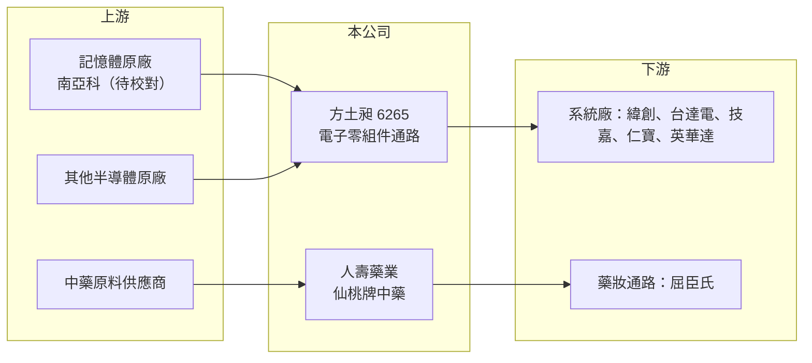

# 6265 方土昶

> 上櫃｜[[產業索引-電子通路業|電子通路業]]｜上市（櫃）日期 2003/10/24

# 第一章：企業模式與商業藍圖

> [!info] 撰寫說明
> 精簡版，由 Claude 依公開資料整理，架構比照 [[2330台積電]] 的四章研究，資料截至 2026-10-08。來源：Goodinfo 經營績效頁、富果研究 2025-12-12 法說會摘要、新聞標題、櫃買中心開放資料快照（基本資料、2026 年第二季損益與資產負債）。公開資料有限，代理品牌與營收比重未查得完整資料。#待校對

方土昶是一家小型的電子零組件代理商，近年再加上中藥保健品牌，形成「半導體通路＋生技」的雙引擎結構。本章說明它靠什麼賺錢，以及為何營收會隨記憶體景氣大起大落。

- **核心業務：** 方土昶的主業是[[電子通路]]，替上游原廠在台灣銷售半導體與電子零組件，並提供備貨與技術支援。依富果整理的 2025 年 12 月法說會內容，客戶包括英華達、台灣國際航電（Garmin）、[[3231緯創]]、[[2308台達電]]、[[2376技嘉]]、[[2324仁寶]] 等系統廠。新聞標題指出公司是 [[2408南亞科]] 的代理商（待校對），這解釋了它的營收與獲利為何和 DRAM 價格高度連動。
- **第二引擎：生技保健：** 公司 100% 持有人壽藥業，經營百年老牌「仙桃牌」中藥產品。2025 年人壽藥業增資到新台幣 1 億元，並從網路銷售擴展到屈臣氏全台門市。這塊業務規模目前遠小於通路本業，但毛利結構和景氣循環都與電子零件不同，目的是分散單一產業的風險。
- **營收結構：** 公司未公開兩大事業的營收比重。從規模判斷，2026 年上半年營收 24.3 億元幾乎都來自電子零組件通路，生技保健占比很小（推估）。
- **營運據點：** 主要在台灣經營，法說會資料沒有提到海外據點。公司實收資本額約 11.8 億元，2003 年上櫃。
- **長期方向：** 管理層的方向是增加新的代理產品線，同時持續推出仙桃牌新品、進入更多大型藥妝通路。長期來看，能否把一次性的記憶體行情轉化為穩定的代理線與客戶基礎，是這家公司的關鍵課題。

# 第二章：護城河深度與競爭優勢

通路商本身的護城河通常不深，方土昶又屬於規模較小的一群。本章說明它僅有的優勢、主要競爭者，以及值得長期追蹤的指標。

- **競爭優勢：** 通路商最重要的資產是[[代理權]]與客戶關係。方土昶若確實取得南亞科等記憶體原廠的代理（待校對），在記憶體缺貨、價格上漲時能優先拿到貨源，這是 2025 年第四季到 2026 年獲利暴增的核心原因（推估）。不過代理權可由原廠收回或分給其他通路，屬於「窄護城河」。
- **主要對手：** 記憶體與零組件通路的大型業者包括 [[3702大聯大]]、[[3036文曄]]、[[8112至上]]，它們有規模、資金與全球據點。方土昶只能在中小型客戶與特定產品線上找空間，議價能力有限。
- **觀察重點：** 第一，記憶體行情回落時，毛利率能否守在 2025 年以前的水準之上。第二，新代理線與生技業務能否帶來不依賴記憶體價格的收入。第三，公司如何運用 2026 年賺到的大量現金，是發放股利、擴充代理線，還是轉投資。

# 第三章：財務體質與盈利規模

資料日期：2026-10-08，表格是撰寫當時的快照；最新月營收、毛利率、累計 EPS 由自動排程寫在本筆記的屬性欄位（月營收、毛利率、累計EPS 等）。#待校對

方土昶的財報是典型的「景氣反轉型」：過去四年營收萎縮、獲利接近零，2025 年下半年起因記憶體行情急速翻轉。本章用多年度數據說明這個落差。

| 年度 | 營收（億元） | [[毛利率]] | [[營業利益率]] | EPS（元） | [[ROE]] |
|---|---|---|---|---|---|
| 2021 | 16.1 | 9.7% | 4.5% | 0.64 | 5.65% |
| 2022 | 12.5 | 2.65% | -2.59% | 0.07 | 0.64% |
| 2023 | 7.04 | -7.37% | -15.5% | -0.58 | -5.09% |
| 2024 | 5.59 | 6.3% | -5.92% | 0.21 | 1.85% |
| 2025 | 9.1 | 20.9% | 11.4% | 0.68 | 5.75% |
| 2026 上半年 | 24.3 | 36.4% | 33.6% | 6.44 | 未查得 |

- **營收規模：** 2021 至 2025 年營收從 16.1 億元降到 9.1 億元，年複合成長率約 -13.3%（推算）。2025 年前三季營收只有 5.33 億元、每股虧損 0.24 元，第四季起營收才明顯放大，2026 年上半年營收已是 2025 全年的 2.7 倍。
- **獲利：** 2026 年上半年毛利率 36.4%、營業利益率 33.6%，對一般通路商而言非常罕見，較可能來自記憶體漲價帶來的低價庫存利益（推估），不宜視為常態。近 5 年平均 ROE 約 1.8%（推算），代表在正常年份這家公司的資本報酬偏低。
- **財務特色：** 2026 年第二季末股東權益 22.1 億元、負債總計 7.5 億元，負債多為流動負債，財務槓桿不高。Goodinfo 顯示長期平均現金股利僅約 0.11 元，配息紀錄不穩定。

**[[ROIC]] 與 [[WACC]]：** 有息負債明細未查得，以負債總計的一半約 3.8 億元作為有息負債上限推估。2025 年稅後營業利益約 0.83 億元（9.1 億 × 11.4% × 0.8），投入資本以 2025 年底權益約 14.5 億元（2026 年第二季權益 22.1 億減上半年淨利 7.6 億）加有息負債推估，ROIC 約 5%（推算）。2026 年上半年營業利益 8.14 億元年化後稅後約 13 億元，除以權益 22.1 億加 3.8 億，ROIC 約 50%（推算，屬景氣高峰的一次性水準）。WACC 用 CAPM 推估：無風險利率 1.75%、市場風險溢酬 6%、β 取小型通路股常見值 1.1（假設），股東權益成本約 8.4%；負債比重低，WACC 約 8%（推算）。結論是：2021 至 2024 年 ROIC 長期低於 WACC，公司並未創造價值；2026 年的超額報酬來自記憶體週期，能否延續要看行情與代理線，不能直接外推。

# 第四章：總體風險與地緣政治

方土昶的風險幾乎都和「規模小、產品集中」有關。本章整理產業週期、營運與其他風險。

- **產業週期：** 記憶體是半導體中波動最大的產品，價格可能在一兩年內上漲數倍，也可能在供給增加後快速崩跌。方土昶 2023 年毛利率曾為 -7.37%，代表跌價時通路商可能必須認列[[存貨跌價損失]]，獲利會從高峰直接轉為虧損。
- **營運風險：** 代理權集中在少數原廠，若原廠調整通路政策或改由大型通路商承接，營收可能大幅縮水。客戶集中在少數系統廠，也代表單一客戶訂單變動影響很大。
- **其他風險：** 生技保健業務面臨法規、通路上架條件與品牌老化的挑戰。電子零件以美元計價為主，匯率波動會影響毛利；公司規模小，資訊揭露有限，投資人較難即時掌握營運變化。

# 專有名詞解析

## 金融

- **[[存貨跌價損失]]**：存貨市價低於帳面成本時必須認列的損失，記憶體等價格波動大的產品特別容易發生。
- **[[ROIC]]**：投入資本報酬率，稅後營業利益除以股東權益加有息負債，衡量本業運用資本的效率。
- **[[WACC]]**：加權平均資金成本，股東權益成本與負債成本依資本結構加權，是 ROIC 必須超越的門檻。

## 產業

- **[[電子通路]]**：替上游原廠銷售零組件並提供備貨、技術支援與帳期的中間商，毛利率低、靠周轉賺錢。
- **[[代理權]]**：原廠授權通路商在特定地區或客戶銷售其產品的權利，是通路商最核心的資產，但可被收回。

# 核心供應鏈

- 上游：[[2408南亞科]]（代理關係待校對）與其他半導體原廠；生技業務的中藥原料供應商。
- 下游／客戶：[[3231緯創]]、[[2308台達電]]、[[2376技嘉]]、[[2324仁寶]]、英華達、台灣國際航電（Garmin）；保健品經屈臣氏等藥妝通路銷售。
- 同業：[[3702大聯大]]、[[3036文曄]]、[[8112至上]]。

## 最新新聞
<!-- news:start（自動產生，請勿手動編輯此範圍） -->
- 2026-10-12 📰 媒體 08:51｜營收速報 - 方土昶(6265)9月營收4.59億元年增率高達509.76％｜[鉅亨網](https://news.cnyes.com/news/id/6627800)

完整紀錄：[[6265方土昶 新聞]]
<!-- news:end -->

## 相關連結
- [公開資訊觀測站](https://mopsov.twse.com.tw/mops/web/t05st03?step=1&firstin=1&co_id=6265)
- [Goodinfo](https://goodinfo.tw/tw/StockDetail.asp?STOCK_ID=6265)
- [Yahoo 股市](https://tw.stock.yahoo.com/quote/6265)
- [鉅亨網新聞](https://www.cnyes.com/twstock/6265/news)
