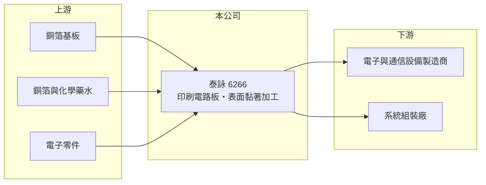

# 6266 泰詠

> 上櫃｜[[產業索引-電子零組件業|電子零組件業]]｜上市（櫃）日期 2004/04/29

# 第一章：企業模式與商業藍圖

> [!info] 撰寫說明
> 精簡版，由 Claude 依公開資料整理，架構比照 [[2330台積電]]，資料截至 2026-10-08。來源：櫃買中心開放資料快照（基本資料、2026 年第二季資產負債與損益、每月營收、本益比殖利率）、Goodinfo 經營績效頁、nStock 公司簡介。公開資料有限，主要產品、應用市場、客戶與生產據點未查得；以 [[PCB]] 為主的產業定位以 Claude 既有認知整理。#待校對

泰詠電子（以下簡稱泰詠）是一家位於新竹的電子零組件製造商，2004 年在櫃買中心掛牌。依公司登記資料，業務是電子產品與通信器材的設計、製造、技術諮詢與[[SMT]]表面黏著加工；市場一般將它歸類為印刷電路板廠（#待校對）。理解泰詠的關鍵在於：它毛利率不高，但費用控制極為精簡，因此營業利益率能穩定維持在一成左右，並把大部分獲利以現金股利發還股東。

- **核心業務：** 泰詠成立於 1990 年，同年 8 月開始營運。公司登記的業務涵蓋電子產品與通信器材的設計、製造與表面黏著加工，代表它除了生產電路板，也可能提供零件組裝的加值服務（推估）。印刷電路板是所有電子產品的基礎零件，小型 PCB 廠多以特定應用的少量多樣訂單維生。
- **營收結構：** 產品別、應用別與客戶別營收比重公開資料未查得。年營收約 30 億至 37 億元，在台灣 PCB 業中屬於中小型規模。
- **營運據點：** 總部登記於新竹市牛埔東路。2026 年第二季總資產約 38.0 億元，其中非流動資產僅約 7.4 億元，流動資產約 30.6 億元，以 PCB 廠而言固定資產比重偏低，推估部分產能在海外或廠房設備已大多折舊（#待校對）。生產據點分布公開資料未查得。
- **長期方向：** 公開資料未揭露明確的擴產或轉型計畫。從財務結構看，泰詠的經營方式偏向保守：不大舉擴產、維持低負債與高配息。長期能否成長，取決於能否切入成長較快的應用市場，例如網通、伺服器或車用電子（推估）。

# 第二章：護城河深度與競爭優勢

泰詠的護城河不在技術或規模，而在於精簡的成本結構與穩定的客戶關係（推估）。

- **競爭優勢：** 泰詠 2019 至 2025 年毛利率約 13.6% 至 18.9%，屬於 PCB 業中偏低的水準，但營業費用占營收只有約 6% 至 7%，使營業利益率維持在 7.7% 至 12.3%。這種「低毛利、低費用」的模式，代表公司以效率而非產品溢價取勝，適合承接規格成熟、需要穩定交期的訂單。
- **主要對手：** 台灣中小型 PCB 同業包括 6141柏承、[[2367燿華]]、[[5439高技]]、6108競國、[[8155博智]]、3715定穎投控，大型廠有 [[3037欣興]]、[[2313華通]]、[[3044健鼎]]，中國大陸則有大量產能。
- **觀察重點：** 長期最值得追蹤的是營業利益率能否守住一成，以及營收能否擺脫 30 億元上下的區間。2026 年上半年營業利益率約 10.0%，與歷史水準相當，但前八月營收年減約 2%，成長動能有限。

# 第三章：財務體質與盈利規模

資料日期：2026-10-08，表格是撰寫當時的快照；最新月營收、毛利率、累計 EPS 由自動排程寫在本筆記的屬性欄位（月營收、毛利率、累計EPS 等）。#待校對

泰詠的財務呈現「穩定獲利、低負債、高配息」的樣貌：2019 至 2025 年每年都賺錢，ROE 多在一成以上。

| 年度 | 營收（億元） | [[毛利率]] | [[營業利益率]] | EPS（元） | [[ROE]] |
|---|---|---|---|---|---|
| 2021 | 25.5 | 14.3% | 8.0% | 1.59 | 10.1% |
| 2022 | 32.9 | 17.9% | 11.8% | 3.00 | 17.4% |
| 2023 | 36.6 | 15.0% | 9.4% | 2.15 | 13.3% |
| 2024 | 32.7 | 18.9% | 12.3% | 2.62 | 15.8% |
| 2025 | 34.0 | 16.9% | 10.9% | 2.00 | 12.1% |

（來源：Goodinfo 經營績效頁；2020 年營收 22.1 億元、EPS 1.48 元，2019 年營收 30.6 億元、EPS 1.76 元。）

- **營收規模：** 2020 至 2025 年營收由 22.1 億元增至 34.0 億元，年複合成長率約 9%（推算）；但 2020 年是低基期，若以 2019 年 30.6 億元起算，六年僅成長約一成。2026 年前八月累計營收約 21.7 億元，年減約 2.2%（官方月營收資料）。
- **獲利：** 近五年平均 ROE 約 13.7%（推算），表現穩定。2026 年上半年營收約 15.5 億元、毛利率約 16.9%、營業利益率約 10.0%、EPS 0.92 元，與往年節奏相近。
- **財務特色：** 2026 年第二季權益約 24.5 億元、負債約 13.5 億元，負債比約 36%，非流動負債僅約 1.4 億元，長期借款很少。每股淨值約 15.9 元。2026 年配發現金股利 1.78 元，以 2025 年 EPS 2.00 元計算配息率約 89%（推算），屬於高配息政策。
- **[[ROIC]] 與 [[WACC]]：** 2025 年營業利益約 3.7 億元（34.0 億元 × 10.9%），稅後約 3.0 億元。以 2026 年第二季權益 24.5 億元到「權益加全部負債」38.0 億元為投入資本區間，ROIC 約 7.8% 至 12.1%（推算）。WACC 以 [[CAPM]] 推估：無風險利率 1.75%、市場風險溢酬 6%、β 假設 0.9，權益成本約 7.15%；稅後負債成本 2%、有息負債占資本約一成，WACC 約 6.6%（推算）。ROIC 高於 WACC，代表泰詠以精簡的資本與費用結構持續創造價值，雖然成長性有限，但屬於穩健型的現金回饋公司。

# 第四章：總體風險與地緣政治

泰詠的風險集中在成長停滯、毛利率偏低，以及產品資訊不透明。

- **產業週期：** PCB 需求跟隨電子產品景氣起伏，下游去庫存時，[[長鞭效應]]會放大成電路板訂單波動。2023 年營收創高後 2024 年回落，說明公司同樣受到產業週期影響。
- **營運風險：** 毛利率只有一成多，原料價格上漲或客戶殺價時，獲利緩衝空間小。產品與客戶結構未公開揭露，投資人難以判斷集中度與成長來源，若主要客戶轉單，影響可能很大（推估）。
- **其他風險：** PCB 主要原料為銅箔基板、銅箔與化學藥水，銅價上漲會壓縮毛利；電鍍與蝕刻製程涉及環保法規。新台幣匯率與美中關稅政策也會影響外銷訂單與生產地點配置（推估）。

# 專有名詞解析

## 金融

- **[[CAPM]]**：資本資產定價模型，以無風險利率加上 β 乘以市場風險溢酬，估算股東要求的報酬率。
- **[[長鞭效應]]**：終端需求的小幅變動，沿供應鏈往上游傳遞時被逐級放大，造成上游庫存與訂單劇烈波動。

## 產業

- **[[PCB]]**：印刷電路板，用來承載電子零件並以銅線路連接，是幾乎所有電子產品的基礎零件。
- **[[SMT]]**：表面黏著技術，把電子零件直接焊接在電路板表面的組裝方式。
- **[[銅箔基板]]**：由銅箔與玻纖布、樹脂壓合而成的板材，是製作印刷電路板的主要原料。

# 核心供應鏈

- 上游：[[銅箔基板]]（例如 [[6213聯茂]]、[[2383台光電]]、[[6274台燿]]，屬推估）、銅箔（例如 8358金居）、化學藥水與電子零件（具體供應商未查得，#待校對）。
- 下游／客戶：電子產品與通信設備製造商、系統組裝廠（具體客戶公開資料未查得）。
- 同業：6141柏承、[[2367燿華]]、[[5439高技]]、6108競國、[[8155博智]]、3715定穎投控，大型廠 [[3037欣興]]、[[2313華通]]、[[3044健鼎]]。

## 最新新聞
<!-- news:start -->
<!-- news:end -->

## 相關連結
- [公開資訊觀測站](https://mopsov.twse.com.tw/mops/web/t05st03?step=1&firstin=1&co_id=6266)
- [Goodinfo](https://goodinfo.tw/tw/StockDetail.asp?STOCK_ID=6266)
- [Yahoo 股市](https://tw.stock.yahoo.com/quote/6266)
- [鉅亨網新聞](https://www.cnyes.com/twstock/6266/news)
