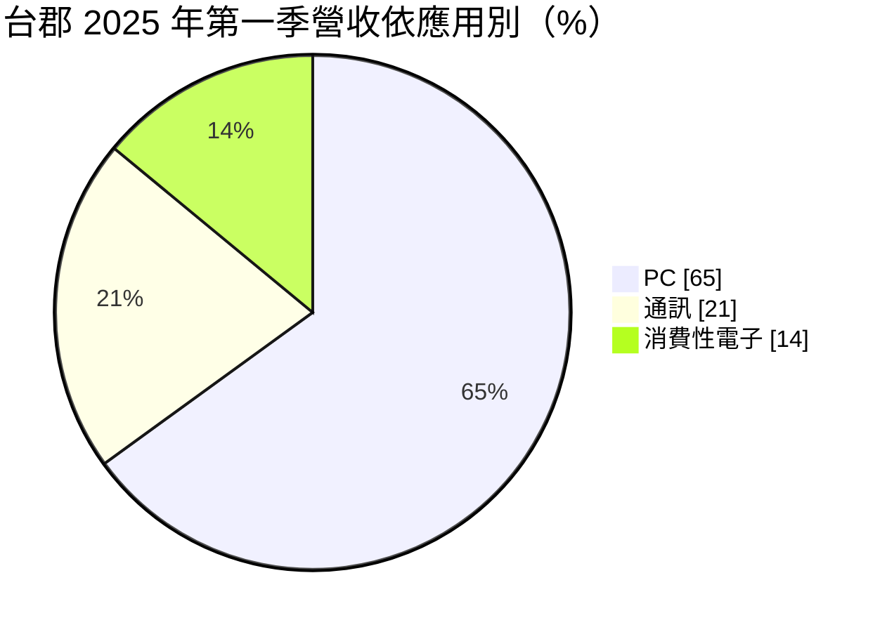
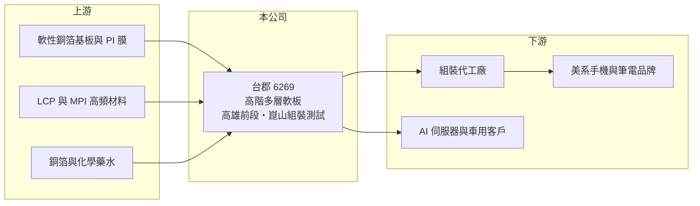

# 6269 台郡

> 上市｜[[產業索引-電子零組件業|電子零組件業]]｜上市（櫃）日期 2003/09/23

# 第一章：企業模式與商業藍圖

> [!info] 撰寫說明
> 精簡版，由 Claude 依公開資料整理，架構比照 [[2330台積電]]，資料截至 2026-10-08。來源：證交所開放資料快照（基本資料、2026 年第二季資產負債與損益、營益分析、股利、每月營收）、Goodinfo 經營績效頁（含 2026 年新聞標題）、優分析 2025 年 6 月個股分析。主要客戶為美系手機與筆電品牌一事以 Claude 既有認知整理。#待校對

台郡科技（以下簡稱台郡）是台灣第二大的[[軟板]]製造商，僅次於 [[4958臻鼎-KY]]，總部位於高雄大寮和發產業園區，2003 年在證交所上市。理解台郡的關鍵在於：它過去十多年靠美系大客戶的手機與筆電軟板成長到四百億元營收規模（#待校對），但 2023 年起訂單與毛利率同步崩落，2024 年轉為虧損，目前正處於「轉型陣痛期」。

- **核心業務：** 台郡成立於 1997 年，產品為單面、雙面與多層軟板，強項在六層以上的高階多層軟板，以及 MPI、[[LCP]] 等高頻材料方案。軟板可以彎折、輕薄，是手機、筆電、平板內部連接各模組的關鍵零件，高階軟板的線路密度與良率要求很高。
- **營收結構：** 依優分析整理，2025 年第一季 PC 約占 65%、通訊 21%、消費性電子 14%。應用結構在十年間大幅轉變：通訊占比由 2015 年的 87% 降到 2024 年的 40%，PC 則由 9% 升到 46%，代表手機軟板訂單明顯流失，改由筆電與平板填補。
- **營運據點：** 高雄廠負責電鍍、設計與鑽孔等前段製程，中國江蘇崑山負責組裝與測試，提供一站式服務。2026 年第二季總資產約 342 億元，其中非流動資產約 177 億元，屬重資本產業。
- **長期方向：** 新任美籍總經理 David Cheng 提出技術創新、成本控制與穩健營運三大方向。轉型重點包括 [[AI 伺服器]]相關高階軟板（2025 年下半年開始小量出貨，市場傳聞打入輝達液冷感測器供應鏈，#待校對）、手機軟板由四層升到六層以提高單價，以及光通訊、車用電子與智慧眼鏡等新應用。

# 第二章：護城河深度與競爭優勢

台郡的護城河曾經建立在美系大客戶的高階軟板認證上，但這道護城河近年已明顯被侵蝕。

- **競爭優勢：** 高階多層軟板的製程難度高，需要大量設備投資與長期良率經驗，全球能穩定供應頂級消費電子品牌的廠商不多。台郡在 2019 年營業利益率仍有 14.6%，代表當時具備相當的技術溢價；龐大的累積盈餘（2026 年第二季保留盈餘約 162 億元）也讓公司有本錢撐過轉型期。
- **主要對手：** 台灣同業包括 [[4958臻鼎-KY]]、[[6153嘉聯益]]、[[8213志超]]、[[3321同泰]]，國際上有日本旗勝（Mektec）、住友電工，以及中國大陸東山精密等大型軟板廠。中國大陸同業近年以價格與產能搶下大量手機軟板訂單，是台郡營收萎縮的主因之一（推估）。
- **觀察重點：** 長期最值得追蹤的是毛利率能否回到一成以上。2025 年毛利率只有 1.3%，2026 年上半年約 1.4%，幾乎無法覆蓋營業費用；AI 伺服器、車用等新應用能否在兩到三年內占到營收一成以上，是轉型成敗的指標。

# 第三章：財務體質與盈利規模

資料日期：2026-10-08，表格是撰寫當時的快照；最新月營收、毛利率、累計 EPS 由自動排程寫在本筆記的屬性欄位（月營收、毛利率、累計EPS 等）。#待校對

台郡的財務呈現「從高峰快速滑落」的樣貌：營收由 2022 年 401 億元降到 2025 年 223 億元，EPS 由 10.83 元轉為虧損 6.95 元。

| 年度 | 營收（億元） | [[毛利率]] | [[營業利益率]] | EPS（元） | [[ROE]] |
|---|---|---|---|---|---|
| 2021 | 356 | 17.8% | 9.2% | 8.19 | 11.2% |
| 2022 | 401 | 17.0% | 8.8% | 10.83 | 13.9% |
| 2023 | 327 | 14.8% | 5.0% | 6.45 | 7.9% |
| 2024 | 264 | 5.8% | -6.9% | -2.56 | -3.1% |
| 2025 | 223 | 1.3% | -14.8% | -6.95 | -9.1% |

（來源：Goodinfo 經營績效頁；2019 年營收 260 億元、EPS 10.02 元，2020 年營收 299 億元、EPS 8.63 元。）

- **營收規模：** 2020 至 2025 年營收由 299 億元降至 223 億元，年複合成長率約 -5.7%（推算）。2026 年前八月累計營收約 148.9 億元，年增約 1.9%（官方月營收資料），止跌但尚未回升。
- **獲利：** 近五年平均 ROE 約 4.2%（推算），且由正轉負。2026 年上半年營收約 108.5 億元、毛利率約 1.4%、營業利益率約 -15.7%、EPS -4.27 元；第二季虧損較第一季收斂（依 2026 年 7 月新聞標題）。
- **財務特色：** 2026 年第二季權益約 221 億元、負債約 120 億元，負債比約 35%，每股淨值約 64 元，財務體質仍穩健。2025 年稅後淨損約 22.3 億元，未配發股利；2025 年曾實施買回庫藏股，目前持有 330 萬股。股價淨值比約 1.0 倍（證交所資料），市場對資產價值的評價已接近帳面。
- **[[ROIC]] 與 [[WACC]]：** 2025 年營業損失約 33 億元（223 億元 × -14.8%），虧損年度不計稅盾。以 2026 年第二季權益 221 億元到「權益加全部負債」342 億元為投入資本區間，ROIC 約 -9.7% 至 -14.9%（推算）。WACC 以 [[CAPM]] 推估：無風險利率 1.75%、市場風險溢酬 6%、β 假設 1.0，權益成本約 7.75%；稅後負債成本 2%、有息負債占資本約兩成五，WACC 約 6.3%（推算）。ROIC 遠低於 WACC，代表台郡目前每年都在侵蝕股東價值；在毛利率回到兩位數以前，龐大的固定資產反而成為折舊負擔。

# 第四章：總體風險與地緣政治

台郡的風險集中在大客戶依賴、軟板產業的價格競爭，以及轉型能否成功。

- **產業週期：** 軟板需求高度依賴手機與筆電新機週期，品牌廠的設計變更與庫存調整會透過[[長鞭效應]]放大成訂單波動。重資本的軟板廠在產能利用率下降時，折舊與人力成本無法分攤，毛利率會急速惡化，2024 至 2025 年就是典型案例。
- **營運風險：** 營收長期集中在少數美系大客戶（推估），一旦在新機種中失去份額，很難由其他客戶在短期內補足。新應用（AI 伺服器、車用、光通訊）的認證期長、初期規模小，轉型期間可能持續虧損。
- **其他風險：** 產品以美元計價為主，新台幣升值 1% 約影響毛利率 0.2 至 0.3 個百分點（優分析估算）；崑山廠涉及美中貿易與關稅政策，客戶可能要求產能移出中國大陸。主要原料為軟性銅箔基板與 PI 膜，原料價格也會影響成本。

# 專有名詞解析

## 應用

- **[[AI 伺服器]]**：搭載 GPU 或 AI 加速晶片、用於訓練與推論的伺服器，功耗與傳輸速度要求遠高於一般伺服器。

## 金融

- **[[CAPM]]**：資本資產定價模型，以無風險利率加上 β 乘以市場風險溢酬，估算股東要求的報酬率。
- **[[長鞭效應]]**：終端需求的小幅變動，沿供應鏈往上游傳遞時被逐級放大，造成上游庫存與訂單劇烈波動。

## 產業

- **[[軟板]]**：以可彎折的聚醯亞胺等薄膜為基材的電路板，用於手機、穿戴裝置與電池模組等狹小或活動空間。
- **[[LCP]]**：液晶高分子材料，介電損耗低，適合用來製作傳輸高頻訊號的軟板與天線。
- **[[PI 膜]]**：聚醯亞胺薄膜，耐高溫、可彎折，是軟板最主要的基材。

# 核心供應鏈

- 上游：軟性銅箔基板與 [[PI 膜]]（例如 [[8039台虹]]，屬推估）、LCP 與 MPI 高頻材料、銅箔與化學藥水（具體供應商未查得，#待校對）。
- 下游／客戶：美系手機與筆電品牌（一般認知為 [[AAPL蘋果]]，#待校對）、組裝代工廠（例如 [[2317鴻海]]、[[4938和碩]]，屬推估）、AI 伺服器與車用客戶（[[NVDA輝達]] 相關傳聞，#待校對）。
- 同業：[[4958臻鼎-KY]]、[[6153嘉聯益]]、[[8213志超]]、[[3321同泰]]，以及日本旗勝、住友電工、東山精密。

## 最新新聞
<!-- news:start（自動產生，請勿手動編輯此範圍） -->
- 2026-10-15 📰 媒體 10:00｜輝達PTFE題材誰最有料？台郡續漲停、台虹爆量回檔，真正訂單仍要看這一步｜[鉅亨網](https://news.cnyes.com/news/id/6630911)

完整紀錄：[[6269台郡 新聞]]
<!-- news:end -->

## 相關連結
- [公開資訊觀測站](https://mopsov.twse.com.tw/mops/web/t05st03?step=1&firstin=1&co_id=6269)
- [Goodinfo](https://goodinfo.tw/tw/StockDetail.asp?STOCK_ID=6269)
- [Yahoo 股市](https://tw.stock.yahoo.com/quote/6269)
- [鉅亨網新聞](https://www.cnyes.com/twstock/6269/news)
