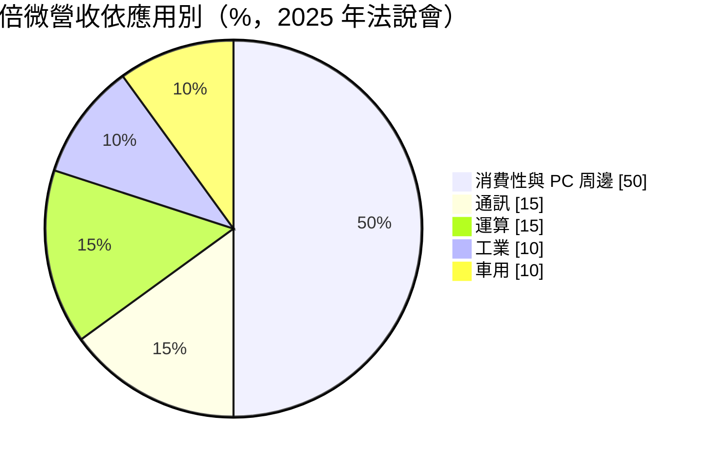
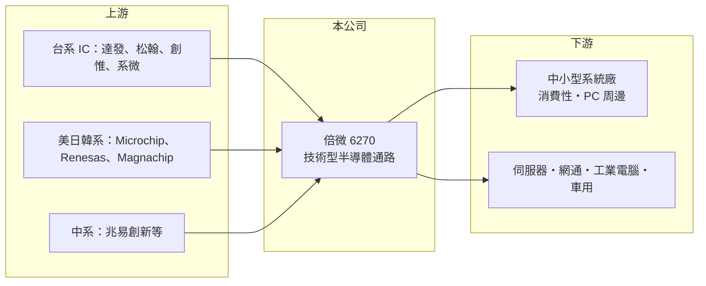

# 6270 倍微

> 上櫃｜[[產業索引-電子通路業|電子通路業]]｜上市（櫃）日期 2003/09/17

# 第一章：企業模式與商業藍圖

> [!info] 撰寫說明
> 精簡版，由 Claude 依公開資料整理，架構比照 [[2330台積電]] 的四章研究，資料截至 2026-10-08。來源：富果研究 2025-11-21 法說會摘要、Goodinfo 經營績效頁、櫃買中心開放資料快照（基本資料、2026 年第二季損益與資產負債）。#待校對

倍微科技是一家以技術支援見長的中型半導體代理商，刻意避開與大型通路商拚價格，專攻中小型客戶與長生命週期的利基應用。本章說明它的代理組合、營收結構與長期方向。

- **核心業務：** 倍微成立於 1992 年，業務是[[電子通路]]，代理 IC 並提供韌體、BIOS 等技術支援。主要代理品牌包括美系 Microchip、Greenliant、Chrontel，台系 [[6526達發]]（Airoha）、[[5471松翰]]、[[6231系微]]、[[6104創惟]]，日韓系 Renesas、Magnachip，以及中國的兆易創新（GigaDevice）等。其中達發、松翰、Microchip、兆易四條產品線合計約占營收 87%，代理組合相當集中。
- **營收結構：** 依應用別，消費性與 PC 周邊約占 50%，通訊與運算各 15%，工業與車用各 10%。依商業模式，純買賣約占 25%，搭配技術支援與共同開發的銷售約占 66%，設計服務與權利金約 6%。這代表倍微的價值主要不在搬貨，而是幫客戶把晶片導入產品。
- **營運據點：** 營運範圍涵蓋台灣、中國大陸與香港，客戶以中小型系統廠為主。公司明確表示不和大型通路商爭搶電子五哥等大客戶，以避免價格戰。
- **長期方向：** 公司的策略是「毛利優先於營收」，並把產品延伸到伺服器（RAID 卡、安全 IC、嵌入式控制器）、網通、NAS 與工業電腦。這些應用的產品生命週期長、設計導入後可持續出貨數年，有助於降低消費性電子的景氣波動。

# 第二章：護城河深度與競爭優勢

倍微的護城河來自技術服務，而不是規模。本章說明這個定位的優勢與限制。

- **競爭優勢：** 倍微擁有 BIOS 與韌體的技術能力，能替中小型客戶完成晶片導入，這就是所謂的[[設計導入]]。客戶一旦在產品中採用某顆晶片，在產品生命週期內通常不會更換，因此技術型通路的訂單黏著度比純買賣高，毛利也略好。
- **主要對手：** 大型通路商如 [[3702大聯大]]、[[3036文曄]] 擁有規模與資金優勢；同為技術型代理的 [[3048益登]]、[[3028增你強]] 則在不同產品線上競爭。倍微的規模較小，只能在特定原廠與利基客戶上建立地位。
- **觀察重點：** 第一，代理線集中度偏高，任何一家主力原廠調整通路政策都會造成衝擊。第二，伺服器與工業應用的新產品能否量產，改善長期偏低的營業利益率。第三，庫存管理：公司表示庫存已從約 15 個月的高峰降到 3 億多元的正常水準，未來是否會再度囤積是重要訊號。

# 第三章：財務體質與盈利規模

資料日期：2026-10-08，表格是撰寫當時的快照；最新月營收、毛利率、累計 EPS 由自動排程寫在本筆記的屬性欄位（月營收、毛利率、累計EPS 等）。#待校對

倍微的財報特色是毛利率穩定在 8% 至 9%，但營業利益率很薄，獲利對營收規模與費用控制非常敏感。本章用多年度數據檢視它的獲利品質。

| 年度 | 營收（億元） | [[毛利率]] | [[營業利益率]] | EPS（元） | [[ROE]] |
|---|---|---|---|---|---|
| 2021 | 41.9 | 9.22% | 3.78% | 2.36 | 11.4% |
| 2022 | 46.1 | 8.76% | 3.72% | 2.31 | 11.0% |
| 2023 | 33.5 | 6.97% | 0.79% | 0.95 | 3.5% |
| 2024 | 26.4 | 8.64% | 0.27% | 0.65 | 1.63% |
| 2025 | 27.7 | 8.51% | 0.75% | 1.08 | 2.7% |
| 2026 上半年 | 16.8 | 8.94% | 2.31% | 0.57 | 未查得 |

- **營收規模：** 營收在 2022 年達 46.1 億元高峰，之後隨消費性電子庫存調整一路下滑，2021 至 2025 年年複合成長率約 -9.8%（推算）。公司在 2025 年法說會預估 2026 年營收大致持平，重點放在毛利改善。
- **獲利：** 2023 至 2025 年營業利益率不到 1%，但 EPS 仍有 0.65 至 1.08 元，代表業外收益占獲利的比重不低。近 5 年平均 ROE 約 6.0%（推算），景氣好時可達 11%，低迷時跌到 2% 以下。
- **財務特色：** 2026 年第二季末股東權益 27.3 億元，其中「其他權益」高達 14.9 億元，可能是持有金融資產的未實現評價利益（推估），因此帳面 ROE 被稀釋。負債總計約 11.9 億元，負債比約三成，公司過去有穩定配息的紀錄，Goodinfo 顯示長期平均現金股利約 1.38 元。

**[[ROIC]] 與 [[WACC]]：** 有息負債明細未查得，以負債總計的一半約 6 億元推估；投入資本扣除可能屬於金融資產評價的其他權益 14.9 億元，以營業相關權益約 12.5 億元加有息負債 6 億元，合計約 18.5 億元。2025 年稅後營業利益約 0.17 億元（27.7 億 × 0.75% × 0.8），ROIC 約 1%（推算）；2021 至 2022 年的高峰期約 6% 至 7%（推算）。WACC 用 CAPM 推估：無風險利率 1.75%、市場風險溢酬 6%、β 取通路股常見值 0.9（假設），股東權益成本約 7.2%；負債成本 2.5%、稅率 20%，WACC 約 6%（推算）。結論是：倍微只有在景氣高峰時 ROIC 接近或略高於 WACC，近三年本業並未創造價值，股東報酬主要靠業外與股利。

# 第四章：總體風險與地緣政治

倍微的風險集中在代理線、終端景氣與地緣政治。本章整理需要長期留意的部分。

- **產業週期：** 營收有一半來自消費性與 PC 周邊，這些產品的需求與庫存循環明顯，容易出現[[長鞭效應]]，也就是終端小幅轉弱、上游訂單大幅減少。2023 至 2024 年營收萎縮就是這個循環的結果。
- **營運風險：** 四條主力產品線占營收約 87%，原廠若收回代理或轉給其他通路，營收會立即受影響。通路商也必須承擔庫存與應收帳款風險，曾經累積到約 15 個月的庫存就是警訊。
- **其他風險：** 代理線同時涵蓋美系與中系原廠，又在中國與香港設有據點，美中科技管制可能限制部分產品的銷售對象。電子零件多以美元計價，新台幣匯率變動會影響毛利。

# 專有名詞解析

## 金融

- **[[長鞭效應]]**：終端需求的小幅變動，沿供應鏈往上游傳遞時被逐級放大，造成上游庫存與訂單劇烈波動。
- **[[ROIC]]**：投入資本報酬率，稅後營業利益除以股東權益加有息負債，衡量本業運用資本的效率。
- **[[WACC]]**：加權平均資金成本，股東權益成本與負債成本依資本結構加權，是 ROIC 必須超越的門檻。

## 產業

- **[[電子通路]]**：替上游原廠銷售零組件並提供備貨、技術支援與帳期的中間商，毛利率低、靠周轉賺錢。
- **[[設計導入]]**：通路商或原廠協助客戶在新產品設計階段採用某顆晶片，量產後在產品生命週期內持續出貨。

# 核心供應鏈

- 上游：[[6526達發]]、[[5471松翰]]、[[6104創惟]]、[[6231系微]]、Microchip、Renesas、Magnachip、兆易創新。
- 下游／客戶：台灣、中國與香港的中小型系統廠，應用於消費性電子、PC 周邊、伺服器與工業電腦。
- 同業：[[3702大聯大]]、[[3036文曄]]、[[3048益登]]、[[3028增你強]]。

## 最新新聞
<!-- news:start -->
<!-- news:end -->

## 相關連結
- [公開資訊觀測站](https://mopsov.twse.com.tw/mops/web/t05st03?step=1&firstin=1&co_id=6270)
- [Goodinfo](https://goodinfo.tw/tw/StockDetail.asp?STOCK_ID=6270)
- [Yahoo 股市](https://tw.stock.yahoo.com/quote/6270)
- [鉅亨網新聞](https://www.cnyes.com/twstock/6270/news)
