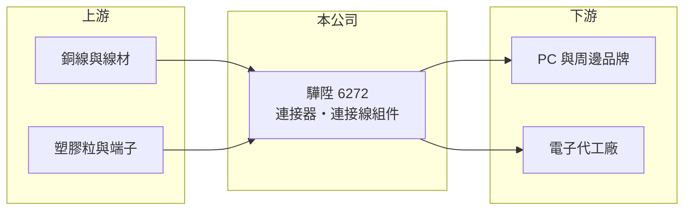

# 6272 驊陞

> 上市｜[[產業索引-電子零組件業|電子零組件業]]｜上市（櫃）日期 2025/12/22

# 第一章：企業模式與商業藍圖

> [!info] 撰寫說明
> 精簡版，由 Claude 依公開資料整理，架構比照 [[2330台積電]]，資料截至 2026-10-08。來源：證交所開放資料快照（基本資料、2026 年第二季資產負債與損益、2025 年度股利）、Goodinfo 經營績效頁、nStock 公司簡介。產品別營收比重、主要客戶與生產據點未查得，公開資料有限。#待校對

驊陞科技（以下簡稱驊陞）是一家以[[連接器]]與[[連接線組件]]為核心的電子零組件公司，理解它的關鍵在於：這類產品單價不高、規格多樣，獲利取決於接單組合與生產效率，而不是單一技術突破。

- **核心業務：** 驊陞成立於 1990 年，依公司登記的營業項目，經營電子用連接器、電腦輸入輸出周邊設備、連接線組件與插頭插座，以及射頻與無線通訊器材的買賣與進出口。連接器與連接線是所有電子產品內部傳輸電力與訊號的必要零件，需求跟著電腦、周邊與消費電子的出貨量走。
- **營收結構：** 公開資料未查得產品別與地區別比重（#待校對）。從營業項目推估，營收以電腦周邊與影音傳輸用的線材、連接器為主，射頻與無線器材屬於輔助業務。
- **營運據點：** 依 nStock 整理的公告標題，公司在 2023 年董事會通過投資設立越南子公司（#待校對），顯示生產布局有往東南亞分散的方向。合併報表中有非控制權益，代表旗下有非全資子公司。
- **長期方向：** 驊陞自 2025 年 12 月 22 日起在證交所上市，實收資本額約 8.18 億元，屬於小型股。2020 至 2025 年營收由 20.7 億元成長到 40.4 億元，[[毛利率]]由 22% 左右提升到 26%，說明產品組合往附加價值較高的方向移動；但 2026 年上半年營收與獲利明顯回落，成長能否延續仍待觀察。

# 第二章：護城河深度與競爭優勢

驊陞屬於規模較小的連接線廠，護城河主要來自客戶認證與彈性生產，而非專利或品牌。

- **競爭優勢：** 連接線與連接器要通過系統廠或品牌客戶的規格認證才能出貨，認證後在同一個產品週期內通常不會更換供應商，這是此行業普遍的轉換成本。驊陞營運超過 35 年，累積了多樣規格的開發經驗，能接小量多樣的訂單。
- **主要對手：** 台灣同業包括 [[3665貿聯-KY]]、[[6197佳必琪]]、[[3023信邦]]、[[8103瀚荃]]、[[2392正崴]] 等，中國大陸也有大量線材廠以低價競爭。驊陞的營收規模遠小於前幾家，議價力有限。
- **觀察重點：** 長期最該觀察[[營業利益率]]。2024 至 2025 年營業利益率升到 6% 至 9%，是近年高點；2026 年上半年降到約 0.9%，代表規模縮小時費用無法同步下降。若營業利益率能回到 5% 以上並維持數年，才算證明競爭力有實質提升。

# 第三章：財務體質與盈利規模

資料日期：2026-10-08，表格是撰寫當時的快照；最新月營收、毛利率、累計 EPS 由自動排程寫在本筆記的屬性欄位（月營收、毛利率、累計EPS 等）。#待校對

驊陞的財務特徵是營收在 2024 至 2025 年快速放大、獲利率同步改善，但波動大，2026 年上半年出現明顯下滑。

| 年度 | 營收（億元） | [[毛利率]] | [[營業利益率]] | EPS（元） | [[ROE]] |
|---|---|---|---|---|---|
| 2021 | 25.9 | 23.7% | 3.67% | 2.13 | 15.3% |
| 2022 | 27.2 | 21.8% | 3.16% | 1.27 | 8.63% |
| 2023 | 26.5 | 21.9% | 3.37% | 0.82 | 6.28% |
| 2024 | 30.8 | 25.4% | 6.30% | 2.28 | 13.2% |
| 2025 | 40.4 | 26.4% | 9.09% | 3.43 | 14.9% |

（來源：Goodinfo 經營績效頁；2020 年營收 20.7 億元、EPS 0.24 元。）

- **營收規模：** 2020 至 2025 年營收年複合成長率約 14.3%（推算）。2026 年上半年營收約 15.7 億元、毛利率 20.9%、營業利益率 0.9%、EPS 0.13 元（證交所資料），營收年化後明顯低於 2025 年，成長出現反轉。
- **獲利：** 2021 至 2025 年平均 ROE 約 11.7%（推算），但年度間落差大，從 6% 到 15% 都出現過，屬於景氣與接單敏感型的獲利結構。毛利率在 22% 至 26% 之間，對線材廠而言屬中等水準。
- **財務特色：** 2026 年第二季總資產約 41.6 億元、負債約 21.8 億元、權益約 19.9 億元，負債比約 52%，每股淨值約 22.7 元。2025 年度配發現金股利 2.0 元，以 2025 年 EPS 推算配息率約六成；Goodinfo 顯示歷年平均現金股利僅約 0.4 元，代表高配息是近年才出現，穩定度仍待驗證。
- **[[ROIC]] 與 [[WACC]]：** 2025 年營業利益約 3.67 億元（40.4 億元 × 9.09%），稅後約 2.94 億元；投入資本以權益 19.9 億元到「權益加全部負債」41.6 億元為區間，ROIC 約 7% 至 15%（推算，有息負債未查得）。WACC 以 [[CAPM]] 推估：無風險利率 1.75%、市場風險溢酬 6%、β 假設 1.1（小型電子零組件股常見值），權益成本約 8.4%；負債占三成、稅前成本 2.5%、稅率 20%，WACC 約 6.4%（推算）。2025 年 ROIC 高於 WACC，但 2021 至 2023 年營業利益率僅 3% 左右，當時 ROIC 多半低於資金成本，長期是否創造價值要看獲利率能否穩住。

# 第四章：總體風險與地緣政治

驊陞的風險來自終端電子景氣、客戶集中與小公司規模。

- **產業週期：** 連接線需求跟著 PC、周邊與消費電子出貨走，終端換機潮與庫存調整會直接反映在營收。2025 年的高成長與 2026 年的回落，正是這種週期性的體現。
- **營運風險：** 小型線材廠常依賴少數大客戶，一旦大客戶轉單或專案結束，營收可能大幅波動。費用結構相對固定，營收下滑時營業利益率會被快速壓縮。
- **其他風險：** 原物料以銅線與塑膠為主，銅價上漲會壓縮毛利；營收多以美元計價，新台幣升值不利獲利。東南亞擴廠可分散關稅與地緣政治風險，但初期會增加管理成本。

# 專有名詞解析

## 金融

- **[[營業利益率]]**：營業利益除以營收，反映本業扣除成本與費用後的獲利能力。
- **[[CAPM]]**：資本資產定價模型，以無風險利率加上 β 乘以市場風險溢酬估算股東要求報酬率。

## 產業

- **[[連接器]]**：讓電子零件或設備之間傳輸電力與訊號的接插元件，例如 USB、HDMI 插座。
- **[[連接線組件]]**：把線材與兩端連接器組裝在一起的成品，例如螢幕線、內部排線。

# 核心供應鏈

- 上游：銅線、線材與塑膠原料供應商，端子與連接器零件廠。#待校對
- 下游／客戶：PC、螢幕與周邊品牌，以及電子代工廠；具名客戶未查得。#待校對
- 同業：[[3665貿聯-KY]]、[[6197佳必琪]]、[[3023信邦]]、[[8103瀚荃]]、[[2392正崴]]。

## 最新新聞
<!-- news:start -->
<!-- news:end -->

## 相關連結
- [公開資訊觀測站](https://mopsov.twse.com.tw/mops/web/t05st03?step=1&firstin=1&co_id=6272)
- [Goodinfo](https://goodinfo.tw/tw/StockDetail.asp?STOCK_ID=6272)
- [Yahoo 股市](https://tw.stock.yahoo.com/quote/6272)
- [鉅亨網新聞](https://www.cnyes.com/twstock/6272/news)
