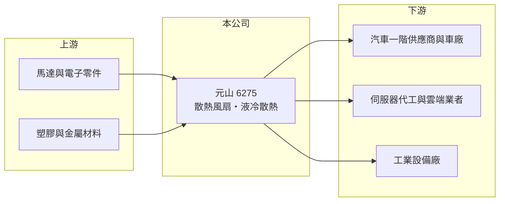

# 6275 元山

> 上櫃｜[[產業索引-電子零組件業|電子零組件業]]｜上市（櫃）日期 2004/12/23

# 第一章：企業模式與商業藍圖

> [!info] 撰寫說明
> 精簡版，由 Claude 依公開資料整理，架構比照 [[2330台積電]]，資料截至 2026-10-08。來源：櫃買中心開放資料快照（基本資料、2026 年第二季資產負債與損益、本益比殖利率）、Goodinfo 經營績效頁、富果研究元山個股分析、優分析與自由時報新聞標題。精確營收比重與具名客戶未查得。#待校對

元山科技（以下簡稱元山）是高雄的[[散熱風扇]]廠，理解它的關鍵在於：公司把風扇技術同時賣給兩個要求最嚴格的市場，一是汽車，二是 [[AI 伺服器]]，前者提供穩定基本盤，後者決定未來的成長幅度。

- **核心業務：** 元山成立於 1987 年，2004 年在櫃買中心掛牌，生產直流散熱風扇、鼓風扇與散熱模組。依富果研究整理，核心技術是流體控制與低噪音設計，並具備熱流模擬與兩相流控制能力。風扇看似簡單，但在車內與伺服器中都要長時間運轉，可靠度與噪音控制才是客戶真正採購的條件。
- **營收結構：** 依富果研究，車用電子營收占比接近一半，是最大的收入來源，其餘為伺服器、高階運算與工業應用（精確比例未查得，#待校對）。車用風扇多用於座椅通風、車用電子散熱等，屬於驗證期長、生命週期長的產品。
- **營運據點：** 2025 年 10 月遷入高雄仁武產業園區的新總部，中國東莞設有生產基地。依富果研究，東莞新產線預計在 2026 年完成，每月新增約 60 萬台 AI 風扇與模組產能；所有工廠符合 VDA 6.3 汽車供應鏈稽核標準。
- **長期方向：** 公司已把「高階運算」列為資源投入的首要方向，開發 120kW 與 150kW 的側櫃式[[液冷散熱]]產品與 [[CDU]]，預計最快 2026 年第四季開始出貨（#待校對）。這代表元山想從單一風扇零件，往伺服器機櫃級散熱系統升級，產品單價與技術門檻都會提高。

# 第二章：護城河深度與競爭優勢

元山的護城河來自車規認證與低噪音技術，但在 AI 散熱市場面對的是規模大得多的對手。

- **競爭優勢：** 車用零件要通過車廠與一階供應商的長期驗證，元山取得 ASPICE Level II 等汽車軟體流程認證，工廠符合 VDA 6.3，這些認證累積需要多年，形成新進者難以跨越的門檻。車用專案一旦導入，通常跟著車型供貨數年，訂單穩定度高於消費電子。
- **主要對手：** 散熱風扇同業有 [[2421建準]]、[[6230尼得科超眾]]，以及日本 Nidec、德國 ebm-papst 等國際大廠；AI 液冷領域則要與 [[3017奇鋐]]、[[3324雙鴻]]、[[8996高力]] 與 [[2308台達電]] 競爭，這些公司規模與客戶關係都明顯領先。
- **觀察重點：** 長期最重要的是液冷與 AI 風扇能否通過大型雲端客戶驗證並放量。若能成功，元山的[[毛利率]]有機會從 18% 左右往上提升；若失敗，公司仍會停留在車用與一般散熱的穩定但低毛利結構。

# 第三章：財務體質與盈利規模

資料日期：2026-10-08，表格是撰寫當時的快照；最新月營收、毛利率、累計 EPS 由自動排程寫在本筆記的屬性欄位（月營收、毛利率、累計EPS 等）。#待校對

元山的財務特徵是營收穩定緩增、毛利率長期維持在 17% 至 18%，ROE 不低但有一部分來自業外收益。

| 年度 | 營收（億元） | [[毛利率]] | [[營業利益率]] | EPS（元） | [[ROE]] |
|---|---|---|---|---|---|
| 2021 | 39.3 | 17.7% | 5.82% | 2.86 | 17.3% |
| 2022 | 36.4 | 18.2% | 4.76% | 2.80 | 15.7% |
| 2023 | 36.3 | 16.6% | 1.46% | 4.08 | 20.5% |
| 2024 | 38.6 | 18.0% | 5.16% | 2.87 | 13.8% |
| 2025 | 42.8 | 18.4% | 4.37% | 2.81 | 13.1% |

（來源：Goodinfo 經營績效頁；2020 年營收 33.3 億元、EPS 2.01 元。）

- **營收規模：** 2020 至 2025 年營收年複合成長率約 5.1%（推算），成長溫和。2026 年上半年營收約 21.8 億元、營業利益率約 3.6%、EPS 0.97 元（櫃買中心資料）。
- **獲利：** 2021 至 2025 年平均 ROE 約 16.1%（推算）。值得注意的是 2023 年營業利益率只有 1.5%，EPS 卻是五年最高的 4.08 元，代表當年有大額業外收益（來源未查得，#待校對）。評估本業時應以營業利益率為準，本業利潤率約 4% 至 6%。
- **財務特色：** 2026 年第二季總資產約 38.1 億元、負債約 21.3 億元、權益約 16.8 億元，負債比約 56%，每股淨值約 20.9 元。最近一年度現金股利約 1.99 元（櫃買中心本益比資料），以 2025 年 EPS 推算配息率約七成。
- **[[ROIC]] 與 [[WACC]]：** 2025 年營業利益約 1.87 億元（42.8 億元 × 4.37%），稅後約 1.50 億元；投入資本以權益 16.8 億元到「權益加全部負債」38.1 億元為區間，ROIC 約 4% 至 9%（推算，有息負債未查得）。WACC 以 [[CAPM]] 推估：無風險利率 1.75%、市場風險溢酬 6%、β 假設 1.1，權益成本約 8.4%；負債占三成、稅前成本 2.5%、稅率 20%，WACC 約 6.4%（推算）。本業 ROIC 與 WACC 大致打平，代表目前的風扇本業只勉強賺回資金成本，液冷等高附加價值產品能否拉高利潤率，是長期價值創造的關鍵。

# 第四章：總體風險與地緣政治

元山的風險在於汽車景氣、AI 散熱的激烈競爭與中國生產集中。

- **產業週期：** 車用營收接近一半，全球汽車銷量與車廠庫存調整會直接影響出貨；AI 伺服器則跟著雲端業者資本支出起伏，兩者週期不同步，可以部分互補。
- **營運風險：** 液冷產品需要大量研發與驗證投入，若客戶驗證延後或未通過，前期投資會壓縮獲利。散熱市場價格競爭激烈，大廠可以用規模壓低報價。
- **其他風險：** 主要產能在中國東莞，面臨美中關稅與供應鏈「中國以外」要求；營收多以美元計價，新台幣升值會壓縮毛利；銅、鋁與馬達材料價格波動也影響成本。

# 專有名詞解析

## 應用

- **[[AI 伺服器]]**：搭載 GPU 等加速器、用於訓練與推論人工智慧模型的伺服器，功耗與散熱需求遠高於一般伺服器。

## 金融

- **[[CAPM]]**：資本資產定價模型，以無風險利率加上 β 乘以市場風險溢酬估算股東要求報酬率。

## 產業

- **[[散熱風扇]]**：以馬達帶動扇葉產生氣流、把熱量帶離電子元件的零件，伺服器與車用電子都大量使用。
- **[[液冷散熱]]**：以液體流經冷板帶走熱量的散熱方式，散熱能力遠高於風冷，是 AI 伺服器的主流方向。
- **[[CDU]]**：冷卻液分配單元，負責在液冷系統中輸送、控溫並監控冷卻液，是機櫃級液冷的核心設備。

# 核心供應鏈

- 上游：馬達、IC、軸承等電子與機構零件，以及塑膠、銅、鋁材料供應商。#待校對
- 下游／客戶：汽車一階供應商與車廠、伺服器代工廠（如 [[2382廣達]]、[[6669緯穎]] 等產業代表，非公司揭露客戶）、工業設備廠。#待校對
- 同業：[[2421建準]]、[[6230尼得科超眾]]、[[3017奇鋐]]、[[3324雙鴻]]、[[8996高力]]。

## 最新新聞
<!-- news:start -->
<!-- news:end -->

## 相關連結
- [公開資訊觀測站](https://mopsov.twse.com.tw/mops/web/t05st03?step=1&firstin=1&co_id=6275)
- [Goodinfo](https://goodinfo.tw/tw/StockDetail.asp?STOCK_ID=6275)
- [Yahoo 股市](https://tw.stock.yahoo.com/quote/6275)
- [鉅亨網新聞](https://www.cnyes.com/twstock/6275/news)
