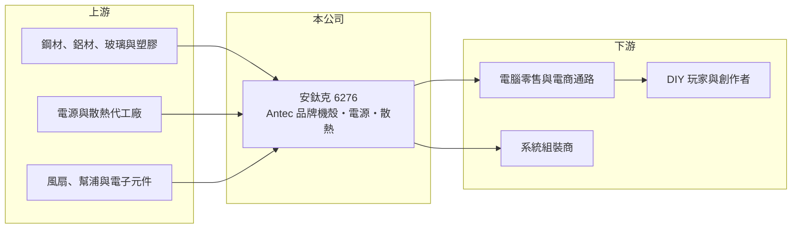

# 6276 安鈦克

> 上櫃｜[[產業索引-電腦及週邊設備業|電腦及週邊設備業]]｜上市（櫃）日期 2003/10/30

# 第一章：企業模式與商業藍圖

> [!info] 撰寫說明
> 精簡版，由 Claude 依公開資料整理，架構比照 [[2330台積電]]，資料截至 2026-10-08。來源：櫃買中心開放資料快照（基本資料、2026 年第二季資產負債與損益、本益比殖利率）、Goodinfo 經營績效頁、安鈦克 2025 年 11 月法說會簡報。品牌歷史與通路描述依記憶整理，已標註待校對。法說簡報寫成立於 1986 年，櫃買中心資料為 1978 年，以官方資料為準。公開資料有限。#待校對

安鈦克是 PC [[DIY]] 市場的自有品牌公司，理解它的關鍵在於：它賣的是電腦玩家自己組裝電腦時挑選的機殼與電源，品牌知名度高，但公司規模小、產品容易被模仿，獲利長期在小賺與虧損之間擺盪。

- **核心業務：** 安鈦克以 Antec 品牌銷售 PC 機殼、[[電源供應器]]、水冷與風冷散熱器、風扇，以及顯示卡支架、延伸線等配件，總公司在台北內湖。Antec 原為美國品牌（#待校對），目前由安鈦克以台灣上櫃公司經營，子公司包括北京與荷蘭據點。2025 年推出預裝 6 把風扇的工作站全塔機殼、搭配資訊顯示螢幕與 iUnity 軟體的散熱產品，鎖定玩家、創作者與工作站用戶。
- **營收結構：** 產品別與地區別比重在法說簡報中未揭露。依產品特性推估，機殼與電源是主要營收來源，銷售以歐美與亞洲的電腦零售與電商通路為主（#待校對）。2025 年前三季營收 11.1 億元、年增 29%，毛利率約 22%。
- **營運據點：** 公司表示利用既有研發與工廠資源開發電源供應器，但未說明生產據點與委外情形，推估以中國代工生產為主（#待校對）。2026 年 8 月公告處分重要子公司並喪失控制力，處分對象與對營運的影響未查得，需要後續確認。
- **長期方向：** 公司的策略是開發散熱更好、相容性更高的機殼與更高效率的電源，並透過多元的周邊產品提高品牌黏著度，依不同族群設計差異化產品線。這是 DIY 品牌商的典型路線，但能否擴大規模，取決於在電商與電競市場的品牌行銷能力。

# 第二章：護城河深度與競爭優勢

安鈦克的護城河主要是 Antec 品牌在 DIY 玩家之間的知名度，但 DIY 零組件的技術門檻不高、競爭者眾多，護城河偏窄。

- **競爭優勢：** Antec 在 PC 機殼與電源市場經營多年（#待校對），在歐美玩家社群中有一定的認知度，品牌讓它能以自有價格銷售，而不必完全依賴代工訂單。電源供應器需要通過 80 Plus 等效率認證與安規認證，安鈦克全系列電源通過 80 Plus 認證，品質形象是品牌溢價的來源。
- **主要對手：** DIY 機殼與電源市場的品牌競爭非常激烈，台灣同業有 [[3540曜越]]（Thermaltake）、[[6117迎廣]]（In Win）、酷碼（Cooler Master，未上市）、銀欣（未上市）、海韻（未上市），國際品牌有 Corsair、NZXT、Lian Li、Fractal Design 等（#待校對），中國品牌也以低價搶市。電源代工則有 [[3015全漢]]、[[2301光寶科]]、[[2308台達電]] 等大廠。
- **觀察重點：** 毛利率長期在 20% 至 29% 之間，營業利益率在 -4% 至 7% 之間擺盪，顯示規模不足以攤提品牌與通路費用。長期要追蹤的是處分子公司後的營運架構、電源與散熱新品能否提升毛利，以及淨值偏低下的財務體質。

# 第三章：財務體質與盈利規模

資料日期：2026-10-08，表格是撰寫當時的快照；最新月營收、毛利率、累計 EPS 由自動排程寫在本筆記的屬性欄位（月營收、毛利率、累計EPS 等）。#待校對

安鈦克的財務是小型品牌商的樣貌：營收十多億元、獲利波動大，2026 年上半年大幅虧損，使淨值降到股本以下。

| 年度 | 營收（億元） | [[毛利率]] | [[營業利益率]] | EPS（元） | [[ROE]] |
|---|---|---|---|---|---|
| 2020 | 17.2 | 22.7% | 7.19% | 3.54 | 28.5% |
| 2021 | 14.9 | 20.3% | 2.75% | 1.09 | 8.51% |
| 2022 | 11.9 | 21.1% | 0.78% | 0.75 | 6.4% |
| 2023 | 11.2 | 29.1% | 5.16% | 1.88 | 16.9% |
| 2024 | 12.0 | 22.4% | -4.21% | -2.16 | -18.6% |
| 2025 | 14.4 | 23.2% | 2.33% | 0.92 | 9.19% |

（來源：Goodinfo 經營績效頁。2026 年上半年依櫃買中心資料：營收 3.99 億元、毛利率 13.8%、營業利益率 -22.5%、EPS -4.78 元。）

- **營收規模：** 2020 年受惠於居家辦公帶動的 DIY 熱潮，營收達 17.2 億元，之後逐年下滑到 2023 年的 11.2 億元，2025 年回升到 14.4 億元。2020 至 2025 年年複合成長率約 -3.5%（推算）。2026 年上半年營收只有 3.99 億元，明顯低於 2025 年同期，可能與處分子公司及記憶體等零件漲價壓抑 DIY 需求有關（推估）。
- **獲利：** 近五年（2021 至 2025）平均 ROE 約 4.5%（推算），而且年度間落差極大，從 -18.6% 到 16.9% 都有。2026 年上半年稅後虧損約 1.05 億元，相當於 2025 年全年營收的 7% 左右，也接近半年前股東權益的一半，是近年最大的虧損。
- **財務特色：** 依 2026 年第二季資料，總資產約 4.36 億元、股東權益約 1.26 億元、負債約 3.10 億元，負債比約七成一；股本 2.20 億元，每股淨值約 5.71 元，已低於面額 10 元，代表帳上已有[[累積虧損]]。對照 2025 年 9 月底資產 6.03 億元、負債 3.80 億元（權益約 2.23 億元），半年內淨值減少約四成。目前未配發股利，Goodinfo 統計長期平均現金股利約 0.47 元。
- **[[ROIC]] 與 [[WACC]]：** 以 2025 年營業利益約 0.34 億元（14.4 億元 × 2.33%）、稅率 20% 計算，稅後營業利益約 0.27 億元；投入資本以 2025 年 9 月底權益 2.23 億元到「權益加全部負債」6.03 億元為區間，ROIC 約 4.5% 至 12%（推算）。2026 年上半年營業虧損約 0.90 億元，年化後 ROIC 為大幅負值（推算）。WACC 以 [[CAPM]] 推估：無風險利率 1.75%、市場風險溢酬 6%、β 假設 1.2（小型消費電子股常見值），權益成本約 9%；稅後負債成本假設 2.4%、負債占四成，WACC 約 6.4%（推算）。以五年平均來看，ROIC 低於 WACC，安鈦克長期並未創造經濟價值，2026 年的虧損更讓利差明顯為負。

# 第四章：總體風險與地緣政治

安鈦克的風險來自 DIY 市場的萎縮、品牌競爭與自身的財務體質。

- **產業週期：** DIY 電腦需求受遊戲、顯示卡世代與零件價格影響，2020 年的居家需求高峰之後市場明顯降溫。顯示卡或記憶體大漲時，玩家會延後組裝新電腦，機殼與電源的需求跟著下滑。
- **營運風險：** 公司規模小、品牌行銷與通路費用占比高，營收一下滑就容易虧損。DIY 零組件競爭者眾多、產品週期短，新品若不受市場青睞，庫存跌價損失會侵蝕獲利。處分重要子公司後的營運架構與營收來源尚未明朗，需觀察後續公告。
- **其他風險：** 每股淨值已低於面額，若虧損持續，可能需要減資或增資來改善財務結構。生產推估集中在中國代工（#待校對），面臨美國關稅風險。營收以美元與歐元計價，匯率波動影響毛利。

# 專有名詞解析

## 應用

- **[[DIY]]**：消費者自行挑選零組件組裝電腦，機殼、電源、散熱器與顯示卡是主要採購品項。
- **[[80 Plus]]**：電源供應器的轉換效率認證，依效率由低到高分為白牌、銅牌、金牌、白金與鈦金等級。

## 金融

- **[[累積虧損]]**：歷年虧損累積後尚未彌補的金額，依公司法須先彌補完畢才能分配盈餘。

## 產業

- **[[電源供應器]]**：把市電轉換為電子設備所需穩定直流電的裝置，PC、伺服器與網通設備都需要，大廠集中在台灣。

# 核心供應鏈

- 上游：機殼用鋼材、鋁材、強化玻璃與塑膠件；電源與散熱器代工廠；風扇、幫浦與電子元件供應商（具體名單未查得，#待校對）。
- 下游／客戶：歐美與亞洲的電腦零售通路、電商平台與系統組裝商，最終使用者為 DIY 玩家、遊戲玩家與內容創作者。
- 同業：[[3540曜越]]、[[6117迎廣]]、[[3015全漢]]；未上市的酷碼、銀欣、海韻；國際品牌 Corsair、NZXT 等（#待校對）。

## 最新新聞
<!-- news:start -->
<!-- news:end -->

## 相關連結
- [公開資訊觀測站](https://mopsov.twse.com.tw/mops/web/t05st03?step=1&firstin=1&co_id=6276)
- [Goodinfo](https://goodinfo.tw/tw/StockDetail.asp?STOCK_ID=6276)
- [Yahoo 股市](https://tw.stock.yahoo.com/quote/6276)
- [鉅亨網新聞](https://www.cnyes.com/twstock/6276/news)
