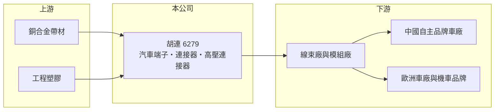

# 6279 胡連

> 上櫃｜[[產業索引-電子零組件業|電子零組件業]]｜上市（櫃）日期 2003/11/26

# 第一章：企業模式與商業藍圖

> [!info] 撰寫說明
> 精簡版，由 Claude 依公開資料整理，架構比照 [[2330台積電]]，資料截至 2026-10-08。來源：櫃買中心開放資料快照（基本資料、2026 年第二季資產負債與損益、本益比殖利率）、Goodinfo 經營績效頁、優分析 2024 年胡連個股文章（產品、市場與客戶）。中國營收占比為 2024 年前後數字，最新比重未查得。#待校對

胡連精密（以下簡稱胡連）是台灣最具代表性的汽車[[連接器]]廠之一，理解它的關鍵在於：公司靠中國自主品牌車廠的崛起成長，產品是每輛車都要用上百個的[[端子]]與塑膠接插件，屬於「小零件、大數量、長週期」的生意。

- **核心業務：** 胡連成立於 1977 年，2003 年在櫃買中心掛牌，生產汽車與機車用的端子、塑膠連接器外殼、保險絲盒、高頻高速[[線束]]與[[高壓連接器]]。端子與連接器負責把車上的電線、感測器與控制器接在一起，汽車電子化程度越高，每輛車用量越多。
- **營收結構：** 依優分析 2024 年整理，中國市場約占總營收 78%，其餘來自歐洲、印度、東南亞與美國。高頻高速線束 2023 年占營收約 2.5%，公司當時規劃逐年提高，屬於成長中的新產品。產品多經由線束廠或模組廠交付車廠。
- **營運據點：** 總部在新北汐止，主要產能在中國，並已在越南完成二期擴建、在印尼設立新廠（2024 年報導，#待校對）。海外據點的目的是貼近東南亞與印度的機車與汽車市場，並分散中國單一生產風險。
- **長期方向：** 胡連的長期成長來自三個方向：一是提高在既有中國車廠的產品滲透率；二是電動車帶來的高壓連接器與高速傳輸線束，單車價值高於傳統低壓端子；三是歐洲與印度的新客戶與新專案，例如歐洲機車品牌的主線束。

# 第二章：護城河深度與競爭優勢

胡連的護城河來自車規認證、模具與產品料號的長期累積，以及對中國自主品牌車廠的貼身服務。

- **競爭優勢：** 汽車零件需通過 [[IATF 16949]] 品質系統與車廠的長期驗證，一個車型的零件確定後通常供貨 5 年以上，轉換成本高。胡連累積數十年的端子與連接器料號與模具，能快速對應車廠新車型的需求，這是新進者短期難以複製的資產。
- **主要對手：** 國際大廠 TE Connectivity、Yazaki（矢崎）、Aptiv、Molex 主導全球汽車連接器市場；中國本土也有中航光電、瑞可達等快速成長的廠商。台灣同業包括 [[3023信邦]]、[[6290良維]]、[[2462良得電]] 等，但專攻汽車端子的規模以胡連較大。
- **觀察重點：** 長期應觀察兩件事：一是中國以外市場的營收比重能否持續提高，降低對中國車市的依賴；二是高壓連接器與高速線束等電動車產品的占比，這決定胡連能否從「低單價零件廠」升級為「電動車關鍵零件廠」，[[毛利率]]維持在 30% 以上是重要指標。

# 第三章：財務體質與盈利規模

資料日期：2026-10-08，表格是撰寫當時的快照；最新月營收、毛利率、累計 EPS 由自動排程寫在本筆記的屬性欄位（月營收、毛利率、累計EPS 等）。#待校對

胡連的財務特徵是營收長期高速成長、毛利率穩定在 30% 以上，且負債低、配息穩定，是汽車零組件中財務體質較好的公司。

| 年度 | 營收（億元） | [[毛利率]] | [[營業利益率]] | EPS（元） | [[ROE]] |
|---|---|---|---|---|---|
| 2021 | 49.5 | 35.1% | 19.6% | 7.91 | 16.5% |
| 2022 | 65.3 | 30.1% | 15.9% | 10.03 | 18.9% |
| 2023 | 73.3 | 32.0% | 16.7% | 9.24 | 15.9% |
| 2024 | 88.0 | 33.3% | 18.0% | 12.79 | 19.4% |
| 2025 | 98.2 | 31.4% | 16.7% | 10.74 | 15.4% |

（來源：Goodinfo 經營績效頁；2020 年營收 36.5 億元、EPS 5.59 元。）

- **營收規模：** 2020 至 2025 年營收年複合成長率約 21.9%（推算），五年間成長近 2.7 倍，主要受惠中國電動車與自主品牌車廠的爆發。2026 年上半年營收約 48.7 億元、毛利率約 27.4%、營業利益率約 11.5%、EPS 4.40 元（櫃買中心資料），毛利率較過去五年略低。
- **獲利：** 2021 至 2025 年平均 ROE 約 17.2%（推算），營業利益率長期維持在 16% 至 20%，在汽車零組件產業中屬於高水準，反映端子產品的規模經濟與模具資產的價值。
- **財務特色：** 2026 年第二季總資產約 158.9 億元、負債約 67.8 億元、權益約 91.1 億元，非流動負債僅約 3 億元，長期借款很少，每股淨值約 76 元。最近一年度現金股利 5.5 元（櫃買中心本益比資料），以 2025 年 EPS 推算配息率約五成；Goodinfo 統計歷年平均現金股利約 3.6 元，配息長期持續發放。
- **[[ROIC]] 與 [[WACC]]：** 2025 年營業利益約 16.4 億元（98.2 億元 × 16.7%），稅後約 13.1 億元；投入資本以權益 91.1 億元到「權益加全部負債」158.9 億元為區間，ROIC 約 8% 至 14%（推算，負債多為應付帳款等營運負債，實際 ROIC 較接近上緣）。WACC 以 [[CAPM]] 推估：無風險利率 1.75%、市場風險溢酬 6%、β 假設 1.0（汽車零組件常見值），權益成本約 7.8%；負債占一成、稅前成本 2.5%、稅率 20%，WACC 約 7.2%（推算）。ROIC 長期高於 WACC，代表胡連持續創造價值，且這是在高成長、低負債的情況下達成，品質較好。

# 第四章：總體風險與地緣政治

胡連的最大風險是對中國汽車市場的高度依賴。

- **產業週期：** 汽車零件需求跟著全球與中國車市走，中國車市價格戰會透過車廠壓價傳遞到零件供應商，2026 年上半年毛利率下滑即可能與此有關（推估）。電動車滲透率提升則是長期支撐。
- **營運風險：** 中國營收占比高，主要客戶為中國自主品牌車廠，若車廠整併或轉向垂直整合自製零件，胡連可能失去訂單。海外新廠初期稼動率低，會壓縮獲利率。
- **其他風險：** 美中關係與關稅可能影響中國車廠出口與台商在中國的經營；人民幣匯率波動直接影響換算後營收與獲利；銅價上漲會增加端子材料成本。

# 專有名詞解析

## 應用

- **[[IATF 16949]]**：國際汽車產業的品質管理系統標準，是成為車廠供應商的基本門檻。

## 產業

- **[[連接器]]**：讓電子零件或設備之間傳輸電力與訊號的接插元件，例如 USB、HDMI 插座。
- **[[端子]]**：連接器內部負責導電接觸的金屬片，通常以銅合金沖壓而成，一輛車需要數百至上千個。
- **[[線束]]**：把多條電線、端子與連接器組合成一束的配線組件，是汽車與設備內部的「神經系統」。
- **[[高壓連接器]]**：電動車電池、馬達與充電系統使用的大電流、高電壓連接器，安全與耐熱要求遠高於一般連接器。

# 核心供應鏈

- 上游：銅合金帶材、電鍍化學品與工程塑膠供應商。#待校對
- 下游／客戶：依 2024 年報導，中國客戶包括吉利、長安、比亞迪、特斯拉、奇瑞、五菱等車廠，多經線束廠交貨；歐洲客戶包括 Magna、Piaggio、Marelli；美國有剷雪車製造商。#待校對
- 同業：TE Connectivity、Yazaki、Aptiv、Molex，台灣 [[3023信邦]]、[[6290良維]]、[[2462良得電]]。

## 最新新聞
<!-- news:start -->
<!-- news:end -->

## 相關連結
- [公開資訊觀測站](https://mopsov.twse.com.tw/mops/web/t05st03?step=1&firstin=1&co_id=6279)
- [Goodinfo](https://goodinfo.tw/tw/StockDetail.asp?STOCK_ID=6279)
- [Yahoo 股市](https://tw.stock.yahoo.com/quote/6279)
- [鉅亨網新聞](https://www.cnyes.com/twstock/6279/news)
