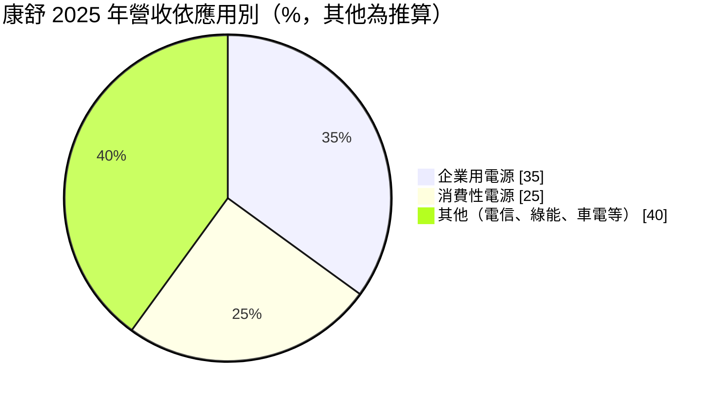
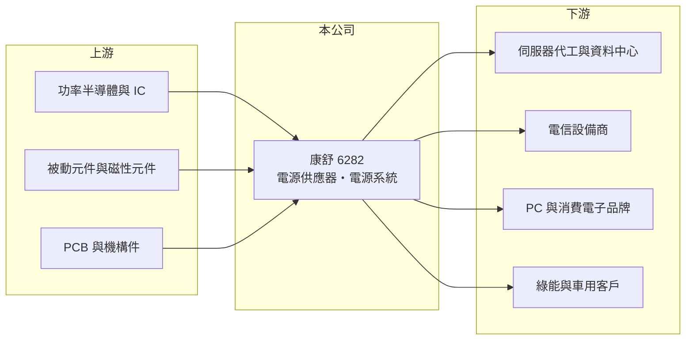

# 6282 康舒

> 上市｜[[產業索引-電子零組件業|電子零組件業]]｜上市（櫃）日期 2003/09/08

# 第一章：企業模式與商業藍圖

> [!info] 撰寫說明
> 精簡版，由 Claude 依公開資料整理，架構比照 [[2330台積電]]，資料截至 2026-10-08。來源：證交所開放資料快照（基本資料、2026 年第二季資產負債與損益、2025 年度股利）、Goodinfo 經營績效頁、優分析 2025 年 11 月康舒法說會報導。生產據點與具名客戶未查得。#待校對

康舒科技（以下簡稱康舒）是台灣老牌的[[電源供應器]]廠，理解它的關鍵在於：營收規模超過 300 億元，但本業利潤率長期很低，公司正嘗試從消費性電源轉向企業、電信、[[AI 伺服器]]、綠能與車用電源，轉型成敗決定它能否走出低獲利。

- **核心業務：** 康舒成立於 1981 年，2003 年在證交所上市，設計與生產各類交換式電源供應器與電源系統，應用範圍包括 PC 與消費電子、伺服器與資料中心、電信基地台、太陽能與儲能、電動車等。電源是所有電子設備都必須的零件，負責把市電轉換成設備需要的穩定電壓。
- **營收結構：** 依 2025 年 11 月法說會報導，企業用電源比重約 35%，已超過消費性電源的 25%；2025 年前三季 AI 相關產品營收比重超過兩成。其餘約 40% 為電信、綠能、車電等其他應用（推算）。這個結構說明康舒已不再是單純的 PC 電源廠，而是橫跨多個應用的綜合電源公司。
- **營運據點：** 生產據點未查得（#待校對）。電源廠的生產一般分布在中國、東南亞與墨西哥等地，以貼近組裝客戶並因應關稅。
- **長期方向：** 公司在 AI 資料中心推出 33kW 機架電源並送樣，規劃推出 72kW 等級產品，並在機櫃層級導入 [[HVDC]] 高壓直流架構。若能打入 AI 伺服器電源供應鏈，康舒的產品組合會從低價消費品轉向高功率、高單價的企業級產品。

# 第二章：護城河深度與競爭優勢

康舒的護城河薄弱，優勢在於產品線廣、技術與客戶基礎老，但在高階電源市場面對強大的對手。

- **競爭優勢：** 康舒擁有四十多年的電源設計經驗，產品線從數十瓦到數十千瓦，能同時服務消費、企業、電信與綠能客戶。電源一旦通過伺服器或電信業者的認證，會跟著產品世代供貨數年，有一定的轉換成本。
- **主要對手：** 伺服器與資料中心電源的龍頭是 [[2308台達電]] 與 [[2301光寶科]]，[[3015全漢]]、[[6412群電]] 也積極布局；消費性電源則有 [[2457飛宏]] 與大量中國廠商。康舒在規模與獲利上明顯落後台達電與光寶科。
- **觀察重點：** 長期最該觀察[[營業利益率]]能否穩定站上 3% 以上。2020 至 2025 年營業利益率都在 2% 以下，甚至轉負；[[毛利率]]雖從約 17% 升到 26%，但費用同步上升，說明轉型投入的研發與管理成本還沒有被營收規模攤平。

# 第三章：財務體質與盈利規模

資料日期：2026-10-08，表格是撰寫當時的快照；最新月營收、毛利率、累計 EPS 由自動排程寫在本筆記的屬性欄位（月營收、毛利率、累計EPS 等）。#待校對

康舒的財務特徵是營收大、毛利率改善，但營業利益率極薄，近五年獲利幾乎被費用與業外損失吃掉。

| 年度 | 營收（億元） | [[毛利率]] | [[營業利益率]] | EPS（元） | [[ROE]] |
|---|---|---|---|---|---|
| 2021 | 219 | 16.6% | 1.91% | 1.17 | 6.33% |
| 2022 | 248 | 16.7% | 1.86% | 1.23 | 6.36% |
| 2023 | 278 | 21.6% | 1.93% | 0.07 | 0.37% |
| 2024 | 317 | 23.3% | -0.39% | -0.04 | -0.07% |
| 2025 | 317 | 25.7% | 2.25% | 0.18 | 0.64% |

（來源：Goodinfo 經營績效頁；2020 年營收 210 億元、EPS 2.54 元。）

- **營收規模：** 2020 至 2025 年營收年複合成長率約 8.6%（推算），成長主要來自企業與綠能電源。2026 年上半年營收約 181 億元、毛利率 22.7%、營業利益率 2.2%、EPS 0.37 元（證交所資料）。
- **獲利：** 2021 至 2025 年平均 ROE 約 2.7%（推算），遠低於資金成本。毛利率持續提升卻無法轉成獲利，代表費用率偏高，[[營業槓桿]]尚未發揮。
- **財務特色：** 2026 年第二季總資產約 535.9 億元、負債約 305.6 億元、權益約 230.3 億元，負債比約 57%，每股淨值約 26.6 元。2025 年度配發 0.8 元現金，全數來自資本公積而非當年盈餘，代表配息不是由本業獲利支撐。公司章程規定現金股利不低於股利總額的 50%。
- **[[ROIC]] 與 [[WACC]]：** 2025 年營業利益約 7.1 億元（317 億元 × 2.25%），稅後約 5.7 億元；投入資本以權益 230 億元到「權益加全部負債」536 億元為區間，ROIC 約 1% 至 2.5%（推算，有息負債未查得）。WACC 以 [[CAPM]] 推估：無風險利率 1.75%、市場風險溢酬 6%、β 假設 1.1，權益成本約 8.4%；負債占四成、稅前成本 2.5%、稅率 20%，WACC 約 5.8%（推算）。ROIC 長期明顯低於 WACC，代表過去五年康舒並未為股東創造價值，AI 與企業電源轉型能否把營業利益率拉高到 5% 以上，是扭轉這個結構的必要條件。

# 第四章：總體風險與地緣政治

康舒的風險在於低利潤率下的轉型執行，以及電源產業的激烈競爭。

- **產業週期：** 消費性電源跟著 PC 與家電景氣走，企業電源則跟著雲端與電信業者的資本支出起伏；美國電信商的投資週期對電信電源影響大。
- **營運風險：** AI 伺服器電源技術更新快，從 33kW 到 72kW、再到 HVDC 架構，每一代都需要大量研發投入，若無法打入主要客戶，投入將難以回收。營業利益率低，任何費用增加或匯兌損失都可能讓全年轉虧。
- **其他風險：** 綠能與儲能電源受各國補貼政策影響；美國關稅與「非中國製造」要求可能迫使產能遷移；半導體與被動元件等材料缺料或漲價會壓縮毛利。

# 專有名詞解析

## 應用

- **[[AI 伺服器]]**：搭載 GPU 等加速器、用於訓練與推論人工智慧模型的伺服器，功耗與散熱需求遠高於一般伺服器。

## 金融

- **[[營業槓桿]]**：固定費用占比高時，營收或毛利小幅變動會造成營業利益大幅變動的現象。
- **[[CAPM]]**：資本資產定價模型，以無風險利率加上 β 乘以市場風險溢酬估算股東要求報酬率。

## 產業

- **[[電源供應器]]**：把市電交流電轉換成電子設備需要的穩定直流電的裝置，是所有電子產品的必要零件。
- **[[HVDC]]**：高壓直流供電架構，在資料中心以較高的直流電壓配電，可降低轉換損耗與線材用量。

# 核心供應鏈

- 上游：功率半導體與電源 IC、被動元件（如 [[2327國巨]]）、磁性元件、PCB 與機構件供應商。#待校對
- 下游／客戶：伺服器代工廠與資料中心業者、電信設備商、PC 與消費電子品牌、太陽能與電動車相關客戶；具名客戶未查得。#待校對
- 同業：[[2308台達電]]、[[2301光寶科]]、[[3015全漢]]、[[6412群電]]、[[2457飛宏]]。

## 最新新聞
<!-- news:start -->
<!-- news:end -->

## 相關連結
- [公開資訊觀測站](https://mopsov.twse.com.tw/mops/web/t05st03?step=1&firstin=1&co_id=6282)
- [Goodinfo](https://goodinfo.tw/tw/StockDetail.asp?STOCK_ID=6282)
- [Yahoo 股市](https://tw.stock.yahoo.com/quote/6282)
- [鉅亨網新聞](https://www.cnyes.com/twstock/6282/news)
