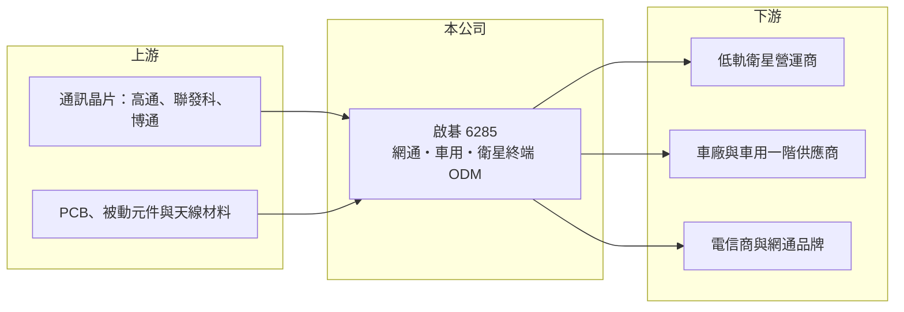

# 6285 啟碁

> 上市｜[[產業索引-通信網路業|通信網路業]]｜上市（櫃）日期 2003/09/22

# 第一章：企業模式與商業藍圖

> [!info] 撰寫說明
> 本文由 Claude 依公開資料整理，架構比照 [[2330台積電]] 的四章研究，資料截至 2026-10-08。財務數字來源：Goodinfo 年度經營績效頁、證交所開放資料（基本資料、2026 年第二季資產負債、損益與營益分析、股利、每月營收）、工商時報 2026 年 8 月報導；產品線、生產據點與集團背景部分憑記憶整理，已標「待校對」，各產品線營收比重未查得。#待校對

評估一家大型網通代工廠，要看它能否在低毛利的代工本業之外，找到技術門檻更高、生命週期更長的產品。本章說明啟碁科技（股票代號：6285，以下簡稱啟碁）如何從傳統網通 [[ODM]] 轉向車用與衛星通訊。

## 一、核心定位：緯創集團的無線通訊設計製造商

啟碁成立於 1996 年，2003 年在證交所上市，實收資本額約 48.3 億元，屬於 [[3231緯創]] 集團（集團關係待校對）。公司的核心能力是無線通訊與天線設計，替國際品牌、電信商與車廠設計並生產通訊設備。2025 年營收約 1,103 億元，是台灣規模最大的網通 ODM 之一。

代工模式的特點是營收大、毛利率低。啟碁的[[毛利率]]長年落在 11% 至 13%，[[營業利益率]]只有 1% 至 4%，獲利高度取決於產品組合、產能利用率與匯率，而不是單一產品的定價能力。

## 二、三大產品線

依工商時報 2026 年報導，啟碁的產品組合優化重點是高階網通、衛星與車用三大事業群，各自的營收比重未查得。

* **網通：** 包括寬頻閘道器、Wi-Fi 設備、交換器與 5G 小型基地台等，客戶為電信商與網通品牌（產品明細待校對）。這是啟碁最早的業務，競爭最激烈，但受惠 Wi-Fi 與光纖網路的規格升級週期。
* **車用：** 包括車載通訊模組、天線與車用雷達等（產品明細待校對）。車用產品需要[[車規驗證]]，導入期長但生命週期可達五至七年，訂單穩定度高於消費性網通。
* **衛星：** 主要為[[低軌衛星]]地面接收終端（待校對）。低軌衛星網路需要大量用戶端天線與終端設備，是近年營收成長的重要動能。

## 三、長期方向與生產布局

啟碁的長期方向是從傳統網通轉向車用與衛星等附加價值較高的領域，降低對單一消費性網通產品的依賴。生產方面，公司在台灣與海外設有工廠，近年配合美國關稅與客戶要求，擴大中國以外的產能（海外據點包括越南與墨西哥，待校對）。2026 年 1 至 8 月營收約 1,012 億元、年增約 38%，顯示新產品線已推動營收重回成長。

# 第二章：護城河深度與競爭優勢

在長期價值投資中，「護城河」指企業抵禦競爭、維持超額利潤的保護機制。本章分析啟碁的優勢、限制與競爭對手。

## 一、啟碁護城河的組成

* **無線與天線設計能力：** 天線、射頻與通訊模組的整合設計，是衛星終端與車用通訊的核心門檻。能在一線客戶的新世代產品開發初期就參與設計，代表後續量產訂單的優先權。
* **規模與集團資源：** 千億元營收規模讓公司在零組件採購、海外建廠與客戶認證上有成本與資源優勢，小型網通廠難以跟進。
* **車用認證：** 車用產品一旦進入車廠供應鏈，換供應商需重新驗證，轉換成本高。

不過代工模式的議價權偏向大客戶，毛利率長期只有一成出頭，護城河屬於窄的類型。

## 二、主要競爭對手

| 對手 | 定位 | 對啟碁的威脅 |
|---|---|---|
| [[3596智易]] | 寬頻與 Wi-Fi 網通 ODM | 在電信商寬頻設備直接競爭 |
| [[5388中磊]] | 寬頻、5G 小型基地台 ODM | 在電信設備與小型基地台重疊 |
| [[3380明泰]] | 網通交換器與無線設備 ODM | 爭取同一批網通品牌訂單 |
| [[2345智邦]] | 資料中心交換器 ODM | 高階網通的標竿對手 |

## 三、守得住／守不住／觀察重點

守得住的是已進入量產的車用與衛星專案，這些產品驗證期長、客戶黏著度高。守不住的是一般網通設備的價格，客戶會在多家 ODM 之間比價。長期觀察重點是衛星與車用比重能否持續提高，以及營業利益率能否穩定站上 4% 以上。

# 第三章：財務體質與盈利規模

資料日期：2026-10-08，表格是撰寫當時的快照；最新月營收、毛利率、累計 EPS 由自動排程寫在本筆記的屬性欄位（月營收、毛利率、累計EPS 等）。#待校對

財務報表是檢驗護城河是否真實存在的最終標準。本章用六年的三率、ROE 與資本報酬，檢視啟碁的獲利品質。

## 一、多年度經營績效

| 年度 | 營收（新台幣） | [[毛利率]] | [[營業利益率]] | EPS（元） | [[ROE]] |
|---|---|---|---|---|---|
| 2020 | 626 億 | 11.1% | 2.35% | 3.76 | 8.9% |
| 2021 | 672 億 | 10.8% | 1.31% | 3.15 | 7.29% |
| 2022 | 953 億 | 12.2% | 3.40% | 7.93 | 16.7% |
| 2023 | 1,108 億 | 12.3% | 4.22% | 8.98 | 15.0% |
| 2024 | 1,102 億 | 12.1% | 3.37% | 7.26 | 11.0% |
| 2025 | 1,103 億 | 12.5% | 3.42% | 6.41 | 9.24% |
| 2026 上半年 | 686 億 | 13.3% | 5.00% | 5.75 | 未查得 |

2022 至 2023 年營收從 672 億元跳升到 1,108 億元，主要來自衛星與車用新產品放量；2024 至 2025 年營收持平、EPS 下滑，反映產品轉換與匯率影響。2026 年上半年營業利益率回到 5%，是近年最高水準。2021 至 2025 年平均 ROE 約 11.8%（推算），營收年複合成長率約 13.2%（推算）。2025 年度現金股利每股 4.3 元，配息率約 67%（推算）。

## 二、[[ROIC]] 與 [[WACC]]：價值創造利差

**ROIC 推算：** 2025 年營業利益約 37.7 億元（1,103 億 × 3.42%），稅後約 30.2 億元。2026 年第二季股東權益約 358 億元，負債約 694 億元，大部分為應付帳款，假設有息負債約占三成、約 208 億元（推估），投入資本約 566 億元，ROIC 約 5.3%（推算）。

**WACC 推算：** 台灣 10 年期公債 1.75%、市場風險溢酬 6%、β 取網通 ODM 同業常見值 1.0，股東權益成本約 7.8%；負債成本 2.5%、稅後 2.0%；權益占投入資本約 63%，WACC 約 5.6%（推算）。

**結論：** 2025 年 ROIC 與 WACC 大致相當，代表公司在低毛利的代工模式下僅勉強回收資金成本。2022 至 2023 年的高峰期 ROIC 明顯較高，若 2026 年營業利益率維持在 5% 左右，利差可望重新擴大。

# 第四章：總體風險與地緣政治

任何企業都無法脫離宏觀環境獨立存在。本章分析啟碁長期必須面對的風險。

## 一、客戶集中與產品週期

衛星與車用專案金額大，營收容易集中在少數客戶。大客戶的產品世代交替或自行調整供應鏈，都會使營收大幅波動。網通產品則跟著 Wi-Fi、光纖與 5G 規格的更新週期起伏，存在明顯的[[長鞭效應]]。

## 二、關稅與海外布局

美國關稅與在地化要求迫使網通廠把產能移出中國，海外建廠需要投入資本並面對初期良率與成本較高的問題。若新廠利用率不足，會拖累本來就不高的利潤率。

## 三、匯率與零組件成本

營收以美元計價為主，新台幣升值會直接壓縮毛利。記憶體、晶片與被動元件漲價時，代工廠能否把成本轉嫁給客戶，取決於合約條件，短期內常需自行吸收。

# 專有名詞解析

## 應用

- **[[低軌衛星]]**：在約 500 至 2,000 公里高度運行的通訊衛星，延遲低，需要大量地面接收終端與天線。
- **[[車規驗證]]**：車用零件須通過可靠度測試與車廠認證，流程常需 2 至 3 年，因此轉換成本高。

## 金融

- **[[長鞭效應]]**：終端需求的小幅變動，沿供應鏈往上游傳遞時被逐級放大，造成上游庫存與訂單劇烈波動。
- **[[ROIC]]**：投入資本報酬率，稅後營業利益除以股東權益與有息負債的合計，衡量本業對所有資金提供者的報酬。
- **[[WACC]]**：加權平均資金成本，依股東權益與負債的比重加權計算的資金成本，ROIC 高於它才代表創造價值。

## 產業

- **[[ODM]]**：原廠委託設計製造，代工廠可提出設計方案並負責生產，與客戶綁定較深，議價能力較高。

# 核心供應鏈

## 1. 上游：晶片與零組件
- 通訊晶片：[[QCOM高通]]、[[2454聯發科]]、[[AVGO博通]]（供應關係為產業常見組合，待校對）
- PCB、被動元件與射頻材料供應商

## 2. 中游：啟碁與同業
- 集團：[[3231緯創]]（待校對）
- 同業：[[3596智易]]、[[5388中磊]]、[[3380明泰]]、[[2345智邦]]

## 3. 下游：客戶
- 低軌衛星營運商、車廠與車用一階供應商、全球電信商與網通品牌（具體客戶名稱未查得）

## 最新新聞
<!-- news:start（自動產生，請勿手動編輯此範圍） -->
- 2026-10-08 📰 媒體 19:51｜營收速報 - 啟碁(6285)9月營收160.79億元年增率高達64.05％｜[鉅亨網](https://news.cnyes.com/news/id/6625899)
- 2026-10-07 📰 媒體 17:00｜啟碁(6285)不只低軌衛星：下一張AI王牌還沒被市場估到？OCS開始走向Hyperscaler量產｜[鉅亨網](https://news.cnyes.com/news/id/6623729)

完整紀錄：[[6285啟碁 新聞]]
<!-- news:end -->

## 相關連結
- [公開資訊觀測站](https://mopsov.twse.com.tw/mops/web/t05st03?step=1&firstin=1&co_id=6285)
- [Goodinfo](https://goodinfo.tw/tw/StockDetail.asp?STOCK_ID=6285)
- [Yahoo 股市](https://tw.stock.yahoo.com/quote/6285)
- [鉅亨網新聞](https://www.cnyes.com/twstock/6285/news)
