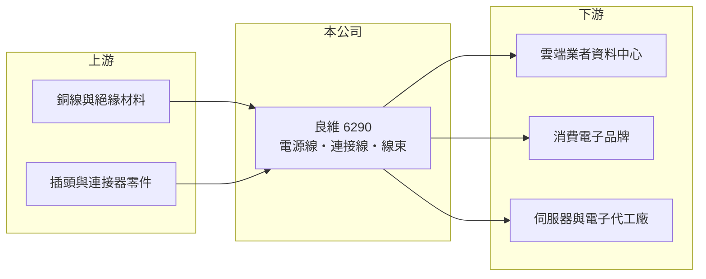

# 6290 良維

> 上櫃｜[[產業索引-電子零組件業|電子零組件業]]｜上市（櫃）日期 2005/06/03

# 第一章：企業模式與商業藍圖

> [!info] 撰寫說明
> 精簡版，由 Claude 依公開資料整理，架構比照 [[2330台積電]]，資料截至 2026-10-08。來源：櫃買中心開放資料快照（基本資料、2026 年第二季資產負債與損益、本益比殖利率）、Goodinfo 經營績效頁、工商時報 2025 年 5 月 12 日良維報導（客戶結構）。完整產品別比重與生產據點未查得。#待校對

良維科技（以下簡稱良維）是以[[電源線]]與連接線起家的線材廠，理解它的關鍵在於：公司在 2020 年代前半主動淘汰低毛利產品，把重心移到雲端資料中心的大電流電源線，客戶結構從消費電子品牌轉向 [[CSP]]，獲利率因此大幅提升。

- **核心業務：** 良維成立於 1972 年，2005 年在櫃買中心掛牌，生產電源線、電源插頭插座、各類連接線與[[線束]]。電源線看似普通，但資料中心機櫃使用的大電力線要承受高電流與長時間運轉，安全認證與品質要求遠高於一般家電線。
- **營收結構：** 依工商時報 2025 年報導，Amazon 雲端（AWS）約占營收近三成，已超越蘋果成為第一大客戶，AWS、蘋果與所有伺服器相關營收合計超過一半；報導指出良維約取得 AWS 大電力電源線七成訂單配比（#待校對）。其餘為消費電子、電腦與工業用線材。
- **營運據點：** 總部在台北，生產據點未查得（#待校對）。依同篇報導，良維在全球設有 37 個發貨倉，能就近供應各地的資料中心與組裝廠，這種物流布局本身就是服務大型雲端客戶的必要條件。
- **長期方向：** 報導指出公司過去三年提列近 10 億元損失與費用，完成組織與產品整頓，並規劃在美國建立示範產線，爭取更多雲端業者訂單。長期目標是成為多家 CSP 的大電力線主要供應商，降低對單一客戶的依賴。

# 第二章：護城河深度與競爭優勢

良維的護城河來自雲端客戶的認證、全球交貨能力與長期合作關係，但客戶集中度高也是一體兩面。

- **競爭優勢：** 資料中心電源線需要取得各國安規認證，並配合客戶在全球各地的機房同步交貨，供應商一旦被大型雲端業者納入名單，後續更換的成本與風險都很高。良維能拿到 AWS 主要配比，代表品質與交期已通過最嚴格的客戶檢驗。
- **主要對手：** 台灣同業有 [[3665貿聯-KY]]、[[6197佳必琪]]、[[2462良得電]]、[[3023信邦]] 等線材與連接器廠，國際上則有 Volex 等電源線大廠，中國也有眾多低價線材廠。在 AI 伺服器電力線領域，貿聯是規模最大的台灣對手。
- **觀察重點：** 長期最該觀察第二、第三家雲端客戶能否放量。若只依賴 AWS，訂單分配變動就可能大幅影響營收；若能擴展到其他 CSP，[[毛利率]]維持在 30% 左右的高水準才有持續性。

# 第三章：財務體質與盈利規模

資料日期：2026-10-08，表格是撰寫當時的快照；最新月營收、毛利率、累計 EPS 由自動排程寫在本筆記的屬性欄位（月營收、毛利率、累計EPS 等）。#待校對

良維的財務特徵是轉型後獲利率明顯跳升，2025 年營收突破百億元，營業利益率接近 18%。

| 年度 | 營收（億元） | [[毛利率]] | [[營業利益率]] | EPS（元） | [[ROE]] |
|---|---|---|---|---|---|
| 2021 | 80.4 | 15.5% | 5.93% | 3.05 | 10.3% |
| 2022 | 77.9 | 18.4% | 8.83% | 5.50 | 17.2% |
| 2023 | 73.6 | 23.9% | 8.19% | 4.17 | 11.9% |
| 2024 | 80.4 | 24.9% | 11.9% | 6.41 | 16.2% |
| 2025 | 102 | 31.4% | 17.9% | 8.73 | 18.9% |

（來源：Goodinfo 經營績效頁；2020 年營收 66 億元、EPS 4.71 元。）

- **營收規模：** 2020 至 2025 年營收年複合成長率約 9.1%（推算）。更重要的是組合改善：毛利率從 2021 年的 15.5% 一路升到 2025 年的 31.4%，說明淘汰低毛利產品、轉向雲端大電力線的策略確實反映在財報上。2026 年上半年營收約 53.1 億元、毛利率約 30.7%、EPS 4.50 元（櫃買中心資料）。
- **獲利：** 2021 至 2025 年平均 ROE 約 14.9%（推算），且呈上升趨勢，2025 年達 18.9%。營業利益率由 6% 升到 18%，顯示營收成長時費用沒有同步增加，[[營業槓桿]]明顯。
- **財務特色：** 2026 年第二季總資產約 135.8 億元、負債約 54.5 億元、權益約 81.4 億元，負債比約 40%，每股淨值約 46.5 元。最近一年度現金股利約 6.19 元（櫃買中心本益比資料），以 2025 年 EPS 推算配息率約七成。
- **[[ROIC]] 與 [[WACC]]：** 2025 年營業利益約 18.3 億元（102 億元 × 17.9%），稅後約 14.6 億元；投入資本以權益 81.4 億元到「權益加全部負債」135.8 億元為區間，ROIC 約 11% 至 18%（推算，有息負債未查得）。WACC 以 [[CAPM]] 推估：無風險利率 1.75%、市場風險溢酬 6%、β 假設 1.2（AI 概念股波動較大），權益成本約 9.0%；負債占兩成、稅前成本 2.5%、稅率 20%，WACC 約 7.6%（推算）。轉型前的 2021 年 ROIC 大致與 WACC 打平，2024 年後明顯高於 WACC，代表新的商業模式開始為股東創造價值。

# 第四章：總體風險與地緣政治

良維的風險主要在於客戶集中與雲端資本支出的週期。

- **產業週期：** 資料中心電源線需求跟著雲端業者的資本支出走，AI 投資若放緩或暫停，訂單會很快反映。消費電子線材則跟著手機與 PC 換機週期起伏。
- **營運風險：** 單一雲端客戶占營收約三成，若客戶調整供應商配比或自行設計規格改由他廠生產，營收與獲利都會受到明顯衝擊。美國示範線等海外擴張初期成本高，執行風險不低。
- **其他風險：** 銅是電源線最主要的原料，銅價大漲會壓縮毛利；美國關稅與「美國製造」要求可能改變供應鏈布局；新台幣升值不利以美元計價的營收。

# 專有名詞解析

## 應用

- **[[CSP]]**：雲端服務供應商，例如 Amazon AWS、微軟 Azure、Google Cloud，是資料中心設備的最大買家。

## 金融

- **[[營業槓桿]]**：固定費用占比高時，營收或毛利小幅變動會造成營業利益大幅變動的現象。
- **[[CAPM]]**：資本資產定價模型，以無風險利率加上 β 乘以市場風險溢酬估算股東要求報酬率。

## 產業

- **[[電源線]]**：把市電或配電系統的電力送進設備的線材，資料中心使用的大電力線需承受高電流並取得各國安規認證。
- **[[線束]]**：把多條電線、端子與連接器組合成一束的配線組件，是汽車與設備內部的「神經系統」。

# 核心供應鏈

- 上游：銅線、PVC 與絕緣材料、插頭與連接器零件供應商。#待校對
- 下游／客戶：依 2025 年報導，主要客戶為 [[AMZN亞馬遜]]（AWS）與 [[AAPL蘋果]]，另有其他雲端業者小量交貨；伺服器代工廠與消費電子廠為間接客戶。#待校對
- 同業：[[3665貿聯-KY]]、[[6197佳必琪]]、[[2462良得電]]、[[3023信邦]]，國際有 Volex。

## 最新新聞
<!-- news:start -->
<!-- news:end -->

## 相關連結
- [公開資訊觀測站](https://mopsov.twse.com.tw/mops/web/t05st03?step=1&firstin=1&co_id=6290)
- [Goodinfo](https://goodinfo.tw/tw/StockDetail.asp?STOCK_ID=6290)
- [Yahoo 股市](https://tw.stock.yahoo.com/quote/6290)
- [鉅亨網新聞](https://www.cnyes.com/twstock/6290/news)
