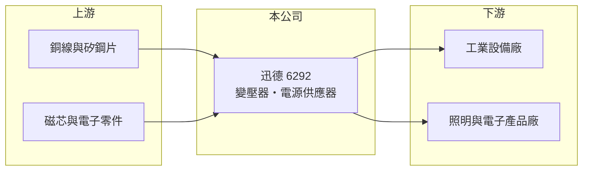

# 6292 迅德

> 上櫃｜[[產業索引-電子零組件業|電子零組件業]]｜上市（櫃）日期 2003/11/26

# 第一章：企業模式與商業藍圖

> [!info] 撰寫說明
> 精簡版，由 Claude 依公開資料整理，架構比照 [[2330台積電]]，資料截至 2026-10-08。來源：櫃買中心開放資料快照（基本資料、2026 年第二季資產負債與損益、本益比殖利率）、Goodinfo 經營績效頁、nStock 公司簡介。產品別比重、客戶與生產據點未查得，公開資料有限。#待校對

迅德興業（以下簡稱迅德）是桃園龜山的小型電源零組件廠，理解它的關鍵在於：公司營收規模只有約 10 億元，但毛利率長期在三成以上，屬於少量多樣、偏工業與利基應用的[[變壓器]]與電源廠；同時它的獲利有相當比例來自業外收益。

- **核心業務：** 迅德成立於 1986 年，2003 年在櫃買中心掛牌，依公司登記營業項目，製造與銷售[[電源供應器]]、變壓器、[[電子安定器]]及相關零配件。變壓器與電源負責把電壓轉換到設備可用的範圍，是工業設備、照明與各類電子產品的基礎零件。
- **營收結構：** 產品別與地區別比重未查得（#待校對）。毛利率長期穩定在 31% 至 36%，高於一般消費性電源廠，推估產品偏向工業、醫療或特殊規格等少量多樣的應用，這類客戶重視可靠度與客製化，價格敏感度較低。
- **營運據點：** 總部登記在桃園龜山，生產據點與子公司名稱未查得（#待校對）。
- **長期方向：** 2020 至 2025 年營收在 10 億至 16 億元之間起伏，沒有明顯的長期成長趨勢；2026 年前九個月營收年增約 26%（nStock 整理）。公司規模小、資訊揭露有限，長期方向需要以年報與法說會資料進一步確認。

# 第二章：護城河深度與競爭優勢

迅德的護城河來自客製化設計能力與利基客戶關係，規模不是它的優勢。

- **競爭優勢：** 工業與特殊應用的變壓器、電源需要依客戶設備客製設計並取得安規認證，一旦導入，客戶在設備生命週期內很少更換供應商。迅德毛利率長期維持三成以上，說明它在利基市場有一定的定價能力。
- **主要對手：** 電源與磁性元件同業包括 [[2308台達電]]、[[2457飛宏]]、[[3015全漢]]，以及專攻磁性元件的中小型廠商與大量中國廠商。迅德營收規模遠小於這些公司，只能在大廠不願投入的小量多樣市場中競爭。
- **觀察重點：** 長期應觀察[[營業利益率]]與本業獲利占比。營業利益率由 2022 年的 15.9% 降到 2025 年的 7.0%，代表營收規模縮小時費用壓力上升；若獲利持續倚賴業外收益，股東應以本業的穩定性為評價基礎。

# 第三章：財務體質與盈利規模

資料日期：2026-10-08，表格是撰寫當時的快照；最新月營收、毛利率、累計 EPS 由自動排程寫在本筆記的屬性欄位（月營收、毛利率、累計EPS 等）。#待校對

迅德的財務特徵是高毛利、低負債、ROE 偏高，但 ROE 有相當部分來自業外收益，本業規模與成長都有限。

| 年度 | 營收（億元） | [[毛利率]] | [[營業利益率]] | EPS（元） | [[ROE]] |
|---|---|---|---|---|---|
| 2021 | 12.1 | 31.2% | 9.35% | 5.01 | 23.1% |
| 2022 | 16.1 | 33.3% | 15.9% | 3.94 | 16.7% |
| 2023 | 13.6 | 33.3% | 12.2% | 5.52 | 21.8% |
| 2024 | 10.4 | 33.8% | 8.78% | 3.87 | 14.5% |
| 2025 | 10.0 | 35.8% | 7.01% | 2.00 | 7.90% |

（來源：Goodinfo 經營績效頁；2020 年營收 10.2 億元、EPS 3.10 元。）

- **營收規模：** 2020 至 2025 年營收年複合成長率約 -0.4%（推算），2022 年高峰後連續下滑。2026 年上半年營收約 5.95 億元、毛利率約 38.8%、營業利益率約 14.5%、EPS 3.52 元（櫃買中心資料），其中業外收益約 0.97 億元，高於營業利益的 0.86 億元。
- **獲利：** 2021 至 2025 年平均 ROE 約 16.8%（推算）。以 2021 年為例，營業利益率不到一成，EPS 卻達 5.01 元，反映業外收益（來源未查得，可能為投資或處分收益，#待校對）對每股盈餘的貢獻很大。
- **財務特色：** 2026 年第二季總資產約 19.7 億元、負債約 7.7 億元、權益約 11.9 億元，負債比約 39%，每股淨值約 25.6 元，保留盈餘約 7.3 億元，高於股本。最近一年度現金股利 1.8 元（櫃買中心本益比資料），以 2025 年 EPS 推算配息率約九成。
- **[[ROIC]] 與 [[WACC]]：** 2025 年營業利益約 0.70 億元（10.0 億元 × 7.01%），稅後約 0.56 億元；投入資本以權益 11.9 億元到「權益加全部負債」19.7 億元為區間，ROIC 約 3% 至 5%（推算，有息負債未查得）。WACC 以 [[CAPM]] 推估：無風險利率 1.75%、市場風險溢酬 6%、β 假設 1.0，權益成本約 7.8%；負債占一成、稅前成本 2.5%、稅率 20%，WACC 約 7.2%（推算）。2025 年本業 ROIC 低於 WACC；2022 至 2023 年營業利益率 12% 至 16% 時 ROIC 則高於資金成本。迅德是否長期創造價值，取決於本業能否回到兩位數營業利益率，而不是業外收益。

# 第四章：總體風險與地緣政治

迅德的風險在於規模小、本業成長停滯，以及獲利對業外收益的依賴。

- **產業週期：** 工業與照明電源需求跟著全球製造業投資與建築景氣走，景氣下行時客戶延後設備採購，訂單會明顯減少。
- **營運風險：** 營收規模小，少數客戶或專案的變動就可能造成營收大幅起伏。業外收益不穩定，若某年缺少這類收益，EPS 會明顯下降。
- **其他風險：** 變壓器主要原料為銅線與矽鋼片，原物料價格上漲會壓縮毛利；匯率變動影響出口報價；照明電子安定器隨 LED 普及，長期需求可能萎縮。

# 專有名詞解析

## 金融

- **[[營業利益率]]**：營業利益除以營收，反映本業扣除成本與費用後的獲利能力。
- **[[CAPM]]**：資本資產定價模型，以無風險利率加上 β 乘以市場風險溢酬估算股東要求報酬率。

## 產業

- **[[變壓器]]**：利用電磁感應改變交流電壓高低的元件，是電源與電力設備的基本零件。
- **[[電源供應器]]**：把市電交流電轉換成電子設備需要的穩定直流電的裝置，是所有電子產品的必要零件。
- **[[電子安定器]]**：控制螢光燈等氣體放電燈啟動與穩定電流的電子裝置，隨 LED 普及需求逐漸下降。

# 核心供應鏈

- 上游：漆包銅線、矽鋼片、鐵氧體磁芯與電子零件供應商。#待校對
- 下游／客戶：工業設備、照明與各類電子產品製造商；具名客戶未查得。#待校對
- 同業：[[2308台達電]]、[[2457飛宏]]、[[3015全漢]]，以及中小型磁性元件廠。

## 最新新聞
<!-- news:start -->
<!-- news:end -->

## 相關連結
- [公開資訊觀測站](https://mopsov.twse.com.tw/mops/web/t05st03?step=1&firstin=1&co_id=6292)
- [Goodinfo](https://goodinfo.tw/tw/StockDetail.asp?STOCK_ID=6292)
- [Yahoo 股市](https://tw.stock.yahoo.com/quote/6292)
- [鉅亨網新聞](https://www.cnyes.com/twstock/6292/news)
