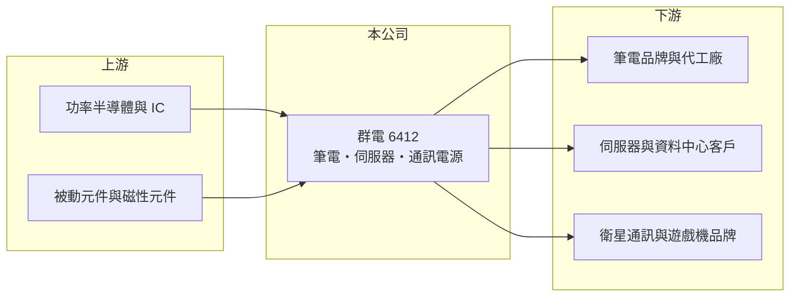

# 6412 群電

> 上市｜[[產業索引-電子零組件業|電子零組件業]]｜上市（櫃）日期 2013/11/08

# 第一章：企業模式與商業藍圖

> [!info] 撰寫說明
> 精簡版，由 Claude 依公開資料整理，架構比照 [[2330台積電]]，資料截至 2026-10-08。來源：證交所開放資料快照（基本資料、2026 年第二季資產負債與損益、2025 年度股利）、Goodinfo 經營績效頁、優分析 2026 年 10 月群電營收報導與 2026 年第二季法說會報導標題。各產品營收比重與生產據點未查得；與 [[2385群光]] 的集團關係為憑記憶撰寫。#待校對

群光電能（以下簡稱群電）是全球主要的筆電[[電源供應器]]廠之一，理解它的關鍵在於：公司營收超過 300 億元，大部分來自筆電變壓器這個成熟、低成長的市場，因此近年積極把重心轉向伺服器、衛星通訊與遊戲機等非筆電電源，以分散對 PC 週期的依賴。

- **核心業務：** 群電成立於 2008 年，2013 年在證交所上市，設計與生產電源供應器與電源管理產品。依憑記憶的資料，群電由 [[2385群光]] 的電源事業分割成立，至今仍屬群光集團（#待校對）。產品涵蓋筆電與桌上型電腦電源、遊戲機電源、伺服器電源、衛星通訊地面接收器電源與家用網通設備電源。
- **營收結構：** 精確比重未查得（#待校對）。依 2026 年 10 月報導，筆電電源受客戶端記憶體缺料與成本壓力影響，出貨放緩；非筆電業務中，伺服器電源的 AI 專案陸續導入，衛星通訊電源全系列需求強勁，新世代家用接收器電源已於 2026 年 9 月量產。
- **營運據點：** 生產據點未查得（#待校對）。PC 電源產業的產能主要在中國與東南亞，以貼近筆電組裝廠。
- **長期方向：** 公司表示筆電業務將「聚焦獲利與產品價值」，不再追求出貨量；成長資源則投入伺服器電源（包括全水冷電源，並接洽國際一線資料中心客戶）與衛星通訊電源。這代表群電正從「量大、毛利低」的筆電變壓器，轉向「量較小、技術門檻較高」的企業與通訊電源。

# 第二章：護城河深度與競爭優勢

群電的護城河來自筆電電源的規模與長期客戶關係，但在高階伺服器電源仍屬挑戰者。

- **競爭優勢：** 筆電電源市場高度集中，群電與 [[2308台達電]]、[[2301光寶科]] 等少數大廠長期供應全球主要筆電品牌，規模帶來採購與生產成本優勢。衛星通訊與遊戲機電源屬於專案型產品，一旦取得品牌客戶的機種，就會隨該機種的生命週期穩定出貨。
- **主要對手：** 筆電電源對手為台達電、光寶科與中國電源廠；伺服器電源的領導者是台達電與光寶科，[[3015全漢]]、[[6282康舒]] 也在積極爭取 AI 伺服器訂單。群電在伺服器電源的市占與技術積累仍落後龍頭。
- **觀察重點：** 長期最該觀察非筆電營收比重與[[毛利率]]。2025 年毛利率降到 16.9%，2026 年上半年約 14.4%，說明筆電電源價格壓力沉重；若伺服器與衛星通訊電源能把毛利率拉回 20% 左右，轉型才算成功。

# 第三章：財務體質與盈利規模

資料日期：2026-10-08，表格是撰寫當時的快照；最新月營收、毛利率、累計 EPS 由自動排程寫在本筆記的屬性欄位（月營收、毛利率、累計EPS 等）。#待校對

群電的財務特徵是營收規模大、負債輕、ROE 長期在兩成以上，但 2025 年起本業獲利率明顯下滑，獲利改由業外收益支撐。

| 年度 | 營收（億元） | [[毛利率]] | [[營業利益率]] | EPS（元） | [[ROE]] |
|---|---|---|---|---|---|
| 2021 | 404 | 17.7% | 8.55% | 7.22 | 27.4% |
| 2022 | 411 | 18.6% | 9.54% | 8.22 | 27.3% |
| 2023 | 363 | 21.2% | 10.9% | 8.27 | 24.9% |
| 2024 | 372 | 20.2% | 10.2% | 8.34 | 22.8% |
| 2025 | 345 | 16.9% | 6.52% | 5.20 | 13.5% |

（來源：Goodinfo 經營績效頁；2020 年營收 349 億元、EPS 5.52 元。）

- **營收規模：** 2020 至 2025 年營收年複合成長率約 -0.2%（推算），營收在 345 億至 411 億元之間起伏，跟著 PC 景氣走，沒有長期成長。2026 年上半年營收約 162 億元、毛利率 14.4%、營業利益率 3.3%、EPS 3.04 元（證交所資料）；其中業外收益約 8.0 億元，高於營業利益 5.3 億元，法說會報導標題也以「業外進補」形容第二季獲利。
- **獲利：** 2021 至 2025 年平均 ROE 約 23.2%（推算），屬於高資本效率；但趨勢向下，2025 年降到 13.5%。這說明過去的高 ROE 建立在筆電電源的穩定利潤上，當這塊市場承壓，ROE 會隨之下降。
- **財務特色：** 2026 年第二季總資產約 350 億元、負債約 196 億元、權益約 154 億元，負債以應付帳款等流動負債為主，非流動負債僅約 3.6 億元，幾乎沒有長期借款，每股淨值約 38.6 元。2025 年度配發現金股利 3.7 元，以 2025 年 EPS 推算配息率約七成；公司章程規定股東股利不高於可分配盈餘的 90%。
- **[[ROIC]] 與 [[WACC]]：** 2025 年營業利益約 22.5 億元（345 億元 × 6.52%），稅後約 18.0 億元；投入資本以權益 154 億元到「權益加全部負債」350 億元為區間，ROIC 約 5% 至 12%（推算）。由於負債多為無息的營運負債，實際 ROIC 較接近上緣約 12%。WACC 以 [[CAPM]] 推估：無風險利率 1.75%、市場風險溢酬 6%、β 假設 0.9（大型電源股常見值），權益成本約 7.2%；負債占一成、稅前成本 2.5%、稅率 20%，WACC 約 6.6%（推算）。2021 至 2024 年 ROIC 明顯高於 WACC，2025 年利差縮小、2026 年上半年本業 ROIC 可能已接近資金成本，非筆電業務能否撐起獲利是價值創造延續的關鍵。

# 第四章：總體風險與地緣政治

群電的風險集中在 PC 週期、筆電電源價格競爭與轉型速度。

- **產業週期：** 筆電電源跟著全球筆電出貨走，換機潮與庫存調整會直接影響營收；記憶體等關鍵零件缺料也會讓品牌延後拉貨，連帶影響電源出貨。
- **營運風險：** 筆電電源毛利率下滑，若非筆電業務放量速度不夠快，本業獲利會持續被壓縮。業外收益不具持續性，不能作為長期獲利的依據。
- **其他風險：** 生產集中在亞洲，面臨美國關稅與供應鏈移轉要求；營收以美元計價，新台幣升值會壓縮毛利；功率半導體與被動元件價格波動影響成本。

# 專有名詞解析

## 應用

- **[[衛星通訊]]**：透過低軌或同步軌道衛星提供網路連線的服務，地面接收器需要專用的電源模組。

## 金融

- **[[CAPM]]**：資本資產定價模型，以無風險利率加上 β 乘以市場風險溢酬估算股東要求報酬率。

## 產業

- **[[電源供應器]]**：把市電交流電轉換成電子設備需要的穩定直流電的裝置，是所有電子產品的必要零件。
- **[[筆電變壓器]]**：筆記型電腦外接的電源轉換器，市場成熟、出貨量大，由少數台系大廠寡占。

# 核心供應鏈

- 上游：功率半導體與電源 IC、被動元件（如 [[2327國巨]]）、磁性元件與 PCB 供應商。#待校對
- 下游／客戶：筆電品牌與代工廠（如 [[2357華碩]]、[[2353宏碁]]、[[2382廣達]] 等產業代表，非公司揭露客戶）、伺服器與資料中心客戶、衛星通訊與遊戲機品牌；母集團 [[2385群光]]。#待校對
- 同業：[[2308台達電]]、[[2301光寶科]]、[[3015全漢]]、[[6282康舒]]、[[2457飛宏]]。

## 最新新聞
<!-- news:start（自動產生，請勿手動編輯此範圍） -->
- 2026-10-12 🏛️ 重訊 13:45｜本公司受邀參加康和證券舉辦之法說會｜[觀測站](https://mops.twse.com.tw/mops/#/web/t05st01)
- 2026-10-05 📰 媒體 18:02｜群電9月營收年減21% 筆電電源動能放緩、非NB需求持穩｜[鉅亨網](https://news.cnyes.com/news/id/6621816)

完整紀錄：[[6412群電 新聞]]
<!-- news:end -->

## 相關連結
- [公開資訊觀測站](https://mopsov.twse.com.tw/mops/web/t05st03?step=1&firstin=1&co_id=6412)
- [Goodinfo](https://goodinfo.tw/tw/StockDetail.asp?STOCK_ID=6412)
- [Yahoo 股市](https://tw.stock.yahoo.com/quote/6412)
- [鉅亨網新聞](https://www.cnyes.com/twstock/6412/news)
