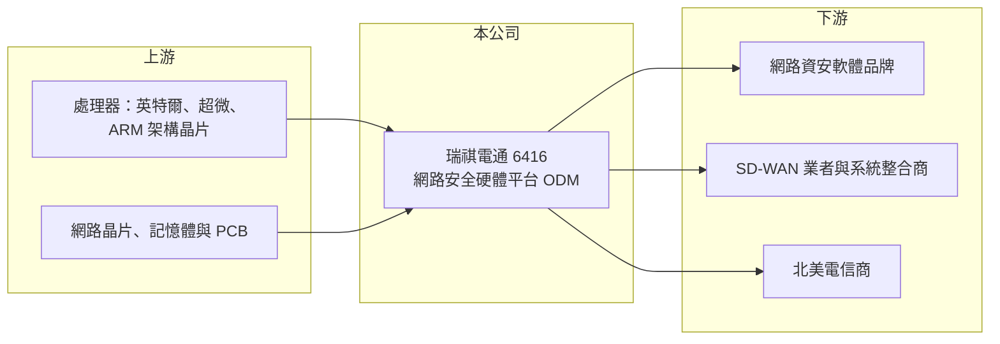

# 6416 瑞祺電通

> 上市｜[[產業索引-通信網路業|通信網路業]]｜上市（櫃）日期 2018/04/16

# 第一章：企業模式與商業藍圖

> [!info] 撰寫說明
> 本文由 Claude 依公開資料整理，架構比照 [[2330台積電]] 的四章研究，資料截至 2026-10-08。財務數字來源：Goodinfo 年度經營績效頁、證交所開放資料（基本資料、2026 年第二季資產負債、損益與營益分析、股利、每月營收）、優分析 2024 年 1 月文章；產品比重為 2024 年初的區間描述，近年比例未查得。#待校對

評估一家網路設備代工廠，要看它的硬體是被客戶當成可替換的零件，還是與客戶軟體深度綁定的平台。本章說明瑞祺電通（股票代號：6416，以下簡稱瑞祺）如何替網路資安軟體公司打造專用硬體平台。

## 一、核心定位：資安軟體業者背後的硬體夥伴

瑞祺成立於 2007 年，2018 年在證交所上市，實收資本額約 7.3 億元。公司設計並製造網路安全設備的硬體平台，包括防火牆、整合式威脅管理（UTM）與入侵偵測防禦系統所用的機器。客戶多是專注軟體與品牌的網路資安公司與系統整合商，它們把自己的資安軟體裝進瑞祺的硬體後，再以自有品牌賣給企業。

這種分工的道理在於，資安公司的核心價值是軟體與威脅資料庫，自行開發與生產硬體不划算。瑞祺以 [[x86]] 與 ARM 架構的網路平台為基礎，替不同客戶調整網路介面、效能與機構設計，屬於 [[ODM]] 模式。

## 二、營收結構：資安產品為主

依優分析 2024 年 1 月的整理，各產品線比重大致如下（近年比重未查得）：

* **網路安全產品：** 約占營收七至八成，是公司的主力，產品包括防火牆、UTM 與入侵偵測防禦設備的硬體平台。
* **[[SD-WAN]]：** 約占一至一成半，主要銷往美洲，協助企業以軟體管理分散各地的網路連線。
* **整合式通訊系統：** 約占半成至一成，客戶為北美電信商。
* **電信局端設備：** 以 x86 平台開發的電信局端設備，是公司開發中的高階產品線。

## 三、長期方向

瑞祺的長期方向是從一般資安盒子往更高階的平台延伸，包括電信局端設備與更高效能的網路安全平台，並爭取北美電信客戶的大型專案。網路攻擊持續增加、企業網路架構雲端化，使資安設備有長期需求，但產品世代與客戶備貨節奏會讓營收出現週期性波動。

# 第二章：護城河深度與競爭優勢

在長期價值投資中，「護城河」指企業抵禦競爭、維持超額利潤的保護機制。本章分析瑞祺的優勢、限制與競爭對手。

## 一、瑞祺護城河的組成

* **軟硬體整合的轉換成本：** 資安軟體需要在特定硬體上完成相容性與效能驗證，客戶一旦採用某一平台，產品生命週期內通常不會更換供應商。這讓瑞祺的訂單具有一定延續性。
* **網路平台設計經驗：** 多網路埠、高吞吐量與加密加速的設計需要長期累積，新進者不易短時間追上。

不過客戶多為大型資安公司，議價能力強，且同業眾多，瑞祺的[[毛利率]]維持在 20% 至 24%，屬於窄護城河。

## 二、主要競爭對手

| 對手 | 定位 | 對瑞祺的威脅 |
|---|---|---|
| [[6245立端]] | 網路安全與通訊平台 | 產品與客戶群高度重疊 |
| [[6166凌華]]、3088艾訊 | 工業電腦與網通平台 | 在網路應用平台局部競爭 |
| 中國與其他亞洲網通平台廠 | 白牌網路設備 | 爭取同一批資安品牌訂單 |
| 客戶自行設計 | 大型資安公司自製硬體 | 降低外包比例的長期風險 |

## 三、守得住／守不住／觀察重點

守得住的是已導入的資安平台專案。守不住的是需求低潮時的價格與數量，2021 年與 2023 年營收都出現明顯衰退。長期觀察重點是高階平台與電信局端設備能否提高比重，以及營業利益率能否回到兩位數。

# 第三章：財務體質與盈利規模

資料日期：2026-10-08，表格是撰寫當時的快照；最新月營收、毛利率、累計 EPS 由自動排程寫在本筆記的屬性欄位（月營收、毛利率、累計EPS 等）。#待校對

財務報表是檢驗護城河是否真實存在的最終標準。本章用六年的三率、ROE 與資本報酬，檢視瑞祺的獲利品質。

## 一、多年度經營績效

| 年度 | 營收（新台幣） | [[毛利率]] | [[營業利益率]] | EPS（元） | [[ROE]] |
|---|---|---|---|---|---|
| 2020 | 54.7 億 | 21.0% | 10.0% | 5.29 | 13.9% |
| 2021 | 46.7 億 | 19.8% | 6.54% | 3.00 | 7.42% |
| 2022 | 49.8 億 | 22.5% | 10.1% | 5.85 | 13.4% |
| 2023 | 40.8 億 | 24.3% | 9.26% | 4.40 | 9.01% |
| 2024 | 42.5 億 | 23.8% | 7.86% | 4.50 | 9.11% |
| 2025 | 43.1 億 | 23.1% | 8.35% | 4.30 | 8.37% |
| 2026 上半年 | 23.9 億 | 24.8% | 11.5% | 2.90 | 未查得 |

營收在 40 億至 55 億元之間來回，沒有明確的長期成長趨勢，反映資安設備客戶的備貨週期。毛利率則從約 20% 緩步提升到 24% 上下，代表產品組合往高階移動。2021 至 2025 年平均 ROE 約 9.5%（推算），營收年複合成長率約 -2.0%（推算）。2025 年度現金股利每股 2.8 元，配息率約 65%（推算）。

## 二、[[ROIC]] 與 [[WACC]]：價值創造利差

**ROIC 推算：** 2025 年營業利益約 3.6 億元（43.1 億 × 8.35%），稅後約 2.9 億元。2026 年第二季權益總計約 37.4 億元，負債約 31.8 億元，假設有息負債約四成、約 12.7 億元（推估），投入資本約 50 億元，ROIC 約 5.7%（推算）。

**WACC 推算：** 台灣 10 年期公債 1.75%、市場風險溢酬 6%、β 取網通平台同業常見值 0.9，股東權益成本約 7.2%；負債成本 2.5%、稅後 2.0%；權益占投入資本約 75%，WACC 約 5.8%（推算）。

**結論：** 2025 年 ROIC 與 WACC 幾乎持平，代表本業僅大致打平資金成本。2026 年上半年營業利益率升到 11.5%，若能維持，ROIC 可回到 8% 以上，重新創造價值。

# 第四章：總體風險與地緣政治

任何企業都無法脫離宏觀環境獨立存在。本章分析瑞祺長期必須面對的風險。

## 一、客戶集中與備貨週期

營收依賴少數大型資安客戶，客戶調整庫存或改由他廠生產時，營收可能一次下滑兩成，2023 年即是例子。這種[[長鞭效應]]讓瑞祺的營收波動大於終端資安市場本身。

## 二、技術演進

企業網路持續雲端化，部分資安功能從實體設備轉向雲端服務（SASE 等架構），實體資安盒子的長期需求可能受到影響。公司需要往電信局端與高效能平台延伸，才能抵銷這個趨勢。

## 三、匯率與零組件

營收以美元計價為主，新台幣升值壓縮毛利。處理器、記憶體與網路晶片的漲價或缺貨，也會影響出貨與成本。

# 專有名詞解析

## 半導體

- **[[x86]]**：英特爾與超微使用的處理器指令集架構，是伺服器、個人電腦與多數網路設備平台的主流架構。

## 應用

- **[[SD-WAN]]**：軟體定義廣域網路，以軟體集中管理企業各據點的網路連線，可混用專線與一般網路降低成本。

## 金融

- **[[長鞭效應]]**：終端需求的小幅變動，沿供應鏈往上游傳遞時被逐級放大，造成上游庫存與訂單劇烈波動。
- **[[ROIC]]**：投入資本報酬率，稅後營業利益除以股東權益與有息負債的合計，衡量本業對所有資金提供者的報酬。
- **[[WACC]]**：加權平均資金成本，依股東權益與負債的比重加權計算的資金成本，ROIC 高於它才代表創造價值。

## 產業

- **[[ODM]]**：原廠委託設計製造，代工廠可提出設計方案並負責生產，與客戶綁定較深，議價能力較高。

# 核心供應鏈

## 1. 上游：處理器與零組件
- 處理器：[[INTC英特爾]]、[[AMD超微]]、[[ARM安謀]] 架構晶片
- 網路晶片：[[AVGO博通]]、[[MRVL邁威爾]]（供應關係為產業常見組合，待校對）

## 2. 中游：瑞祺與同業
- 同業：[[6245立端]]、[[6166凌華]]、3088艾訊

## 3. 下游：客戶
- 網路資安軟體品牌、SD-WAN 業者、系統整合商與北美電信商（具體客戶名稱未查得）

## 最新新聞
<!-- news:start -->
<!-- news:end -->

## 相關連結
- [公開資訊觀測站](https://mopsov.twse.com.tw/mops/web/t05st03?step=1&firstin=1&co_id=6416)
- [Goodinfo](https://goodinfo.tw/tw/StockDetail.asp?STOCK_ID=6416)
- [Yahoo 股市](https://tw.stock.yahoo.com/quote/6416)
- [鉅亨網新聞](https://www.cnyes.com/twstock/6416/news)
