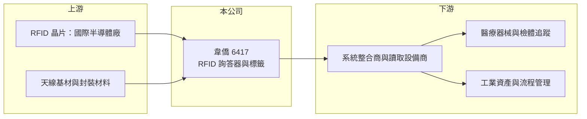

# 6417 韋僑

> 上櫃｜[[產業索引-通信網路業|通信網路業]]｜上市（櫃）日期 2015/10/08

# 第一章：企業模式與商業藍圖

> [!info] 撰寫說明
> 本文由 Claude 依公開資料整理，架構比照 [[2330台積電]] 的四章研究，資料截至 2026-10-08。財務數字來源：Goodinfo 年度經營績效頁、櫃買中心開放資料（基本資料、2026 年第二季資產負債與損益、本益比殖利率）、nStock 公司簡介、優分析報導標題；產品線與應用市場描述部分憑記憶整理，已標「待校對」，營收比重未查得。公開資料有限。#待校對

評估一家 [[RFID]] 公司，要看它的標籤是一次性的低價耗材，還是能在特定場域重複使用、需要客製驗證的專業產品。本章說明韋僑科技（股票代號：6417，以下簡稱韋僑）如何在 RFID 的利基市場建立穩定成長的事業。

## 一、核心定位：RFID 詢答器的設計與製造

韋僑成立於 1999 年，2015 年在櫃買中心掛牌，實收資本額約 4.2 億元。依公司登記的業務說明，主要業務為 RFID 相關產品的設計、研發與製造，產品是無線射頻識別詢答器（RFID Transponder），也就是內含晶片與天線、可被讀取器無線讀寫的標籤，另經營相關代理與進出口貿易。

RFID 的價值在於不需要逐一掃描條碼，就能自動辨識與追蹤物品。韋僑的產品依應用需求設計成不同的封裝與尺寸，例如耐高溫、耐化學、可金屬表面讀取的工業標籤，以及醫療用的標籤（產品細節待校對）。這類標籤的單價高於零售業用的一般貼紙型標籤，需要依場域客製，毛利率也較高。

## 二、應用市場

依 2025 年優分析報導標題，公司鎖定醫療市場與工業應用的成長機會。醫療場域的 RFID 用於器械、檢體與耗材追蹤，工業場域用於工具、資產與生產流程管理。這兩類應用都重視可靠度與法規追溯，產品導入後通常會長期沿用。公司另有電子紙相關產品（待校對），各應用的營收比重未查得。

## 三、長期方向

韋僑的營收從 2020 年的 9.9 億元成長到 2025 年的 16.1 億元，2026 年前 9 個月累計約 14.4 億元、年增約 22%。長期方向是把 RFID 從物流與零售擴展到醫療、工業與資產管理等高附加價值場域。隨著各產業推動數位化、[[IoT]] 物聯網與可追溯性，RFID 的滲透率仍有提升空間。

# 第二章：護城河深度與競爭優勢

在長期價值投資中，「護城河」指企業抵禦競爭、維持超額利潤的保護機制。本章分析韋僑的優勢、限制與競爭對手。

## 一、韋僑護城河的組成

* **客製化封裝能力：** 特殊環境的 RFID 標籤需要在材料、封裝與天線設計上反覆測試，才能在金屬、液體或高溫環境下穩定讀取。這些經驗累積是韋僑毛利率能維持在約 30% 的基礎。
* **客戶驗證的轉換成本：** 醫療與工業客戶導入 RFID 系統時，標籤要和讀取設備、軟體一起驗證，更換標籤供應商需要重新測試整套系統，形成[[轉換成本]]。

不過 RFID 晶片掌握在少數國際半導體廠手中，標籤廠的技術門檻主要在封裝與應用，護城河屬於窄的類型。

## 二、主要競爭對手

| 對手 | 定位 | 對韋僑的威脅 |
|---|---|---|
| Avery Dennison | 全球最大 RFID 標籤廠 | 規模與零售客戶基礎雄厚 |
| HID Global | 工業與門禁 RFID | 在工業標籤與資產追蹤重疊 |
| 中國 RFID 標籤廠 | 低價量產 | 在標準化標籤壓低價格 |
| 台灣與日韓 RFID 標籤廠 | 利基型客製標籤 | 在工業與醫療客製案爭取相同客戶 |

## 三、守得住／守不住／觀察重點

守得住的是需要客製封裝與長期驗證的工業與醫療標籤。守不住的是一般物流與零售用的標準標籤，價格由大廠與中國廠主導。長期觀察重點是醫療市場的導入速度、新應用帶來的營收比重，以及營收成長能否持續轉成更高的營業利益率。

# 第三章：財務體質與盈利規模

資料日期：2026-10-08，表格是撰寫當時的快照；最新月營收、毛利率、累計 EPS 由自動排程寫在本筆記的屬性欄位（月營收、毛利率、累計EPS 等）。#待校對

財務報表是檢驗護城河是否真實存在的最終標準。本章用六年的三率、ROE 與資本報酬，檢視韋僑的獲利品質。

## 一、多年度經營績效

| 年度 | 營收（新台幣） | [[毛利率]] | [[營業利益率]] | EPS（元） | [[ROE]] |
|---|---|---|---|---|---|
| 2020 | 9.93 億 | 27.8% | 11.9% | 2.69 | 11.9% |
| 2021 | 10.9 億 | 28.7% | 12.1% | 3.02 | 10.5% |
| 2022 | 13.2 億 | 31.7% | 15.6% | 4.50 | 13.9% |
| 2023 | 14.3 億 | 30.5% | 13.8% | 4.02 | 11.5% |
| 2024 | 14.9 億 | 29.1% | 13.9% | 4.35 | 11.8% |
| 2025 | 16.1 億 | 31.4% | 16.1% | 4.83 | 12.2% |
| 2026 上半年 | 9.34 億 | 34.6% | 20.1% | 3.62 | 未查得 |

韋僑的特色是穩定：六年間營收逐年成長、沒有虧損年度，毛利率維持在 28% 至 35%，2026 年上半年營業利益率更升到 20%，顯示規模經濟開始發揮。2021 至 2025 年平均 ROE 約 12.0%（推算），營收年複合成長率約 10.2%（推算）。最近一次現金股利每股 2.4 元（2024 年為 2.2 元），配息穩定。

## 二、[[ROIC]] 與 [[WACC]]：價值創造利差

**ROIC 推算：** 2025 年營業利益約 2.6 億元（16.1 億 × 16.1%），稅後約 2.1 億元。2026 年第二季股東權益約 17.7 億元，負債約 13 億元，其中非流動負債 5.7 億元，假設有息負債約 6.5 億元（推估），投入資本約 24.2 億元，ROIC 約 8.6%（推算）。

**WACC 推算：** 台灣 10 年期公債 1.75%、市場風險溢酬 6%、β 取電子元件同業常見值 0.8，股東權益成本約 6.6%；負債成本 2.5%、稅後 2.0%；權益占投入資本約 73%，WACC 約 5.3%（推算）。

**結論：** ROIC 高於 WACC 約 3 個百分點，代表韋僑能穩定創造價值，但利差不算大。若 2026 年上半年的 20% 營業利益率能延續，ROIC 有機會提升到 10% 以上。

# 第四章：總體風險與地緣政治

任何企業都無法脫離宏觀環境獨立存在。本章分析韋僑長期必須面對的風險。

## 一、晶片供應與成本

RFID 標籤的晶片由少數國際半導體廠供應，晶片缺貨或漲價會直接影響出貨與毛利。標籤廠對上游的議價能力有限。

## 二、應用推廣速度

醫療與工業 RFID 的導入需要客戶投資讀取設備與系統，景氣不佳時企業可能延後資本支出，影響標籤需求。新應用從試點到全面導入的時間往往比預期長。

## 三、競爭與匯率

國際大廠與中國廠持續擴產，標準型標籤價格長期下降。營收以外銷為主，新台幣升值會壓縮獲利，海外市場的貿易政策變化也可能影響出貨。

# 專有名詞解析

## 應用

- **[[RFID]]**：無線射頻辨識，以無線電波讀寫標籤中的晶片資料，可同時辨識多個物品且不需對準。
- **[[IoT]]**：物聯網，讓各種設備連上網路、彼此交換資料，用於工廠、醫療與資產管理等場域。

## 金融

- **[[ROIC]]**：投入資本報酬率，稅後營業利益除以股東權益與有息負債的合計，衡量本業對所有資金提供者的報酬。
- **[[WACC]]**：加權平均資金成本，依股東權益與負債的比重加權計算的資金成本，ROIC 高於它才代表創造價值。

## 產業

- **[[轉換成本]]**：客戶更換供應商時需承擔的驗證、重新設計與停機風險，轉換成本高代表客戶黏著度高。

# 核心供應鏈

## 1. 上游：晶片與材料
- RFID 晶片：NXP、Impinj 等國際晶片廠（供應關係為產業常見組合，待校對）
- 天線基材與封裝材料供應商

## 2. 中游：韋僑與同業
- 同業：Avery Dennison、HID Global、中國 RFID 標籤廠

## 3. 下游：客戶
- 醫療、工業與資產管理的系統整合商與終端用戶（具體客戶名稱未查得）

## 最新新聞
<!-- news:start（自動產生，請勿手動編輯此範圍） -->
- 2026-10-12 📰 媒體 11:36｜RFID雙雄韋僑、永道-KY營收Q3同創新高 本季營運仍看旺｜[鉅亨網](https://news.cnyes.com/news/id/6627936)
- 2026-10-08 📰 媒體 20:00｜韋僑9月營收創歷史次高、Q3營收連創新高 全年營收再突破｜[鉅亨網](https://news.cnyes.com/news/id/6625884)

完整紀錄：[[6417韋僑 新聞]]
<!-- news:end -->

## 相關連結
- [公開資訊觀測站](https://mopsov.twse.com.tw/mops/web/t05st03?step=1&firstin=1&co_id=6417)
- [Goodinfo](https://goodinfo.tw/tw/StockDetail.asp?STOCK_ID=6417)
- [Yahoo 股市](https://tw.stock.yahoo.com/quote/6417)
- [鉅亨網新聞](https://www.cnyes.com/twstock/6417/news)
