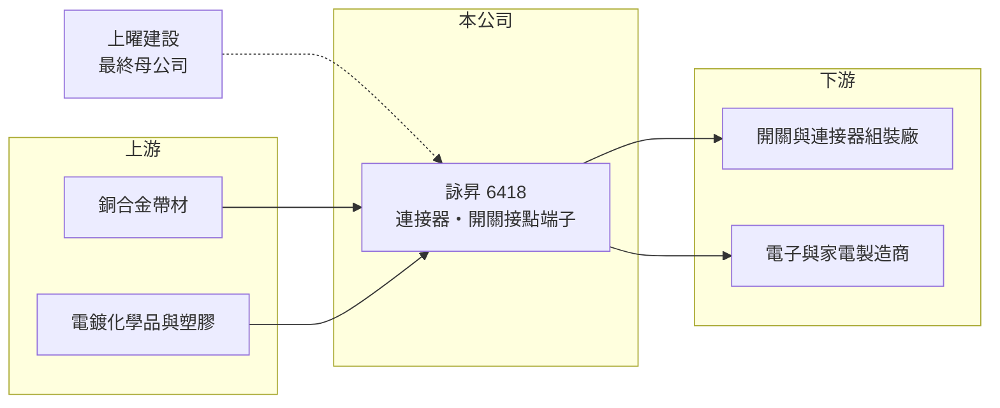

# 6418 詠昇

> 上櫃｜[[產業索引-電子零組件業|電子零組件業]]｜上市（櫃）日期 2019/02/18

# 第一章：企業模式與商業藍圖

> [!info] 撰寫說明
> 精簡版，由 Claude 依公開資料整理，架構比照 [[2330台積電]]，資料截至 2026-10-08。來源：櫃買中心開放資料快照（基本資料、2026 年第二季資產負債與損益、本益比殖利率）、Goodinfo 經營績效頁、nStock 公司簡介（營業項目與 2025 年經營權變動）。產品別比重、應用市場、客戶與生產據點未查得，公開資料有限。#待校對

詠昇電子（以下簡稱詠昇）是桃園中壢的小型[[連接器]]與[[端子]]廠，理解它的關鍵在於兩點：一是產品屬於精密沖壓的小零件，獲利取決於製程良率與接單組合；二是 2025 年經營權易主，由建設公司 [[1316上曜]] 取得控制權，未來的經營方向可能改變。

- **核心業務：** 詠昇成立於 1988 年，2019 年 2 月在櫃買中心掛牌，依公司登記營業項目，從事電子連接器、開關接點端子等零件的組合、製造、加工與買賣，以及相關投資。開關接點端子是各類開關、按鍵與連接器內負責導通電流的金屬零件，需要精密沖壓與電鍍技術。
- **營收結構：** 產品別、應用市場與地區別比重未查得（#待校對）。營收規模約 7.5 億至 9 億元，毛利率約 18% 至 21%，屬於代工性質較高、議價力中等的零件廠。
- **營運據點：** 總部登記在桃園中壢，合併報表包含子公司，但子公司名稱與海外生產據點未查得（#待校對）。
- **長期方向：** 依 nStock 整理，2025 年 9 月上曜建設開發及其子公司公開收購詠昇 24.91% 股權，同年 11 月股東臨時會全面改選董事，上曜建設成為最終母公司。建設公司入主電子零件廠，可能帶來資金挹注或資產活化，也可能改變原有的經營重心，這是觀察詠昇長期方向最重要的結構性事件。

# 第二章：護城河深度與競爭優勢

詠昇的護城河有限，競爭力主要來自精密沖壓製程與既有客戶的認證。

- **競爭優勢：** 端子與連接器零件需要通過客戶的規格與可靠度認證，量產後在同一個產品週期內很少更換供應商。詠昇營運超過 35 年，累積了模具開發與沖壓電鍍的製程經驗，能承接客製化零件。
- **主要對手：** 台灣連接器與端子同業眾多，包括 [[2392正崴]]、[[3533嘉澤]]、[[8103瀚荃]]、[[3605宏致]]、[[6279胡連]] 等，這些公司規模都大得多；中國也有大量低價沖壓廠。詠昇在規模與產品廣度上沒有優勢。
- **觀察重點：** 長期應觀察兩件事：一是新經營團隊的資本配置方向，例如是否增資擴產、處分資產或調整業務；二是[[營業利益率]]能否從目前的 4% 左右提升，否則本業難以賺回資金成本。

# 第三章：財務體質與盈利規模

資料日期：2026-10-08，表格是撰寫當時的快照；最新月營收、毛利率、累計 EPS 由自動排程寫在本筆記的屬性欄位（月營收、毛利率、累計EPS 等）。#待校對

詠昇的財務特徵是營收規模小且停滯，營業利益率偏低，ROE 長期在個位數。

| 年度 | 營收（億元） | [[毛利率]] | [[營業利益率]] | EPS（元） | [[ROE]] |
|---|---|---|---|---|---|
| 2021 | 8.80 | 13.1% | -1.70% | -0.68 | -5.03% |
| 2022 | 8.18 | 18.1% | 3.02% | 0.76 | 5.62% |
| 2023 | 8.28 | 20.6% | 5.67% | 1.38 | 9.65% |
| 2024 | 7.95 | 20.2% | 4.19% | 1.10 | 7.42% |
| 2025 | 7.82 | 20.6% | 4.09% | 0.73 | 4.90% |

（來源：Goodinfo 經營績效頁；2020 年營收 7.49 億元、EPS 0.17 元。）

- **營收規模：** 2020 至 2025 年營收年複合成長率約 0.9%（推算），基本上沒有成長。2026 年上半年營收約 4.37 億元、營業利益率約 4.4%、EPS 0.24 元（櫃買中心資料），前九個月營收年增約 22%（nStock 整理），但獲利仍薄。
- **獲利：** 2021 至 2025 年平均 ROE 約 4.5%（推算），2021 年曾出現虧損。毛利率從 2021 年的 13% 改善到 20% 左右，但營業利益率始終在 6% 以下，代表費用相對營收偏高。
- **財務特色：** 2026 年第二季總資產約 10.5 億元、負債約 5.3 億元、權益約 5.2 億元，負債比約 51%，非流動負債約 2.6 億元，每股淨值約 14.9 元。最近一年度現金股利約 0.38 元（櫃買中心本益比資料），以 2025 年 EPS 推算配息率約五成。
- **[[ROIC]] 與 [[WACC]]：** 2025 年營業利益約 0.32 億元（7.82 億元 × 4.09%），稅後約 0.26 億元；投入資本以權益 5.2 億元到「權益加全部負債」10.5 億元為區間，ROIC 約 2.5% 至 5%（推算，有息負債未查得）。WACC 以 [[CAPM]] 推估：無風險利率 1.75%、市場風險溢酬 6%、β 假設 1.0，權益成本約 7.8%；負債占三成、稅前成本 2.5%、稅率 20%，WACC 約 6.0%（推算）。ROIC 長期低於 WACC，代表詠昇過去五年並未為股東創造經濟價值，需要明顯提升本業獲利率才能扭轉。

# 第四章：總體風險與地緣政治

詠昇的風險在於規模小、獲利薄，以及經營權變動帶來的不確定性。

- **產業週期：** 端子與連接器需求跟著下游電子、家電或車用產品的出貨走，終端景氣下滑時，小型零件廠通常最先被砍單。
- **營運風險：** 營收規模小、營業利益率低，任何原料上漲或單一客戶流失都可能讓公司轉虧。新經營團隊來自建設業，若電子本業的管理與研發投入減少，競爭力可能下滑。
- **其他風險：** 端子主要原料為銅合金，銅價上漲會壓縮毛利；電鍍製程受環保法規約束；匯率變動影響出口報價。

# 專有名詞解析

## 金融

- **[[營業利益率]]**：營業利益除以營收，反映本業扣除成本與費用後的獲利能力。
- **[[CAPM]]**：資本資產定價模型，以無風險利率加上 β 乘以市場風險溢酬估算股東要求報酬率。

## 產業

- **[[連接器]]**：讓電子零件或設備之間傳輸電力與訊號的接插元件，例如 USB、HDMI 插座。
- **[[端子]]**：連接器內部負責導電接觸的金屬片，通常以銅合金沖壓而成，一輛車需要數百至上千個。
- **[[公開收購]]**：收購方對外公告在一定期間、以一定價格向不特定股東收購股份，常用於取得公司經營權。

# 核心供應鏈

- 上游：銅合金帶材、電鍍化學品與工程塑膠供應商。#待校對
- 下游／客戶：開關與連接器組裝廠、電子與家電製造商；具名客戶未查得。#待校對
- 同業：[[2392正崴]]、[[3533嘉澤]]、[[8103瀚荃]]、[[3605宏致]]；母公司 [[1316上曜]]。

## 最新新聞
<!-- news:start（自動產生，請勿手動編輯此範圍） -->
- 2026-10-16 📰 媒體 18:10｜臺銀10億元無人機採購案開標 世紀*子公司詠昇成為共同供應契約得標人｜[鉅亨網](https://news.cnyes.com/news/id/6632216)
- 2026-10-16 🏛️ 重訊 16:53｜本公司取得臺灣銀行採購部「無人機組」共同供應 契約（案號 LP5-114063）「訓練用無人機組」品項決標。｜[觀測站](https://mops.twse.com.tw/mops/#/web/t05st01)

完整紀錄：[[6418詠昇 新聞]]
<!-- news:end -->

## 相關連結
- [公開資訊觀測站](https://mopsov.twse.com.tw/mops/web/t05st03?step=1&firstin=1&co_id=6418)
- [Goodinfo](https://goodinfo.tw/tw/StockDetail.asp?STOCK_ID=6418)
- [Yahoo 股市](https://tw.stock.yahoo.com/quote/6418)
- [鉅亨網新聞](https://www.cnyes.com/twstock/6418/news)
