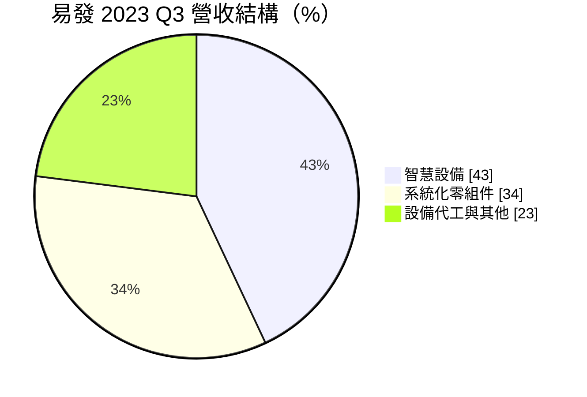
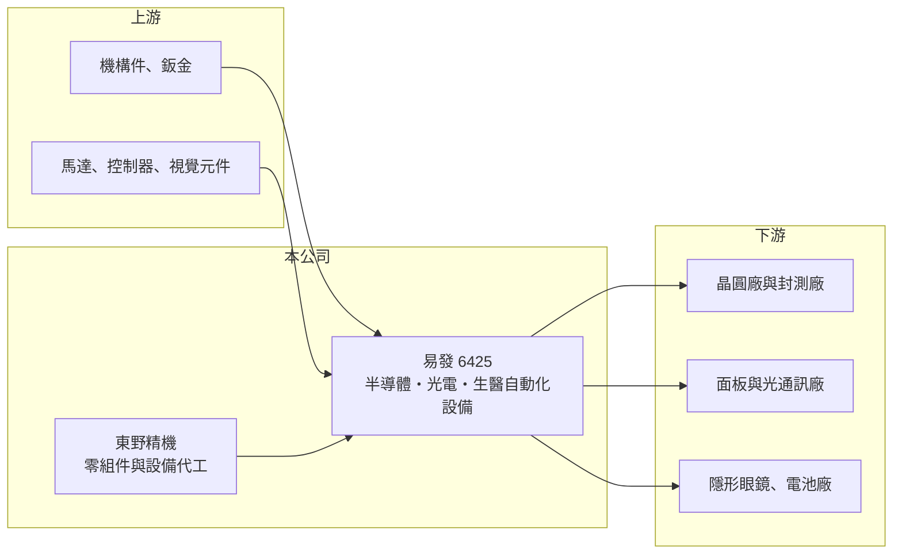

# 6425 易發

> 上櫃｜[[產業索引-電機機械|電機機械]]｜上市（櫃）日期 2019/01/18

# 第一章：企業模式與商業藍圖

> [!info] 撰寫說明
> 精簡版，由 Claude 依公開資料整理，架構比照 [[2330台積電]]，資料截至 2026-10-08。來源：櫃買中心開放資料快照（基本資料、2026 年第二季資產負債與損益、每月營收、本益比殖利率）、Goodinfo 經營績效頁、富果研究法說會摘要（營收結構為 2023 年第三季資料）。法說會摘要為 AI 整理內容，產品與客戶描述尚未逐條比對原始文件。#待校對

易發精機（以下簡稱易發）是一家客製化[[自動化設備]]製造商，從面板貼合設備起家，近年把重心轉向半導體設備。理解它的關鍵在於：設備業務的訂單隨客戶擴產起伏很大，易發過去多年在虧損與小賺之間擺盪，長期價值取決於半導體與新應用能否帶來穩定的高毛利訂單。

- **核心業務：** 易發成立於 1988 年，2019 年在櫃買中心上櫃，實收資本額約 5.14 億元，董事長為羅文進、總經理為林福明，總部位於桃園中壢。公司累積近 30 年的[[貼合]]（Bonding）技術，產品涵蓋半導體的貼膜、封裝、拆包自動化與晶圓 [[AOI]] 檢測設備，面板的 FOG 與 OCA 貼合設備，以及隱形眼鏡製程設備。這些設備多為依客戶製程客製，技術門檻在於精密對位與良率控制。
- **營收結構：** 依 2023 年第三季法說會資料，智慧設備約占 43%、系統化零組件約占 34%、設備代工與其他約占 23%。設備本身的毛利率依產品不同約 20% 至 40%，其中生醫（隱形眼鏡）設備最高，零組件與代工約 20%。由於零組件與代工的毛利較低，產品組合的變化會直接影響整體獲利。
- **營運據點：** 主要生產基地在台灣，中國昆山據點服務當地客戶並以電池設備為主。子公司東野精機提供設備代工與系統化零組件，東野旗下的日普精工生產精密工程塑膠零件。半導體客戶分布在台灣、新加坡與馬來西亞，日本市場則透過合作夥伴開發。
- **長期方向：** 公司把成長重心放在半導體、光通訊與矽水膠隱形眼鏡設備三個領域，並開發 3D IC 等[[先進封裝]]相關設備、切入 AI 伺服器組裝自動化。這代表易發想從面板設備的低成長市場，轉向半導體資本支出這個更大的市場。月營收資料的備註指出，2026 年營收增加來自「客戶產能建置」，顯示設備訂單仍高度依賴客戶擴產節奏。

# 第二章：護城河深度與競爭優勢

易發的護城河屬於「技術經驗型」，建立在長年累積的製程知識，而不是規模或品牌，因此深度有限。

- **競爭優勢：** 貼合與精密對位是易發近 30 年的核心能力，客戶導入一台設備需要經過製程驗證，一旦通過，後續擴線常會沿用同一家供應商，這構成一定的[[轉換成本]]。隱形眼鏡全製程設備是相對冷門的利基，公司自稱是台灣經驗最多的供應商之一，競爭者較少、毛利也較高。
- **主要對手：** 半導體後段自動化設備在台灣有 [[6187萬潤]]、[[6640均華]]、[[3583辛耘]]、[[6438迅得]] 等同業，面板貼合設備則面對日本、韓國與中國設備商的競爭。客製化設備市場分散，誰能進入大客戶的合格供應商名單，比產品本身更重要。
- **觀察重點：** 長期要看半導體設備的營收比重能否持續提高，並帶動整體毛利率穩定在 30% 以上。2024 年毛利率升到 31.8%，但營業費用偏高，營業利益率仍只有個位數，費用控制與規模經濟是能否穩定獲利的關鍵。

# 第三章：財務體質與盈利規模

資料日期：2026-10-08，表格是撰寫當時的快照；最新月營收、毛利率、累計 EPS 由自動排程寫在本筆記的屬性欄位（月營收、毛利率、累計EPS 等）。#待校對

易發的財務呈現典型的中小型設備廠樣貌：營收隨訂單大幅波動，多數年度處於虧損。

| 年度 | 營收（億元） | [[毛利率]] | [[營業利益率]] | EPS（元） | [[ROE]] |
|---|---|---|---|---|---|
| 2019 | 14.3 | 21.9% | -10.1% | -3.33 | -12.7% |
| 2020 | 13.5 | 23.4% | -2.91% | -1.00 | -3.98% |
| 2021 | 18.0 | 16.7% | -6.07% | -2.52 | -11.0% |
| 2022 | 16.0 | 25.4% | 1.89% | 1.12 | 5.20% |
| 2023 | 10.9 | 24.9% | -7.09% | -1.59 | -7.60% |
| 2024 | 17.0 | 31.8% | 3.04% | 0.69 | 3.22% |
| 2025 | 14.1 | 29.0% | -4.89% | -1.61 | -5.74% |
| 2026 上半年 | 8.74 | 31.6% | 2.49% | 0.66 | 未查得 |

（來源：Goodinfo 經營績效頁；2026 上半年取自櫃買中心開放資料。）

- **營收規模：** 2019 至 2025 年營收在 10.9 億至 18.0 億元之間來回，沒有明確的成長趨勢，2021 至 2025 年年複合成長率約 -5.9%（推算）。這反映設備業的特性：營收取決於客戶當年是否擴產，而不是穩定的重複性需求。
- **獲利：** 2019 至 2025 年七年中有五年虧損，2021 至 2025 年平均 ROE 約 -3.2%（推算）。毛利率由 2021 年的 16.7% 提升到 2024 年後的約 30%，代表產品組合確實在改善，但營業費用率接近 30%，吃掉了大部分毛利。
- **財務特色：** 依 2026 年第二季資料，總資產約 34.9 億元、權益約 13.4 億元、負債約 21.4 億元，負債比約 61%，以設備業來說偏高，其中流動負債約 16.7 億元，推估包含客戶預收款與短期借款。保留盈餘僅約 0.74 億元，配息能力有限。
- **[[ROIC]] 與 [[WACC]]：** 2026 年上半年營業利益約 0.22 億元，年化後稅後營業利益約 0.35 億元（推算，稅率 20%），以權益 13.4 億元到「權益加全部負債」34.9 億元作為投入資本，ROIC 約 1.0% 至 2.6%（推算）；2025 年營業虧損約 0.69 億元，ROIC 為負。WACC 以 [[CAPM]] 推估：無風險利率 1.75%、市場風險溢酬 6%、β 假設 1.2（設備股常見值），權益成本約 9.0%；假設有息負債占資本約 40%、稅前負債成本 2.5%，WACC 約 6.2%（推算）。ROIC 長期低於 WACC，代表易發過去多年並未替股東創造經濟價值，轉型能否成功要看半導體設備能否把 ROIC 拉到 WACC 之上。

# 第四章：總體風險與地緣政治

易發的風險主要來自設備業的週期性、客戶集中與長期獲利能力不足。

- **產業週期：** 半導體與面板設備需求跟著客戶資本支出走，景氣好時訂單集中湧入，景氣差時可能連續數季接不到大單，營收年增減三到四成是常態。隱形眼鏡與電池設備雖能分散風險，但規模較小。
- **營運風險：** 客製化設備的研發與驗證成本高，若新設備未能轉為量產訂單，前期投入就會變成費用。負債比偏高、保留盈餘低，連續虧損時財務彈性有限，可能需要增資或借款。
- **其他風險：** 中國昆山據點面對當地低價設備商的競爭與兩岸政策風險；電池設備需求受中國電動車與儲能景氣影響；無人機開發主要為政府科專計畫，短期沒有明確營收。

# 專有名詞解析

## 半導體

- **[[AOI]]**：自動光學檢測，用相機與影像演算法檢查產品外觀缺陷，取代人工目檢。
- **[[先進封裝]]**：把多顆晶片以中介層、混合鍵合等方式高密度整合的封裝技術，例如 CoWoS、SoIC。

## 金融

- **[[轉換成本]]**：客戶更換供應商時需要付出的時間、驗證與風險成本，越高代表客戶越不容易流失。
- **[[CAPM]]**：資本資產定價模型，以無風險利率加上 β 乘以市場風險溢酬，推估股東要求的報酬率。

## 產業

- **[[自動化設備]]**：依客戶製程需求設計、取代人工作業的生產設備，多為客製化，訂單隨客戶擴產起伏。
- **[[貼合]]**：把兩片材料或元件精準對位後黏合的製程，用於面板、觸控與半導體封裝。

# 核心供應鏈

- 上游：機構件、鈑金、馬達、控制器與影像檢測元件等，實際供應商未查得，#待校對。
- 下游／客戶：台灣與東南亞的晶圓廠與封測廠、面板與光通訊廠、隱形眼鏡製造商、中國電池廠；具體客戶名稱未查得。
- 同業：[[6187萬潤]]、[[6640均華]]、[[3583辛耘]]、[[6438迅得]]。

## 最新新聞
<!-- news:start（自動產生，請勿手動編輯此範圍） -->
- 2026-10-22 🏛️ 重訊 15:26｜更正本公司115年08月為他人背書保證申報事項｜[觀測站](https://mops.twse.com.tw/mops/#/web/t05st01)

完整紀錄：[[6425易發 新聞]]
<!-- news:end -->

## 相關連結
- [公開資訊觀測站](https://mopsov.twse.com.tw/mops/web/t05st03?step=1&firstin=1&co_id=6425)
- [Goodinfo](https://goodinfo.tw/tw/StockDetail.asp?STOCK_ID=6425)
- [Yahoo 股市](https://tw.stock.yahoo.com/quote/6425)
- [鉅亨網新聞](https://www.cnyes.com/twstock/6425/news)
