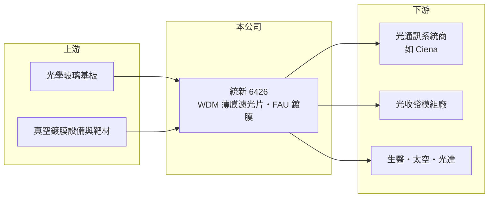

# 6426 統新

> 上市｜[[產業索引-通信網路業|通信網路業]]｜上市（櫃）日期 2021/03/24

# 第一章：企業模式與商業藍圖

> [!info] 撰寫說明
> 本文由 Claude 依公開資料整理，架構比照 [[2330台積電]] 的四章研究，資料截至 2026-10-08。財務數字來源：Goodinfo 年度經營績效頁、證交所開放資料（基本資料、2026 年第二季資產負債、損益與營益分析、股利、每月營收）、富果研究整理的 2026 年 8 月法說會摘要；各產品營收比重未查得。#待校對

評估一家光學元件公司，要看它的產品是否處在資料傳輸頻寬持續擴張的路徑上，以及能否在高規格產品維持技術領先。本章說明統新光訊（股票代號：6426，以下簡稱統新）如何以[[薄膜濾光片]]切入 AI 資料中心互連市場。

## 一、核心定位：光通訊薄膜濾光片專業廠

統新成立於 2003 年，2021 年在證交所上市，實收資本額約 3.9 億元。公司專注研發與製造光學薄膜濾光片，主要用於光纖通訊。濾光片的功能是讓特定波長的光通過、其他波長反射，是[[WDM]] 分波多工系統把多個波長的訊號合在一條光纖傳輸、再在接收端拆開的關鍵元件。

薄膜濾光片的製程是在玻璃基板上以真空鍍膜堆疊數十至上百層薄膜，每層厚度都要精準控制。層數越多、波長間距越窄，良率越難掌握，因此高階濾光片的毛利率可以很高，2026 年上半年[[毛利率]]約 49%。

## 二、產品結構：三種資料中心互連

依 2026 年 8 月法說會，統新的產品依資料中心的互連層級分為三類，營收比重未查得：

* **Scale Across（資料中心之間互連）：** 高技術門檻的 WDM 濾光片，用於長距離連接多座資料中心，是目前最主要的營收與獲利來源，終端客戶包括光通訊設備商 Ciena。
* **Scale Out（機櫃之間互連）：** 供應 800G 與 1.6T [[光收發模組]] 所需的濾光片，需求量大但競爭較多。
* **Scale Up（機櫃內互連）：** 提供光纖陣列單元（FAU）的鍍膜服務，出貨穩定但規模較小。

此外，公司也供應生醫、太空、半導體與光達等應用，但隨著 AI 相關業務快速成長，這些業務的占比相對下降。

## 三、長期方向

管理層認為大型 AI 資料中心正走向分散式、多座叢集互連的架構，需求重心從算力延伸到頻寬，這使跨資料中心的 WDM 濾光片需求至少可持續三年。公司另有機會受惠美國寬頻基礎建設計畫，但截至 2026 年 8 月尚未接到相關訂單。長期策略是深耕高門檻的 Scale Across 市場，同時保留生醫、太空等多元應用，以分散單一市場的風險。

# 第二章：護城河深度與競爭優勢

在長期價值投資中，「護城河」指企業抵禦競爭、維持超額利潤的保護機制。本章分析統新的優勢、限制與競爭對手。

## 一、統新護城河的組成

* **高階鍍膜製程：** 窄頻、多層數的 WDM 濾光片需要長期累積的鍍膜參數與設備調校經驗，良率差距直接決定成本。這是統新在景氣回升時能迅速把毛利率拉到五成以上的原因。
* **設備商認證：** 光通訊系統商對元件的可靠度要求嚴格，認證週期長，一旦進入供應鏈，短期內不易被取代。

不過統新規模小，營收高度依賴光通訊景氣，2023 至 2025 年連續虧損，說明護城河在需求低谷時無法保護獲利，屬於窄護城河。

## 二、主要競爭對手

| 對手 | 定位 | 對統新的威脅 |
|---|---|---|
| 中國光學薄膜廠 | 大量產能、價格低 | 在標準型濾光片壓低價格 |
| 美日光學元件大廠 | 光通訊被動元件與濾光片 | 技術與客戶基礎雄厚 |
| [[3363上詮]]、[[6442光聖]] | 光纖連接與被動元件 | 在 FAU 與被動光元件局部重疊 |
| 光收發模組廠自製 | 垂直整合 | 降低外購濾光片比例 |

## 三、守得住／守不住／觀察重點

守得住的是技術門檻最高的跨資料中心 WDM 濾光片。守不住的是需求低谷期的獲利，以及 800G、1.6T 模組用標準濾光片的價格。長期觀察重點是 Scale Across 需求能否如管理層預期延續多年，以及公司能否把 2026 年的獲利轉成穩定的股利政策。

# 第三章：財務體質與盈利規模

資料日期：2026-10-08，表格是撰寫當時的快照；最新月營收、毛利率、累計 EPS 由自動排程寫在本筆記的屬性欄位（月營收、毛利率、累計EPS 等）。#待校對

財務報表是檢驗護城河是否真實存在的最終標準。本章用六年的三率、ROE 與資本報酬，檢視統新的獲利品質。

## 一、多年度經營績效

| 年度 | 營收（新台幣） | [[毛利率]] | [[營業利益率]] | EPS（元） | [[ROE]] |
|---|---|---|---|---|---|
| 2020 | 7.11 億 | 53.2% | 25.5% | 3.58 | 10.2% |
| 2021 | 5.19 億 | 37.0% | 2.31% | 0.30 | 0.88% |
| 2022 | 6.24 億 | 41.1% | 11.7% | 2.33 | 6.93% |
| 2023 | 3.63 億 | 10.1% | -40.6% | -2.68 | -8.56% |
| 2024 | 3.30 億 | 0.82% | -52.0% | -3.58 | -13.3% |
| 2025 | 4.87 億 | 29.9% | -5.03% | -0.78 | -3.22% |
| 2026 上半年 | 3.62 億 | 49.1% | 26.1% | 2.96 | 未查得 |

這張表清楚呈現薄膜濾光片的高[[營運槓桿]]：營收從 7 億元掉到 3.3 億元時，固定的設備折舊與人力讓毛利率幾乎歸零；2026 年上半年營收回升，毛利率立刻回到近五成。2021 至 2025 年平均 ROE 約 -3.5%（推算），營收年複合成長率約 -1.6%（推算）。2025 年因虧損，盈餘未配發現金股利，改以資本公積每股配發 0.5 元。

## 二、[[ROIC]] 與 [[WACC]]：價值創造利差

**ROIC 推算：** 2025 年營業損失約 0.24 億元（4.87 億 × -5.03%），ROIC 約 -2.4%（推算），代表當年本業未能回收任何資金成本。若以 2026 年上半年營業利益 0.94 億元年化（約 1.9 億元，稅後約 1.5 億元）計算，搭配 2026 年第二季股東權益約 10 億元、負債僅 1.1 億元（有息負債估計極少，假設 0.2 億元），投入資本約 10.2 億元，年化 ROIC 約 14.8%（推算）。

**WACC 推算：** 台灣 10 年期公債 1.75%、市場風險溢酬 6%、β 取光通訊元件同業常見值 1.2，股東權益成本約 9.0%；負債成本 2.5%、稅後 2.0%；權益占投入資本約 98%，WACC 約 8.8%（推算）。

**結論：** 統新在景氣低谷時 ROIC 為負、遠低於 WACC，景氣高峰時則能超過 WACC。長期是否創造價值，取決於高峰期能維持多久，以及低谷期的虧損深度；2023 至 2025 年的連續虧損顯示，長期平均報酬仍未明顯超越資金成本。

# 第四章：總體風險與地緣政治

任何企業都無法脫離宏觀環境獨立存在。本章分析統新長期必須面對的風險。

## 一、光通訊景氣週期

統新的營收高度依賴光通訊設備商的資本支出。2023 至 2024 年電信與資料中心光通訊需求下滑時，公司營收腰斬並連續虧損，顯示規模小的元件廠承受週期的能力有限。AI 資料中心投資若放緩，同樣的情況可能重演。

## 二、客戶集中與技術替代

跨資料中心互連的系統商集中在少數國際大廠，單一客戶的庫存調整就會造成營收大幅波動。長期而言，若光通訊系統改採其他分波技術或整合式光學元件，薄膜濾光片的需求結構也可能改變。

## 三、匯率與競爭

營收以外銷為主，新台幣升值會壓縮毛利。中國光學廠在標準型濾光片的擴產，可能使中低階產品的價格持續下降。

# 專有名詞解析

## 應用

- **[[WDM]]**：分波多工，把不同波長的光訊號合併在同一條光纖傳輸，可大幅提高光纖的傳輸容量。

## 金融

- **[[營運槓桿]]**：固定成本占比高的企業，營收小幅變動就會造成獲利大幅變動的特性。
- **[[ROIC]]**：投入資本報酬率，稅後營業利益除以股東權益與有息負債的合計，衡量本業對所有資金提供者的報酬。
- **[[WACC]]**：加權平均資金成本，依股東權益與負債的比重加權計算的資金成本，ROIC 高於它才代表創造價值。

## 產業

- **[[薄膜濾光片]]**：在玻璃基板上真空鍍上多層光學薄膜，只讓特定波長的光通過，是光通訊分波的關鍵元件。
- **[[光收發模組]]**：把電訊號轉成光訊號、再把光訊號轉回電訊號的模組，是資料中心與電信網路的連接元件。

# 核心供應鏈

## 1. 上游：基板與鍍膜設備
- 光學玻璃基板、真空鍍膜設備與鍍膜材料供應商

## 2. 中游：統新與同業
- 同業：中國光學薄膜廠、美日光學元件廠；相關光通訊元件廠 [[3363上詮]]、[[6442光聖]]

## 3. 下游：客戶
- 光通訊系統商（Ciena）、光收發模組廠、資料中心業者
- 生醫、太空、半導體與光達應用客戶

## 最新新聞
<!-- news:start -->
<!-- news:end -->

## 相關連結
- [公開資訊觀測站](https://mopsov.twse.com.tw/mops/web/t05st03?step=1&firstin=1&co_id=6426)
- [Goodinfo](https://goodinfo.tw/tw/StockDetail.asp?STOCK_ID=6426)
- [Yahoo 股市](https://tw.stock.yahoo.com/quote/6426)
- [鉅亨網新聞](https://www.cnyes.com/twstock/6426/news)
